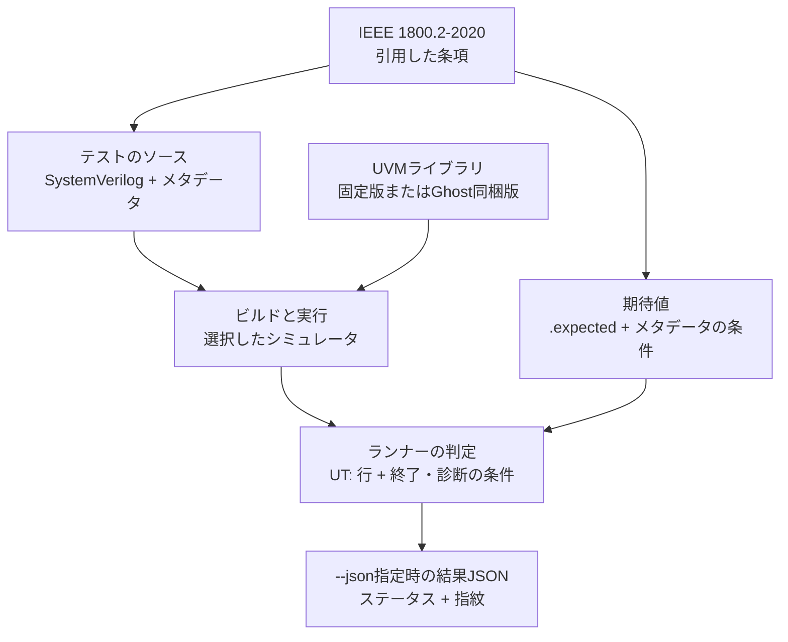

# kirimasim-uvm-tests

[English](README.md)

[](https://github.com/kurochan001/kirimasim-uvm-tests/actions/workflows/check.yml)
[](LICENSE)

IEEE 1800.2-2020（UVM）の動作を確かめる、シミュレータ向けの適合性テストスイートです。
[kirimasim](https://github.com/kurochan001/kirimasim)向けに作り、
[kirimasim-tests](https://github.com/kurochan001/kirimasim-tests)（IEEE 1800-2023の言語の適合性）と対になります。
英語版が正本で、この日本語版はその対訳です。

用語は[用語集](docs/glossary.ja.md)、実行方法や結果の読み方は[FAQ](docs/faq.ja.md)、
ライブラリの制約は[既知差分](docs/known-differences.ja.md)を参照してください。
以前の追加作業と測定は[開発履歴](docs/history.ja.md)に保存し、このREADMEは現時点の情報を説明します。

> **状態：M3を継続中。** 14の章・付録ディレクトリにシミュレーションテスト685件があります。
> `verilator@5.052`のoracle付きが624件、specのみが61件です。
> 全件が`:spec_check: ai`で、人による照合の記録はまだありません。
> M1・M2の条項ごとの目標は未達のまま、M3にmemoryのfrontdoor転送、registerのupdate／mirrorとアクセスhookを追加しました。

## 目次

- [現在の対象範囲](#現在の対象範囲)と[実行結果](#現在の実行結果)
- [スイートの実行](#スイートの実行)
- [テストの形式](#テストの形式)と[期待出力の決め方](#期待出力の決め方)
- [UVMライブラリ](#uvmライブラリ)・[検査](#検査)・[進め方](#進め方)
- [用語集](docs/glossary.ja.md)・[FAQ](docs/faq.ja.md)・
  [既知差分](docs/known-differences.ja.md)・[開発履歴](docs/history.ja.md)

## 現在の対象範囲

M1の229件はobject・transaction、copy／compare／print／packのpolicy、reporting、factory、
phase、objection、configurationを検査します。M2の360件はTLM 1のFIFO・analysis経路・
request/response channel、TLM 2のpayload・拡張・一部のsocket transport、sequenceの実行・
応答・操作マクロとpull／push sequencerの制御、callbackの登録・継承・走査・途中終了を追加しています。

M3の96件は第18〜19章のregister field・register・block・memory・address mapと、transaction記述子・
adapter・predictorです。frontdoorはテストベンチ内のbusモデルとsequencer／driverの実際の接続を使い、
passive predictorは別の検査系から観測transactionを入力します。RTLのDUTやDPI実装は使いません。

直近24件はmemoryのfrontdoor経路を8件、registerのupdate・mirror・busエラーを8件、アクセスhookを8件追加します。
20件がVerilatorの両seedで一致し、burstの物理beatの種別とregister／fieldのhook順序の4件はspecのみで保持します。
検査系の制限と順序の既知差分は[FAQ](docs/faq.ja.md#memory転送とregisterのアクセスhook)で説明します。

対象を絞った動作検査であり、各段階で各条項2件以上という目標に対する棚卸しが残っています。
条項の引用には準備に使うAPIや構造上の参照も含まれるため、引用件数だけでは要求の網羅は示せません。
レジスタ層の転送などの追加動作と、承認された分母に基づく要求カバレッジは今後の計画です。

## 現在の実行結果

最新のローカル記録は2026-11-01の685件を対象にします。各シミュレータで追加24件の結果と、
[256d873](https://github.com/kurochan001/kirimasim-uvm-tests/commit/256d8733015a93ca12537536446cb429324b0d00)
にある既存661件を合算し、入力・ランナー・版・設定の指紋が一致することを確認しています。
Ghostは前回の測定と同じ実行ファイル・profileの固定コピーを使い、kirimasimも前回の固定buildを使います。

| シミュレータ | 観測結果 |
| --- | --- |
| Verilator 5.052・固定版UVM・`UVM_NO_DPI` | 624件がseed 1・73とも一致。specのみの54件はseed 1で差分。別の7件はライブラリAPI欠落でビルド不可 |
| kirimasim・固定版UVM | 678件が`uvm_object_wrapper`未実装。7件は先にライブラリAPI欠落を検出してFAIL |
| Ghost・同梱UVM | 各seedで145件一致・540件不一致。seed 1・73で不一致になるテストも同じ |
| Ghost・固定版UVM | 過去の実行ファイルではスモーク不一致。今回のbuildの固定版測定は未実施 |
| Icarus Verilog 13.0 | このUVMスイートでは使わない |

Verilatorは各テストで最初の不一致seedで停止します。実行時の既知差分54件はseed 1の記録で、
seed 73の結果は示しません。API欠落の7件（時刻APIの1件とsequence libraryの6件）には実行時のseed結果がありません。
`known`・`unsupported`は成功に数えません。[既知差分](docs/known-differences.ja.md)を参照してください。

CheckバッジはGitHub Actionsの状態を示し、上記のローカル結果とは別です。
Checkはツール・メタデータ・ライブラリと、oracle付き624件のVerilator実行を検査します。
Ghostとkirimasimは実行しません。このリポジトリにはNightlyや結果の自動公開はありません。

## 確かめること

- **対象**：シミュレータがUVMライブラリを実行したとき、IEEE 1800.2-2020が定める結果になるか。
  フェーズの順序、objectionによるフェーズの終了、factoryの置き換え、config_dbの検索、
  シーケンスとシーケンサ、TLMの接続、レジスタ層などです。
- **期待値の根拠**：1800.2-2020の条項。`:lrm:`に記録し、テストの冒頭のコメントで、何を確かめるかを
  自分の言葉で説明します。規格本文は転載しません。
- **ライブラリ**：Accellera版UVMライブラリのリリース2020.3.1を、`third_party/uvm.lock`で固定して使います
  （「UVMライブラリ」を参照）。配布物の`DEVIATIONS.md`には、ライブラリが規格と異なる箇所が3件あります
  （18.2.3.4、18.4.3.6、13.1.5.1）。期待値はこれらに依存させず、触れざるをえないテストは差異として記録します。
- **範囲外**：SystemVerilogの言語そのもの（kirimasim-testsで扱う）、UVMの教材、性能、
  レジスタモデルの生成ツール、ベンダー固有の拡張。

## kirimasim-testsとの関係

| | kirimasim-tests | kirimasim-uvm-tests |
| --- | --- | --- |
| 規格 | IEEE 1800-2023 | IEEE 1800.2-2020（実行の意味は1800-2023の言語に従う） |
| 外部依存 | なし（小さな独立した設計） | UVMライブラリ（版と指紋で固定） |
| 配置 | `tests/chNN/`（1800-2023の章） | `tests/uNN/`（1800.2の章） |
| 固定版のoracle | Icarus Verilog 13.0、Verilator 5.052 | 再現できる範囲でVerilator 5.052 |
| 共通の判定・結果JSON | 元になる実装 | `suite_results.py`を固定コミットから写す。ランナーはこのスイート独自（`tools/UPSTREAM`） |
| CI | 独自 | 独自（テストごとにUVMをコンパイルするため重い） |

UVMのテストが言語機能（クラス、パラメータ化クラス、制約、プロセス制御など）の不具合で失敗したら、
その最小例をkirimasim-testsに言語のテストとして追加します。UVMのスイートは、
言語のテストの不足を見つける役も担います。

## ディレクトリ構成

```text
tests/uNN/<name>.sv          メタデータ付きテスト（NNは1800.2の章）
tests/uNN/<name>.expected    期待する観測行
tests/uB/, uC/, uD/          現在の付録テスト：マクロ・設定・callback
docs/glossary*.md            用語集
docs/faq*.md                 よくある質問
docs/known-differences*.md   現在の制約とspecのみの期待値
docs/history*.md             過去の追加作業と測定
third_party/uvm.lock         固定したライブラリ：リリース、取得元、コミット、指紋
third_party/uvm/<version>/   ライブラリ本体（取得するもので、コミットしない）
tools/fetch_uvm.py           ライブラリを取得し、指紋を確かめる
tools/uvm_common.py          ライブラリと一緒にコンパイルする方法、観測する行
tools/run_kirimasim.py       kirimasimのランナー
tools/run_verilator.py       Verilatorのランナー
tools/run_ghost.py           非公開プロファイルを使うGhostのランナー
tools/suite_results.py       判定と結果JSON（kirimasim-testsから写したもの）
tools/lint_metadata.py       メタデータとテストの形式の検査
tools/sv_lifetimes.py        初期化付き手続き内ローカル変数の字句チェック
tools/clauses_1800_2.txt     1800.2-2020の条項番号（番号だけ）
tools/UPSTREAM               写したツールの元と、変えた点
```

## テストの形式

### 例

```systemverilog
/*
:name: test_common_phases_run_in_order
:description: the common phases run in their order, ... (IEEE 1800.2-2020 Section 9.8.1)
:tags: u09 uvm
:type: simulation
:lrm: 1800.2-2020 9.8.1 9.5 9.6 9.7 10.5.1
:uvm: 2020.3.1
:oracle: spec verilator@5.052
:spec_check: ai
:fourstate: no
:nondeterministic: no
:args: +UVM_TESTNAME=t
:expected_stdout: @test_common_phases_run_in_order.expected
*/
```

### メタデータ

kirimasim-testsとsv-testsの形式を引き継ぎ、次の点を変えます。

| フィールド | 意味 |
| --- | --- |
| `:lrm:` | `1800.2-2020 <条項>`。言語の規則にも依存するテストは、その後に`1800-2023 <条項>`を足す。1800.2の最初の条項がディレクトリを決める |
| `:tags:` | 章のディレクトリ`uNN`と`uvm`（sv-testsがUVMのテストに付けるタグ） |
| `:uvm:` | テストが前提にするライブラリのリリース。固定したものと同じでなければならない |
| `:uvm_dpi:` | `yes`はDPIを有効にするマクロ指定。実装の供給・リンクは別途必要。[コンパイル](#コンパイル)を参照 |
| `:uvm_defines:` | ライブラリに渡すマクロ（例：`UVM_ENABLE_DEPRECATED_API`） |
| `:args:` | `+UVM_TESTNAME=…`などの実行時引数 |

`:oracle:`・`:spec_check:`・`:fourstate:`・`:nondeterministic:`・`:should_fail_because:`・
`:expected_stderr_regex:`・`:expected_exit:`・`:files:`・`:defines:`・`:incdirs:`・`:top_module:`の意味は
kirimasim-testsと同じです。

### 何を観測するか

1800.2が定めるのは、レポートを組み立てるメソッドの役割までで、出来上がる文字列ではありません。
`compose_report_message`（6.5.1.2.15）は重大度・コンポーネント名・ID・メッセージから文字列を作りますが、
`UVM_INFO file(line) @ time: name [id] msg`という並びはライブラリが決めています。
ファイル名、行番号、時刻の書式も、ライブラリとシミュレータで変わります。そこで次のようにします。

- **既定のレポート行は比べない。**
- **テストは、観測した値を`UT: `で始まる行に`$display`で出す。** 出すのは規格が定める値だけです
  （フェーズの順序、件数、読み戻した値、比較の結果など）。期待出力と比べるのはこの行だけです。
  レポートの仕組みが壊れていても、他の章のテストが巻き込まれずに済みます。
- **レポートの件数は値で読む。** report serverの`get_severity_count`・`get_id_count`で読み、
  `UT: `の行に出します。
- **6章（レポート）のテスト**は、独自のreport serverやreport catcherを使い、規格が定める入力
  （重大度、ID、冗長度、動作）と結果の対応を`UT: `の行で確かめます。
- 規格が定めないものに依存しません。乱数の値、同時に始まるプロセスの順序、
  規格が定める以外の自動生成名などです。

## 期待出力の決め方

1. 引用した条項から期待出力を決めます（`:oracle: spec`）。
2. ライブラリのソース（Apache-2.0）は規格の理解のために読めますが、期待値は規格から決めます。
   ライブラリ自身の`DEVIATIONS.md`と[既知差分](docs/known-differences.ja.md)で、
   ライブラリの制約と固定版で再現したoracleを区別します。
   不足する必須動作を直接検査するテストは、specのみの期待値を保持します。
3. 固定版での再現：
   - Verilator 5.052は、`UVM_NO_DPI`でライブラリをビルドして実行できます。x・zに依存せず、
     seed 1と73の両方で再現したテストには、kirimasim-testsと同じく`verilator@5.052`を付けます。
   - Icarus Verilog 13.0はUVMを実行できないので使いません。
4. シミュレータと期待出力が食い違っても、出力を写して解決しません。判断するのは条項です。

### テストから結果までの流れ

引用した条項から決める期待値と、実行から得る観測結果を、判定の段階で照合します。



ビルド・実行の失敗も結果として記録します。ライブラリの識別情報も実行条件の一部で、
Ghostの同梱モードでは供給されたUVMを使います。ステータスとコマンドの終了コードは
[FAQ](docs/faq.ja.md#結果の読み方)を参照してください。

## UVMライブラリ

### 取得

`python3 tools/fetch_uvm.py`は、`third_party/uvm.lock`が名指すリリースを
[accellera-official/uvm-core](https://github.com/accellera-official/uvm-core)
（タグ`2020.3.1`、コミット`78c06547a2a0`）から取得して`third_party/uvm/2020.3.1/`に置き、
展開したファイルの指紋（326ファイルそれぞれのパスとSHA-256）を確かめます。
取得先が圧縮し直すことがあるので、アーカイブ自体の指紋は使いません。
`--check`は、置いてあるコピーだけを確かめます。ライブラリはコミットしません。

### コンパイル

- 固定版の実行は`src`をinclude先に追加し、テストより先に`src/uvm_pkg.sv`をコンパイルします。
  Verilatorは`-I`、kirimasim・Ghostは`+incdir+`を使います。Ghostの同梱モードは別途パッケージを供給します。
- テストが`:uvm_dpi: yes`としない限り`UVM_NO_DPI`を定義します。ライブラリのHDLバックドア用のDPIは、
  商用シミュレータ3種向けの実装しか持たないためです。DPIなしのライブラリは、`+UVM_TESTNAME`を自分で読み、
  名前の照合を正規表現ではなくglobで行い、コンポーネント名を検査しません。
  `UVM_NO_DPI`のサポートを削除するかもしれない、という警告も出します。
  正規表現やバックドアに依存するテストは`:uvm_dpi: yes`とし、DPIを読み込めるシミュレータでだけ実行します
  （`UVM_HDL_NO_DPI`ならバックドアだけを外せます）。
- 現在の685件はすべて`UVM_NO_DPI`で実行します。`:uvm_dpi: yes`はこのマクロを外す指定で、
  C/C++のDPI実装を自動でビルド・リンクする指定ではありません。
  現在のVerilatorランナーはDPIのC/C++ソースを追加しません。
- `:uvm_defines:`で`UVM_ENABLE_DEPRECATED_API`を指定できますが、現在は付録Hのテストも、
  このマクロを要求するテストもありません。

## スイートの実行

```sh
python3 tools/fetch_uvm.py
python3 tools/run_kirimasim.py --kirimasim /path/to/kirimasim -j 8 --json out/kirimasim.json
python3 tools/run_verilator.py --seeds 1 73 --build-jobs 2 -j 2 --json out/verilator.json
```

ランナーにはPython 3.10以降が必要です。結果のJSONはkirimasim-testsと同じ形
（`tools/suite_results.py`）なので、履歴やレポートのツールでそのまま読めます。
`run_verilator.py`はテストごとにUVMパッケージ全体をビルドします。
`-j`は並行するテスト数、`--build-jobs`は各テストのC++ビルド並列数です
（既定の0はすべてのハードウェアスレッド）。ccacheは使いません。Verilatorは大きなモデルを
事前コンパイル済みヘッダーでビルドし、そこにビルド先の絶対パスが入るので、ccacheが別の場所で作った
ヘッダーを返すとビルドが壊れるためです。

`--seeds 1 73`は各モデルを一度だけビルドし、seedごとに新しいプロセスで実行します。
すべてのseedで一致した場合だけ成功です。従来の`--seed N`も使えます。
結果JSONのconfigurationには、指定に応じて`seed`か`seeds`を記録します。

Verilatorの既定の対象はoracle付き・2値の624件です。`--all`を付けるとspecのみの61件も含めます。
oracleのないテストの不一致は`known`で、コマンドを失敗させません。oracle付きの不一致は失敗です。
テストのパスを明示した場合は、そのテストだけが対象です。スモークテスト1件の実行例です。

```sh
python3 tools/run_verilator.py --seeds 1 73 --build-jobs 2 -j 1 \
  --json out/verilator-smoke.json tests/u09/test_common_phases_run_in_order.sv
```

各実行は一時的なビルドディレクトリを使います。`out/`はGitの対象外で、CheckはそのJSONを公開しません。
結果の分類・終了コード・指紋の読み方は[FAQ](docs/faq.ja.md)を参照してください。

### Ghost

```sh
python3 tools/run_ghost.py --simulator /path/to/private/simulator \
  --profile /path/to/private-profile.json -j 2 --json out/ghost.json
```

非公開のJSONプロファイルに`arguments`（文字列の配列）、`environment`（文字列の対応表）、
`uvm_mode`を明示します。

- `pinned`：固定版UVMをテストより先にコンパイルします。同梱UVMの自動読み込みは
  プロファイル側で無効にします。
- `bundled`：UVMの供給をプロファイルとシミュレータに任せ、別のパッケージをコンパイルしません。
  共通の規格期待値と比較しますが、**固定版ライブラリの実行証拠にはしません**。
  テストの`:uvm:`から同梱ライブラリの版を推測しません。

同梱モードのプロファイルには、ソースとヘッダーを含む非公開ディレクトリ`uvm_library_dir`も
指定し、実行引数で同じライブラリを選びます。コードもヘッダーも実行ファイル内に組み込まれて
いる場合だけ、代わりに`uvm_embedded: true`を指定します。この2通りのどちらかが必要です。
ディレクトリのパスは結果に書きません。

公開JSONには`uvm_source`、`uvm_pinned`、テストが前提にする版（`test_uvm`）、実行ファイルと
プロファイルのSHA-256を記録します。固定版とディレクトリに置かれた同梱版では、ライブラリの
内容の指紋とファイル数も記録します。
シミュレータの名前・版・パス、プロファイルの内容、診断は公開しません。
実行中に実行ファイル・プロファイル・ライブラリが変わったら、結果を書きません。
固定版モードでは、実行前にライブラリの内容がlockと一致することも確かめます。

## 検査

```sh
python3 tools/fetch_uvm.py --check
python3 -m unittest discover -s tools -p 'test_*.py'
python3 tools/lint_metadata.py
```

現在のツールの単体テストは41件、メタデータの対象はシミュレーションテスト685件です。
[Check](.github/workflows/check.yml)は`main`へのpush・pull request・手動実行で動きます。
別のVerilatorジョブは5.052・`UVM_NO_DPI`・seed 1と73でoracle付きのテストを実行し、
各モデルを一度ビルドして2回使います。Checkの成功はその検査の成功を示し、
UVMの全要求や全シミュレータの成功を示すものではありません。

## 進め方

| 段階 | 範囲 | 現在の状態・目標 |
| --- | --- | --- |
| M0 | 取得・実行・メタデータとツールの検査、Check、スモークテスト | 基盤を実装済み |
| M1 | 基本クラス・policy・factory・phase・objection・設定・reporting | 229件。各条項2件以上という目標の棚卸しは未完 |
| M2 | sequence・sequencer・TLM・callback | 360件。同じ目標へ拡充中 |
| M3 | レジスタ層（17〜19、付録E） | 第18〜19章に96件。より広いbusの検査は今後追加 |
| M4 | 要求台帳とカバレッジ | 計画段階。カバレッジを主張する前に分母を承認 |

M2では、キュー上の所有・停止・default resourceの残りの条件、callbackの動作、
TLM 2のより広いprotocol・timing・socketの組み合わせなどが残っています。
注記と配送の検査だけでprotocolやtiming全体を確認したとは扱いません。ライブラリの条項注記は
棚卸しの手がかりになりますが、規格との照合が必要です。M2開始によってM1完了とは扱いません。

M3を開始してもM1・M2の目標は未完として管理します。M3にはvirtual register、memoryのpackingやエラー・
policy・mapの追加条件、adapter／predictorの統合、custom frontdoor、backdoor／DPI、
register層の登録callback、付録Eのsequenceが残っています。現在のbusモデルで確認するのは選択したUVM経路であり、
RTLのprotocolやtimingの検査は別の作業です。

## テストの追加・修正

シミュレータを動かす前に、引用した規格から観測結果を決めます。テストは独立させ、
規格が定める結果だけを`UT: `行に出力します。シミュレータとライブラリの組み合わせで差があっても、
規格の期待値を保持します。初期化付き手続き内ローカル変数は寿命を明示し（SystemVerilog 6.21）、
forkの共有状態が生存するようにし、blockingの観測にはwatchdogを設けます。
メタデータとツールを検査し、固定版のoracleタグは両seedで再現してから付けます。
規格PDFはローカルに置き、Gitの対象にしません。

## 権利と出典

- 1800.2の本文・図・サンプルコードは転載しません。条項番号を引用し、自分の言葉で説明します。
- UVMライブラリはApache-2.0です。取得するもので、コミットしません。
  コミットする場合は、`LICENSE.txt`と`NOTICE.txt`を一緒に置きます。
- GPL・LGPLのシミュレータ（Icarus Verilog、Verilator）の実装ソースは読みません。
- 公開前のシミュレータの名前、版、実行プロファイル、パスは公開しません。

## ライセンス

Apache License 2.0 with LLVM Exceptions（`Apache-2.0 WITH LLVM-exception`）。
[LICENSE](LICENSE)を参照してください。
