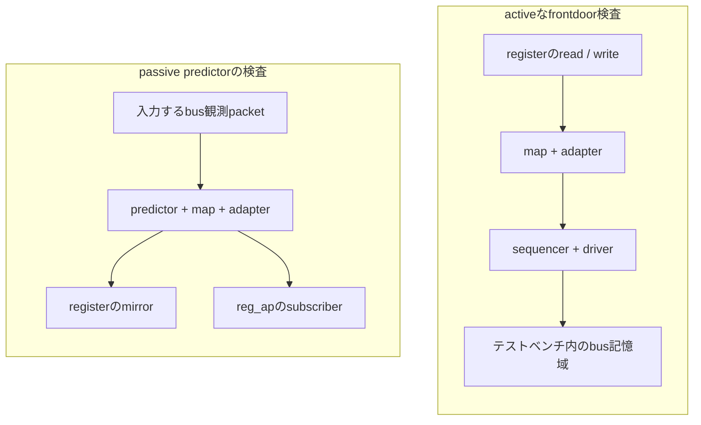
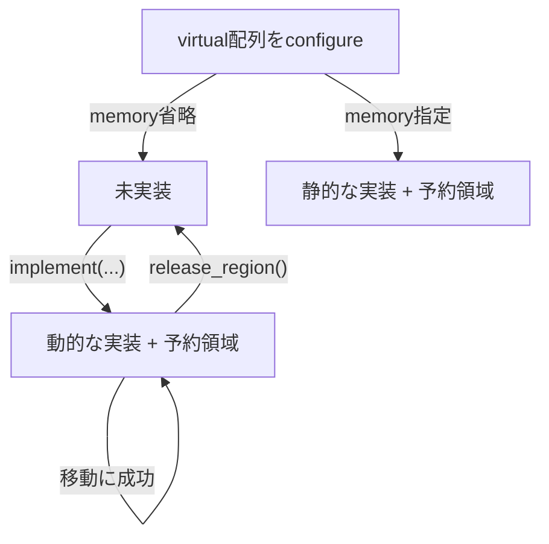
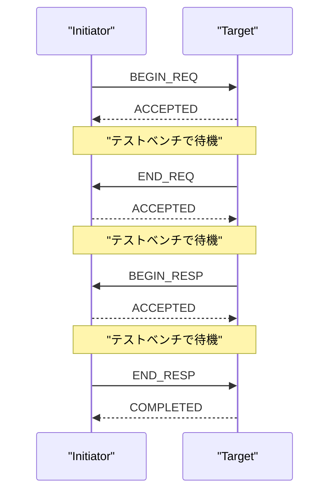
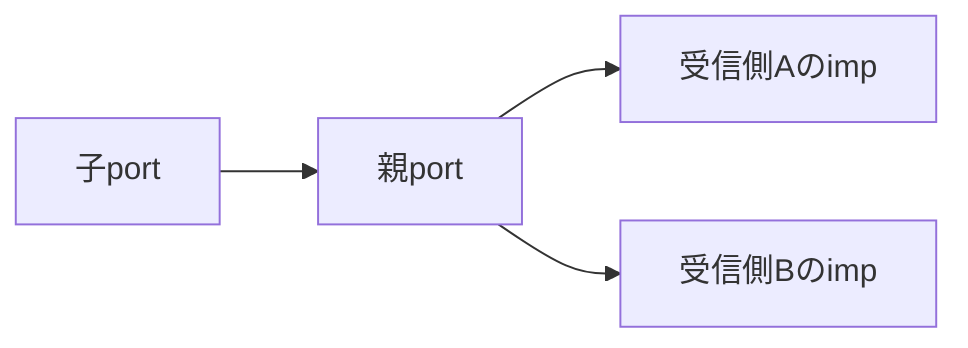
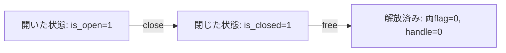
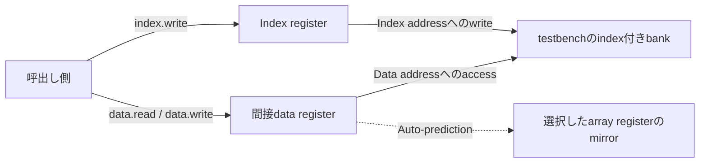
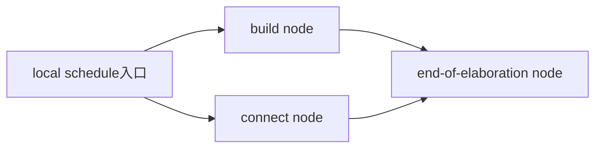
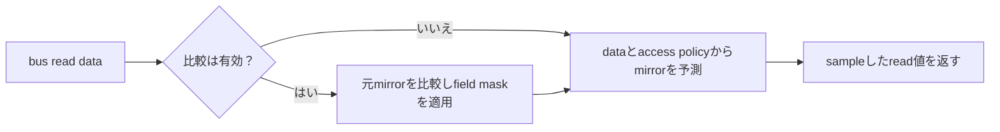
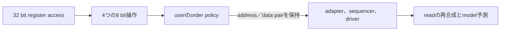
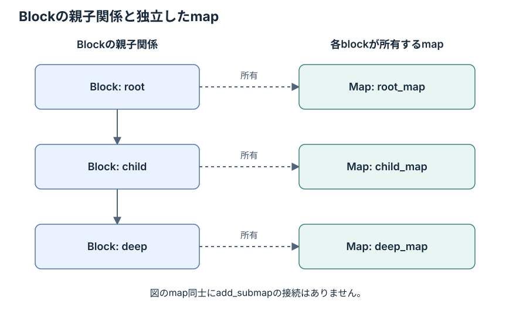

# FAQ

[English](faq.md) · [README](../README.ja.md) · [用語集](glossary.ja.md)

どの質問が当てはまるか分からない場合は、[読み方ガイド](reading-guide.ja.md)で最初の実行、結果ラベル、進捗の件数を結び付けて読めます。

現在のランナーの動作を説明します。件数と測定範囲は[README](../README.ja.md#現在の実行結果)、
個別の制約は[既知差分](known-differences.ja.md)にまとめています。

質問番号はリンク先を保つための番号で通読の順番ではなく、過去の追加作業についての回答内の件数はその時点の値なので、現在値は[最新のスナップショット](results.ja.md#現在のスナップショット)で確認できます。

## 疑問に合う説明を探す

質問は話題ごとにまとめているため、知りたいことに合う入口を選び、回答内のリンクから詳しいガイドへ進めます。

API名やテストのファイル名が分かる場合は、その表記でブラウザのページ内検索ができ、回答で使う識別子をソースから探す場所は[ヘッダーのガイド](testing.ja.md#メタデータ)で確認できます。

- 最初の実行の準備：[最初の実行](#最初の実行)と[runnerのコマンド](testing.ja.md#スイートの実行)。
- 出力や終了コードの解釈：[結果ラベル](#結果の読み方)と[測定条件](results.ja.md#結果の解釈)。
- reportと表示policy：[reportの配送とprinterの状態](#reportの配送先とprinterの状態)と[関連用語](glossary.ja.md#uvmの構成要素)。
- 待機と同期：[event・barrier・transportの質問](#eventbarrierの同期と時刻を隔てたtransport履歴)と[関連用語](glossary.ja.md#同期とtransportの履歴)。
- objectionの取消しの理解：[taskのgate](#q405-drain中の再raiseから何を追加しましたか)と[net伝播](#q406-新しい件数が保留dropより少ない場合は何をassertしますか)。
- configurationの検索：[resourceの選択とsort](#resource収集sortconfig-alias)と[関連用語](glossary.ja.md#resourceとsequenceの順序)。
- compiler診断を読む：[拒否と合法control](#compiler拒否と合法control)と[テストのmetadata](testing.ja.md#メタデータ)。
- sequenceや通信の理解：[lockとtransport](#lockとnonblocking-transport)と[TLMの用語](glossary.ja.md#transaction単位の通信)。
- TLM 2のphaseと時間の区別：[protocolの履歴](#q96-新しいtlm-2テストはprotocol検査器やシミュレータのschedulerですか)と[delayの注記](#q25-tlmのdelay-annotationを変えるとシミュレーション時刻も進みますか)。
- 入れ子transportの束縛の理解：[input handle](#q402-delayのreferenceはendpointがcallerのhandleを置換できる意味ですか)と[liveなphase参照](#q403-transport呼出しの復帰前にcallerのphaseを読む理由は)。
- 自動記録とdriver markの区別：[抑制の観測](#q413-recording無効化profileはflag-queryに何を追加しますか)と[peerの診断](#q414-peerのevent件数を調査専用にする理由は)。
- 記録したproperty dataの追跡：[実際の記録経路](#q416-property-profileはtransaction-markに何を追加しますか)と[件数の限界](#q417-正確な件数や時刻でなく記録の存在を検査する理由は)。
- heartbeat監視の理解：[活動区間の質問](#heartbeatpayload-dispatchabstract-fifo)と[heartbeatの用語](glossary.ja.md#heartbeatvirtual-accessorfifoモデル)。
- macro flagの理解：[field-macroの型と操作の質問](#field-macroの型引数と対応する操作flag)と[controlの用語](glossary.ja.md#field-macroとcallbackのcontrol)。
- レジスタのテストの理解：[モデルの基本](#レジスタモデルの基本)と[レジスタの用語](glossary.ja.md#レジスタモデル)。
- memoryのqueryの読み方：[rightsとaccess](#q398-memoryのrightsと有効accessが異なる理由は)と[addressの単位](#q399-どのaddress単位とrelocation条件を検査しますか)。
- coverageという語の意味：[registerの計測model](#q311-coverageの構築でfunctional-coverageのbinを測定しますか)と[M4の計数単位](requirements.ja.md#計数単位と対象範囲の案)。
- 実際のHDLアクセスの確認：[pathと観測の質問](#register-hdl-pathと観測の前提)と[別のHDL runner](testing.ja.md#verilatorのvpi-hdl部分集合)。
- 進捗の確認や対応付けの変更：[M4の質問](#要求台帳とm4)と[台帳の更新手順](requirements.ja.md#テストや対応付けの更新)。
- 問題の報告：[投稿方針](#商用シミュレータとissueの投稿方針)と[資料の出典](provenance.ja.md#ライブラリと規格)。

## 最初の実行

### Q1. kirimasim-testsとの違いは何ですか

kirimasim-testsはIEEE 1800-2023のSystemVerilog言語を検査します。
こちらはシミュレータが固定版UVMライブラリを実行したときの動作をIEEE 1800.2-2020と照合します。
UVMの不一致を言語だけで再現できる最小例はkirimasim-testsに置きます。
UVMの不一致にはシミュレータ・ライブラリ・テストそれぞれの可能性があります。

### Q2. 必要な環境とUVMの取得元は何ですか

Verilatorのスモーク実行では、UVM取得に加えてシミュレータとC++ビルド環境のインストールが必要であり、準備から実行までの流れは[最初の実行の前に](reading-guide.ja.md#最初の実行の前に)で確認できます。

Python 3.10以降と、UVMを実行できるシミュレータが必要です。固定版のoracleはVerilator 5.052です。
モデルのビルドにはC++ツールチェーンとmakeも必要で、制約付きの乱数化を行うモデルは実行中にpath上のz3 solverを呼び出します。
Ubuntuでの準備はCheckとRegressionが使う[準備用action](../.github/actions/setup-verilator/action.yml)にあります。

`python3 tools/fetch_uvm.py`で、lockに指定したAccellera UVMを取得します。
`python3 tools/fetch_uvm.py --check`は取得済みのファイル数と内容の指紋を照合します。
ライブラリは取得するもので、このリポジトリにはコミットしません。

### Q3. まず1件だけ動かすにはどうしますか

スモーク実行が成功したかは保存したJSON内の当該ケースの`pass`判定で確認でき、その探し方は[結果JSONを開く](reading-guide.ja.md#結果jsonを開く)で説明しています。

Verilator 5.052をPATHに置き、リポジトリのrootから実行します。

```sh
python3 tools/fetch_uvm.py
python3 tools/run_verilator.py --seeds 1 73 --build-jobs 2 -j 1 \
  --json out/verilator-smoke.json tests/u09/test_common_phases_run_in_order.sv
```

`--seeds`は複数の値を受け取るため、例のようにseedの後、テストのパスより前に`--build-jobs`などの
optionを置きます。パスを明示した場合は、そのテストだけが対象です。
スモーク実行は選択した1件を確認するもので、seedと結果ラベルの意味は[実行と結果](glossary.ja.md#実行と結果)で説明しています。

選択するソースと期待値ファイルは実行前から読めるため、このコマンドが何を確かめるかは[ファイルを辿る具体例](reading-guide.ja.md#1件のテストをファイルで辿る)で確認できます。

### Q4. specのみのテストも含めるにはどうしますか

`--all`で対象を広げてもDPIの実装は追加されず、別backendのrunnerが必要になる条件は[Q12](#q12-uvm_dpi-yesだけでdpiを使うビルドが完成しますか)で確認できます。

パスを指定しないVerilator実行は、X・Zに依存せず`verilator@5.052`のタグがあるテストを選びます。
すべての2値のテストを含めるには`--all`を付けます。

```sh
python3 tools/run_verilator.py --all --seeds 1 73 --build-jobs 2 -j 2 \
  --json out/verilator-all.json
```

kirimasimとGhostは既定で全件を選びます。`--all`はVerilatorランナーのoptionで、他のランナーの共通optionではありません。

## 結果の読み方

結果ラベルは指定条件に対するrunnerの判定を示し、差分だけで原因を特定できない理由は[結果の解釈](results.ja.md#結果の解釈)で説明しています。

### Q5. pass・fail・known・unsupportedはどう違いますか

不正設計のケースでの一致は、必要な診断を伴って拒否されたことを意味し、simulationの成功と異なる期待の扱いは[Q199](#q199-compile拒否を一致に数える理由は)で説明しています。

| ステータス | 意味 | 記録するランナー |
| --- | --- | --- |
| `pass` | 期待出力と、必須の終了・診断の条件が一致 | 3つのランナーすべて |
| `fail` | 出力などの条件が合わない、またはビルド・実行に失敗 | kirimasim・Ghost、oracleタグ付きのVerilator |
| `known` | oracleタグのないVerilatorケースの不一致やビルド・実行失敗。成功には数えない | Verilatorのみ |
| `unsupported` | 所定の未対応診断と終了コードを返した | kirimasimのみ |

Ghostの不一致は、同梱ライブラリの差も含めて`fail`として記録します。
kirimasimでも、それ以外のコンパイル失敗は`fail`になる場合があります。
失敗したテスト数を、そのまま異なる不具合の個数と解釈しないでください。

### Q6. KNOWNがあるのにVerilatorコマンドが成功するのはなぜですか

コマンドの終了コードは実行全体の要約、JSONの各項目はケースごとの判定であり、要約を解釈する前に各項目を一覧する方法は[結果JSONを開く](reading-guide.ja.md#結果jsonを開く)で確認できます。

終了コードは、固定版oracleタグ付きのテストの回帰を検出するためのものです。
タグのないテストの不一致はJSONに`known`として記録し、コマンドを失敗させません。
タグがなくても一致すればJSONでは`pass`ですが、端末のoracle付きテストの分母には含めず、
タグも自動では追加しません。kirimasimは`fail`・`unsupported`、Ghostは`fail`があれば失敗終了します。
終了コードだけでなく、JSONの分類も確認してください。

### Q7. なぜUVMの全メッセージを比較せずUT行だけを比べるのですか

UVMの既定の表示形式・パス・行番号・時刻の形式は変わり得ます。
ランナーは行頭が正確に`UT: `で始まる行だけを選び、順序・空白・値を保持して比較します。
テストはreport件数など、規格が定める動作をこの行で観測し、必要なら終了・診断の条件も指定します。
[何を観測するか](testing.ja.md#何を観測するか)を参照してください。

必須のUVMエラーを起こす操作を意図的に行い、その件数を確認するテストもあります。
そのエラーだけで失敗にはならず、要求する観測結果と終了条件で判定します。

### Q8. specのみの期待値をライブラリの出力に合わせないのはなぜですか

期待値の根拠は規格で、ライブラリやシミュレータの差によって変更しません。
現在はtransactionの初期状態、無効なfield_opのアクセス、report reset、objector一覧、
応答の制御、USER arbitrationなどをspecのみで保持しています。
phaseの子タスク終了の差分は、シミュレータとライブラリのどちらが原因か未確定です。
対象範囲とテストへのリンクは[既知差分](known-differences.ja.md)にあります。

### Q9. Checkが緑ならkirimasimでもUVMが成功したということですか

[Check](../.github/workflows/check.yml)はメタデータ・ツール・固定版ライブラリと、入力が変わったVerilatorのoracleを検査し、[Regression](../.github/workflows/regression.yml)は全タグ付きoracleを実行します。
どちらもkirimasim・Ghostは実行せず、Checkはspecのみの一致も成功条件にはしていません。
現在のkirimasimの記録では、大半が`uvm_object_wrapper`未実装で停止し、残りはそれより前に
ライブラリAPIの欠落で失敗します。いずれも、そのコンパイル上の障害より後の動作を検査できた結果ではありません。

### Q10. Nightlyや公開の結果ダッシュボードはどこにありますか

このリポジトリには、現在Nightlyや結果の自動公開はありません。毎週の[Regression](../.github/workflows/regression.yml)はタグ付きVerilator検査を再実行しますが、そのJSONはjob内に留まり公開しません。バッジはCheckとライセンスへリンクします。
kirimasim-testsには独自のNightlyがありますが、こちらのUVMスイートの結果ではありません。
`out/`のJSONは明示的に共有するまではローカルのもので、テストをpushしても自動では公開しません。

## 実行条件

runnerによってライブラリとlinkするbackendが変わるため、異なる実行modeの結果を比較する前に[実行環境の説明](testing.ja.md#uvmライブラリ)で条件を確認してください。

### Q11. Ghostの結果は何を確認し、なぜ仮名なのですか

Ghostは公開前のシミュレータの仮名です。実行ファイルの識別情報・版・パス・profile・診断は非公開にし、
公開JSONには一般化した理由と内容の指紋を使います。

| モード | UVMの供給元 | 結果が対象にする組み合わせ |
| --- | --- | --- |
| `pinned` | ランナーが固定版をコンパイルし、profileで同梱UVMの自動読み込みを無効にする | シミュレータと固定版ライブラリ |
| `bundled` | profileでライブラリのtreeを供給するか、UVMの組み込みを宣言する | シミュレータと供給されたライブラリ。固定版での実行証拠にはならない |

同梱版の識別にはtreeの指紋または組み込みの宣言を使います。
同梱版の不一致だけでシミュレータとライブラリのどちらが原因かは決まりません。
[Ghostの設定](testing.ja.md#ghost)を参照してください。

### Q12. uvm_dpi: yesだけでDPIを使うビルドが完成しますか

既定のマクロ一覧から`UVM_NO_DPI`を外す指定です。UVMのC/C++実装の供給・リンクは行いません。
通常のVerilator runnerは、そのsourceを追加しません。`UVM_NO_DPI`が2701件、HDL DPIの明示選択が38件です。
別の18検査系はHDLを無効にしてcommand-line／regex DPIを明示して有効化し、
[command-line runner](testing.ja.md#verilatorのcommand-line部分集合)がその別backendをlinkします。
[別のVPI runner](testing.ja.md#verilatorのvpi-hdl部分集合)は独自の限定backendをlinkし、結果は宣言した実行条件だけに適用します。
DPIなしのglobによる照合も、完全な正規表現への対応とは異なります。
ユーザー定義の`uvm_reg_backdoor` handlerはHDL DPIなしで動作できます（Q67）。

### Q13. ビルドが重い理由と2種類の並列数の違いは何ですか

`-j 2 --build-jobs 2`では最大2テストを並行buildし、それぞれのC++ buildに2 jobを指定するため、手元の環境に合わせる指定方法は[runnerのガイド](testing.ja.md#スイートの実行)を参照してください。

各テストのモデルにUVMパッケージ全体を含めるためです。`-j`は同時に実行するテスト数、
`--build-jobs`はVerilatorの各C++ビルド内の並列数です。runtimeで`--seeds`を使えばビルドは一度で、
seedごとに新しいプロセスを使います。事前コンパイル済みヘッダーにビルド先の絶対パスが入るため、
そのまま別の場所へ再利用できないccacheはランナーのビルド環境で無効にしています。

### Q14. seedを2つ変えれば決定性や4値の動作も証明できますか

できません。seed 1・73は、乱数を使う初期化条件を変えて固定版の期待値を確認するもので、
乱数そのものは表示しません。Verilatorの既定の対象からはX・Zに依存するテストを除きます。
2値の実行は4値の動作の確認にはならず、2つのseedの成功ですべての実行の正しさも示せません。
複数seedのテストは最初の不一致で止まるため、実行時の既知差分はseed 1の記録で、seed 73の結果ではありません。
ビルドできないケースには、実行時のseed結果がありません。

### Q15. 過去の結果を現在も使えるか、どう確認しますか

テスト入力とランナーの指紋、設定、シミュレータの版、ライブラリの識別情報を比較します。
JSONには`inputs_sha256`・`runner_sha256`・`runner_changed`・`configuration`・`generated_at`を記録します。
実行中に入力が変わったテストは、有効な入力指紋の代わりに`inputs_changed`を記録します。
Ghostはさらに実行ファイル・profile・供給されたライブラリの指紋を記録します。
条件が変われば新しい証拠が必要です。同じ条件の結果は出所を残して合算できますが、
全件を一緒に再ビルドしたという意味にはなりません。

[記録の合算](results.ja.md#記録の合算)の照合項目では、保存済みの結果をまとめる前に比較する識別情報を説明しています。

## 範囲・照合・修正

実行成功と要求レビューは別の記録なので、完了やcoverageの回答を読む際は[対応状況と進捗を読む](reading-guide.ja.md#対応状況と進捗を読む)を使ってください。

### Q16. M1・M2・M3は完了していますか。件数は何の網羅を示しますか

M1・M2には条項ごとの目標に未達があります。M3はbusモデルのfrontdoor経路を含め942件まで追加した段階で、未完です。
次の段階の開始によって、それまでの段階が完了したとは扱いません。
範囲と残りの作業は[進め方](../README.ja.md#進め方)にあります。
件数はテストの本数で、規格の全要求や組み合わせの棚卸しではありません。
引用条項だけでは要求の網羅は示せません。M4で[最初の台帳と棚卸し](requirements.ja.md)を作成しましたが、
規範的義務の分解と分母の承認は未完です。

### Q17. spec_check: aiは人によるレビューや証明を意味しますか

AIが引用した規格と期待値を照合した記録です。人によるレビューや全要求の証明ではありません。
現在は全テストがこの値です。固定版シミュレータでの再現は、別の`:oracle:`に記録します。

### Q18. 期待値の誤りはどう報告・修正しますか

テスト、引用した条項、期待する観測、実行条件を特定します。テストに必要な修正と、シミュレータや
ライブラリの差分を分けて扱い、Ghostの非公開情報を守ります。修正後はメタデータとツールを検査し、
固定版のoracleは両seedで再現します。[テストの追加・修正](testing.ja.md#テストの追加修正)を参照してください。

結果のラベルだけが分かっている場合は、修正案を用意する前に[差分を調べる](reading-guide.ja.md#差分を調べる)の手順でテスト、満たさなかった検査、実行条件を特定できます。

照合に使うIEEEのPDFはローカルに置き、Gitの対象にしません。本文や例を転載せず、自分の言葉で
動作を説明して条項番号を引用します。UVMライブラリはApache-2.0で別に取得します。
このスイートのライセンスはApache-2.0 WITH LLVM-exceptionです。

## lockとnonblocking transport

sequenceはtransactionを供給し、sequencerはその実行を仲裁する役割を持ち、以下の所有権や通信の質問を読むための基礎は[UVMの構成要素](glossary.ja.md#uvmの構成要素)で説明しています。

### Q19. lockとgrabはどう違い、所有者がblockedになることはありますか

lockは通常の要求の仲裁に加わり、grabは先頭に入ります。どちらも、互換性のないlockやgrabが
取得を妨げている間は待ちます。親がlockを持ったままでも、子の所有によって親が一時的に
blockedになる場合があります。`has_lock`と`is_blocked`を別々に確認してください。
入れ子の所有で現在実行できるsequenceは`current_grabber`が示します。

現在のテストは所有、子の解放による復帰、待機中の取得、実際のdriverへのitemの排他を検査します。
先に待っているFIFO要求を追い越さないことと、取得済みitemの完了を待つことの2件は、specのみで保持します。
固定版ライブラリではlockを早く付与してしまうためです。[既知差分](known-differences.ja.md)を参照してください。

### Q20. nonblocking transportはどうやって即時に応答できますか

この回答はTLM 1の`nb_transport`が返す完了のbitを扱い、TLM 2のnonblocking呼出しが使うphase引数と同期enumの結果は[TLMの用語集](glossary.ja.md#transaction単位の通信)で確認できます。

受理した要求のanalysis通知を同期的に受けたtargetが、その場で応答を計算し、
`nb_transport`から戻る前にresponse put portへ書き込めます。テストはこの経路を公開APIで接続し、
呼び出し後に受理済みの要求を回収して容量を再利用します。

即時完了できない場合の戻り値は0です。期待値では、その出力引数の値や、要求の一部がキューへ
入ったかは指定しません。再実行のテストは`try_get`で残った要求があれば回収し、
その成否自体は検査せず、新しいtransactionを実行します。

### Q21. killされたsequenceのbodyやhookはどうなりますか

実行中のbodyを停止し、状態を`UVM_STOPPED`にして、待っている`start`を復帰させます。
sequencerの要求や所有も後処理します。規格は停止hookの`do_kill`に加えて、`post_body`・`post_start`も
実行するように定めています。固定版はこの2つのpost hookを呼ばないため、sequencerあり・なしの
テストで必須動作をspecのみの期待値として保持します。

直接のkillによる自動objectionのdropと、`stop_sequences`後のsequencerの再利用も検査します。
stopでも自動objectionを解除する必要がありますが、固定版のrootを停止する経路ではdropしません。
単独・親子のケースで必須動作をspecのみで保持します。[既知差分](known-differences.ja.md)を参照してください。
この操作で破棄されたdriver保持中の要求には後から完了通知せず、新しい要求を取り出してから、
その要求について`item_done`を呼びます。

### Q22. default phase sequenceはどう選ばれますか

phase開始時に、sequencerの完全名とphase名のscopeで`default_sequence` resourceを検索します。
例は`uvm_test_top.sequencer.main_phase`です。対象の型は`uvm_sequence_base`と`uvm_object_wrapper`です。
優先度でresourceを選び、選択したnullは無効化を示します。instanceはそのまま使い、wrapperは
sequencerのパスとwrapper型名を生成の文脈にしてfactoryを呼びます。

sequencerと開始phaseを設定し、無効化しない限りrandomizeしてから実行します。
phase終了時も実行中ならkillします。wrapperがsequence以外を生成した場合は、エラーを出して
defaultを開始しません。固定版はwarningだけを出すため、必須エラーをspecのみで保持します。

### Q23. 終了・停止したsequenceへ遅れて応答が来たらどうなりますか

元のsequenceが`UVM_FINISHED`または`UVM_STOPPED`なら、`put_response`は応答を捨ててwarningを出します。
実際の要求からIDをコピーしてからsequenceを終了させ、warningと不達の両方を検査します。
queueは時間を区切って待ち、handlerは呼ばれないことを確認します。別の生存sequenceへの応答は、
1つのsequenceをkillしても正常に届く必要があります。

transaction IDだけが配送の識別情報ではありません。新しいsequenceでそのIDを再利用しても、
停止したsequenceへの古い応答が混入してはいけません。この検査は遅れた配送を対象とし、
stop前にすでに配送された応答の消去を含む、あらゆる後処理を検証したとは扱いません。

### Q24. defaultに指定したinstanceはwrapperより必ず優先されますか

されません。`uvm_sequence_base`と`uvm_object_wrapper`のresourceだけを残し、最高のprecedenceを選びます。
同じならlookupのキューに残った最初の要素を使います。不適合な型を除いても、有効な要素同士の
相対的な順序を保つ必要があります。無関係な型のnull `uvm_object`は除外し、受け入れる型の
選択されたnullだけがdefaultを無効化します。

同一優先度のテストは別々のresourceを作り、公開pool APIの低優先度の追加で順序を明示しています。
同じ設定を更新する場合がある`config_db::set`の繰り返しから、キュー順を推測していません。

### Q25. TLMのdelay annotationを変えるとシミュレーション時刻も進みますか

annotationはoffsetを持つobjectで、その変更だけでは待機しません。targetは同じシミュレーション時刻で
注記を増やして返すことも、blocking実装の処理として明示的に待つこともできます。
テストは注記値とシミュレーション時刻の同一性を別々に確認します。絶対変換は1単位の秒数を明示し、
scaled操作は対応するtime literalを使います。テストの100秒のscaleは変換の基準で、100秒待つ指定ではありません。

realは小さな許容差で比較し、resolution未満の丸め・負の時刻・浮動小数点の内部表現は指定しません。
固定版の既定名とsetter欠落は[既知差分](known-differences.ja.md)に残します。
setterのケースはビルド不可であり、seedを実行して失敗した結果ではありません。

### Q26. 二段socketのbackwardをテスト内で接続し直さないのはなぜですか

nonblocking socketの`connect` APIがbackwardを自動で接続するためです。手動の接続ではその動作を
迂回してしまうので、二段initiatorは規格の経路を保持します。固定版では2つのbackward exportの
接続方向が逆になり、binding検査に失敗します。forwardは子portから親portへの正しい階層を使っています。

他の経路の成功は、そのtransactionについてpayload・delayの同一性、注記、戻り値、phase参照の伝搬を
確認した結果です。protocolやtimingのあらゆる合法な組み合わせを保証しません。
callback iteratorも、位置の整数値を決めつけず、公開APIで走査・再開します。

## push転送・sequence操作・payloadのpack

### Q27. push sequencerのitemはいつ完了しますか

push sequencerはdriverを呼び出して要求を渡す仕組みで、完了規則の前提となる転送経路は[TLMの用語](glossary.ja.md#transaction単位の通信)で説明しています。

IEEE 1800.2-2020の15.6.3.3では、driverのblocking `put`から戻った後に、sequenceの
item完了待ちが戻ります。push driverはpull portの`item_done`を使いません。
正の遅延を使うテストでは、`put`が処理中の間は`finish_item`が戻らないことを確認します。
別のテストで3要求の転送と、共通APIの要求・応答履歴を確認します。
固定版ライブラリの複数要求に関する制限は[既知の差分](known-differences.ja.md)に記録しています。

### Q28. sequence操作マクロはすべて引数を乱数化しますか

`uvm_create`はitemや子sequenceの生成とcontext設定だけを行います。
`uvm_send`は乱数化せず実行し、`uvm_rand_send`は乱数化してから実行します。
ただし子sequenceの乱数化が無効なら、その乱数化を省略します。
`uvm_do`は生成と乱数化付きの実行を組み合わせます。子sequenceは`call_pre_post`を0にして
開始するため、`body`は実行しますが、`pre_body`と`post_body`は呼びません。
テストでは解が1つの制約とcallback回数を使い、乱数の選択による期待値の変化を避けています。

### Q29. generic payloadのpackには何が含まれますか

packは選択したpayload fieldをstreamへ直列化する処理で、確保した配列と有効長が異なり得る理由は[payloadの用語](glossary.ja.md#transaction単位の通信)で説明しています。

規格で順序を定めたscalarフィールドと、data・byte-enableの有効長までのbyteを含みます。
配列の余分なbyteやextensionは、既定のpack対象ではありません。
有効長より配列が短い場合はfatalを報告します。そのテストはreport catcherがfatalを観測した時点で
終了し、fatalを抑制した後の実行については期待値を定めません。
往復変換と公開packer APIでの読み出しを使い、特定のバイナリ表現に依存しないようにしています。

## sequence libraryとマクロの制御

sequence libraryは登録されたsequence型から実行対象を選ぶもので、以下の登録規則の前提になる所属と選択は[UVMの用語集](glossary.ja.md#uvmの構成要素)で説明しています。

### Q30. libraryのinstance登録とtypewide登録はどう違いますか

`add_sequence`と`add_sequences`は1つのlibraryへ登録します。staticのtypewide版は、
以降に生成するlibraryへ反映され、既存instanceは変更しません。重複する型は警告なしで無視します。
`get_sequences`は呼び出し元のqueueの既存要素の後へ一覧を追記します。
テストは型の所属を比較し、明記されていない挿入順を決めつけません。

削除は別の規則です。static登録された型を削除した場合は全instanceを更新し、未登録の型を
削除した場合はwarningを出します。固定版は呼び出したinstanceだけから削除し、未登録時のwarningも
出しません。どちらも[既知差分](known-differences.ja.md)に規格の期待値を保持します。

### Q31. sequence libraryの一部テストがseed実行前に失敗するのはなぜですか

IEEE 1800.2-2020には、選択mode・乱数化回数の下限と上限を設定・取得するAPIと、
`get_num_sequences_executed`があります。固定版にはこの7つのmethodがありません。
14件は規格の呼び出しを保持するためビルドできず、実行時のseed結果を持ちません。
必須APIを旧来の公開fieldへ置き換えません。登録や選択hookの直接呼び出しが成功しても、
実行modeや実行回数の適合を確認できたことにはなりません。

### Q32. itemの乱数fieldを無効にすると乱数化callbackも省略しますか

fieldの`rand_mode(0)`はその変数の値を維持しますが、itemの`randomize`はcallbackを呼びます。
子sequence全体の乱数化を無効にした場合は、操作マクロが`randomize`の呼び出し自体を省略します。
テストはこの違い、生成時のfactory置換、乱数化とdriver転送を囲む親のhook順序を確認します。
型付きsequencerの宣言を検査するケースは、明示的なcast後にsubtypeのmemberへアクセスし、
自動的な初期化方針を仮定しません。

## 低水準のsequence送信とtransportの委譲

### Q33. grant・送信・item完了はどの順に行いますか

grantは送信の許可、completionは要求の完了通知を表し、それぞれと別responseの配送との違いは[sequenceの用語](glossary.ja.md#uvmの構成要素)で確認できます。

itemのcontextを設定した後、`wait_for_grant`を呼び、シミュレーション時間を進めずに
`send_request`を呼びます。その後、必要なら完了を待ちます。既定の送信は乱数化せず、
rerandomize引数を1にした場合はdriverへ渡す前に乱数化します。

完了は`item_done`、または`get`の暗黙の通知で伝わります。特定のtransaction IDの待機は
その完了通知より前に開始する必要があり、後から待つと停止したままになる場合があります。
[2要求のケース](../tests/u14/test_sequence_wait_for_item_done_matches_each_explicit_transaction_id.sv)は
個別に完了を通知し、2つ目のitemを保持している間の状態を観測します。完了通知自体は応答を供給しません。

### Q34. 分割したmaster／slave impの呼び出しはどのcomponentが処理しますか

impはTLM接続の処理を実装する終端で、その終端と所有するcomponentとの違いは[TLMの用語](glossary.ja.md#transaction単位の通信)で確認できます。

impのconstructorの要求側・応答側引数が、実装する兄弟componentを選びます。
親はimpを所有しますが、転送methodを実装する必要はありません。
masterは要求を書いて応答を読み、slaveは要求を読んで応答を書きます。読み出しにはpeekも含みます。

[masterの混在操作ケース](../tests/u12/test_master_combined_imp_routes_mixed_operations_to_split_implementations.sv)は
要求をint、応答をstringとし、blocking・nonblocking操作と独立した領域の再利用を検査します。
別のケースでexport経由、利用可否、容量を確認します。失敗した読み出しの未規定の出力値は検査しません。

### Q35. 通常のTLM 2 exportもbackwardを自動接続しますか

通常のforward・backward経路は個別に接続します。portからexportの連鎖を通ってimpへ到達すると、
指定した実装が呼ばれます。往復のテストは両方向を明示的に接続し、socket接続の副作用には頼りません。

[custom型のforwardケース](../tests/u12/test_tlm2_nested_forward_exports_preserve_custom_transaction_and_phase_types.sv)は
独自のtransactionとphase enumを2つのexportへ渡します。handleの同一性、型付きphase参照の更新、
annotationを確認します。この汎用接続の結果だけで、あらゆるphase・timingの組み合わせが
base protocolとして合法であることを示すものではありません。

## FIFOの通知と実行対象の指定

### Q36. FIFOをpeekしたときもget_apへ通知しますか

peekはFIFO先頭を取り出さずに観測する操作で、通知規則の前提となる観測と消費の違いは[FIFOの用語](glossary.ja.md#transaction単位の通信)で確認できます。

IEEE 1800.2-2020の12.2.8.1.6はget操作だけでなく、`peek`と成功した`try_peek`も含めています。
peekはitemを残すため、通知は取り除いたことを意味しません。2つのpeekケースは、消費する前に2回の
通知を観測します。固定版は両方のpeek通知を省略するため、必要な件数を
[既知差分](known-differences.ja.md)に保持します。

別のケースで複数subscriberへの配信、受け入れたput、成功したget、objectの同一性を検査します。
失敗した読み出しの出力値は検査せず、利用できなかった転送は通知件数に加えません。

### Q37. start_itemはどのsequencerと優先度を使いますか

明示的なsequencer引数、itemのsequencer、実行中sequenceのsequencerの順で選びます。
[3つのcontextのケース](../tests/u14/test_sequence_start_item_explicit_sequencer_overrides_item_and_parent_context.sv)は
別々のsequencerとdriverで選択した経路を確認します。優先度が非負ならsequenceの値を上書きし、
負なら-1以外の値でもsequenceから継承します。

nullのitem、`is_item`が0のsequence、3つのsequencer候補がすべてない場合は、ERRORと即時のreturnが
必要です。固定版はFATALを使います。テストはreport catcherで元の重大度を数え、必要なERRORを
[既知差分](known-differences.ja.md)として保持します。

### Q38. 外部objectを指定したマクロはどのcallbackを実行しますか

typewide callbackは型に対して、instance callbackは特定のobjectに対して登録するもので、2つの登録範囲は[callbackの用語](glossary.ja.md#uvmの構成要素)で説明しています。

`uvm_do_obj_callbacks`とそのexit-on版は、渡したobjectを使います。呼び出し元のdispatcherだけに
登録したentryは含めず、適用されるtypewide・指定instanceのentryを実行し、無効なentryは飛ばします。
[contextを切り替えるケース](../tests/uB/test_callback_object_macro_switches_between_explicit_external_contexts.sv)は
1つのdispatcherから2つの外部objectを呼び、それぞれの実行対象を確認します。

exit-onのテストは、trueまたはfalseの最初の一致で停止することを確認します。一致しない場合は、
走査や呼び出しがないことを検査し、関数の不一致時の戻り値や後続文へ進む方針は指定しません。

## TLM実装宣言マクロ

impはTLM portやexportを通じて呼ばれるmethodを供給するもので、以下に出る生成method名と接続上の役割は[TLMの用語集](glossary.ja.md#transaction単位の通信)で確認できます。

### Q39. imp宣言マクロのsuffixは何を変えますか

別のimp classを生成し、対応する名前の実装methodを選びます。接続したportのinterfaceは変わらず、
たとえば`put`が`_left`のimpを通って`put_left`へ届きます。componentはsuffixなしの`put`を持たずに、
2つの実装を公開できます。

[両対応putのケース](../tests/uB/test_tlm_put_imp_decl_routes_two_suffixes.sv)はblocking・nonblockingの
呼び出し、満杯時の拒否、領域を空けた後の成功を検査します。宣言のケースはAnnex B.5の22系列を、
独立した2つの入力名で検査します。不正な接続やschedulingのあらゆる組み合わせを保証しません。

### Q40. 生成したmaster impでも要求と応答を別objectへ委譲できますか

`REQ_IMP`・`RSP_IMP`は型を表し、constructorの`req_imp`・`rsp_imp`は実際の兄弟instanceを
指定します。suffixはそのobject上のmethod名に付きます。
[分割実装のケース](../tests/uB/test_tlm_master_imp_decl_delegates_suffixed_methods_to_split_sibling_implementations.sv)は
intの要求とstringの応答を使い、親には転送methodを設けません。
blocking・nonblockingの両方で、正しい兄弟とsuffixへ届く必要があります。

別のanalysisケースでは、suffix付きwriteへ元のclass handleを渡します。同一性と入力別の件数を
比較し、暗黙の複製やtransactionの変更は要求しません。

### Q41. B.5.11のケースでget／peekのマクロ名を使うのはなぜですか

見出しは`uvm_nonblocking_get_peek_imp_decl`で、本文もnonblocking get／peek両対応のclassを
説明しています。一方、呼び出し例はB.5.8と同じpeek専用の表記です。
[B.5.11のケース](../tests/uB/test_tlm_nonblocking_get_peek_imp_decl_routes_two_suffixes.sv)は見出しと
説明されたclassに従う解釈で、getとpeekの両方を呼びます。

この解釈はテストのコメントに記録し、レビュー項目として残します。固定版での一致は再現の記録であり、
規格の表記の不一致を解消したり、人のレビューに代わったりはしません。
現在の他のテストと同じく、`spec_check: ai`を保持します。

## libraryの構築・itemの完了・extensionの識別

staticな所属はsequence libraryの型に、instance内の追加は個々のlibrary objectに属し、以下で使う型とobjectの役割は[UVMの用語集](glossary.ja.md#uvmの構成要素)で確認できます。

### Q42. libraryの構築直後にstatic所属を検査するのはなぜですか

規格のsubtypeの例はutilitiesマクロと、`super.new`を呼ぶconstructorを使っています。
その型やbaseにstatic登録したmemberは、構築後に利用できる必要があります。4件で2つのinstance、
2種類のlibrary、継承、static所属と並ぶinstance内の追加を検査します。

固定版はこれらのsubtypeの一覧を構築時に取り込みません。テストは公開の一覧を使い、実装固有の追加の
初期化methodを呼びません。[既知差分](known-differences.ja.md)を参照してください。
別の成功ケースはinstance登録と既定のRANDで10回の子の実行を確認します。選択変数への単一解の制約で、
乱数の分布や登録順への依存を避けています。これで欠落したAPIが検証済みになるわけではありません。

### Q43. driverへ要求が届いてもfinish_itemの呼び出しを観測するのはなぜですか

14.2.6.3はsequenceのvirtualな`send_request`・`wait_for_item_done`を呼び、再乱数化を0にし、
itemの明示的なtransaction IDを待機へ渡すことを定めています。固定版はsequencerを直接呼び、
完了IDに-1を使います。テストはvirtual methodの実行と引数の伝搬を区別します。
追加の3つの不正入力ではERRORと即時のreturnが必要ですが、固定版の経路は参照時に終了する場合があります。
これらはAPI欠落のビルド失敗ではなく、[既知差分](known-differences.ja.md)に記録する実行時の差分です。

[hook順序のケース](../tests/u14/test_sequence_finish_item_orders_mid_mutation_before_send_and_post_after_ack.sv)では、
mid-doの変更が送信時に見え、post-doが遅延した完了通知を観測することも確認します。
catcherは重大度を書き換えずに数え、fatal後の継続の方針は指定しません。

### Q44. extensionのtype keyはinstance名と同じですか

extensionはpayloadに追加の型付きdataを結び付ける仕組みで、型の識別と個々のobjectの名前との違いは[extensionの用語](glossary.ja.md#uvmの構成要素)で説明しています。

`uvm_tlm_extension_base::get_type_handle`が返すkeyはextensionの型を識別します。
同じ型のinstanceは改名後もkeyを共有し、異なる型はinstance名が同じでも別のkeyを持ちます。
type-handle名は特定の修飾形式を要求せず、同じ型での安定性と別の型との相違を比較します。

payloadへの登録・置換・削除はその不透明なkeyを使います。
[短いaliasのケース](../tests/u12/test_tlm2_gp_alias_shares_payload_and_polymorphic_extension_state.sv)は、
`uvm_tlm_gp`と`uvm_tlm_generic_payload`のhandleが同じpayloadの登録状態を見ることも確認します。
型の数値IDや暗黙のcloneは要求しません。

## レジスタモデルの基本

desired値、mirror、アクセス先の記憶域は異なる状態であり、registerの回答で使う用語は[レジスタモデル](glossary.ja.md#レジスタモデル)で説明しています。

### Q45. set・predict・resetはDUTへアクセスしますか

M3の初回はモデル内の操作です。desiredはモデルが書き込みたい値、mirroredはモデルが現在記録している値です。
今回の表では処理中ではないfieldを使い、predictionの種類は`UVM_PREDICT_DIRECT`とします。

| 操作 | desired値 | mirrored値 | DUTへのアクセス |
| --- | --- | --- | --- |
| `set(value)` | 設定したaccess policyを適用 | 変えない | なし |
| `predict`（DIRECT） | 計算値に置き換える | 計算値に置き換える | なし |
| `reset(kind)` | その種類のreset値があれば復元 | その種類のreset値があれば復元 | なし |

ROの`set`はdesiredを変えず、W1Cの`set`は指定した1のbitをdesiredから消します。
直接のpredictionはaccess policyにかかわらず値を更新し、値を設定していない種類のresetはfieldを変えません。
`needs_update`は書き込み可能なdesired値との整合を取る必要があるかを調べるもので、それ自体は転送しません。
[fieldのset](../tests/u18/test_reg_field_set_changes_desired_without_predicting_mirror.sv)と
[再帰reset](../tests/u18/test_reg_block_reset_recurses_into_child_registers.sv)はbusやHDL backdoorなしで状態を観測します。

### Q46. mapのアドレスはbyte単位ですか。配列が逆順になるのはなぜですか

dataの桁の順序とtransactionの時間順序は別で、未指定の発行順を仮定せず完了した要求を比較する方法は[bus観測のFAQ](#q290-観測requestをaddress順に並べる理由は)で説明しています。

アドレス単位は`byte_addressing`で決まり、有効なら1 byte、無効なら設定したbus幅です。
registerのlocal offsetと、外部から見た物理アドレスは別の値です。
[word単位のケース](../tests/u18/test_reg_map_word_addressing_translates_offsets_in_bus_units.sv)では、
複数回のbus転送に対応する連続したwordアドレスを確認します。

`get_addresses`は、データの下位側から順に物理アドレスを返します。
big endianのmapでは数値として降順になる場合があります。
[little endian](../tests/u18/test_reg_map_little_endian_wide_register_lists_addresses_in_data_order.sv)と
[big endian](../tests/u18/test_reg_map_big_endian_wide_register_lists_addresses_in_data_order.sv)のケースは、
6 byteのregisterを2 byteずつの3回へ分けます。submapは親へのoffsetを加え、rootまでの最小bus幅を使います。
これらはアドレスの計算であり、実際のbus転送は行いません。

### Q47. レジスタモデルのどの基礎を検査していますか

field／register／blockの構築と配置、access policy、resetの種類、desired／mirroredの状態、
再帰resetとlock、mapの単位・権限・endian・再配置・階層を検査します。
lock前のfield検索とmapの幅・変換はspecのみの期待値を保持し、lock前の検査にはlock後の比較も含みます。

memory、adapter、predictor、frontdoor、callback、virtual registerのケースは以下で説明します。
追加のpacking／エラー・policy／map条件、predictorの統合、frontdoor／callbackの組み合わせ、HDL path／DPI、
割り当てpolicyの追加条件、付録Eの追加条件は未完です。
Q68で組み込みテストsequenceと選択maskの範囲を説明します。
registerとmemoryのmap問い合わせは引数を明示します。
配布物の複数mapに関する注記とnull時のmap解決は[既知差分](known-differences.ja.md)で説明します。
全件が`spec_check: ai`で、レビュー済みのレジスタ層の要求カバレッジ台帳ではありません。

## memory・prediction・mapの制御

### Q48. memoryもregisterのようにmirrorを持ちますか。offsetは何を表しますか

location indexはmemory内の1 wordを選び、外部addressはmapにも依存するため、以下の例で使う単位は[レジスタモデルの用語](glossary.ja.md#レジスタモデル)で確認できます。

`uvm_mem`は連続したlocationを表しますが、全locationのmirror値は保持しません。
構築時にlocationの数とbit幅を記録し、1 locationのbyte幅は端数を切り上げます。
配置とアドレスに加え、現在はテストベンチdriverを通るfrontdoorのデータ転送も検査します（Q54）。

location番号が変わるとlocal offsetと外部アドレスも変わります。byte単位の2 byte locationは2ずつ、
4 byte bus上のword単位の4 byte locationは1ずつ進みます。
固定版の`get_offset`はlocationを使わないため、[locationのoffset検査](../tests/u18/test_mem_location_offsets_include_the_location_index_stride.sv)は
規格の期待値を保持し、外部アドレスが進むことも別に観測します。

非共有memoryの権限問い合わせは18.6.4.5のRWです。実効accessの問い合わせは別で、18.6.4.6に従って
指定mapの制限を反映します。[単一mapのaccess検査](../tests/u18/test_mem_intrinsic_readonly_policy_and_map_rights_are_distinct.sv)は
この区別を既知差分として保持します。

[2つのinterfaceのケース](../tests/u18/test_mem_two_interface_maps_preserve_membership_addresses_and_rights.sv)では、
明示したmapへの所属、独立したアドレスとRO／WO権限、エラーがないことを検査します。
この結果が対象とするのは兄弟mapの構成です。共有mapの階層や配布物の複数mapの注記は、別途照合が必要です。

### Q49. READ／WRITE predictionはbus転送を実行しますか

predictionは計算値や観測値をモデルへ渡す操作です。`UVM_PREDICT_DIRECT`はpolicyの効果を適用せず値を写し、
READ／WRITEは観測した操作に応じた効果を適用します。fieldのprediction検査は観測値を模擬し、driverやDUTは動かしません。

READ predictionは読み出し後のRCを0、RSを全bit 1にします。
WRITE predictionはW1C／W1S／W1Tで1のbitを消去・設定・反転し、W0C／W0Sでは0のbitを使います。
2回の操作で前の状態を引き継ぐことも確認します。
[write-onceのケース](../tests/u18/test_reg_field_write_once_prediction_rearms_only_after_hard_reset.sv)は、
SOFT resetが設定値を復元しても書き込み保護を維持し、HARD resetが次の初回書き込みを許すことを調べます。
各ケースでdesiredとmirroredの両方を観測します。

### Q50. mapの制御では何を検査しますか

registerとmemoryの再配置で、物理アドレスとlock済みの検索結果が更新されることを検査します。
検索のケースはroot baseを0にします。同じアドレスのRO／WO registerは読み書きの方向で選び分け、
fieldとmapの権限が矛盾する場合はNOACCESSになります。いずれもbus転送を伴わないモデルの問い合わせです。

mapの`reset()`の既定値はSOFTで、register・fieldのHARDとは異なります。
[map単位のreset](../tests/u18/test_reg_map_reset_defaults_to_soft_and_preserves_other_maps_registers.sv)では、
別mapのregisterが変わらないことも確認します。不正入力の検査は元の重大度、必須の戻り値、呼び出し元の配列の維持を観測します。
auto-predictの検査はmapごとのmode flagだけを扱い、下記のfrontdoor検査ではbusモデルの読み書きに伴う効果も確認します。

## adapter・predictor・frontdoorの経路

adapterはregister操作とbus操作を変換し、predictorは観測した通信からモデル状態を更新するもので、frontdoor accessとの関係は[レジスタの用語集](glossary.ja.md#レジスタモデル)で説明しています。

### Q51. adapterと操作記述子では何を検査しますか

7件で標準TLM adapterのcommand・address・byte長・独立した生成・byte enable・成功／エラー応答の変換・
callback外のcontextを検査します。同じdata byteを使って数値上のbyte順を固定せず、失敗したreadのdataも指定しません。
[操作の値配列](../tests/u19/test_reg_item_value_array_resize_preserves_prefix_and_zero_fills_growth.sv)は、
19.1.1.2.4の既定サイズ、既存要素の維持、拡張や縮小後の再拡張で新しい要素が0になることを確認します。

activeなcontext検査では、`reg2bus`内で`get_item`を読み取り、register・map・extension・操作種別・doorを観測します。
返されたitemは変更しません。callback外では`bus2reg`内も含めてnullである必要があります。

### Q52. passive predictorとfrontdoorのauto-predictionはどう違いますか

別々の検査系を使います。組み込みfrontdoorはsequencer／driverを通じてregisterアクセスを開始し、
passive側はmap・adapterを設定したpredictorへ、analysis portから観測packetを入力します。



predictorはRW／RO・RC／W1Cの効果、公開する操作の情報、両endianでの幅の広いregisterの組み立て、
memoryと未登録アドレスの無視を検査します。必要なbus wordが揃うまでは公開しません。
hookの転送先変更は19.3.3.2の転送先と値の変更を期待値に保持します。[既知差分](known-differences.ja.md)を参照してください。

### Q53. frontdoorはRTLのDUTやbusの全組み合わせを検査しますか

組み込みfrontdoorの検査系はテストベンチ内の記憶域モデルと実際のsequencer／driver接続を使い、正の遅延後に完了を通知します。
auto-predictionの有効／無効、別のresponse item、狭いbusへのwriteの対応関係、adapter contextを検査します。
addressとdataの対応を確認し、規定されていない転送順序は要求しません。
big endianの幅の広いreadは標準TLM adapterを使い、同じpayload byteから値を復元する規格の期待値をspecのみで保持します。

RTLのDUTやDPIを使わない、選択したUVM経路の検査です。実際のbus信号protocol、より広い応答・エラー・timingの
組み合わせ、monitorとpredictorをつないだ実転送は今後の作業です。
追加したmemory転送、update／mirror、エラーstatus、アクセスhookはQ54〜Q56で説明します。

## memory転送とregisterのアクセスhook

busの1 beatはaccessのうちbus幅までの部分を転送するため、memoryの1 location全体との違いは[レジスタモデルの用語](glossary.ja.md#レジスタモデル)で確認できます。

### Q54. memoryのどの転送を検査していますか

8件で、0以外のlocationのbyte幅read／write、driverの別応答、byte幅busでのlittle endianの32 bit location、
word単位のアドレス、3 locationのburst read／writeを検査します。
driverは正の遅延の後に応答し、物理アドレスとデータを保存します。RTL memoryやlocationごとのUVM mirrorは使いません。

burstではmemory・bus・`uvm_reg_data_t`の幅をすべて64 bitにそろえ、配列の1要素が1 locationを満たします。
狭いmemoryへの配列packing、最後の部分beat、big endianのmemory転送、memoryエラーの組み合わせは未追加です。
driverの記憶域は検査系の状態であり、`uvm_mem`が保持するmirrorではありません。
burstの2件はspecのみです。19.1.2.1が物理bus記述子をREAD／WRITEとするのに対し、固定版UVMはburst種別をadapterへ渡します。
[既知差分](known-differences.ja.md)も参照してください。

### Q55. update・mirrorとbusエラーでは何を検査していますか

mirrorはモデルが記録する状態、`mirror()`は読み出しと任意の比較を行う操作で、モデル内だけのpredictionとの違いは[レジスタモデルの用語](glossary.ja.md#レジスタモデル)で確認できます。

`set`は転送なしでdesiredを変えます。`update`は必要な場合に書き込み、成功時のauto-predictionで次のupdateが不要になります。
W1C／W1Sではbusへ送るwrite maskと結果のmirrorを分けて観測します。命令のデータとpolicy適用後の値は異なる場合があります。

`mirror(UVM_CHECK)`はreadし、不一致を報告してmirrorを更新します。fieldの比較を無効にすると、その不一致はエラーになりません。
catcherは元のerror severityを数え、severityを書き換えずに期待した診断を受け取ります。
別の2件ではadapter経由のbusエラーを呼び出し元へ返し、その後の再試行の成功を確認します。
失敗したreadのデータや失敗時点のmirrorの値は規定しません。

### Q56. どのアクセスhookと順序を検査していますか

registerの継承methodをoverrideし、pre-writeの値の変更、pre-read／pre-writeでbus要求を出す前の中止、
post-readの戻り値の変更、post-read／post-writeの戻りstatusの変更を検査します。
post-readの値のケースは呼び出し元の値を確認し、hook後のmirrorは規定しません。

18.4.8.1／.3と18.5.6.1／.3はregisterのhookをfieldより先としています。
順序の2件は`RF`を期待しますが、固定版UVMは`FR`になるためspecのみで保持します。
[既知差分](known-differences.ja.md)も参照してください。
この8件は継承methodのoverrideです。追加した登録callbackはQ58で説明します。callbackでの転送先変更、
登録callbackを含むfield／registerの順序や追加のpost-hookの組み合わせは今後の作業です。

## custom frontdoor・登録callback・virtual register

custom frontdoorはaccess用のsequenceを供給し、登録callbackはaccess処理を観測・変更するもので、それぞれが関わる場所は[レジスタの用語集](glossary.ja.md#レジスタモデル)で説明しています。

### Q57. custom frontdoorは組み込みの経路とどう違いますか

8件で、registerやmemoryへ`uvm_reg_frontdoor`のsequenceを関連付けます。
本体は`rw_info`を受け取り、正の遅延の後に自分の記憶域を読み書きします。
register／memoryのデータとstatus、unmapped register、element／map／extensionのcontext、
実行先sequencer、registerのmapごとのhandlerの置き換えを検査します。

今回のsequence本体はcustom accessの接点をモデル化し、adapterのitemをbus driverへ送りません。
以前の組み込みfrontdoorのケースでは、別途sequencer／driverの接続を検査しています。どちらもRTLのprotocolの証拠ではありません。
[操作contextのケース](../tests/u19/test_reg_custom_frontdoor_receives_extension_map_element_and_sequencer_context.sv)も参照してください。

### Q58. 登録型register callbackでは何を追加していますか

instanceごとの`uvm_reg_cb`を7件追加し、pre-writeの値、pre-readでの中止、post-readの値、
post-writeのstatus、削除、同じregisterの継承pre／post methodとの順序を検査します。
pre methodは登録callbackより先、登録post callbackはpost methodより先です。
以前のregister対fieldの順序のケースとは別の条件です。

残る1件はfieldへ`post_predict` callbackを登録し、以前のmirrorとREAD predictionを受け取って、予測後の値を変更します。
これはbus転送なしで観測値を入力する検査です。追加のmemory／backdoor objectへの登録、encode／decodeの連鎖、
転送先変更、追加のfield／register順序の組み合わせは未検証です。

### Q59. virtual registerのケースはどこまで検査していますか

8件で、親と未実装のmemory、詰めた／間隔を明示した静的配列、memoryのmapへの所属と外部アドレス、
virtual fieldの親・幅・位置、fieldの順序と名前検索、幅の広い実装先memoryでのbyte幅を確認します。
virtual fieldはfactoryで生成します。この8件はモデルの問い合わせです。Q60〜Q62で転送、選択した動的な実装とmemory managerを追加します。
Q65で指定policyによる割り当てを追加します。追加の割り当てpolicy条件や、virtual配列の領域をmanagerから直接解放することへの保護は未検証です。

間隔を明示したケースでは、16 bitの要素がbyte幅memoryの2 locationを使います。
先頭locationは2、増分は3 memory wordなので、`location(i) = 2 + 3*i`です。
byte単位のmapのbaseを`0x100`、memoryのoffsetを`0x20`とすると、次の配置になります。アドレスのケースは要素2を観測します。

| 配列番号 | 使用するmemory location | 最初の外部アドレス |
| --- | --- | --- |
| 0 | 2〜3 | `0x122` |
| 1 | 5〜6 | `0x125` |
| 2 | 8〜9 | `0x128` |

[アドレスのケース](../tests/u18/test_vreg_static_array_inherits_memory_map_membership_and_external_address.sv)はmapを明示します。
18.9.1.2.9のbyte幅は実装先memoryのlocation幅の整数倍です。16 bitのvirtual registerを32 bit memoryで実装すると4 byteになります。
固定版UVMは2 byteを返すため、この1件は規格の結果をspecのみで保持します。[既知差分](known-differences.ja.md)も参照してください。

## virtual registerの転送とmemory領域

virtual registerの要素はmemory locationへ重なり、要素間の間隔によって隙間が生じるため、indexとaddressの単位は[レジスタモデルの用語集](glossary.ja.md#レジスタモデル)で確認してください。

### Q60. virtual registerとregionのどの転送を検査していますか

7件で、既存のadapter・sequencer・正の遅延を持つテストベンチdriverを通じ、virtual register／fieldを読み書きします。
詰めた配列要素、間隔を明示した配列と未変更のpadding、他のbitを保持するfieldの部分write、
memory locationをまたぐfieldのread、byte幅busへ分割する16 bit memoryを検査します。
失敗したvirtual readの後に再試行し、失敗時のデータには期待値を置きません。

残る1件は`uvm_mem_region`に対する相対offsetでwrite／readします。
memory location 12から始まるregionの相対offset 2はlocation 14で、この検査系の物理byteアドレスは`0x2e`です。
RTLのDUT、virtual registerのmirror、backdoorの統合を含まない、選択したfrontdoor経路の検査です。

### Q61. virtual registerの動的な実装はどこまで検査していますか

ここでの動的な実装はvirtual register配列の記憶域となるmemory locationを割り当てたり解放したりすることで、配置やregionの用語は[レジスタモデルの用語](glossary.ja.md#レジスタモデル)で説明しています。

8件で、実装と領域の配置、同じmemory内／同じblockの別memoryへの移動、動的な解放と再利用、
静的な実装の解放拒否、重複の拒否、memory引数を省略したresize、領域からvirtual配列の所有者を取得する問い合わせを検査します。



図は成功時の状態遷移です。静的な実装は動的な解放を試みても予約を保持します。
動的なケースはmanagerから直接ではなく、`uvm_vreg`を通じて解放します。
managerからの直接解放への保護、memoryを明示した同じ位置での拡大、追加の失敗条件は未検証です。
Q65で有効な開始位置を1つに固定した指定policyによる`allocate`を検査します。

2件は規格の結果をspecのみで保持します。18.9.1.1.3は既存配列のresizeでmemoryを省略した場合に配置を保持しますが、
固定版UVMはnull引数を拒否します。18.12.7.2.7はregionから実装しているvirtual配列を返すとしますが、固定版は所有者がnullです。
[既知差分](known-differences.ja.md)も参照してください。

### Q62. memory managerでは何を検査していますか

独立したmanagerの8件で、byte要求をmemory location単位へ切り上げること、重複とアドレスの範囲、
個別の解放と再利用、列挙とreset、全解放、互換な再設定、指定した割り当てpolicyを検査します。
列挙では各regionが1回ずつ現れることを要求し、アドレスの順序は要求しません。再設定は記述子の同一性ではなく値で確認します。

requestのpolicyは開始offsetを有効な1 locationに固定し、両seedで同じ結果になります。
policyの受け渡しと予約の検査であり、統計的な割り当て、GREEDY／THRIFTYの違い、BROAD／NEARBYの局所性は未検証です。
独立したregionのmemoryとvirtual配列の所有者はnullです。memoryに接続したregionのデータアクセスはQ60で説明します。
予約の拒否には、引用した条項が定めていない診断severityを要求しません。

## 商用シミュレータとIssueの投稿方針

独立した再現例とは、問題の動作だけを切り出して自分で書く小さなテストであり、以下の方針に沿って添える情報は[報告のガイド](provenance.ja.md#issueの投稿方針とフォーム)で確認できます。

### Q63. 商用シミュレータを実行したり、その結果を利用したりしますか

本プロジェクトでは商用SystemVerilogシミュレータの実行・比較を行いません。
第三者が得たものも含め、商用製品の実行結果・出力・診断を、期待値、テストの設計、実装判断へ流用しません。
結果を非公開にするだけで利用許諾が成立するとは扱いません。結果の公表、製品の挙動分析、競合製品の開発に関する
契約上の問題を避けるための運用方針であり、通常の動作確認が常に禁止されるという断定ではありません。
条件は製品・契約・法域によって異なります。

期待値はIEEE 1800.2-2020の条項と独立に書いたモデルから導きます。`verilator@5.052`は固定版での再現を記録し、
kirimasimと公開用に整えたゲストGhostの結果も、記録した条件での結果に限ります。
Ghostは本プロジェクトの公開前のゲストであり、商用結果を仮名で投稿するための枠ではありません。
このスイートは商用製品での実行可否や結果の一致を示しません。

[kirimasim-tests](https://github.com/kurochan001/kirimasim-tests)の投稿方針を、このスイートのUVM規格と確認対象のランナーへ合わせて踏襲します。
[期待値の決め方](testing.ja.md#期待出力の決め方)と[現在の記録の範囲](results.ja.md)も参照してください。

### Q64. Issueに商用シミュレータの出力・診断を載せてもよいですか

受け付けません。Issue本文・コメント、ログ、添付、画像、波形、外部の貼付け先や実行環境へのリンクも対象です。
匿名化した抜粋・要約や第三者の商用結果の転載も含めないでください。
報告のために商用シミュレータの実行を求めず、対象外の資料を実行証拠として利用しません。

IEEE 1800.2-2020の条項番号、自分の言葉による説明、独立に書いた最小再現コードを使います。
実行証拠はVerilator・kirimasim・本プロジェクトのゲストGhostの公開用に整えた結果に限定します。
ツールの版とスイートのコミットを添え、Ghostの非公開の識別情報は保護してください。規格本文や個人情報も含めません。

日英の[Issueフォーム](../.github/ISSUE_TEMPLATE/report.yml)には、案内、必須の確認欄、内容・スイートの版・自作の再現例の入力欄があります。
[テンプレート設定](../.github/ISSUE_TEMPLATE/config.yml)は`blank_issues_enabled: false`とし、一般投稿者へフォームの利用を促します。
ただし内容の自動検査ではなく、管理者・API・CLIによる投稿、投稿後のコメント・添付まで防ぐものではありません。
[GitHubのテンプレート設定の説明](https://docs.github.com/en/communities/using-templates-to-encourage-useful-issues-and-pull-requests/configuring-issue-templates-for-your-repository)も参照してください。
対象外の資料が投稿されても転載・要約・取り込みは行わず、投稿者または管理者による対応を求めます。

## virtual配列の割り当て・callback・ユーザー定義backdoor

割り当てはvirtual register配列のためのmemory領域を予約し、解放はその予約を戻す操作で、領域と物理bus addressの違いは[レジスタの用語集](glossary.ja.md#レジスタモデル)で説明しています。

### Q65. virtual registerの割り当てでは何を検査していますか

8件で、有効な開始位置が1つになる指定policyを`uvm_vreg::allocate`へ渡し、戻り領域の同一性と配置、
配列の位置とアドレス、解放と再利用、同じmemory内／同じblockの別memoryへの移動、矛盾したpolicy、
静的な実装の再割り当て拒否、幅の広いmemoryでの予約単位を確認します。解放はmanagerから直接ではなくvirtual配列を通じて行います。

制御されたpolicyの受け渡しであり、既定の割り当て、GREEDY／THRIFTYの再利用、BROAD／NEARBYの局所性の統計的な検査ではありません。
padding付き間隔を持つ既存配列の割り当て、同じ位置での拡大、追加の失敗の組み合わせは未検証です。

### Q66. virtual registerとfieldのどのcallbackを検査していますか

8件で、virtual registerのpre-writeの値、post-readの値、post-writeのstatus、親のwrite／read時のfieldのbit範囲の変更、
親とfield単独のAPI経由のwrite-hook順序を確認します。`uvm_vreg_cb`と`uvm_vreg_field_cb`で登録します。

virtualのwrite-hookではpre-writeはfieldがregisterより先、post-writeはregisterがfieldより先です。
登録pre callbackは継承methodの後、登録post callbackは継承methodの前です。
親の操作では`FfRr`と`rRfF`を期待し、大文字は継承method、小文字は登録callbackを示します。

field単独のwriteは`cM`を期待しますが、固定版UVMは`Mc`になります。
18.10.6.2.2と18.10.5.2はcallbackをmethodより先とするため、この1件をspecのみで保持します。
親のvirtual write経路は成功する比較対象です。[既知差分](known-differences.ja.md)も参照してください。
read-hookの順序と追加のcallbackの組み合わせは別の作業です。

### Q67. ユーザー定義backdoorにHDL DPIは必要ですか。peek／pokeはどう違いますか

rawなpeek／pokeとpolicyを適用するregisterのread／writeでは状態への作用が異なり、以下のケースの前提となる違いは[backdoorの用語](glossary.ja.md#レジスタモデル)で確認できます。

8件で`uvm_reg_backdoor`のsubclassを使い、正の遅延でテストベンチの記憶域を読み書きします。
overrideは最初に必須のpre helper、最後にpost helperを呼びます。registerのrawなpoke／peek、物理アクセスを模擬する
RO／W1CのwriteとRCのread、memoryのlocationを選ぶpoke／peek、blockからの継承とローカルでの上書き、失敗statusと再試行を確認します。
HDL path、vendorのbackend、RTLのDUTは使わず、全件で`UVM_NO_DPI`を保持します。

`peek`は直接sampleし、`poke`は直接depositします。backdoor経由のregisterの`read`／`write`は物理アクセスのpolicyを模擬し、
ROはbitを保持し、W1Cはmaskを適用し、RCはsampleした値を返してから記憶域をclearします。
自動予測を明示したRCのケースではread後のミラー値0も要求します（18.2.5.2・18.4.4.15・18.5.5.17）。
固定版UVMはsampleした`0xa6`をミラーへ記録するためspecのみとし、sampleした返り値とclear後の記憶域を成功する比較対象にします。
[既知差分](known-differences.ja.md)も参照してください。失敗したreadのデータは規定しません。組み込みのHDL path／DPI、自動更新thread、backdoor callbackの全組み合わせは未検証です。

## 付録Eの組み込みテストsequence

### Q68. どの組み込みregister／memoryテストsequenceを検査していますか

組み込みregister sequenceは設定済みのregister modelを操作するもので、access結果を読む前に、このスイートが使う記憶域は[レジスタモデルの用語](glossary.ja.md#レジスタモデル)で確認できます。

`tests/uE/`の88件で、次の系統に加えconstructor／宣言、target／protected slot、実行中child経路を検査します。統合wrapperはalgorithm検査系3件、bit bashとregister accessは
ユーザー定義の未知policy、register accessはblock除外も検査します。

| 系統 | sequenceのclass | 主な観測 |
| --- | --- | --- |
| Reset | `uvm_reg_hw_reset_seq` | モデルのreset、記憶域の一致・不一致、map、階層、除外 |
| Bit bash | `uvm_reg_single_bit_bash_seq`, `uvm_reg_bit_bash_seq` | bitの両方の値、map、stuck bit、階層、除外 |
| Register access | `uvm_reg_single_access_seq`, `uvm_reg_access_seq` | 両アクセス経路、不一致、RO／backdoorなしのskip、階層、除外 |
| Memory walk | `uvm_mem_single_walk_seq`, `uvm_mem_walk_seq` | locationの網羅、stuck bit、map、階層、除外、限定したaddress／data関係（Q134） |
| Memory access | `uvm_mem_single_access_seq`, `uvm_mem_access_seq` | 4 locationのfrontdoor／backdoor照合、不一致、階層、除外 |
| Shared register | `uvm_reg_shared_access_seq`, `uvm_reg_mem_shared_access_seq` | 2／3 map、map間の観測、不一致、除外 |
| Shared memory | `uvm_mem_shared_access_seq`, `uvm_reg_mem_shared_access_seq` | 2／3 mapの4 location、不一致、階層、除外 |
| 統合access | `uvm_reg_mem_access_seq` | 両model family、child階層、直接の比較対象を持つblock除外 |
| Test selection | `uvm_reg_mem_built_in_seq` | 既定／0のmask、個別flag、ORによる選択と順序 |
| HDL paths | `uvm_reg_mem_hdl_paths_seq` | 実際のpath利用可否、既定／明示の表現選択、zero-time検査 |

[reset](../tests/uE/test_hw_reset_sequence_restores_model_reset_before_comparing_storage.sv)、
[bit-bash](../tests/uE/test_single_bit_bash_sequence_exercises_both_values_of_every_rw_bit.sv)、
[register access](../tests/uE/test_single_register_access_sequence_cross_checks_frontdoor_and_user_backdoor.sv)、
[memory walk](../tests/uE/test_single_memory_walk_sequence_reads_and_writes_every_location.sv)の検査系を参照してください。
選んだsequence動作の検査であり、付録E全体の台帳ではありません。

### Q69. RTLのDUTを検査しますか。HDL DPIは必要ですか

多くは正の遅延を持つテストベンチstorageで実行します。別のHDL-path検査系4件は、
[明示VPI条件](testing.ja.md#verilatorのvpi-hdl部分集合)で、実際の公開HDL変数を使います。
register accessではcustom frontdoor sequenceと
ユーザー定義backdoorが記憶域を共有し、shared-mapとmemory walkはfrontdoorを使います。
memory accessもユーザー定義backdoorを使い、これらのmodel化storageの検査は`UVM_NO_DPI`を保持します。
resetのケースは開始前に記憶域を宣言したreset値へ初期化し、モデルのresetと比較を検査します。
物理的なDUTのreset動作は未検証です。

故障のケースは、正常なモデルでerrorなしの実行を先に確認してから、reset値の誤り、registerのstuck bit、
registerの経路間の不一致、memoryのstuck bit、memory／interfaceのreadの不一致を入れます。catcherはseverityを変えずにwarning／errorの診断の増加を数え、
ID・文面・正確な件数は要求しません。故障や直接の比較対象を観測する前に転送のカウンタとbit maskを初期化します。
ROとbackdoorなしのskipは転送の有無を規定し、診断severityは規定しません。
bit-bashではbitの両方の値、memory walkでは4 locationすべてのアクセスを観測します。
これらではlibrary固有のpatternやtransaction順は要求せず、別のQ134 observerで限定した歴史的なaddress／data関係を加えます。
選択したdispatcherの組み合わせでは17.2.2.10が定める系統の実行順序を確認します（Q75）。

### Q70. 除外resourceはsequenceへどう影響しますか

除外resourceはscope・名前・型で選ばれるため、対象のモデルパスとの一致が必要な理由は[configurationの用語](glossary.ja.md#uvmの構成要素)で確認できます。

`REG::`の名前空間へ`uvm_resource_db#(bit)`のentryを置きます。今回の除外は`NO_REG_TESTS`、
`NO_REG_HW_RESET_TEST`、`NO_REG_BIT_BASH_TEST`、`NO_REG_ACCESS_TEST`、`NO_MEM_WALK_TEST`、
`NO_MEM_ACCESS_TEST`、`NO_REG_SHARED_ACCESS_TEST`、`NO_MEM_SHARED_ACCESS_TEST`です。
register／memoryの完全一致のscopeは別の対象を除外せず、blockの完全一致のscopeはその走査を除外しますが、
直接選んだ子blockや要素の名前には一致しません。残った対象が動作することも比較対象として検査します。
今回は完全一致のscopeを使い、wildcardの組み合わせは未検証です。

E.6.2はblockに指定した`NO_MEM_WALK_TEST`でblockをskipするとしますが、固定版UVMのそのguardは
代わりに`NO_MEM_ACCESS_TEST`を調べるため、walkの除外があってもmemoryへアクセスします。
必要なskipをspecのみで保持し、その後にmemory単独のwalkが成功することも確認します。
[既知差分](known-differences.ja.md)を参照してください。

### Q71. 付録Eには何が残っていますか

HDL pathの検査（E.7）、walking-ones algorithm全体、追加のpolicy／status／maskの組み合わせは未検証です。
E.3.3は統合wrapperを直接検査し、単独bit bashとregister accessは未知policyのskipも検査しますが、全policy条件は網羅しません。
dispatcherは選んだflagと1つのORの組み合わせを検査し、既定の全テストmaskは値を検査するだけで、全組み合わせを実行していません。
物理的なDUTのreset、混在するmap権限、追加のfield policyの組み合わせ、wildcardの除外、追加の階層形状も別の作業です。
商用シミュレータ・vendor backend・HDL DPIは使いません。全件が`spec_check: ai`で、件数や2つのseedでの一致は
人の照合、4値の正しさ、完全なカバレッジを示しません。

## memory access・shared map・テストの選択

異なる経路で値を照合するには、選択したfrontdoorとbackdoorのhandlerが同じ記憶域を参照する必要があり、modelのmirrorとの違いは[レジスタの用語集](glossary.ja.md#レジスタモデル)で説明しています。

### Q72. memoryのfrontdoor／backdoor access sequenceでは何を検査していますか

6件で、両経路からの4 locationの照合、read値の不一致、backdoorなしのskip、個別memoryの除外、
root／childの走査、block除外と直接の比較対象を検査します。正の遅延を持つhandlerが記憶域を共有し、RTLやHDL DPIは使いません。
乱数のpayloadや正確なtransaction件数の代わりに、アクセス範囲のmaskと診断の増加を観測します。
[memory accessの検査系](../tests/uE/test_single_memory_access_sequence_cross_checks_all_locations_through_both_paths.sv)を参照してください。

E.5.1は個別memoryに`NO_MEM_SHARED_ACCESS_TEST`を指定しますが、固定版UVMは代わりに
`NO_MEM_ACCESS_TEST`を調べます。必要なskipをspecのみで保持し、独立した別のmemoryを比較対象にします。
E.5.2は別途blockに`NO_MEM_ACCESS_TEST`を指定します。2つのscopeと名前は同一視しません。
[既知差分](known-differences.ja.md)も参照してください。

### Q73. registerのmap間の可視性はどう観測していますか

6件で、2／3個のRW map、interfaceのread値の破損、個別registerの除外、shared block wrapper、
block除外と直接の比較対象を検査します。各interfaceは、自分が読む値を最後に書いた別interfaceを記録します。
2／3 mapのケースでは、mapの列挙順序を固定せず、方向を持つすべてのmap間の組を要求します。RTLのbusはありません。
[3 mapの検査系](../tests/uE/test_shared_register_sequence_checks_all_pairs_of_three_maps.sv)を参照してください。

### Q74. shared memoryにはlocationごとのミラーを作りますか

作りません。6件で、4 locationを持つ2／3 map、1つのinterfaceのread値の破損、2種類のshared-access除外を
個別memoryへ適用すること、shared wrapperによる階層の走査を検査します。各locationで両方向、
3 mapでは方向を持つ6つの組すべてを観測します。sequence内の比較は一時的な期待値を使い、
検査系に永続的なmemoryのミラーは追加しません。
[shared memoryの検査系](../tests/uE/test_shared_memory_sequence_checks_all_location_pairs_across_three_maps.sv)を参照してください。

故障の実行は正常な比較から始めます。故障や直接の比較対象を観測する前に、mask・カウンタ・最後の書き込み元の記録を初期化し、
記憶域は共有したままにします。完全一致のscopeの除外は独立した別の対象を除外しません。
read／write権限の組み合わせや未知のpolicyは未検証です。

### Q75. dispatcherのどの選択を検査していますか

6件で、規格がvirtualと宣言する`uvm_reg_mem_built_in_seq`を拡張します。
64 bitの既定値`UVM_DO_ALL_REG_MEM_TESTS`、0による選択とresetの比較対象、
`UVM_DO_REG_HW_RESET`、`UVM_DO_REG_ACCESS`、`UVM_DO_MEM_ACCESS`、
`UVM_DO_REG_BIT_BASH | UVM_DO_MEM_WALK`を検査します。

個別flagは選択したモデルの系統だけが動作することを要求します。ORのケースは両方の系統が動作し、
17.2.2.10の順序に従いregisterの動作が終わってからmemoryが始まることを確認します。
内部のアクセスパターンや正確な件数は規定しません。
[順序を伴う選択の検査系](../tests/uE/test_built_in_test_dispatcher_ored_flags_run_bit_bash_before_memory_walk.sv)を参照してください。
既定のmaskは値の検査だけで、全flagを同時には実行しません。shared wrapperはdispatcherのflagを介さず直接検査します。

## 要求台帳とM4

台帳は義務と期待する観測を実測した一致とは別に記録し、以下の回答で使う対応付けは[要求と証拠のガイド](requirements.ja.md#引用要求実行の証拠)で説明しています。

### Q76. 条項を引用すれば、その要求を検査したことになりますか

なりません。最初のUVM引用は主な対象のラベルで、後続の引用は準備のAPIを示す場合もあります。
[台帳](requirements.ja.md)には、要求、条件、期待する観測の明示的な対応が必要です。
引用をカバレッジに自動昇格せず、子条項の参照を親へ自動集約もしません。
controlの対応は、その要求の直接の検査ではありません。

### Q77. M4を始めたのに、カバレッジ率がないのはなぜですか

AIによる4150要求案は部分的な分解で、4150要求を2706テストへ直接対応付け、直接未対応は0要求、別の56テストはcontrol専用です。
全2762テストに要求の対応付けがあります。2,507の条項番号は規範的要求の単位ではありません。
範囲は提案、棚卸しは未完、分母は未承認で、M4の開始はどれの承認にもなりません。
既知差分やHDL／DPIの制約によって義務を暗黙に除外しません。[承認までの手順](requirements.ja.md#m4の残作業と承認)を参照してください。

### Q78. テスト索引が古くなったら、どう直しますか

`python3 tools/requirements.py check`を実行し、
`python3 tools/requirements.py sync --output out/test-index-proposal.json`で別fileに案を出力します。
対応済みの指紋を更新する前に、影響する要求、source、期待する観測を再照合します。
syncは既存の対応済み指紋を保持するので、案の取り込みだけで変更した対応を認定し直せません。
入力には期待値file、helper、ライブラリlockも含みます。[更新手順](requirements.ja.md#テストや対応付けの更新)を参照してください。
台帳は実行結果を読まず、測定した成功を追加しません。

### Q79. 次にレビューするM4の項目はどう取り出しますか

`python3 tools/requirements.py backlog --root E --lang ja`を使い、必要なら
`--json out/requirements-backlog-E.json`を加えます。全rootなら`--root`を省略します。
端末には件数、JSONには項目の一覧を出力します。出力は、直接の対応がない要求、どちらの役割の対応もないテスト、未評価の番号を分けます。
controlのみの要求は最初の区分に残り、そのcontrolテストは対応済みです。
要求は自身の条項、テストは主引用のrootで選びます。
[一覧のガイド](requirements.ja.md#レビュー用の未整理項目とroot別集計)で件数を説明しています。
一覧が空でも、規範的義務の分解の完了を認定しません。

### Q80. 生成レポートの元になった台帳はどう識別しますか

JSONに`ledger_inputs_sha256`を記録し、同じ範囲、台帳、番号の分類、テスト索引、catalogを検査した全体／filterのレポートで共有します。
要求文、分類の根拠、照合、対応などの入力の意味が変わると変化し、JSONの整形やリポジトリの配置先では変わりません。
出力file全体ではなく入力を識別するため、schemaと選択条件も比較します。
[レポートの識別](requirements.ja.md#生成レポートの識別)を参照してください。
分母の承認、人による照合の記録、実行の指紋の代わりにはなりません。

## 基本APIと停止後の検査系

### Q81. database・pool・agent・utilityの追加検査は何を示しますか

databaseの接続検査系は接続hookをoverrideし、openの失敗／成功、open／closeの繰り返し、instanceの独立した状態を観測します。
streamや外部backendは開きません。別の[stream検査系](#記録streamchannel待機field制御)が
lifecycleのmetadataを検査します。poolは置換、欠落keyの生成、削除を通して異なるkey数を数え、
default値の検査では明示的な2状態の要素型を使います。agentは派生agentを使い、child build前にenum値で設定し、driverの転送は行いません。

文字列の分割は、連続／先頭／末尾の空fieldと空入力を保ち、以前のqueue内容を置き換えます。
command-lineの照会は、引数の列挙順を固定せず、literalなsuffixの所属、一致なしでの消去、繰り返しによる置換を検査します。
固定ライブラリでは`UVM_NO_DPI`で渡した引数を列挙できず、specのみで保持します。
[database](../tests/u07/test_database_repeated_open_close_preserves_peer_state_and_hook_counts.sv)、
[pool](../tests/u11/test_pool_num_tracks_implicit_creation_deletion_and_instance_scope.sv)、
[agent](../tests/u13/test_agent_activity_uses_independent_enum_configuration.sv)、
[文字列](../tests/uF/test_string_split_preserves_consecutive_and_edge_empty_fields.sv)、
[引数](../tests/uG/test_command_arg_values_collect_matching_suffixes_without_stale_entries.sv)の検査系を参照してください。

### Q82. 所有権待機の解放は、何もない状態のstopとどう区別しますか

最初に所有者がsequencerを保持します。正の遅延によって、lock／grab待機者が開始済みで、まだ所有権を得ていないことを確認します。
その待機者をkillすると停止を保ち、後続の実driver転送を許可する必要があります。待機者2つのケースでは、
待機lockの片方のkillが、もう片方を残すことも検査します。sequencer全体のstopでは所有者と両種の待機者を取り消し、
新しいsequenceで転送します。[生存する待機者](../tests/u14/test_sequence_kill_of_queued_lock_preserves_another_waiter.sv)と
[stop](../tests/u15/test_stop_sequences_cancels_queued_lock_and_grab_before_fresh_transfer.sv)を参照してください。

非公開のarbitration queueを読まず、公開の所有権／状態とpayloadの配送を検査します。停止後に必要なhookとは分けて検査し、
hookの既知差分は別に保持します（Q21）。全response／default-resource条件や公平性を示すものではありません。

### Q83. register／memory accessの統合wrapperは何を追加しますか

`uvm_reg_mem_access_seq`を直接使い、両model familyにfrontdoorとuser backdoorの両経路を要求し、child階層も含めます。
利用可能なfrontdoor mapの観測を合算し、maskで全memory locationを確認します。このwrapperでは全map経由のアクセスは要求しません。
[root](../tests/uE/test_combined_access_wrapper_checks_register_and_memory_paths.sv)と
[階層](../tests/uE/test_combined_access_wrapper_recurses_into_child_registers_and_memories.sv)のケースを参照してください。

blockのexactな`NO_REG_ACCESS_TEST`では統合wrapper区間のアクセスなしを要求し、その後register／memory単独の比較対象を別々に実行します。
区間の間で観測counterとmaskを初期化します。固定ライブラリはwrapper区間でmemoryを検査するため、
[除外ケース](../tests/uE/test_combined_access_wrapper_honors_block_exclusion_with_direct_controls.sv)はE.3.3のskip期待値をspecのみで保持します。
DPIを使わないテストベンチの記憶域の検査であり、物理DUTのresetや付録E全体の網羅ではありません。

### Q84. 未知access policyは、policy名の綴り誤りと同じですか

fieldの設定前に`uvm_reg_field::define_access`で独自名を登録します。有効なユーザー定義policyですが、
組み込み検査algorithmにとって動作が未知です。各skip検査ではアクセスなしを観測し、続いて既知RWの別対象が動作することを確認します。
skipの診断は固定しません。[単独access](../tests/uE/test_single_register_access_sequence_skips_user_defined_unknown_policy.sv)はE.3.1のskipと一致します。
[bit-bash](../tests/uE/test_single_bit_bash_sequence_skips_user_defined_unknown_policy.sv)は、固定ライブラリが独自policyのregisterにもアクセスするため、
E.2.1のskipをspecのみで保持します。policyの混在や追加のmap権限は未検証です。

## errorの契約と端数転送

### Q85. 基本APIのerror・解放の検査は、制御値のgetterから何を進めましたか

report-serverのcopyは、宛先のみ、元のみ、重複するIDを持つ独立したserverから始め、重複countを異なる値にします。
copyの繰り返しと、severity countの明示した0への置換も含め、累積するmergeを検査します。
[mergeのケース](../tests/u06/test_report_server_copy_merges_disjoint_and_overlapping_ids.sv)は、global serverを置き換えず公開のmessage実行を使います。

objectionのclearは、overrideしたdropped methodと登録callbackの両方を検査します。通常の部分dropでprobeの動作を確認し、
source引数を渡す場合も、clearがどちらのprobeも増やさずcountをresetすることを要求します。
[clearと比較対象](../tests/u10/test_objection_clear_omits_dropped_hooks_before_and_after_partial_drop.sv)を参照してください。
正の遅延により、clearのreturnより後へ誤って遅延したcallbackも観測します。

他のケースでは、[active objectへのnull push](../tests/u16/test_policy_null_active_push_preserves_two_existing_stack_entries.sv)、
[reference modeのcopy](../tests/u16/test_copier_reference_copy_reports_error_for_an_aliased_object.sv)、
[上限を超える整数pack](../tests/u16/test_packer_integral_size_65_reports_error_before_independent_boundary_control.sv)に、元のERROR severityを要求します。
診断IDや文面は固定しません。null pushは公開stackを保持する必要があり、不正copyの結果と不正packの状態は調べません。
独立した新object／policyを正常な比較対象にします。object側のpolicy同期や、全error／復旧経路を示すものではありません。

### Q86. outputのformalなのに、失敗したFIFO readの出力保持を検査する理由は何ですか

IEEE 1800.2-2020の12.2.4.2.6／12.2.4.2.8は、取得不可のnonblocking readで出力を変更しないとし、
引数を`output`として宣言します。SystemVerilog 13.5ではreturn時にformalの出力値を呼出し側へ代入し、
呼出し側のsentinelを中へ読み込みません。このsignatureと本文の食い違いはレビューが必要です。
検査系は記載された出力保持の事後条件を保持し、不一致をシミュレータの不具合と断定しません。

空FIFOへ既定値でない2状態値／nonnull handleを渡します。その後、別のtransactionを保存してget／peekを成功させ、
FIFOが動作することも確認します。占有数はget後に0、peek後に1です。
[値のget](../tests/u12/test_tlm_fifo_failed_try_get_preserves_two_state_value_before_success.sv)と
[handleのpeek](../tests/u12/test_tlm_fifo_failed_try_peek_preserves_object_handle_before_success.sv)を参照してください。
このTLMの明示した事後条件をregister／memoryのread errorへ推定せず、それらの検査系では失敗readのdataを制約しません。

### Q87. 20-bit memoryと失敗／再試行のケースは何を示しますか

隣接する20-bit location 2つを、8-bitのlittle-endian busで転送します。各locationは3 addressを使い、
2回のアクセスがlocationの境界を保つ必要があります。`n_bits`をlogical model bit数とする解釈では幅8・8・4を期待しますが、
byteへ丸めた物理転送幅との違いはレビューが必要です。その期待値を明示して保持し、address／方向／幅を分けて観測し、
ライブラリの確定した不具合とは断定しません。
[write](../tests/u18/test_mem_frontdoor_twenty_bit_write_preserves_location_boundaries_and_partial_width.sv)は、有効なbeat dataと隣接記憶域の保持を検査します。
[read](../tests/u18/test_mem_frontdoor_twenty_bit_read_assembles_declared_bits_and_partial_width.sv)は、最終物理byteのpaddingが0でなくても、
宣言したmodel bitを検査します。beatの未使用bitと、返却値の宣言幅より上のbitは制約しません。
物理beatの端数であり、burst配列のpackingにおける最終要素の端数とは別です。

byteに整列する[24-bit write](../tests/u18/test_mem_frontdoor_twenty_four_bit_write_uses_one_byte_in_final_bus_word.sv)と
[read](../tests/u18/test_mem_frontdoor_twenty_four_bit_read_uses_one_byte_in_final_bus_word.sv)は16-bit busを使い、幅16・8を期待します。
この比較では公開address一覧で記憶域を準備し、address変換を独立に証明するものではありません。

別の1-byte memoryの[write](../tests/u18/test_mem_frontdoor_write_propagates_failure_before_successful_retry.sv)と
[read](../tests/u18/test_mem_frontdoor_read_propagates_failure_without_constraining_failed_data.sv)では、adapterの失敗後に新しい再試行を成功させます。
statusと実request数を調べ、失敗readのdataは調べません。拒否したwriteで記憶域を保つのはdriverが選んだ検査系の比較対象であり、
故障hardware全般の保証ではありません。RTLやHDL DPIなしのテストベンチのadapter／sequencer／driverの検査です。

## 出力・上限・応答の観測

### Q88. printerの配置を固定せずに、どう出力を検査しますか

組み込みtable／line printerで、固有のfield名と10進の値を出力します。
[名前の出力](../tests/u16/test_printer_name_enable_changes_emitted_field_membership.sv)は、有効時に名前があり、無効時に名前がなく、
値はどちらでも見えることを検査します。別policyと、値を変更した再利用で、localな設定と古い出力を確認します。
列、空白、句読点は固定しません。

field-macro配列は、begin／endそれぞれの負の境界で実際に出力し、固有の全要素を確認します。中央値の変更と、
[空／再設定の再利用](../tests/u16/test_printer_negative_end_renders_all_elements_without_stale_empty_output.sv)を比較対象にします。
16.2.6では有限windowの中央省略は任意なので、その省略は要求しません。選択した整数配列の出力であり、全型、radix、再帰形式の検査ではありません。

### Q89. comparison・quit・phaseの上限は、具体的に何を制限しますか

comparerは短絡せず3 fieldを不一致にし、`do_compare`中の個別reportだけを数えて、後のframeworkの集約報告を区間外にします。
上限1は上界の検査とし、上限5の比較対象で3 reportが出て、不一致の記録も3件残ることを確認します。
[上限0](../tests/u16/test_comparer_zero_message_limit_suppresses_reports_before_a_visible_control.sv)は個別reportなしを期待しますが、
固定UVMは0を無制限として扱うため、規格の期待値をspecのみで保持します。

[quit上限](../tests/u06/test_report_quit_limit_2_terminates_at_boundary_through_pre_abort.sv)は有限境界で`UVM_COUNT`を使い、
実際の`pre_abort`の走査と、後の時刻へ到達しないことを検査します。simulation終了を要求した同じ評価内の実行順序は制約しません。
F.7.3.2のhookは13.1.4.6のcomponent methodで、印刷上の参照13.1.4.1.6はextract phaseを指します。
COUNT actionの解釈は[要求台帳の説明](requirements.ja.md#レビュー用の未整理項目とroot別集計)にも記載します。

[ready反復上限](../tests/u13/test_phase_ready_iteration_cap_2_bounds_repeated_raise_drop_callbacks.sv)では、
各callbackでobjectionのraiseと遅延dropを対応させます。上限がなければcallbackが次の反復を再起動し続けますが、
設定した上限2／3で追加callbackを止め、`phase_ended`へ進むことを確認します。
ユーザーが永久にobjectionを保持した場合の終了や、兄弟phaseの条件は要求しません。

### Q90. 応答待ちのケースは、保存済み応答の選択から何を追加しますか

[特定IDの待機](../tests/u14/test_sequence_targeted_response_wait_ignores_two_unmatched_arrivals.sv)は、
不一致の2応答が到着してもblockを保ち、要求IDを受け取ってから、残った応答をFIFO順で取得します。
別のケースでは、同じ明示transaction IDを持つ2応答を両方取得し、一致同士の順序を固定せず所属を検査して、別IDも保持します。
空のFIFO待機は、最初の応答を消費した後も再びblockすることを確認します。

[実行中の2受信側](../tests/u15/test_sequencer_response_routes_separate_live_sequences_with_the_same_transaction_id.sv)は、
transaction IDを同じにしてsequenceの起点を分けます。片方の応答で宛先sequenceだけが再開する必要があります。
全応答のrouting IDは実際にacknowledgeしたrequestからcopyし、正の遅延で待機を確認します。
handleの同一性により、偶然dataが同じ場合と配送を区別します。非公開queue、一致応答の同順位内の順序、追加の公平性は仮定しません。

### Q91. predictorの途中値とbyte enableはどう検査しますか

little／big-endian mapで、広幅register 2つへbus wordを交互に送ります。
[交互の観測](../tests/u19/test_reg_predictor_interleaved_little_endian_registers_keep_partial_values_independent.sv)では、
未完了registerのmirrorを保持し、完了時に自身の組立値だけを通知することを要求します。
big-endianでは下位wordを低い物理addressより先に供給し、addressの到着順は仮定せず、非公開の待機状態は読みません。

[write mask](../tests/u19/test_reg_predictor_write_byte_enables_preserve_unobserved_fields.sv)と
[read mask](../tests/u19/test_reg_predictor_read_byte_enables_preserve_unobserved_fields.sv)は、byteに整列する2 fieldの下位のみ、上位のみ、全無効のlaneを選びます。
RW write／RO readは有効fieldだけを更新し、全無効ではmirrorを保ったまま、対応したtransactionを`reg_ap`から通知します。
active predictionを無効にしたpassive analysisの観測です。RTL timing、未完了検出の診断、field内のbyte mask、全access policyは別の作業です。

## コンテナ、待機するFIFO、memory hook

containerのcursorは走査位置を表し、失敗したstepでもその値を保持する場合があるため、扱いは[コンテナの用語](glossary.ja.md#コンテナとmemory-hookの観測)で確認できます。

### Q92. コンテナの件数だけで走査、global共有、空の動作も示せますか？

件数だけでは示せません。
[順方向の走査](../tests/u11/test_pool_forward_iteration_visits_each_key_and_preserves_the_exhausted_cursor.sv)と
逆方向の検査系で、全keyを1回ずつ訪問すること、対応する値、境界での戻り値、終端cursorの保持を検査します。
空／1 entryの検査では参照引数のsentinelを保ちます。削除後の新たな走査で残った集合を検査し、
追加の訪問順序を要求したり、走査の途中で変更したりはしません。

globalのpool／queueのaccessorは、共有するsingletonのhandleを返す必要があります。
独立したlocalコンテナを、置換、削除、index／keyによる取得の比較対象にします。
有効なqueue挿入は後続entryを移動し、size以上への挿入はwarningを出して変更しません。
空queueの先頭／末尾からのpopはwarningを出して2値の既定値0を返す必要があり、
この2つのwarning検査はspec-onlyに残します。先頭／末尾への挿入の待機では、空queue、
無関係な別queue、消費しない再開、空でないqueueでの即時の戻り、空にした後の新たな待機を扱います。
[queueの待機](../tests/u11/test_queue_wait_until_not_empty_reblocks_after_draining_and_front_insertion.sv)と
[既知差分](known-differences.ja.md#固定版ライブラリの制約)を参照してください。

### Q93. 同時に待つFIFOの呼出しは決まった順序で再開する必要がありますか？

この検査系では、待機reader間の勝者や公平性は要求しません。
[2つのconsumer](../tests/u12/test_tlm_fifo_two_waiting_consumers_remove_distinct_arrivals_without_assuming_a_winner.sv)は、
異なる到着値を各1回消費する必要があり、最初の到着後は片方だけが完了します。
2つの待機peekは1つの新しい先頭値を両方で観測し、後のgetのために保持します。
正の遅延で待機状態を成立させ、schedulerの同じ評価内での順序は断定しません。

[flushの検査系](../tests/u12/test_tlm_fifo_flush_releases_capacity_to_an_already_blocked_producer.sv)は、
満杯の有限FIFOにputを開始します。古い内容を削除すると待機put用の容量が空き、
新しく入った値を後から取得できる必要があります。
2つのanalysis FIFOはそれぞれ自身のwriteだけで再開し、取得後は再び待機します。
並行動作の観測を追加するものであり、flushの全競合、取消、scheduleの全組合せは扱いません。

### Q94. memory hookの検査はregister callbackに加えて何を示しますか？

決定的なテストベンチのcustom frontdoorを通して`uvm_mem`を操作します。
[pre-writeの合成](../tests/u18/test_mem_registered_pre_write_callback_changes_offset_and_follows_the_method_value_change.sv)は、
methodがcallbackより先であること、交換不能なdata変更の合成、write先offsetの変更を要求します。
pre-readでは別々のstorageを持つmap間で、offsetとmapの両方を変更します。
pre-read／pre-writeの失敗hookは転送を防ぐ必要があり、正常なretryで後のアクセスが動作することを確認します。
中止するreadの失敗時のdataは制約しません。

[post-readの検査系](../tests/u18/test_mem_post_read_callback_and_method_compose_returned_data_and_status_in_order.sv)は、
callbackがmethodより先であることを要求し、storageを変えずに合成した値と最後のstatusを返します。
post-writeもcallbackがmethodより先の順序、最後のstatus、descriptor変更後に再転送しないことを検査します。
callbackを削除して正常な比較対象を用意します。pre-readのmap変更とpost-writeの順序は固定ライブラリで
spec-onlyに残し、期待値を維持します。選択したUVM hookの動作を示すものであり、RTL protocol、HDL DPI、
burst、全callback組合せは示しません。

## event／barrierの同期と時刻を隔てたtransport履歴

eventは待機者へ通知し、barrierは参加者がしきい値に達するまで待つもので、繰り返し待つ際の状態保持とresetの作用は[同期の用語集](glossary.ja.md#同期とtransportの履歴)で説明しています。

### Q95. eventとbarrierは1回のtriggerやthreshold到達後も解除されたままですか？

eventでは、onの間は`wait_on`が直ちに戻り、`wait_off`はresetまで待ちます。
reset後の新しい`wait_on`は次のtriggerまでblockします。通常の`wait_trigger_data`は、以前のtriggerが
先のtime sliceにあれば、新しいtriggerを待ちます。一方、
[persistentの検査系](../tests/u10/test_event_persistent_trigger_data_is_immediate_only_in_the_triggering_time_slice.sv)は、
同じsliceのtrigger直後に`wait_ptrigger_data`を使い、後のsliceでは新triggerが必要なことも確認します。
既定dataのsetter／getterと、明示／省略したtrigger引数は、eventごとに別途検査します。

barrierは既定でauto-resetなので、各roundで再びthresholdへ到達する必要があります。
[auto-resetを無効にする検査](../tests/u10/test_barrier_without_auto_reset_remains_open_until_explicit_reset.sv)では、
resetまでbarrierを開いたままにします。別の検査系でthresholdを待機数より下げる場合と、
既定wakeupのresetを扱い、その後の再利用も確認します。正の遅延で待機状態を成立させ、参加者の解除順序は要求しません。
eventのdelta 1の待機、callback、取消、wakeupなしのresetは別途扱います。

### Q96. 新しいTLM 2テストはprotocol検査器やシミュレータのschedulerですか？

ここでの`BEGIN_REQ`などのphase名はtransactionのprotocol状態を表し、テストベンチ全体を進めるUVMの実行phaseとの違いは[TLMの用語](glossary.ja.md#transaction単位の通信)で確認できます。

選択したprotocolの履歴を駆動するのはテストベンチで、socketは呼出しを転送します。
[4-phaseの検査系](../tests/u12/test_tlm2_four_phase_socket_history_preserves_delayed_forward_and_backward_annotations.sv)は、
対のpass-through socketを通して、呼出し間に正の待機を入れ、次の順序で送ります。
各関数はsimulation時刻を進めず戻り、指定payload／delayのhandleを保つ必要があります。
時間注釈は明示的にnanosecond単位で測定し、これらの待機とは区別します。



他の検査系は両方向でphaseの変更を返し、完了したpayload／delay handleを再利用し、
2 transactionを受け付けてから応答を逆順に返します。
[2 contextの検査系](../tests/u12/test_tlm2_two_outstanding_socket_responses_keep_reversed_payloads_and_annotations_separate.sv)は、
次のrequestを始める前に各request phaseを終え、片方のresponseを完了してから別のresponseを返します。
payloadのstatusと累積delayは独立に保ちます。未完了の状態と応答のscheduleは検査系が担当します。
この確認は、UVMが所有するscheduler、protocolの強制、socket階層とtimingの全組合せを意味しません。

### Q97. read-clear／set policyの検査は物理registerのreadを実行しますか？

この検査系は、明示した観測値を渡してfield predictionを呼びます。
busの実行や物理read taskの戻り値の断定は行いません。WRITE入力では`WC`、`WS`、`W0T`、`WRC`、`WRS`、
`W1SRC`、`W1CRS`、`W0SRC`、`W0CRS`を扱います。
clear／set policyのREAD入力は、副作用前にsampleした値を表し、その後のdesired／mirrorは副作用後の状態を表す必要があります。
後続のwriteは、その新しい状態を使います。

[1を設定／readで消去する検査系](../tests/u18/test_reg_field_write_one_set_read_clear_prediction_preserves_peer_through_write_read_cycles.sv)と、
逆に消去／readで設定する検査系は、隣接RW fieldを保持します。
[0を選ぶ組](../tests/u18/test_reg_field_zero_selected_write_read_side_effects_keep_complementary_slices_independent.sv)では、
逆のread副作用を持つfieldを隣接させます。選択した履歴を通して、fieldのdesired／mirror、隣接fieldのmirror、
合成したregisterのmirrorを検査します。全byte enableを有効にし、制約map、部分mask、backdoor、4値、他の幅は別途扱います。

## 階層の照会、解決済みport、symbolicなHDL path

symbolicなHDL pathはmodelの記述で、実際のアクセスにはシミュレータ内の対象の解決が必要なため、その区別は[階層とHDLの用語](glossary.ja.md#階層bindinghdlの記述)で確認できます。

### Q98. component階層の検査系は何を観測しますか？

phase scheduleを実行せず、名前を明示したUVM componentを構築します。親handle、dotで区切るfull name、depthは、
そのcomponent階層を指します。2 branchでlocal名slotを再利用し、leaf名だけを全pathの代わりにはできないようにします。
相対lookupは受信側から、先頭dotは暗黙のcomponent rootから始めます。失敗したlookupはnullを返し、
その後も階層を有効な照会に使えます。

[子listの取得](../tests/u13/test_component_children_append_preserves_prefix_and_excludes_descendants.sv)は、
呼出し側が持つprefixの後ろへ直接の子を追加します。queueを編集してもcomponentは削除しません。
子のiteratorは、空／終端の名前保持と、交互に走査する各親の所属を、訪問順を要求せず検査します。
wildcard lookup、動的な改名、走査途中の変更は、この検査系の範囲外です。

### Q99. 親portへの1接続から、なぜ2つのTLM implementationが見えますか？

binding解決はportの連鎖全体をたどります。
[親のfanoutの検査系](../tests/u12/test_hierarchical_put_port_resolves_parent_fanout_to_the_final_implementations.sv)は、
子から親への直接接続は1つですが、elaboration後は両portの`size()`が2になります。図は接続の形を示します。



解決後の`run_phase`で`get_if(i)`を使います。providerのindex順を仮定せず、返すhandleの所属から期待する受信側を識別します。
選んだblockingの`put`、`get`、`peek`の呼出しは、受信側／sourceの同一性を保ちます。
nonblockingの`can_put`と`try_put`は、別々の1 entry FIFOを満たし、満杯での置換を拒否して元の値を保ちます。
既定のputはindex 0に照合します。これらのテストでは、`set_default_index`の呼出し、不正な接続数、
接続errorのseverityは指定しません。

### Q100. symbolicなHDL pathで、HDL objectへアクセスできることを示しますか？

HDL pathはdesignのobject、componentの完全名はUVM testbenchのcomponentを指し、それぞれの照会が扱う構造は[階層の用語集](glossary.ja.md#階層bindinghdlの記述)で区別しています。

HDL変数を作ったりDPIを呼んだりせず、pathの記述を照会します。register／memoryのkind照会では、RTL／GATEの記述、
親のGATEの既定、kindごとの消去を使います。既定clearはRTLを削除し、その後の既定照会もGATEを選びます。
これらの検査系は、返すelementのslice形状ではなく、path数とkindの所属を照会します。

blockの文字列照会では、重複する祖先pathの全8組合せ、独自の区切り、RTLの祖先を上書きしてGATEを保つ絶対rootを検査します。
既定abstractionの継承は、固定ライブラリでspec-onlyの差分があります。
[標準concat getter](../tests/u17/test_hdl_concat_standard_get_slices_returns_the_appended_most_to_least_order.sv)とsetterの検査系は、
標準APIの呼出し、最上位から最下位のslice順序、重ならないbit範囲を保ち、method欠落でビルドできません。
[既知差分](known-differences.ja.md#固定版ライブラリの制約)で期待を明示します。
現在は別の[VPI HDL部分集合](testing.ja.md#verilatorのvpi-hdl部分集合)で、実際の記憶域へのdepositと付録Eのpath利用可否を直接検査します。
利用できないpathのsequenceはwarning／転送なしの期待との差分を保持し、symbolicな照会だけでは実際のアクセスを立証しません。商用の実行結果は引き続き除外します。

台帳では、選択した既存のgeneric payload／extensionの検査系も対応付けます。
address／data／maskの状態、command／statusの述語、型keyの同一性、消去、既定packは別々の観測です。
getterだけでは、targetの転送、maskの適用、streaming engine、DMI accessを示しません。

## waiterの取消、blocking呼出し、modelの照会

pre-trigger vetoはeventの発火を止めるためwaiterが待機したままになる場合があり、ここで使うeventの状態は[同期の用語](glossary.ja.md#同期とtransportの履歴)で確認できます。

### Q101. event callbackと取消の検査系は何を要求しますか？

型付きevent callbackは、標準のpre／post hook宣言を使い、`uvm_callbacks`経由で登録します。
pre-triggerの拒否では、待機processを待たせたままeventをoffに保ち、受理したtriggerでは、
eventを新dataで活動状態にした後でpost-triggerを呼びます。callbackの無効化は、event自体を抑止せずhookを飛ばす必要があります。
固定libraryは無効hookも呼ぶため、その期待はspec-onlyを保ちます。

[wakeup reset](../tests/u10/test_event_reset_with_wakeup_releases_both_wait_styles_without_callback_dispatch.sv)は、
確立した`wait_trigger`と`wait_ptrigger`の呼出し側を、callback dispatchなしで解放する必要があります。
固定Verilatorの組合せはここでtimeoutし、simulator／libraryの原因は未確定です。
別のevent／barrier取消の検査系は、待機processを1つkillして、明示的に`cancel`を呼びます。
解放順を仮定せず、件数と生存participantを検査します。process終了後の明示的な計数であり、killしたwaiterの自動cleanupではありません。

専用event／barrier poolは、欠けたkeyのobjectを生成し、同じlocal keyのbindingを再利用して、別key／local poolの独立性を保ちます。
繰り返す`get_global_pool`は、選択した型の1つのpoolを共有します。これらの検査系では、記載された`get_global`の戻り型の不整合は解釈しません。
event poolの件数は、初期所属を要求せず、新keyによる増分を測ります。

### Q102. 重なるblocking TLM 2 trafficで何が成立しますか？

targetの実装が片方の呼出しで長く待機し、後からの短い呼出しが先に完了できるようにします。
両呼出しの待機、短い方の戻り、最終的なpayload／delayの同一性、変更、status、annotationを観測します。
共有socketと、別々にbindingしたsocket pairを扱い、共有transactionのraceを避けるため異なるobjectを使います。

endpointがscheduleと結果を実装します。blocking transportは呼出しを転送し、その処理後に戻ります。
annotation値はoffsetであり、simulationの遅延として自動消費しません。error／retryの検査系は、
入れ子のexportを通して同じpayload／delayを再利用します。
[独自transactionの検査系](../tests/u12/test_tlm2_nested_blocking_exports_forward_a_custom_transaction_and_its_completion.sv)は、
port／export／impのchain全体をparameter化し、自身のreplyとstatus fieldを返します。
これらの呼出しはnonblockingのphaseやsync enumを使わず、busをmodel化せず、任意の並行transactionの安全性は示しません。

### Q103. register階層の照会とsequencer履歴はどの範囲ですか？

register modelの検査系は、設定した親handle、直接／再帰的なblock／register／field／memory集合、単純名の検索を照会します。
新しいqueueと正確なhandle所属で、走査順の仮定を避けます。localなregister／memory名は子孫より優先し、
欠けたobject、祖先、peer rootは受信側の検索範囲外です。regfileの配置は、blockと包含fileの両方の同一性を保ちます。
これらの照会にaddress map、転送、HDL変数、DPIは不要です。

[registerのlookup](../tests/u18/test_block_register_name_lookup_prefers_local_scope_and_finds_descendants.sv)は、
model lock前後の有効な期待を保持します。固定libraryはlock前のregisterを発見せず、lock後も入れ子のregfile内registerを発見しません。
通常のlock後のlookupを、動作する対照とします。

台帳では、既存sequencerのmode／容量の制御、要求／応答数、最新を先頭にした履歴、current-itemの寿命、
繰り返すpeek／get、直接実行、push配送を別々に対応付けます。mode getterはarbitrationの検査ではなく、
保持した応答履歴はsequenceの応答queueではありません。pushの複数要求／履歴の検査系は、既知のspec-only差分を保持します。
既存テストの対応付けで、実行の合格や人による照合は追加しません。

## 記録stream、channel待機、field制御

記録streamはtransaction recorderを所有し、closeとfreeは寿命に異なる作用を持つもので、以下のlifecycle検査で使うstreamとhandleは[記録の用語集](glossary.ja.md#記録のlifecycleとfield-metadata)で説明しています。

### Q104. streamのclose・free・handleで何が成立しますか？

localなdatabase hookが、database、scope、record型の明示metadataを持つmemory内streamを生成します。
外部databaseやrecorder dataはありません。1 streamのcloseは、そのclose hookを呼び、peerを開いたまま保ちます。
閉じたstreamのfreeは、解放hookを呼び、整数handleを無効にします。検査するlifecycleは次のとおりです。



[handle lookup](../tests/u07/test_recording_stream_handles_identify_distinct_streams_across_databases.sv)は、
close後も正確な同一性を保持し、free済みhandleはnullへ解決します。数値ID、訪問順、queueへの追加動作、handle再利用は指定しません。
元のstreamだけの検査系には開いたrecorderがありません。別の[recorder検査系](#recorderのlifecyclesocketのguard間接register)で
連鎖するcleanupを検査し、外部への記録内容は未検査のままです。

閉じたdatabaseからのstream生成と、新しいstreamのmetadataのwarningは、固定libraryの差分を保持します。
列挙は、queueの所属と戻り件数を区別します。queue数を返す本文は、記載された1-bit unsignedの戻りsignatureと矛盾します。
要レビューの解釈を残し、[既知差分](known-differences.ja.md)に記載します。

link検査では、endpointのgetter／setter hookを別途数え、明示名でprefillしたparent／child、cause／effect、relatedのdescriptorを検査します。
link descriptorだけでは、databaseへの記録の永続化は成立しません。

### Q105. 逆方向のtrafficでchannelのwaiterを解放できますか？

要求と応答のFIFOはstorageを分けます。満杯の要求putは、応答を保存したまま要求の空きを待ち、
満杯の応答putは、要求を保存したまま応答の空きを待ちます。masterの応答getは、新しい要求では満たしません。
slaveの要求peekは、新しい応答では満たさず、最終的な要求はgetで取得可能なまま残ります。

[要求peekの検査系](../tests/u12/test_request_response_channel_slave_peek_waits_for_a_request_and_preserves_its_head.sv)は、
正の遅延で待機状態を確立します。各方向で待機する呼出し側は1つだけで、waiterの選択順は指定しません。
channelは、transaction IDを自動照合したり、bus protocolをmodel化したりはしません。

既存のanalysis、port、channelの検査系も、台帳で明示的に対応付けます。broadcastではsubscriber順を指定しません。
分離したmaster／slave impは、型付きの要求と応答を別のimplementation objectへroutingします。
逐次blocking transportの検査では複数outstanding要求の照合を示さず、size 0のqueueの検査では無限のresourceを証明しません。

### Q106. fieldのpolicyとresetの制御はDUTへアクセスしますか？

modelのmetadataとdesired／mirror値を照会します。accessの置換は以前のpolicyを返し、登録は名前を正規化して、
有効なcustom名と組み込みpolicyを区別します。custom access algorithmは実装しません。
volatilityとcompareのsetterはlocal設定を保持し、物理的な値の変更やmirror比較は示しません。

reset metadataは、resetの適用とは別です。HARD／SOFT値の定義は、liveなdesired／mirror dataを変更しません。
1 kindの削除は以前の有無を返し、別kindとpeerのmetadataを保持します。未定義／削除済みkindのresetは両live値を変更せず、
定義済みSOFTと既定HARDのresetは両値をlocalに復元します。欠けたresetの照会は、desired／mirror値を等しくし、
乖離した場合の意味を要求しません。

[fieldの最大幅](../tests/u18/test_reg_field_maximum_width_tracks_the_largest_configured_field_across_models.sv)はstaticな照会で、
後から小さいfieldを作っても最大値は減りません。物理的なreset信号、address-map転送、RTL storage、DPIは使いません。

## recorderのlifecycle、socketのguard、間接register

recorderのcloseはtransactionの終了、freeはlink可能期間の終了を表し、その違いは[recorderの期間に関する用語](glossary.ja.md#recorderのlink可能期間)で説明しています。

### Q107. recorderのclose／freeとstreamのcleanupはどう関係しますか？

local streamは、stream、型、open時刻の明示metadataを持つ具体recorderを生成します。
recorderのcloseは、open時刻を保持して指定close時刻を保存し、peerはopenを保ちます。
open中recorderのfreeは、指定時刻で先に閉じてから解放し、handleを無効にしますが、包含streamはopenを保ちます。

[streamのclose](../tests/u07/test_stream_close_dispatches_its_hook_before_closing_only_open_recorders.sv)は、
まだopen中のrecordを閉じる前にstream hookを呼びます。既にclosedのrecordは再び閉じません。
明示的に閉じたstreamのfreeは、残る全recordをfreeする前に自身の解放hookを呼びます。
兄弟recorder間の順序は要求しません。record列挙は正確なqueue所属を調べ、記載された戻り件数の幅は解釈しません。

scalarの記録呼出しは、整数値、幅／radix、real／string／time値、generic型metadataをimplementation hookで別途検査します。
時刻17／29／31は明示した記録timestampであり、省略時刻の置換や実simulation遅延は検査しません。
外部database、vendorのattribute macro、object再帰の形式、直列化した記録出力は使いません。

### Q108. socketのconstructorと禁止connectの検査は何を示しますか？

blocking／nonblocking、terminator／pass-throughの全8種で、implementation／port／exportの役割、親、
1対1の最小／最大接続数をconstructorで検査します。elaboration前に照会する宣言上の属性であり、
解決済み接続先を数えたり、forward／backward transportの実行を示したりはしません。

両modeでtarget terminatorの`connect`は禁止されています。
[blockingの検査系](../tests/u12/test_tlm2_blocking_target_socket_connect_reports_error_for_each_forbidden_call.sv)と
nonblockingの対応検査系は、互換provider handleで2回呼び、毎回新しいERRORを要求します。
診断の文言や、不正providerの型変換は指定しません。constructorには互換な親のimplementation methodを使いますが、
既定IMPによるtransport配送は別途示しません。

台帳では、選択した既存のarbitration／所有権の検査系も対応付けます。FIFOとstrict modeは要求される順序をassertし、
random modeは統計的な主張をせず所属と完了を検査します。USER modeは2候補のhandleを使います。
入れ子lock／grab、相互に使える解放、利用可否の検査は、任意の並行性やcleanupとは区別します。
既存のFIFO lockとack前grantの差分は、spec-onlyのoracleを保持します。

### Q109. 間接registerはarray要素をどのように選びますか？

設定したindex registerが要素を選び、各data-port access前に明示したindex writeを完了します。
modelは等しい8-bitのarray要素と、有効index 0〜2を使います。driverがindex付きstorageの動作を実装し、
auto-predictionが選択したarray registerのmirrorを更新します。



[選択とwrite](../tests/u18/test_indirect_register_write_updates_only_the_index_selected_array_element.sv)は、
他の位置を保持します。別の検査系は、読戻し、再選択、2つのindex writeの最新値、独立した2組のindex／data pair、
任意のregfile配置を扱います。driverが拒否したwriteはstorageへcommitせず、UVMはerrorを返して再試行までmodelを保つ必要があります。
失敗readのdataは制約せず、成功する再試行は選択値を返してpredictします。

testbenchのadapter／sequencer／driverと、明示したmap／auto-prediction設定を使います。
RTL／DPIの動作、範囲外indexの規則、任意の並行access、間接backdoor、array registerのfrontdoor sequenceを
自動生成する要求は成立させません。

## phase graph、型付きsocket通信、coverage hook

phaseの実装は動作を供給し、graphのnodeはその実行文脈を持つもので、違いは[phaseとsamplingの用語](glossary.ja.md#phaseの同一性とcoverage-sampling)で説明しています。

### Q110. phase graphの照会は何を示しますか？

local階層の検査系は、明示したparent edgeと囲むdomainを検査します。
[full nameの検査系](../tests/u09/test_phase_full_name_includes_domain_and_nested_schedules.sv)は、
domainからleafまでの名前を検査します。
別のgraph検査系は、singleton phase implementationをlocal scheduleへ追加し、
nodeの同一性、scope内lookup、推移順序、並列joinを検査します。



並列nodeは兄弟の前後にはなく、joinは両方の後にあります。これらの検査系はphase callbackを実行しません。
実行時のschedule、domain間の同期、任意のgraph走査は示しません。
get_scheduleの戻り型とget_impのNODE／IMPの記載は、このassertionの範囲外です。

固定libraryは、nodeが自身のimplementationをfindするとimplementation handleを返します。
規範的な期待はnode handleを保持し、隣接lookupの成功と存在しない結果は別の比較対象とします。
これは既知差分として記録し、oracle一致には数えません。

### Q111. 検査するsocketは独自transaction型を扱えますか？

[blockingのparent implementation検査系](../tests/u12/test_tlm2_custom_transaction_blocking_socket_uses_parent_implementation.sv)は、
generic payloadと独立したobject classを使います。target socketでimplementation引数を省略したとき、
実際に呼出しが配送されることを検査します。別の検査系は、独立した子implementationを指定します。
どちらもtransactionとdelayのhandleを保持し、requestを渡してreply／completionを変更し、
正のsimulation遅延後にreturnします。canonical delay annotationは別に観測します。

[pass-through initiatorの検査系](../tests/u12/test_tlm2_custom_transaction_passthrough_initiator_routes_both_directions.sv)と
対応するtarget検査系は、同じcustom objectと標準phase enumを使います。
待機せずに、forwardの受理、自動backward route、phaseの参照引数の変更、完了、annotationを検査します。
単一pass-through nodeでは、入れ子initiatorの既知制限は解決しません。
これはroutingの検査であり、完全な時間付きbase protocolの検証や、任意の独自phase型の検査ではありません。

### Q112. coverage hookは機能coverage比率の測定と同じですか？

検査系は、宣言したmodelの搭載状況、有効な計測mask、user sampling hookの呼出しを別々に観測します。
covergroup、bin、機能coverage比率は収集しません。[制御の検査系](../tests/u18/test_coverage_register_and_memory_controls_return_the_previously_enabled_models.sv)は、
未搭載modelの制限とpeerの独立性を検査します。blockの制御は、入れ子block、register、memoryへ到達します。
規格はset_coverageで直前に有効なmaskを返すことを要求しますが、固定libraryは新maskを返すため、
その戻り値の検査はspec-onlyを保持します。

[register sampling](../tests/u18/test_coverage_register_write_samples_after_bus_completion_before_mirror_update.sv)は、
自動予測がmirrorを更新する前に、完了した1 byte bus dataを観測します。
別の検査系はread data、memoryの方向／map／完了、非0 map baseでもblock相対となるoffset、
拒否したwriteがretry前にblockをsampleしないことを検査します。memory samplingは完了locationごとに
hook 1回を期待しますが、固定libraryは余分なlocationをsampleします。memory hookのoffsetは解釈しません。
userが呼ぶsample_valuesのoverrideはsuperを呼び、選択subtree内の再帰訪問を数え、兄弟間の順序は要求しません。

台帳は既存のset／reset／predict／updateも対応付けます。desired値、mirror値、sampling counter、
testbench storageは別の観測です。W1C／W1Sのupdateは物理write maskとmodel状態を観測し、
driver storageはhardwareのaccess policyをmodel化しません。

## componentの記録、sequenceのreport、readの照合

### Q113. componentの記録とtransaction自身の記録はどう関係しますか？

component記録の既定はoffで、有効化とdatabase選択はcomponentごとに独立します。
transaction自身の記録を無効化していても、componentは自身のstream経由で記録できます。
[lifecycleの検査系](../tests/u13/test_component_enabled_recording_defers_properties_until_end_and_honors_free_handle.sv)は、
内部で選ぶstream型を指定せず、begin hookからrecorderを得ます。
beginはtransaction属性を記録せずrecordを開きます。endはtransactionを更新し、componentのpost hookを呼び、
属性を記録してからfree_handleに応じてrecorderをcloseまたはfreeします。
明示した時刻はmetadataであり、その時刻まで待つ検査ではありません。

別のaccept／begin／endのnull guardと時刻転送はcomponent hookを観測し、component eventの起動や
transaction linkは示しません。streamのcacheは名前／型pairとcomponent scopeを区別します。
[参照解放の検査系](../tests/u13/test_component_free_recording_stream_invalidates_only_its_cached_pair.sv)は、
peer pairを保持し、次の同じ要求で新しいstreamを得ることを要求します。
固定版は検査したpairで元cache entryを残すため、spec-onlyを保持します。外部記録形式は生成しません。

### Q114. sequenceのmessageはどのreporterを使い、contextは何を意味しますか？

[report objectの検査系](../tests/u14/test_sequence_reporting_object_follows_current_sequencer_and_returns_to_root.sv)は、
binding／再binding後のsequencerの正確な同一性と、参照解除後の暗黙root reporterを検査します。
verbosity照会は、現在reporterとそのID／severity設定を使います。
これは、componentの親でなくsequenceの親をたどる、ドット区切りのsequence pathとは別です。

message生成のprobeは、virtual処理を捕捉してfieldと抑止を照合し、FATALを含むhandler actionを実行しません。
別の[事前生成messageの検査系](../tests/u14/test_sequence_reporting_preformed_messages_use_sequence_path_or_preserve_explicit_context.sv)は、
実handlerとcatcherを使います。空contextはparent_sequence.itemとなり、
manual contextはreporterが変わっても保持します。

M4は既存のstart／finish／grant／送信も対応付けます。itemのgrant、sequencerのacknowledge、
物理driverの完了は別の観測です。既知の不正入力severity、virtual dispatch、明示IDの差分は規範的な期待を保持します。

### Q115. check-on-readは何を比較し、mirrorはいつ更新しますか？

check-on-readの既定はoffです。引数なしでsetterを呼ぶと、mapと既存submapの比較を有効化します。
[有効時の不一致の検査系](../tests/u18/test_check_on_read_default_enable_argument_reports_mismatch_before_replacing_the_mirror.sv)は、
元のmirrorとの不一致にERRORを要求します。一致dataや明示的に無効化した比較は、新しい不一致を報告しません。
独立したinterface mapは自身の設定を保持し、比較を無効化したfieldは、隣のfieldの不一致を隠しません。



検査系の全root interfaceで、自動予測を明示的に有効化します。比較のoffは予測をoffにしません。
[read-clearの検査系](../tests/u18/test_check_on_read_read_clear_compares_returned_data_before_predicting_the_clear.sv)は、
sampleした5aをmirror 5aと比較してERRORを出さず、mirrorを0へ予測し、callerには元の5aを返します。
これは読出し後の効果をmodel化し、driverは単純なstorageなのでRTLのclearは示しません。
不一致の報告とbus転送の失敗は別です。受動predictorの統合は検査系の範囲外です。

## coreの既定値、library index、registerの転送順序

### Q116. core-serviceの既定値テストは何を示しますか？

core serviceは、globalなUVM serviceの共通access pointです。
[既定printerの検査系](../tests/uF/test_core_service_default_printer_replacement_and_null_fallback.sv)と
packer／comparer／copierの対応する検査系は、2つの明示policyを選択してからnullを渡します。
照会は、選択handle、次に非nullの実装既定値を返す必要があります。
特定の既定classや、元の既定handleの復元は要求しません。

factory、report-server、記録databaseの検査系は、有効なservice instanceを置換して保存handleへ戻します。
object生成、report数の移行、database I/Oは検査しません。[seedの検査系](../tests/uF/test_core_service_global_seed_is_immutable_within_one_simulation.sv)は、
乱数取得、object生成、遅延を挟んでも、1 simulation内でglobal seedの反復照会が一致することだけを検査します。
seedの数値を固定せず、別のseed 1／73 process間の一致も要求しません。
独自core serviceの初期化は検査系の範囲外です。

### Q117. library wrapperのlookupはsequenceを実行しますか？

[indexの検査系](../tests/u14/test_sequence_library_index_lookup_matches_public_enumeration_and_repeated_identity.sv)は、
member sequenceを生成／実行せず、登録した型wrapperを照会します。有効indexは新しい公開列挙と比較し、
登録順は仮定しません。別の検査系は独立libraryと削除後のlookupを検査します。
不正な検査値は個数+1とunsigned最大値で、各呼出しへERROR／nullを要求し、有効な所属を保持します。
空のlibraryと、記載された個数と同じindexの境界は、この検査では示しません。

M4は既存の登録、selector、実行を別に対応付けます。既定selectorを直接呼ぶ検査は、
固定rangeの戻り列と独立した位置を示し、USER modeの実行は示しません。
実際の既定RAND検査系は、合法な10 childの回数を保持し、alpha／betaのconstraintと単一／非強制の候補は
乱数分布を示しません。標準mode／count／counter APIの欠落はbuild差分のままです。
対応する検査系では、その必須の標準呼出しをlegacy fieldで置換しません。

### Q118. registerのbus accessは値を変えずに並べ替えられますか？

registerのtransaction-order policyは物理操作structのqueueを受け、完全な操作を並べ替えられます。
[little-endian write](../tests/u18/test_reg_order_policy_little_endian_write_uses_requested_bus_order.sv)は、
32 bit register 1つの4つの8 bit操作をaddress降順で並べます。address／dataのpairを保ち、
論理値12345678 hexについてaddress 23／22／21／20がbyte 12／34／56／78を運びます。

設定したpolicyの意図する経路は次のとおりです。



[並べ替えたread](../tests/u18/test_reg_order_policy_little_endian_read_uses_requested_bus_order.sv)は、
要求したbus順とbyte dataを観測しますが、固定libraryは12345678 hexでなく78563412へ合成します。
big-endian write／readも既存の全幅byte反転制約を保持し、big-endian readは両原因を組み合わせます。
この3件は規範的なspec-only oracleを保持します。

別の比較対象で、未設定のpeer interface、policyの置換、byteを失わない解除を検査します。
解除後の既定転送順は規定しません。sort algorithmは検査系のcodeであり、
適合の観測はlibraryのdispatch、bus順、data保持を対象とします。
memory burst、端数bus word、同時access、子mapへの継承は主張しません。

## visitor、blocking transport、register sequenceの便利method

### Q119. visitorのテストは、どの走査順を要求しますか？

[top-down](../tests/uF/test_visitor_top_down_adapter_visits_each_node_in_the_required_partial_order.sv)と
[bottom-up](../tests/uF/test_visitor_bottom_up_adapter_visits_each_node_in_the_required_partial_order.sv)は、
祖先／子孫の逆の関係を検査します。[by-level](../tests/uF/test_visitor_by_level_adapter_visits_each_node_in_the_required_partial_order.sv)は、
直下の両子が両孫より前であることを要求します。5 nodeを各1回訪問し、兄弟順は固定しません。
begin／end callbackは既定走査の前後を囲みます。callbackを無効にしても全訪問を保持し、
再利用したvisitorは、後の呼出しで選択subtreeだけを走査できます。

独自proxyは小さなnoncomponent treeも供給します。検査系は有限で非循環のtreeを使います。
coreのcomponent visitorの選択／復元はhandle選択を示し、自動走査や名前検査は示しません。

### Q120. blocking transportは、packet内容でreplyを照合しますか？

[遅延reply](../tests/u12/test_blocking_transport_waits_for_response_and_preserves_both_object_handles.sv)は、
transportの待機、正確なrequest objectの投入、正確なresponse objectのreturnを検査します。
channelのrequest／response FIFOがその仕組みで、これらの検査系はprotocolに基づく照合を主張しません。
逐次呼出しは1 channelを再利用します。事前投入したresponseを返しても、元requestはrequest側に残り、
経過時刻0は要求しません。独立した2 channelは、それぞれの遅延replyに従って完了します。
同じchannelへの同時callerは未対応です。

### Q121. register-sequenceの便利APIは、直接accessに何を加えますか？

8 wrapperは、呼出しsequenceをparentとしてregister／memory accessを呼びます。
[write_reg](../tests/u19/test_reg_sequence_write_reg_forwards_parent_map_priority_and_extension.sv)は、
正確なparent、element、extensionに加え、明示mapとpriorityを観測します。memoryはlocation offsetも観測します。
poke／peekはuser backdoorを使い、指定kindを保持し、ROへのdepositとread-clear writeを伴わないRCの
samplingを検査します。updateはdirtyなdesired stateを1回書き、次のcleanなaccessを省略します。
mirrorは、明示の不一致報告と既定のno-check動作を別々に検査します。

既定specializationをsequencerなしのvirtual sequenceとして動かし、mapが遅延adapter／sequencer／driver busを
供給します。user backdoorはpre／post hookでstorageをモデル化し、RTL／DPIを使いません。
これらは既定の変換bodyや任意BASE specializationを実行しません。

## 照合、responseのclear、register記述子

### Q122. 文字列照合とenum変換は、どの動作を検査しますか？

簡易照合は、starが0文字以上、plusが1文字以上、questionがちょうど1文字を表します。
検査系は文字列全体と、literalのdot／角括弧／丸括弧を検査します。
[plusのケース](../tests/uF/test_is_match_plus_requires_at_least_one_character.sv)は規格の期待を保持し、
固定no-DPI fallbackがplusをliteralとして扱うためspec-onlyです。POSIX式とDPI有効時の実行は扱いません。

enum変換は、大文字小文字を区別する正確な名前を要求します。疎なsigned値、小文字／空白付き／拡張／空の名前、
独立した型、既定active／passive specializationを検査します。成功した呼出しだけ出力enumを観測します。
失敗時は0を返す必要がありますが、失敗後の出力参照の値は指定しません。

### Q123. sequenceのresponse queueをclearすると、どうなりますか？

[clearして待つケース](../tests/u14/test_sequence_clear_response_queue_discards_pending_replies_and_waits_for_a_fresh_reply.sv)は、
実requestのreply 2つをqueueへ入れてclearし、新しい3番目のreplyを待ちます。最初の2つはreturnしてはいけません。
別ケースは、実行中peerのqueue、反復clear後の有限容量の再利用、別途選択したcontrolの保持を検査します。
control保持は前後の値を比較し、既知のerror-enable既定値の差分は別に記録します。

[IDを指定した待機](../tests/u14/test_sequence_get_response_waits_for_a_matching_reply_and_retains_earlier_nonmatches.sv)は、
不一致reply 2つから始め、選択IDが来るまで待ち、その後に元の不一致を到着順で取得します。
route IDは実requestから取得します。clear／配送の同時raceや、同じIDが複数ある場合の選択順は主張しません。

### Q124. register-itemのテストは、物理register accessを示しますか？

記述子のmetadataと配列APIを直接検査します。
[既定値](../tests/u19/test_reg_item_documented_defaults_exclude_undefined_enum_and_data_values.sv)は、
規定された初期値だけを読み、未定義の初期enum／data値は除きます。HAS_Xの明示代入は、statusの列挙値で、
4状態dataの検査ではありません。別ケースは、正確なmodel／map／parent／extension handleの置換／clear、
metadataの独立性、callerとのaliasがない配列copyを検査します。空配列からの再拡張は新値を0初期化します。
不正set／get indexはwarningを必要とし、writeを無視し、readは0を返します。固定libraryは不正writeを拡張し、
warningを省くため、この期待はspec-onlyです。別itemと小さなindexで観測を分離します。

これらはsequence、bus、DUTを実行しません。source filenameは単なるmetadata文字列です。
物理accessと引き渡し動作は別の統合検査系で示します。共有期待出力行は、複数の要求案を支えても、各観測を独立にはしません。

## component検索、state待機、memory便利method

### Q125. scope付きcomponent検索は、相対名を使いますか？

root検索は、subtreeから開始してもcomponentのfull nameとpatternを比較します。
[scope付き検索](../tests/uF/test_root_find_all_scoping_keeps_full_name_matching_and_preserves_a_nonmatch.sv)は、
相対leaf文字列ではcaller prefixを保持し、次にfull-name一致を追加します。別ケースは、開始nodeの包含、peerの除外、
正確なhandle、反復追加を検査します。兄弟順を固定せず所属を確認し、find／find_allの一致は唯一の一致の場合だけ要求します。

### Q126. 新しいsequence-state待機は、何を示しますか？

OR maskは、選択したいずれかの状態を受け入れます。
[BODYまたはFINISHED](../tests/u14/test_sequence_state_or_mask_returns_at_body_before_finished.sv)は、
遅延終了前のBODY中にreturnします。別ケースは、kill後のSTOPPED待機、既にSTOPPEDの場合のreturn、
2 instanceのwaiter独立性、同じhandleの2回目の実行を観測します。公開state methodを使う未設定virtual sequenceで、
driver、task-phase実行、初期状態、poll数、kill post-hook順は推測しません。

### Q127. memory sequenceの便利methodは、access contextをどう保持しますか？

[poke_mem](../tests/u19/test_reg_sequence_poke_mem_deposits_readonly_data_with_parent_offset_and_extension.sv)と
peekの各ケースは、呼出しsequenceをparentとして、正確なmemory、offset、extension、明示backdoor kindを指定します。
user backdoorは16 bit locationをモデル化します。location独立性、非破壊peek、status失敗／retry、null-extension既定値、
機能に影響しないdebug引数、異なるmemory上の並行2 sequenceも検査します。失敗readのdataと既定kindの解決は
指定しません。HDL／DPI、物理bus、memory mirrorは主張しません。追加20件はVerilatorと一致し、
今回の新しいkirimasim／Ghost結果はありません。

## 全既存テストの対応付け後

対応付けはテストがどの義務を検査する予定かを記録し、実行結果や網羅性には別の証拠が必要であり、以下の0件という回答を読む前に[要求のガイド](requirements.ja.md#引用要求実行の証拠)で関係を確認できます。

### Q128. 未対応テスト0件なら、M1〜M4は完了ですか？

いいえ。`tests_without_requirement_links`は0で、現在の全テストに、明示的なdirectまたはcontrolの対応があります。
別の集計`requirements_without_direct_tests`も0件です。memory-walkの対応はQ134の限定した歴史的解釈で、
省略されたIEEEの詳細の承認ではありません。HDL depositと利用可否には、明示VPI検査系があります。
全catalog識別子が部分的な分解または明示分類を持ちますが、残る義務と人のレビューは未完で、分母は未承認です。

[新しいpolicyテスト](../tests/u16/test_policy_object_stack_tracks_nested_active_policy_push_and_pop.sv)は、
標準getterを使って、以前のobject側同期の未対応付けを解消します。固定libraryにはそのgetterがなく、
buildは`known`で、`pass`ではありません。既存evidenceへの対応付けは、新たな実行や既知差分の成功への変換にはなりません。
[現在の台帳](requirements.ja.md)を参照してください。

## 明示的なHDL backendとport-baseの観測

### Q129. 商用シミュレータの結果なしで、HDL動作をどう検査しますか？

38検査系が[別VPI runner](testing.ja.md#verilatorのvpi-hdl部分集合)と独自backendで実公開HDL storageへアクセスします。
既存deposit／readは選択変数とpeerを扱い、memory 3入力は実array cell、分割bank、ROM writeとpokeも扱います。
新規9入力は公開forceableな8／40-bit reg／wireでforce／release、即時release/read、反対／後続更新、存在しない／未instrument targetの失敗controlを検査します。

正時間force_time 8入力に加え、register whole／split 6入力で公開read、peek、pokeを観測し、37件が両seed一致します。利用できないpathのsequenceはE.7 warning／転送なしの期待を保持しますが、seed 1でERRORとread試行の差分があります。
通常runnerはbackendをlinkせず全38件が`:oracle: spec`を保持し、厳格なHDL条件の不一致は`fail`です。
一般array／select／型、広い時間付き／時間単位の条件、4値は未完です。与えたbackendによる重複条件の範囲は[HDLのFAQ](#hdlのforceとreleaseの条件)にあり、vendor overlay、kirimasim、Ghostの結果は主張しません。

### Q130. port-baseとexport-indexの検査は、何を示しますか？

具象base subclassで、queryをoverrideせず、名前、parent、role／型、boundsを照会します。
別のconstructorは、base boundsを省略して、実際の既定値を観測します。
所属検査は、文字列keyや列挙順を指定せず、正確なprovider／client handleを使います。
export fanoutはelaboration後だけ照会します。blocking exportは、既定選択と再選択を検査する前に、
各解決済みindexをhandleで識別するため、provider順を仮定しません。

固定libraryのgeneric型名は必要な接頭辞を省き、実測したdefault-index setterは呼出し先を切り替えません。
両方とも規範的な期待値を保持します。queryだけでは、全接続診断、関係検査、interface trafficの成立は示しません。

## containerの意味、双方向export、algorithm解釈

### Q131. containerでは、どの動作を追加観測しますか？

[poolの既定値](../tests/u11/test_pool_constructor_names_and_default_type_keep_local_instances_independent.sv)と
[queueの既定値](../tests/u11/test_queue_constructor_names_and_front_back_insertion_preserve_local_order.sv)は、
明示specializationのaliasで、既定型とstorage共有を検査します。名前、local instanceの独立性、key置換／非挿入の所属照会、
front／back挿入、占有数、消費しないget、空でないpopの正確なhandle、index／既定の削除を区別して観測します。
範囲外getは、2値vectorとobjectのwarningと不在entryの値を検査し、負のget indexや4値の既定値は推測しません。

### Q132. 双方向exportの9種類すべてで、transport配送を検査しますか？

いいえ。9種類すべてで、既定bounds、名前／parent／roleの具象constructor検査を行います。
slave interfaceはrequest／response methodの方向が反転するため、constructor probeは共通baseへのcastを避けます。
入れ子blocking／nonblocking transportは、独自request／response handle、blockingのreturn、完了bit、失敗、再利用を別に観測します。
既存の混在master／slave検査系が、別に方向を検査します。constructor照会だけでは、配送、任意binding診断、並行性の成立は示しません。

### Q133. zero-time force_timeには、force／release backendの対応が必要ですか？

いいえ。時刻の省略または明示0では、19.6.2.4はdepositへ委譲します。
[既定](../tests/u19/test_hdl_force_time_default_time_delegates_to_deposit_without_force_or_release.sv)と
[明示0](../tests/u19/test_hdl_force_time_explicit_zero_time_delegates_to_deposit_without_force_or_release.sv)は、
実際のstorage変更、deposit 1回、force／release／read呼出しなし、時刻経過なしを観測します。
選択した正の期間は別に測定し、[期間のFAQ](#正時間force_timeの観測)で説明していますが、zero-timeの観測だけでは成立しません。戻り値についての本文とtask宣言が矛盾するため、task戻り値のassertionは作りません。
別のpath検査は、空でないabstraction listが指定entry、空listがblock既定を選び、不正な代替を訪れないことを検査します。

### Q134. memory-walk algorithmをどう解釈していますか？

IEEE E.6.1は、algorithm名を示すだけで、詳細を記載しません。
[公式UVM 1.2 LRMの27.7、印刷p.730](https://accellera.org/images/downloads/standards/uvm/UVM_Class_Reference_Manual_1.2.pdf#page=739)を、歴史的な解釈根拠にします。
[独自observer](../tests/uE/test_memory_walk_address_data_relations_follow_the_documented_historical_interpretation.sv)は、
4 location・8 bit memory 1つの2 mapで、addressに依存する初期／read／退去時の値とlocalな順序を検査します。
walk自体を生成せず、実装出力から期待値を導きません。

レビューが必要なAI解釈で、IEEEの改訂や、全size／mapの証明ではありません。location maskや固定bit故障の検出だけでは不十分です。
frontdoor保護のwarningはalgorithm oracleの対象外で、ERRORと観測した関係は検査します。
直接テスト未対応0件は、対応した要求案を数えるだけで、歴史的解釈の承認ではありません。

### Q135. 見出しを未評価queueから外せますか？

個別に読んだ後、日英の根拠とAI／人のレビューを[番号の分類](../coverage/assessments.json)へ記録すれば可能です。
構造上の見出しは関連要求を持たず、文脈の説明は既存要求を指定します。
未レビューの記録、推測した分類、親への集約では外せません。生成状態は`assessed`で、要求条項の`partial`と区別します。
現在の分類は445件で、分母承認や新たなpassを加えません。第11章の未評価0件でも、その要求の完了ではありません。

### Q136. 明示strict configurationで新規検査は成功しますか？

いいえ。固定libraryの既定modeは、field-name filteringにない独自resourceをskipします。
明示的な`UVM_COMPONENT_CONFIG_MODE_DEFAULT=CONFIG_STRICT` buildはresourceを見つけますが、必要なUVM_SET
operationなしにset_localを直接呼びます。両条件とも、規格に基づくdispatch／抑制の期待をspec-onlyで保持します。
strictはlibraryのbuild条件で、IEEE APIや既定buildのevidenceではありません。
別のport warning検査は、actionのあるreportだけを数え、内部のUVM_NO_ACTION reportを除きます。
存在する値0のrelationship resourceでは、依然として誤ってwarningを発行します。

### Q137. registry初期化のテストは何を観測しますか？

同じspecializationのgetは同一proxyを返し、異なるTnameのspecializationは別になります。
represented instanceを生成せずに、明示名と既定`<unknown>`を観測します。別の検査系では新factoryを選択し、
proxyを明示初期化して正確な登録／名前検索を検査し、factoryを通して生成してから元の選択を復元します。
static初期化順やglobal registry総数は指定せず、ユーザーからfactoryの生成callbackを直接呼びません。

### Q138. 履歴容量0でもitemを配送できますか？

新sequencer検査は、容量0でもrequest／responseを配送し、その後2 entryを有効にして新規3 itemを送ってから、
新しい順の履歴を検査します。範囲を確実に超えるindexを使い、容量変更直後の追い出しや、nと容量が等しい境界は推測しません。
別のpeer検査は正確なhandleと元itemの変更を確認し、peer dataは不変です。response IDは消費requestから取得し、
replyはrsp_exportを通します。

### Q139. block lockの検査はbusやHDLの動作を示しますか？

いいえ。再帰lock flagとmap検索、mode伝播、unlock／追加／再lock、完了待機、絶対／相対のblock検索という、
model構造の観測です。bus transactionやHDL accessはありません。root一覧は検査対象の正確な所属を使い、global総数を指定しません。
検索queueは新しく用意し、列挙順を指定せず、単一block検索は曖昧でない名前を使います。
waiterは完了前に待機し、完了後に新しく開始するwaitはoracleの対象外とします。
標準APIの欠落はspec-onlyのbuild結果として残し、libraryの非公開状態で代用しません。

### Q140. abstract registryの検査範囲は何ですか？

virtualなrepresented型にabstract registryを使います。singleton同一性、明示／既定名、選択factoryへの登録、
具象型と相対instanceのoverride、overrideなし生成のerror／nullを検査します。
abstract objectの不整合なsignatureやinstance overrideの参照先からcallback overloadを仮定せず、factory境界を使います。
本文の修正や人の承認は主張しません。componentはparentあり／なしを別条件にし、固定libraryではparentなし診断がnullを参照します。
parentありとabstract objectの対照検査は一致します。

### Q141. IDコピーとparent変更は非公開APIを使わずどう検査しますか？

2つのlive sequenceが指定replyを待ちます。set_id_infoでIDをコピーしてからdriverがsource transaction IDを99へ変えます。
replyを逆順に配送しても、ID 11／22と不変のpayload／名前で、正確な待機sequenceへ届きます。
非公開sequence IDのgetter／setterは使いません。別のinactive検査でparentの置換／解除後の正確なparent、root、path、自動depthを調べます。
明示set_depthがなければ必要なdepthは3／2／1で、固定libraryのcacheは3のままなので、その期待はspec-onlyで保持します。

### Q142. block mapの解除は何を示しますか？

lock前に、block unregisterで別々のmapの一方を解除し、register、memory、static virtual-register overlayをblock一覧から除きます。
別mapを保持し、同名child map／registerも保持してhierarchical照会へ残します。
解除済みmapの照会、shared mapの所有規則、解除後のdefault map選択、bus転送、HDL動作は推測しません。
別の検査系で、map生成／address単位、local map一覧／default再選択、明示frontdoor／backdoorの置換を確認します。

### Q143. recording callbackの検査は何を追加しますか？

backend closeが失敗すると、再試行成功までdatabaseはopenを保持します。stream／recorder backendは最初にnull、次に事前生成candidateを返し、
成功した結果だけを初期化／登録します。正確な名前、scope、型、stream handle、明示recording time 17を観測します。
link endpointはfree前ならcloseでき、正確なrelationがdatabase hookへ届きます。外部recording fileを使わないin-memory callbackです。
不整合なunsigned個数戻り値は無視し、queue内容を検査します。未変更hook検査系4件にもcallback要求の明示対応を加えます。

### Q144. sequence再利用の実行ごとに何が変わりますか？

parentのあるchild startが通常完了する場合、hookの制御は次のように異なります。
各cellは、列挙した両methodまたは3つのcallbackそれぞれに適用します。

| Hook／callback | `call_pre_post = 0` | `call_pre_post = 1` |
| --- | --- | --- |
| Childの`pre_body`／`post_body` | 呼ばない | 各startで1回呼ぶ |
| Childの`pre_start`／`post_start` | 各startで1回呼ぶ | 各startで1回呼ぶ |
| Parentの`pre_do`／`mid_do`／`post_do` | 各startで1回呼ぶ | 各startで1回呼ぶ |

別parent下でchildを再利用し、正確なchild引数と現在parentを確認します。hook全体の相互順序は指定しません。
別の検査で、完了start間にstarting phaseをmain／shutdown／nullへ設定し、automatic objectionを1／0／1へ変えます。
pre_startの数は設定に一致し、完了したstartはそれぞれobjectionを解放します。制御変更は完了した実行の間だけで行います。

### Q145. block階層とmap階層をなぜ区別しますか？

次の図は、名前照会の検査系から各blockのmapを1つずつ示します。
実線はblockの親子関係、破線はmapの所有を示します。図のmap同士にadd_submapの接続はありません。



blockはchild blockを持ち、mapは独立してsubmapを持ちます。新map名照会は、local mapのsubmapにしていない登録済みchild blockのmapも、
18.1.3.13に従って検索しますが、固定版の実行では見つけません。block名の検査は有効なsimple nameを使い、
直接childの対照は一致しても、rootから今回のgrandchildを見つけません。virtual register／field照会は別に、
local／既定／明示subtreeの所属と名前に一致します。map unregisterはlocal register／memory／submapを除き、独立mapの正確な内容を保持します。
busやHDLの動作を示すものではありません。

### Q146. constructorの命名では、どの条件を観測しますか？

名前の省略、明示、明示的な空文字を別入力として扱います。具体的な拡張は引数なしのsuper.new()で抽象基底の既定値を観測し、
別の名前付き拡張は指定文字列を転送します。recording database／stream、3種類のlink constructor、sequence item／base／
型付きsequence／library、register fileを検査します。prefilled linkのhelperも、規定のpc_link／ce_link／ce_linkという既定名と
endpointの独立性を保持します。related linkのce_linkは、7.3.4.2.2のsignatureと本文の両方で規定されています。
命名のcontrolは、sequence実行、backend記録、factory生成、規定のない初期field値を示しません。

### Q147. register fileの照会は、どのHDL abstractionの既定値を使いますか？

APIごとに、既定値の選択が異なります。

| API | Design abstractionの選択 |
| --- | --- |
| `add_hdl_path`／`clear_hdl_path` | kindを省略すると`RTL` |
| `has_hdl_path`／`get_hdl_path` | kindを省略すると、最も近い包含register file／blockの既定値 |
| `get_default_hdl_path` | 現在fileで明示した既定値。未設定なら最も近い祖先の既定値を使い、fallbackは`RTL` |
| `get_full_hdl_path` | kindを省略すると、現在fileの既定abstraction |

存在のcontrolでは、blockがRTLのまま、現在fileでGATEを選択します。RTLをclearすると、明示GATEの存在はtrueでも、
kind省略の存在はfalseです。別の検査系2件は、既定値を設定していないのにGATE／CPUを継承せずRTLを保持する差分と、
full pathのkind省略がflattenされた親のGATE選択に従わない差分を保持します。明示local overrideと明示RTL／GATEのflattenは一致します。
[既知差分](known-differences.ja.md#固定版ライブラリの制約)を参照してください。

### Q148. register fileの完全pathが8個なら、複製されたHDL storageを検査したことになりますか？

symbolicな文字列です。blockの代替2個、outer fileの代替2個、inner fileの代替2個から、完全な組合せ8個を作ります。
毎回新しいqueueの正確な所属と件数を検査し、列挙順序を固定しません。local照会は成分2個のままで、flattenされたfileは論理名のsegmentを加えません。
storageを検索せず、DPIやbus転送も行いません。実際のHDL accessは、別の
[backendと実行条件](testing.ja.md#verilatorのvpi-hdl部分集合)で扱います。

## Heartbeat・payload dispatch・abstract FIFO

### Q149. heartbeatのstart eventを省略すると、選択済みeventを置換しますか？

`start()`のnull eventは、以前選択したeventを再利用します。別の明示eventは動作中ならerrorで、stop後は受け付けます。
検査系は、動作中のevent省略呼出しの前に、stop後の再利用と明示same-eventの対照を観測します。
固定版の動作中guardはerrorを整形する際にnull引数を参照するため、規範的な再利用の期待を保持します。
[既知差分](known-differences.ja.md#固定版ライブラリの制約)を参照してください。

modeは明示選択してから照会します。`UVM_NO_HB_MODE`を`set_mode`の照会に使い、mode変更時の戻り値は要求しません。
正常な`UVM_ALL_ACTIVE` windowには参加者の除去／追加を含めます。未参加時の失敗modeと診断severity、ONE／ANYのwindow組合せ、
広い並行条件は未評価です。

### Q150. payload accessorを基底型handleから呼ぶのはなぜですか？

派生instanceに結び付けた`uvm_tlm_generic_payload` handleで、APIのvirtual dispatchを観測します。
対象のsetter／getter override 14個が直接の公開呼出しを数え、標準実装へ値を転送します。counterは生成後にresetします。
address／command、配列、width／DMI／statusの各検査系で、選択値を保持します。既存setter観測11件にも明示要求を加え、新測定は加えません。
transport、targetの所有規則、pack、DMIの許可は別の義務です。
[要求の対応付け](requirements.ja.md#引用要求実行の証拠)を参照してください。

### Q151. FIFOのinline制約とsubtype宣言制約をなぜ分けて記録しますか？

両検査系とも、継承したFIFO容量の要求を保持します。Verilator 5.052と固定UVMのseed 1では、次の違いがあります。

| 制約条件、容量3 | 要求する観測 | 測定した観測 |
| --- | --- | --- |
| Inline `fifo.size() == 3` | 成功、size 3 | 成功、size 0 |
| Inline `fifo.size() == 4` | 拒否 | 拒否 |
| Subtype宣言 `fifo.size() == 3` | 成功、size 3 | 成功、size 3 |
| Subtype宣言 `fifo.size() == 4` | 拒否 | 成功を返す |

[inline検査系](../tests/u18/test_reg_fifo_randomization_accepts_capacity_and_rejects_an_oversized_queue.sv)と、
[subtype境界の検査系](../tests/u18/test_reg_fifo_capacity_constraint_applies_to_subtype_declared_queue_sizes.sv)を参照してください。
この観測だけではsimulator／libraryのどちらが原因かを決めません。他のFIFO検査系はconstructor metadata、公開queueの追加制約、
instanceの独立性、popしないgetを観測します。queueの直接準備／popは検査系の刺激です。FIFOのbus read／write、update、compare、predictionと、
それらの初期化条件は未完で、DUT FIFO storageは実行していません。

## Catcherのissue、sequence印字と別response

report catcherは処理中のreportを調べたり変更したりする仕組みであり、追加のreportと現在のreportの再発行の違いは[catcherの用語](glossary.ja.md#catcherの発行と印字返却対象object)で確認できます。

### Q152. Catcherのhelper報告と、issue後のTHROWはどう違いますか？

選択したhelperはcatching callback列を迂回して補助の報告を生成し、外側の報告は続行できます。
`issue()`は、変更後のIDを含む現在のmessageを発行します。その後のcallbackの返却値により、通常処理でも発行するかが変わります。
独自の2-catcher検査系では次を観測します。

| 先頭catcherの操作 | 先頭の訪問 | 末尾の訪問 | Serverの発行 |
| --- | --- | --- | --- |
| INFO、ERRORまたは汎用WARNINGのhelper後にTHROW | 1 | 1 | helper 1 + 外側1 |
| issue後にCAUGHT | 1 | 0 | 現在のmessage 1 |
| issue後にTHROW | 1 | 1 | 現在のmessage 2 |

件数は明示的なDISPLAY actionで観測し、診断文面やfatal終了は固定しません。
[caught](../tests/u06/test_report_catcher_issue_counts_the_current_message_before_it_is_caught.sv)と
[thrown](../tests/u06/test_report_catcher_issue_counts_the_current_message_before_it_is_thrown.sv)の検査系で返却値を区別します。

### Q153. Sequenceの既定印字はreq／rspの固定書式を要求しますか？

固定書式は要求しません。sequenceは既定の`do_print`を保持し、DEEP再帰と無制限の深さを明示して、現在の型付き`req`と
`rsp`のitem hookへの訪問を記録します。requestのみとresponseのみの検査系で存在を分けます。
[置換の検査系](../tests/u14/test_sequence_default_print_visits_replacement_items.sv)は置換後の新規itemを調べ、null化後に古いitemを再訪問しないことを確認します。
sequenceの実行、null fieldの書式、2 fieldが同じobjectを共有する場合の巡回回数は評価しません。

### Q154. Driverの別responseとrequest内の結果をどう区別しますか？

adapterで`provides_responses = 1`を選びます。独自driverはrouting IDを引き継いだ新規objectを返し、request側には矛盾するdata／statusを残します。
各`bus2reg`のobjectは返したresponseそのものであり、response変換中の`get_item`はnullです。
write成功、値の変わる反復read、write失敗後の再試行、memory read失敗後の再試行で、status／dataの対象を保ちます。
[memoryの復帰検査系](../tests/u19/test_adapter_separate_response_controls_failed_memory_read_retry.sv)は失敗readのdataを固定しません。
busは独自のtestbench modelであり、HDL DUT転送、byte-enable対応、parent sequenceのclone契約は評価しません。

## Catcherの状態、sequenceの解放とfieldのbyte lane

### Q155. Catch中のmessage変更は、次の報告も変えますか？

変更は現在のmessageに属します。独自の6検査系は、先頭catcherでseverity、verbosity、ID、text、action、contextを別々に変更し、次のcatcherで変更を観測します。
元の値で明示初期化した2件目の報告では、両callbackが元の値を観測します。file名と行番号は指定値のままです。
末尾で両報告をcatchするため、server出力、変更後のfilter、並行messageは評価しません。[contextの検査系](../tests/u06/test_report_catcher_context_mutation_reaches_tail_without_leaking_to_next_report.sv)を参照してください。

### Q156. Sequenceのunlock／ungrabは、別の既定sequencerの所有も解放しますか？

sequencer引数を省略すると、そのsequenceに設定した既定値を使います。明示した解放は指定先を対象とし、既定値を置き換えません。
2検査系で両方の所有を保持し、1つずつ解放します。`ungrab`はlockも、`unlock`はgrabも解放でき、
[待機peerの検査系](../tests/u14/test_sequence_cross_release_releases_selected_ownership.sv)は解放後に待機中呼出しが戻ることを観測します。
idleなsequencerの条件であり、子孫の所有、動作中bodyの終了、既定値なしのfatal経路は評価しません。
既存の`do_kill`観測に要求を対応付けますが、別に要求されるpost hookの差分は変更しません。

### Q157. Byte-enableでのfieldアクセスは、隣接fieldを保持しますか？

対象のbyteを占有するfieldと対応する物理interfaceでは、fieldのread／writeは対象byteを選びます。
非対応時は、field readがregister全体のmirrorを更新し、field writeは全registerへのfallbackで他fieldのmirrorを使います。
実際のstorageとmirrorは異なることがあります。

| 条件 | 必要な観測 | Verilator／固定UVMの観測 |
| --- | --- | --- |
| 対応low write、実際のword 0xabcd、mirror 0x1234 | mask 1、実際のword 0xab5a | mask 3、実際のword 0x125a |
| 対応high read、実際のword 0xabcd、mirror 0x1234 | mask 2、low mirror 0x34 | mask 3、low mirror 0xcd |
| 非対応high read後、実際のhigh byteを変更してlow write | 全mask、writeはhigh mirrorを使う | 両seedで一致 |

固定libraryは、byteが異なりbyte enableに対応していても、bus wordを共有する2 fieldを拒否します。
最初の2行は規範的期待を[既知差分](known-differences.ja.md#固定版ライブラリの制約)として保持します。
[fallback対照](../tests/u18/test_field_byte_enable_fallback_selects_individual_or_whole_register_access.sv)は別に一致します。
独自bus modelでの観測で、HDL DUT storageや副作用を持つaccess policyは使いません。

## 事前構成message、fatal guardとfield配置

### Q158. Catcherのprivate fieldでget_report_messageの欠落を代用できますか？

標準の公開APIを保持します。3検査系は現在messageの同一性、live setter、逐次再利用時の生成元／actionの再設定を要求します。
固定libraryには`get_report_message`がないため、build結果だけがあり、実行時結果はありません。
台帳の対応は期待される観測でありpassではありません。[既知差分](known-differences.ja.md#固定版ライブラリの制約)を参照してください。

### Q159. 既定sequencerなしの所有テストがnonzero終了を要求するのはなぜですか？

元のUVM_FATAL severityを観測し、制御した観測を出力してから、検査系自身のfatal sentinelで終了します。
`:expected_exit: nonzero`と`:expected_stderr_regex:`で、この意図的な終了を観測不足や無関係のcrashから区別します。
library診断文面やfatal終了コードを固定せず、fatal後の実行は要求しません。signalは引き続き失敗です。
[lock検査系](../tests/u14/test_sequence_lock_without_a_default_sequencer_reports_fatal.sv)を参照してください。

### Q160. Fieldの配置をどこまで追加検査しますか？

| 条件 | 必要な動作 | 記録の範囲 |
| --- | --- | --- |
| 1 byte内の2 nibble | 全registerへのfallbackで、writeはpeer mirrorを使いreadは更新する | 両seedで一致 |
| bit 4から始まる8-bit対象 | 隣接mirrorの合成と論理field bitの抽出 | 両seedで一致 |
| byte独立field、1-byte little-endian bus | high address 0x21、low address 0x20 | 両seedで一致 |
| byte独立field、1-byte big-endian bus | high address 0x20、low address 0x21 | seed 1でaddress／data差分 |

auto-predictionを使う独自RW-field bus modelであり、HDL storage、access policyの副作用、未使用data lane値は評価しません。
[big-endian検査系](../tests/u18/test_field_access_big_endian_respects_layout_and_physical_bus_width.sv)は設定したbyte順を保持します。
アクセス可能という結果だけでは、正しい物理転送を証明しません。

## Handlerの委譲、relevance待ちとTLM adapterの範囲

### Q161. 設定したhandlerでの記録は何を検証しますか？

独自の`process_report_message` overrideが、指定した事前構成objectまたは生成messageのfieldを受け取ります。
共有／置換したhandlerは、選択したreport objectの報告を受け取ります。serverへ転送せず戻るため、委譲と同一性を検査し、
出力書式や欠落したcatcher getterは検査しません。[事前構成の検査系](../tests/u06/test_report_handler_preformed_dispatch_preserves_message_and_reporter.sv)を参照してください。

### Q162. 単一の閉じたgate以外で、relevance待ちをどう検査しますか？

| 条件 | 観測 |
| --- | --- |
| 両待機要求がirrelevant | 両wait methodが参加し、開いたgateだけが進む |
| 一方のpeerが実行可能 | 閉じたpeerを待たせて完了し、その後peerも再開できる |
| 同じsequenceを再開 | 再び閉じたgateで新しいwaitを経て、新規itemを完了する |

正の遅延と明示gateで順番を定め、内部の正確なpollやwait呼出し回数は要求しません。
[全員待機の検査系](../tests/u14/test_sequence_relevance_all_waiters_releases_only_eligible_requests.sv)は、同条件での選択順、lock、任意の実行順の組合せを評価しません。

### Q163. Payloadのbyte長からpartial-byteの有効bit数を一意に復元しますか？

今回、その逆対応は未整理として残します。payloadのdata長はbyte単位で、generic operationは転送するabstract-value bitの範囲を持ちます。
operation再利用ではcommand、address、有効data、有効lane、statusを検査し、再構築する`n_bits`は固定しません。
byte長×8を強制せず、観測された古いbit数も期待値にしません。error dataと未使用の上位bitもoracleの範囲外です。
[active frontdoor検査系](../tests/u19/test_reg_tlm_adapter_frontdoor_reads_use_fresh_payloads_and_operation_context.sv)は、全16-bitの操作と同じ値のbyte、独自driverのstorageを使います。

## 型の同一性、報告の状態と非一様変換

### Q164. Static型proxyと既定の型照会は同じ観測ですか？

別の観測です。登録baseのstatic proxyはその型のままで、factoryが作るchildは独自のdynamic proxyを返します。
別の検査系では、既定の`get_object_type`実装が現在のvirtual型名をunknown、registered、再びunknownと照会します。
instanceのrenameはleaf名を変えても型proxyを変えません。factory contextは通常objectの完全名へ階層を加えません。
直接の印字hookは指定policyごとに検査し、外側の印字lifecycleや固定書式は主張しません。
[型照会の検査系](../tests/u05/test_object_default_type_lookup_tracks_the_current_registered_type_name.sv)を参照してください。

### Q165. 非一様adapterの往復変換は何を検証しますか？

[交互laneの検査系](../tests/u19/test_reg_tlm_adapter_alternating_lanes_roundtrip_preserves_valid_operation_fields.sv)は、
両方向の変換後にsource operationの有効laneのbit、address、command、mask、statusを検査します。
full-wordと最後の9-bitの条件で有効範囲を変え、別検査系でsource再利用と公開配列変更に対するpayload配列の独立性を確認します。
往復変換だけでは対応する片方向の誤りを見逃すため、payloadの絶対byte順、片方向のlane対応、padding値、逆変換する`n_bits`は独立に認定しません。

### Q166. Sequence報告のadmissionがreport objectの動作と異なるのはなぜですか？

保持する14.1.3.3の解釈では、各sequence-interface methodはenabled照会がfalseなら停止します。
固定実装はHIGH INFOを抑制しますが、明示enabled照会がfalseでもHIGH WARNING・ERROR・FATALをvirtual処理methodへ渡します。
検査系はserver出力なしで処理を記録し、閾値以内の比較対象の前にcounterをresetします。
これは、report objectがnon-INFOのverbosityを無視する6.3.3.3とは別です。[既知差分](known-differences.ja.md#固定版ライブラリの制約)と
[report-object比較対象](../tests/u06/test_reporting_verbosity_filters_info_but_not_warning_error_or_fatal.sv)を参照してください。
class契約の解釈作業として残し、simulatorの不具合とは割り当てません。

### Q167. 再帰的なreport-file設定を固定file番号なしでどう検査しますか？

[階層の検査系](../tests/uD/test_report_file_hierarchy_propagates_each_scope_and_preserves_outside_peers.sv)は、
4 fileを開いたまま、branch・child・leafの実効handleを比較します。より具体的なseverity／ID pairを設定する前にID選択を観測し、
その後pairが優先することを確認します。child subtreeの更新はそのsubtreeだけを変え、pairの優先順位と外側peerの設定を保持します。
数値descriptor、出力書式、書き込んだfile内容はoracleの範囲外です。このannex D検査系はM1報告の拡充です。

## Register-global宣言と完了の境界

### Q168. Logic typedefの幅とunknown-status symbolは4-state動作を証明しますか？

証明しません。[幅を設定する検査系](../tests/u17/test_register_global_configured_widths_match_public_type_declarations.sv)は、
選択したlibrary macro値で公開typedefの範囲を検査し、既定値は別の検査系で確認します。logic aliasは幅、enumはsymbol利用可否を検査します。
X／Z保持、伝播、unknown結果の扱い、register操作の意味は認定しません。宣言条項に要求案があっても、これらの条件は残ります。

### Q169. なぜconcat検査は欠落methodやconstructor引数を保持しますか？

規格は名前付き生成とslice accessorを提供しますが、固定libraryの公開interfaceは異なります。
[constructor検査系](../tests/u17/test_hdl_concat_standard_constructor_accepts_explicit_and_empty_instance_names.sv)は、名前getterを作らず明示・空・省略引数を検査します。
置換／追記の検査系も、有効なmetadataで標準accessorだけを使います。build失敗は実行時結果を主張せずspecのみで保持し、
不正記述の拒否や実際のHDL storage accessを認定しません。legacy memberでは別interfaceを検査することになり、これらの義務は未対応のままです。

### Q170. 第17章の未評価0件で継続goalは完了しますか？

完了しません。章の30番号は部分分解22件・明示したAI分類8件です。構造的な見出しや文脈的な宣言は、個別に読み、根拠を記録してから分類します。
4-state動作、enumで制御する操作、coverage割当、constructorの保持名の観測、独立した検査が残ります。
goalはM1〜M4全体が対象で、未評価資料とこれらの残る条件の監査が必要です。[goalの引継ぎ](handoff.ja.md#継続goalと完了監査)を参照してください。

## 実command lineと別実行条件

### Q171. 新しいbridgeで通常のno-DPI引数検査はpassになりますか？

なりません。元の2入力と通常の実行時差分は保持します。新しい18検査系は別のVPI引数bridgeと固定UVM regex DPIを明示して有効化します。
通常runnerはそのbackendをlinkできず、別条件では17件をseed 1・73で再現し、quit警告の差分1件を保持します。
[command-line runner](testing.ja.md#verilatorのcommand-line部分集合)を参照してください。重複する件数を通常passへ加算しません。

### Q172. Lockしたquit上限が正しいのに、なぜテストは差分になりますか？

G.2.6はNOでlockした上限をuser codeが変えようとした場合に警告を要求します。
[検査系](../tests/uG/test_command_max_quit_count_rejects_a_later_user_setting.sv)は変更試行の前後で7を観測しますが、警告probeはWARNINGを見ず、固定serverはINFOを発行します。
YESの比較対象は9を受け付けます。generic期待出力は警告要求を保持し、診断文面、ID、無関係な報告件数、quit終了を固定しません。

### Q173. Annex Gの未評価0件でcommand-line coverageは完了しますか？

完了しません。22番号は部分分解18件・明示した構造分類4件です。宣言と選択した組込みoptionはphase default sequence 1件を含む実際の観測を持ちますが、
regex suffix抽出、不正な式／option、重複の各条件、wildcard／ALLの組合せ、同時刻の順序、non-run phase、広いresource優先順位は残ります。
別の[条件marker](testing.ja.md#verilatorのcommand-line部分集合)は再現済みcheckを選び、要求範囲やgoalを再定義しません。

## Sequence宣言、巡回fieldと中止

### Q174. Protected実行counterの観測は、欠落したgetterを置き換えますか？

置き換えません。14.4.4.5はprotected counterを明示するため、独自subtypeでそのfieldを観測できます。
[gateを使う検査系](../tests/u14/test_sequence_library_protected_counter_excludes_gated_children_and_preserves_a_peer.sv)は、
実行前0、実行中の子の除外、完了子の件数、peerの保持を検査します。bound sequencer contextと既定10子回数を使い、driver itemは転送しません。
既存の公開getter検査はAPI欠落buildを保持し、getter成功は推論しません。unbound libraryの適用可否と再開時counter resetは別のレビュー条件です。

### Q175. 巡回fieldの抽選はRANDC modeのlibrary実行を認定しますか？

認定しません。[3 index検査系](../tests/u14/test_sequence_library_randc_field_preserves_cycles_for_three_indices.sv)は、
標準の16-bit randc field、有効な登録index、重複しない完全cycle 2回を検査します。単一候補と拡張部分集合で合法domainを変え、乱数順序を固定しません。
subtype probeのrandomize呼出しで継承fieldを指定します。直接のfield観測であり、欠落した標準mode APIをlegacy mode memberで置換せず、
RANDC modeの選択／実行は未完として保持します。

### Q176. Relevance待ちの要求に対するkillとstopは何を追加しますか？

driverが独自relevance待ちへ入った後、そのsequenceをkillすると、待機要求を削除してstartを解放し、無関係な待機者を保持する必要があります。
生存側または新規peerが、その後実際のitem転送を完了します。[親子stopの検査系](../tests/u15/test_stop_sequences_cancels_a_child_relevance_wait_and_allows_fresh_traffic.sv)は、
activeな親子tree、両停止状態、kill hook、その後の新規trafficを検査します。非公開request queueや正確なpoll／hook回数は使いません。
必要なpost-body／post-start hookは別のspec-only差分のままで、cleanupの成功をkill契約全体のpassへ変えません。

## User backdoorと設定済みpredictor

ここで使うuser backdoorはテストベンチ側で記憶域の動作を用意するため、呼び出しの成功だけでは実際のHDL変数へのアクセスを示さず、経路の違いは[レジスタの用語](glossary.ja.md#レジスタモデル)で確認できます。

### Q177. 既定user-backdoor readの検査系は何を示しますか？

基底handleからlibraryの継承read taskを呼びます。独自functionが記憶data／statusを設定し、独自hook／callbackで、
pre hook、登録pre callback、function、登録post callback、post hookの順序を観測します。同じdescriptorがoffset／値の変更を運びます。
成功、失敗、同じcallbackの削除／再登録を検査し、失敗read dataは固定しません。物理HDLや新しいDPI backendを使わないuser-backdoor検査です。
別の遅延task-read検査系で、基底handleを通す成功／失敗時の最初／最後のhelper配置を検査します。encode／decode配列の伝播には別検査系があり、spec-only差分も保持します。既定readのtraceだけで伝播を認定しません。

### Q178. user writeの一致で、印刷された可視性宣言も解決しますか？

いいえ。規格のwrite宣言と拡張の本文は追加レビューが必要です。検査系は実際のregister modelから独自public virtual拡張を呼び、
標準protected helperを最初／最後に置きます。hook／callbackの順序、変換dataが独自記憶域へ渡ること、戻るstatusを検査します。
この選択した拡張経路を検証し、既定base-write実装の認定や、観測したlibrary動作からの可視性／virtual性の解決は行いません。
曖昧さは要求案の制限に保持します。

### Q179. predictorのmap／adapter検査は何を示しますか？

両設定は規定どおりrun前に行います。独立mapで異なるaddressのregister検索と公開を分離し、共有map上の独立decoderで、
同じraw itemから異なる選択mirror／公開値を得ます。独自送信側とsinkで実際のpredictor portとregister mirrorを観測します。
別のconstructor検査ではcomponentの同一性、親／名前、選択したportの正確な型を調べます。packetのfactory登録は固定library向けの設定で、oracleは規格から導きます。
実行中の再設定、物理bus traffic、既定int変換の利用可否、未規定の待機transaction診断severityは示しません。

## Callback値pipelineとregister translation

callbackはdataを変換できるため、呼出し順序の一致だけでは次のcallbackに変更値が届くことを示せず、必要な観測の違いは[pipelineの用語集](glossary.ja.md#pipelineとtranslationのevidence)で説明しています。

### Q180. callbackの順序が正しければencode／decodeの値伝播も示せますか？

いいえ。2要素のuser-backdoor検査系は、呼出し順序、clear-textのpre／post data、中間配列、最終の記憶／戻り値を別々に観測します。
XOR後の加算を意図的に非可換にし、decodeではcallbackと操作を逆順にします。固定版実行では必要な順序は一致しますが、
次のcallback／最終の値経路より前に配列変更を失います。4件は規格から導いた値をspec-only差分として保持します。
実際の既定encoder／decoderの呼出しはdataを変更せず成功しますが、その比較対象で変換pipelineを認定しません。検査codeがhelper配列を修復することはありません。

### Q181. 実際のregister translation sequenceの検査では何を追加しますか？

upstream producerが抽象register itemを投入し、既定translation bodyが取り出し、設定したadapterがbus packetを生成して、
実際のsequencer／driver handshakeで各遅延操作を完了します。別の直接検査はdo_reg_itemを呼び、write失敗、元dataのread、成功する再試行を含めます。
便利methodへの委譲に加えてtranslation経路を検査します。upstreamなしに誤ってsuper.bodyを呼ぶuser testはwarningを出し、cleanupまで待機します。
別のvirtual-model検査はbodyをoverrideし、sequencerなしで実行します。任意bus幅、物理DUT traffic、公平性、全終了hookは認定しません。

### Q182. HDL幅parameterの検査はforce／release対応も示しますか？

no-DPI probeは宣言integer parameterと選択macroの一致だけを、省略設定と明示256設定で検査します。
実装macroの数値既定値は固定しません。別のHDL force／release証拠では選択8／40-bit reg／wireの操作を検査し、
[HDLのFAQ](#hdlのforceとreleaseの条件)で説明していますが、parameterだけの一致はそれらroutineの実行証拠にはなりません。
広い型と正時間force_timeの広い条件は未完です。

## 同期の状態・data・resetのevidence

raw waitは待機開始後のtriggerを待ち、persistent waitは同じtime sliceですでに起きたtriggerも捉えられるため、以下の時刻の観測を読む前に[eventの用語](glossary.ja.md#同期とtransportの履歴)で違いを確認できます。

### Q183. rawとpersistentのevent待ちはどう区別しますか？

raw検査はtrigger前に早いwaiterを確立し、trigger後の同じsliceで遅いraw waitを逐次呼びます。早い呼出しは最初のtriggerで戻り、遅い呼出しには新triggerが必要です。
実測の早い呼出しは2回目で初めて戻るため、規範的な期待をspec-onlyで保持します。別のpersistent検査はtrigger sliceで直ちに戻りますが、
eventがonでも後のsliceでは待機します。正の安定待ちと公開countで、release順序や実装schedulerの固定を避けます。時刻／状態検査では受理trigger、拒否、resetも区別します。

### Q184. wakeupなしresetでeventとbarrierのcount契約は同じですか？

いいえ。barrier resetは件数を明示的に消去してthresholdを保持し、wakeup 0では新groupがthresholdへ達するまで旧callerを待機させます。
その選択した比較対象は両seedで一致します。一方eventのwaiter照会は実際の待機processを報告するため、wakeupなしreset後も3 callerが待機しているのに、固定版が0を報告する点は差分です。
その後の新event triggerでは全員を解放し、取り残しは観測していません。object payload検査は通常のlive handle alias、scalar検査は複製した値を保持し、これらdata条件はwaiter計数とは別です。

### Q185. poolの初期所属とglobal accessは完全に対応していますか？

event-pool初期所属には専用検査があり、getが生成する前からbegin・accept・endが必要です。固定poolはそれらを欠きますが、
以前の増分テストは意図的に初期sizeを無視しており、有効なままです。constructorと正確なgeneric基底型には正の検査があります。
専用get_globalの両条項はpool戻り型を宣言しながら、本文はitemを返すと説明します。両番号には現在部分的な要求がありますが、返却型の食違いは未解決です。
[現在の照会の証拠](results.ja.md#記録の合算)では、印刷pool receiverとitem型の動作controlを分けます。
get_global_pool後のgetが成功しても食違いは解決しません。constructor／名前の検査で既定内容や任意のglobal範囲は認定しません。

## Objectionの伝播とcallback parameter

objectionは親へ伝播できるcountによって活動を継続させる仕組みであり、自身のcount、合計、callback引数を別々に観測する理由は[objectionの用語](glossary.ja.md#uvmの構成要素)で確認できます。

### Q186. 既定と登録objection hookの検査は何を示しますか？

実際のobjection実装が独自component hookと、明示enableした登録callbackへ到達します。raise、部分drop、最終dropを通し、
両方が選択したobjection／source／description／count contextを受け取ります。sourceでは正のdrain後に両遅延task hookを実行し、
いずれの実行中もroot totalを保持して、完了後に0となります。componentと登録bodyの相対順序は固定しません。
別のraised／drain中mode変更検査は、非公開状態probeではなく実際の残数／drain状態で、ERROR、mode保持、後のidle成功を要求します。

### Q187. propagation mode 0は中間descendant totalをなくしますか？

規格は中間callbackを省略すると説明し、total照会の契約はobject自身とdescendantのobjectionを含みます。そのため検査系は中間totalを2、次に1とする期待を保持します。
固定版はそこを0とし、source／root totalと選択callback経路は一致します。検査系全体は最初の差分でspec-onlyに保持し、既定modeの比較対象は別に一致します。
照会の定義とcallback経路は異なる義務で、片方の観測を他方の代わりにしません。mode／並行条件のcoverageは部分的なままです。

### Q188. callbackのどの既定値を検査し、どれを未解決に残しますか？

constructorの名前と宣言T／CB parameterの既定値には、正の型検査があります。有効な登録組ではadd／deleteのCBを省略しても、型付き列挙と実際の型付き委譲を使えます。
is_enabledは明示0／1の変更に従い、それ以外の非切替引数では変わりません。callback_mode宣言の省略値は-1ですが本文は1を要求するため、
解釈を未解決に保持し、新規検査は常に引数を指定します。callback初期enable状態、不正組の診断severity、未記載のobjection-callback constructor省略形は固定libraryから推論しません。

## TLMの型既定値とFIFO照会

REQとRSPはrequestとresponseの型を表し、省略した型引数には宣言された既定型が適用されるため、既定型と合法controlの検査方法は[宣言の用語](glossary.ja.md#宣言の既定値とcompiler検査)で確認できます。

### Q189. REQだけ指定するbidirectional port検査は、なぜbuild差分ですか？

12.2.3.3はREQとRSPに独立したinteger既定値を宣言します。REQをstringと明示しRSPを省略すると、期待する正確なinterfaceはstring／intです。
固定portはRSPをREQと同じ型にするため、型が合いません。検査系は規格の宣言を保持し、RSPを明示すると検査対象条件が消えてしまいます。
全int既定と、異なる要求／応答転送型を明示する検査は、別の一致する比較対象です。これは実行時seedのevidenceがない宣言既定値build失敗で、API欠落／DPI未linkとは別に数えます。

### Q190. FIFO照会とinterface-view検査は何を示しますか？

正の有限容量と現在の使用数を区別し、fill、拒否、peek、get、flushでsize、used、is_empty、is_fullを検査します。
bound get／peek portはobject headを消費せずavailabilityを報告し、live handle dataと独立peer記憶域も扱います。
公開FIFO export viewは結合blocking／nonblocking methodへ委譲し、bound portとinterface viewからのanalysis writeは到着順を保持します。
失敗出力保持とpeek-analysis通知は別の契約です。型／基底viewやconstructor probeだけではbinding解決を認定しません。

### Q191. 容量0のFIFO full判定は完全に解決していますか？

いいえ。size 0は容量上限なしを明示する一方、is_fullはentry件数とsizeの一致とも記述され、空の無制限FIFOでの組合せは追加レビューが必要です。
選択した無制限probeはis_fullをassertせず、size 0、使用数の増加／消費、availabilityを検査します。正の有限sizeのfullには別の直接検査があります。
未解決条件を残し、固定実装をoracleにはしません。広いprotocol、並行性、不正sizeの条件も未完です。

## 分類の変更と互換な記録

条項の分類は解釈を記録し、互換な実行記録は結果の再利用に使うもので、再利用に必要な同一性の確認は[証拠のガイド](results.ja.md#記録の合算)で説明しています。

### Q192. 文脈分類を後から修正できますか？

はい。12.2.9.2を再読し、結合transport channelが両FIFO sizeを1に固定する義務を確認しました。
以前の文脈記録を直接要求2件へ置き換え、実bound-interface容量検査へ対応します。
未評価件数は減らさず、除外も承認しません。以前の要求は全て保持します。

### Q193. 互換なguest部分集合が1081件へ減った理由は？

command enum引用、Boolean rerandomization観測、virtual-field configure引用に加え、reraiseの主引用を直した元入力1件で指紋が変わり、古いguest行を除外しました。4入力はそれぞれの変更時点で再測定し、reraiseの改訂は前回の拡充で両seedを測定しました。歴史的な1085記録の出典fileは保持します。
現在は互換1081入力を再利用し、未測定1681入力は追加1677件と修正した元入力4件です。今回の新しいfilterやguest再実行はなく、[以前の修正](#q408-引用の修正でguestの結果が改善したり条項coverageを証明したりしますか)と[記録の合算](results.ja.md#記録の合算)で説明しています。

## interfaceの委譲とsocketの接続構造

portはinterfaceを呼び、exportは転送し、implementationはmethodを提供する役割で、接続構造の疑問に進む前に[TLMの用語](glossary.ja.md#transaction単位の通信)で区別を確認できます。

### Q194. predicateの実装が別のvirtual照会へ委譲してもよいですか？

規格が内部algorithmを制約しない限り可能です。応答照会の検査系はvirtual OK predicateへの選択した外部呼出しだけを数え、
error predicateからの内部委譲を許容します。全7応答statusを検査します。
独自response-string prefixはvirtual委譲を検査するもので、基底string形式は規定しません。

### Q195. blocking relayのprovider一覧probeは何を意味しますか？

12.3.5.7.4／12.3.5.8.4はblocking見出しでnonblocking providerを列挙します。
逐語一覧を読む限定probe 2件は受理期待を保持しますが、seed 1で拒否されます。別の実際のblocking経路は両seed一致です。
一致しても矛盾する一覧は解決せず、期待provider名の変更も認めません。両差分には規格照合が必要です。

### Q196. ERRORとprovider entryの残存はsocketの不具合を証明しますか？

いいえ。同種接続の限定probeは、禁止呼出し後に直接entryが残らないことを期待します。
initiatorはERRORを報告しながらentryを保持し、targetは残しません。一般制約は不正呼出し後の直接一覧の事後条件を明記していません。
解釈と不一致を可視に保ちます。raw entryは解決済み実行接続や不具合の証明ではありません。

### Q197. 未評価番号がなくなったので第12章は完了ですか？

いいえ。部分分解169番号とAI分類45番号（構造29／文脈16）があります。class既定値と選択呼出しだけでは、全member所有関係、抽象／不正利用条件、protocol／timing履歴、payloadのbus規則、文言の矛盾を尽くしません。
範囲と分母は未承認で、M1〜M4も未完です。

### Q198. 明示implementationと独自phaseの検査は何を示しますか？

実socket 2組で、明示worker hookとIMP省略時に選ぶ互換親hookを区別します。
実際の独自transaction／phase relayで両経路とreference phase更新を保持します。
これらの正の宣言／転送probeは名目的IMP=intやPを省略した印刷connect signatureを認定しません。独自backend algorithmは設定です。

## compiler拒否と合法control

不正入力の検査はシミュレーション前の拒否を期待するもので、必要なcompiler診断の指定方法は[不正入力のmetadata](testing.ja.md#メタデータ)で説明しています。

### Q199. compile拒否を一致に数える理由は？

選択した抽象生成35検査は、規格でvirtualと宣言したclassを意図的に直接生成します。必要な結果はfixtureとclassを識別するerrorでの拒否です。
一致した拒否はruntime seedを伴わない成功したnegative検査であり、simulationの予期しないbuild 140件とは別です。
pure-method／const参照検査は追加のnegative条件であり、それぞれ宣言oracleに従って判定します。

[メタデータの規則](testing.ja.md#メタデータ)では、期待する拒否と実行スクリプトが照合すべき診断を、テストに記録する方法を説明しています。

### Q200. 台帳schema 2は以前の出力linkを変えますか？

いいえ。schema 2は以前の出力link形式を保持し、compile stageと正確な宣言regexの診断形式を追加します。不正elaboration metadataでruntime期待がないことを要求します。
schema 1も引き続き読め、混在／未知fieldや古いpatternは拒否します。検証はcompiler実測結果を読みません。個別要求の照合で直接anchorを追加する場合も、既存linkは保持して変更を明示します。

### Q201. 全2762テストを2 seedで実行しましたか？

いいえ。simulation 2663件とelaboration 99件があります。通常記録はruntime両seed一致2198件、期待compiler拒否94件、既知simulation差分458件、不正compile受理の既知差分5件で、4値の7件は2値のoracleでは実行しません。
不正design 99件は、compileを受理された場合もruntime seedを実行しません。

`configuration`の`seeds`は要求した設定であり、全ケースが両方の実行に達した証拠ではないため、個別の結果と併せた読み方は[JSONのガイド](reading-guide.ja.md#結果jsonを開く)で確認できます。

### Q202. 以前の合法controlは何を示しますか？

以前の具象／proxy生成fixtureは、対応する抽象生成検査のcontrolとして未変更runtime evidenceを保持します。新しい完全report-server constructor controlは別に測定します。
各controlを直接compiler evidenceと分け、それぞれの入力同一性を保持します。stub method本体は合法constructor／signature検査の準備だけです。
guest実行、人のレビュー、範囲／分母承認は推論しません。

### Q203. subscriber／visitor未実装がspecのみの理由は？

[subscriber](../tests/u13/test_subscriber_concrete_subclass_must_implement_write.sv)と
[visitor](../tests/uF/test_visitor_concrete_subclass_must_implement_visit.sv)は、write／visitを欠いた具象subtypeを生成します。
規格はmethodをpureとし、SystemVerilogは具象classに実装を要求します。native toolはこの2入力を受理します。
拒否oracleを保持して既知差分を記録し、不正binaryは実行しません。この結果だけではsimulator／libraryの原因を割り当てません。

### Q204. 継承実装controlは何を示しますか？

選択runtime 3件は合法な継承recording hook、public analysis export経由のsubscriber配送、const／ref効果を伴うexact adapter converter signatureを示し、分離した不正宣言と対にします。
独自の記録／copy algorithmは準備であり、任意adapterの正しさ、全subclass、物理bus、抽象interface全体のcoverageは認定しません。
両seedが一致しても、negative期待は独立して保持します。

## reportの配送先とprinterの状態

reportの配送設定は出力先を選び、printer policyは選択した値や書式の状態を扱うもので、それぞれの役割は[UVMの用語](glossary.ja.md#uvmの構成要素)で確認できます。

### Q205. 共有resetは全てのverbosity keyを復帰しますか？

いいえ。[新条件](../tests/u06/test_reporting_shared_reset_restores_all_threshold_keys_before_live_filtering.sv)ではgeneralとID閾値は復帰してもseverity／ID値が残ります。
既定resetの期待とknown状態を保持し、seed 73結果は主張しません。reset前の照会が正しくてもfixture全体をpassにせず、以前のseverity overrideも解決しません。

### Q206. 実log fileとsummaryで既定報告書式を認定しますか？

いいえ。LOG 4経路は実際にhandlerが選ぶfileと独自formatterを使い、各payloadは有効fileだけへ到達します。
pipeline overrideは別にcatcher／compose／executeの順序と正確な引数を観測します。summaryは空でない選択出力先と空のpeer fileを確認します。
選択した経路／dispatch条件を示し、既定文面、全統計内容、message記録、全action組合せ、全printer出力は未完です。

### Q207. report print検査は非公開field名や既定文面を要求しますか？

いいえ。独自printerは指定された共通message値と選択handler設定を観測し、raw整数／decimal generic値を受けて自身のemit markerを使います。
再印字は選択した古い値なしで現在の値を確認します。全field、表現、設定分類、組込みformatは認定せず、実printer形式は別の構造／prefix／選択separator controlで確認します。

### Q208. 新しいprinter観測で何がknownに残りますか？

8 fixtureはSHALLOW再帰、depth、無効radix prefix、root既定値、format-control flushの差分を保持し、seed 1で最初に異なりseed 73は実行しません。
entry-depth境界matrixは限定した読み方で、別の超過済みscopeは等号に依存しません。[既知差分](known-differences.ja.md)を参照してください。

### Q209. 第6章の未評価0でreportingやM1〜M4は完了ですか？

いいえ。第6章には部分分解98番号・分類19番号があり、選択print probeで残る条件は完了しません。全体の未評価は0番号です。
printer 16.2節のtable-format概要16.2.10は選択した短rowの義務を部分分解し、導入16は文脈の分類のままで、第16章は未評価0・部分176番号です。範囲と分母は未承認で、link queue 0件でもgoalは完了しません。

### Q210. flush時の設定規則は全printer controlで同じですか？

いいえ。引用した各controlの規則を保ちます。table／tree indentとtree／line separator条項は、後続setterがなければflush後の既定値を明示します。
新fixtureは固定libraryが変更値を保持しても、その期待を維持します。以前のbase-control観測で種類別条項を上書きせず、全flush／formatting動作も承認しません。

## recorder hookとhandleの観測

hookはrecorderの実装が提供するmethod、返却するattribute handleは識別用tokenであり、呼出しの観測とdataの記録の違いは[recorderの用語](glossary.ja.md#recorderと間接access)で確認できます。

### Q211. recorder pure hookはruntime失敗をoracleにしますか？

いいえ。不正具象subtypeごとに必須pure hook 1つだけを省略し、他を実装します。対象compile診断が直接oracleで、compilerが不正designを受理してもruntime seedは実行しません。
別の合法recorderで生成controlを行い、callback動作は別テストで確認します。

### Q212. attribute-handle overrideでtool互換性が証明されますか？

いいえ。独自overrideはdummy token 4343を返し、recorder base view経由のvirtual dispatchを観測します。
vendor macroを呼ばず、専用handleやrecording backendを検証しません。既定対応状態とhandle等値は別の公開API観測です。

## regionの委譲とburst宣言

regionのobserverは物理記憶域へアクセスせずに変換後の引数を検査でき、モデルとアクセスの層の違いは[レジスタモデルの用語](glossary.ja.md#レジスタモデル)で説明しています。

### Q213. region委譲テストで実memoryやHDL転送を立証しますか？

いいえ。[委譲observer](../tests/u18/test_memory_region_read_delegates_relative_offsets_context_data_and_status.sv)は独自memory subtypeで、regionが変換したoffset／contextを受け、応答data／statusを供給します。
物理storageではなくregion wrapperを検査し、以前の[実frontdoor control](../tests/u18/test_memory_region_frontdoor_access_translates_region_relative_offsets.sv)は別条件として保持します。失敗read dataは検査しません。

### Q214. burst宣言は完全に整合していますか？

いいえ。memory burst-write宣言は本文が開始offsetを要求する位置でoffsetを省略し、region burst-read arrayはmemory APIがrefを使う位置にoutputを使います。
選択した独自observerでは限定した読み方を保持し、全burst長規則を認定せず、印刷された食違いも解決しません。

## sequence入力の修正とguestの記録

sequenceテストを修正するとguestを再実行しなくても以前の記録が使えなくなる場合があり、再利用できる記録の条件は[証拠の集約](results.ja.md#記録の合算)で説明しています。

### Q215. guest実行なしで互換部分集合が減った理由は何ですか？

[rerandomization fixture](../tests/u14/test_sequence_send_request_rerandomize_uses_request_constraint_once.sv)を正確なcallback 1回ではなく、正の回数全てを許容するよう訂正しました。
入力指紋が変わるため、古いfail／unsupported guest記録を、引用を変更したcommand入力とvirtual fieldのconfigure入力とともに除外します。元の1085記録fileは保持し、現在の再利用は1081入力です。
これはfilterで、新しいpass／failやsimulator改善ではありません。

### Q216. 新しいsequencer検査で残りの契約は完了しますか？

いいえ。型付interface flow、base grant／send／done、選択記録controlにはprobeがありますが、[差分3件](known-differences.ja.md)を保持します。
interface導入／型関係とzero-time relevance guardには部分的な要求があります。type、topology、priority、記録event、protocolの部分条件は全て残り、待機解釈は限定したままです。

## componentの寿命と便宜interface

phase taskとcallbackから開始したthreadでは寿命が異なる場合があり、観測対象となるthreadの違いは[componentの寿命の用語](glossary.ja.md#componentの寿命と便宜hook)で説明しています。

### Q217. componentのdomain／protocol probeで任意実行を認定しますか？

いいえ。[domain probe](../tests/u13/test_component_domain_selection_inherits_by_default_and_distinguishes_local_updates.sv)は公開された選択／既定handleと階層／local更新を確認します。
空／独自scheduleには別の構造観測があります。[protocol probe](../tests/u13/test_component_suspend_resume_dispatch_to_the_original_protocol_through_a_base_view.sv)は規格が要求するuser実装へのvirtual dispatchを確認します。
共通library停止機構、全schedule node、非同期domain、外部DUT protocolは立証しません。

### Q218. 新observerはどの順序とerror回復を要求しますか？

phaseの鎖はphasing前に存在し、各componentでstart、対応method、endを観測します。function phaseはtop-down／bottom-upの方向に従い、並行task開始順は固定しません。
objectionで選択task phaseを維持し、別のexit hookで子孫から祖先へのpre_abortを観測します。同名child／既定put probeは自身の一般error catcher内で終了するため、
不正呼出のreturn、回復状態、正確なerror文／severityを要求しません。これらの選択契約で第13章やM1〜M4は完了しません。

### Q219. phase taskとcallback threadの寿命は同じですか？

いいえ。[runtime task probe](../tests/u13/test_component_runtime_phase_kills_a_nonreturning_task_and_its_forked_descendant.sv)は未完了phase taskと子孫がphaseと共に終わることを期待します。
[callback probe](../tests/u13/test_component_phase_callback_threads_survive_their_runtime_phase_end.sv)はcallbackからspawnしたthreadが継続することを期待し、固定組合せは両選択条件に差分を保持します。
[印刷hook probe](../tests/u13/test_component_printed_all_dropped_function_signature_dispatches_through_a_base_view.sv)は別にcomponent function宣言とtaskの食違いをbuild evidenceに保持し、runtime seedを実行しません。確定原因は割り当てません。

### Q220. 便宜helperでconstructor／severity規則はなくなりますか？

いいえ。[object省略probe](../tests/uD/test_component_factory_create_object_preserves_explicit_and_omitted_names.sv)は独自constructorの既定を空にし、全userのfallback名を制約しません。
[型override probe](../tests/uD/test_component_factory_typed_type_override_forwards_default_and_explicit_replace.sv)は後続の名前生成におけるreplace 0動作を差分として保持します。
[階層report probe](../tests/uD/test_component_hierarchical_id_and_pair_verbosity_preserve_subtree_precedence_and_live_filtering.sv)は設定照会と、verbosityを無視する実WARNING callを区別します。
INFO 3／WARNING 6の配送は引用規則に従い、他の全override／report組合せは部分対応に残します。

## recording callbackとregisterへの転送

宣言、記録した時刻、記憶域への転送はそれぞれ異なる観測で、選択した効果を期待出力にする考え方は[観測の規則](testing.ja.md#何を観測するか)で説明しています。

### Q221. 選択error／event timestampで全recording backendを認定しますか？

いいえ。[error](../tests/u13/test_component_error_recording_selected_backend_marks_explicit_default_and_zero_times.sv)／[event](../tests/u13/test_component_event_recording_selected_backend_marks_explicit_default_and_zero_times.sv) probeは独自公開backend callbackでtimestampを解釈します。
返却handle、string、keep-active利用を標準化せず、そのbackendのfree前にerrorの長さ0を観測します。
[object wrapper probe](../tests/u05/test_object_record_ignores_null_policies_and_delegates_the_same_object_to_a_supplied_recorder.sv)は実null-policyの無報告と同一object委譲を別に確認し、info user-hook抑制はrecorderのimplementation-hook契約に属します。

### Q222. null alias markerはcallback実行evidenceですか？

いいえ。[宣言probe](../tests/uD/test_callback_phase_objection_and_report_iterator_aliases_match_declared_specializations.sv)は正確なspecializationとの双方向暗黙class変換を要求するgeneric functionを呼び、null等値はcompile成功markerだけです。
[印刷alias](../tests/uD/test_printed_report_callback_typedef_name_matches_the_declared_specialization.sv)はreport_db／report_cbの食違いをbuild evidenceで保持します。
[禁止type_idアクセス](../tests/uD/test_callback_iterator_forbidden_type_id_access_is_rejected.sv)は別のcompiler拒否fixtureで、runtime seedを実行しません。callback配送、全iterator走査、milestone全体のcoverageは認定しません。

### Q223. 転送observerで実frontdoor動作を立証しますか？

[転送probe](../tests/uD/test_named_register_write_forwards_lookup_defaults_context_status_and_debug_invariance.sv)は独自target応答に対して名前wrapperを確認し、target自体はDUT transportを実装しません。
別の[frontdoor case](../tests/uD/test_named_register_access_uses_real_frontdoor_storage_and_preserves_debug_and_retry_results.sv)は継承register操作と実adapter／sequencer／driver経路から独自storageを使います。
[block update case](../tests/u18/test_block_update_writes_changed_local_and_nested_registers_and_skips_clean_values.sv)は兄弟順を規定せず選択physical writeも数えます。
異なる適用条件を保持し、完全なhardware、不正map、失敗data、全policyのcoverageは認定しません。

### Q224. D.3 fileをM3に数える理由と、付録Dは完了したのか？

主引用がdirectoryを決めるため、名前によるregister／memoryのD.3 fixtureはuDに置きます。機能対象はregister層なので名前アクセス6 fixtureをM3に数えます。
章別の棚卸しとmilestone分類は同じテストに対する異なる観点です。付録Dの未評価は0ですが部分39番号が残り、条件と元のM1〜M4目標は未完了です。全体の未評価は0番号です。

## blockとregisterの照会の境界

モデルの照会は選択した状態や設定を返すもので、実際のDUTアクセスとの違いは[レジスタの用語](glossary.ja.md#レジスタモデル)で確認できます。

### Q225. block coverageのmetadataでcovergroupを測定しますか？

いいえ。[構築probe](../tests/u18/test_block_build_coverage_intersects_requested_models_with_exact_scope_inclusion.sv)は要求／includeされたmodel maskを、
[有効mask probe](../tests/u18/test_block_get_coverage_checks_all_requested_enabled_models_and_default_all_mask.sv)は現在の測定設定を確認します。
covergroup binのsamplingやcoverage率の立証ではありません。peerは明示無効化し、set_coverageの以前のmaskを返す独立要求は未変更です。

### Q226. 継承backdoorとHDL kindのprobeは同じ結果ですか？

[backdoor置換case](../tests/u18/test_block_inherited_backdoor_queries_follow_later_ancestor_replacement_without_local_assignment.sv)は先行継承照会後も両seedで一致します。
別の継承HDL kind存在caseは最寄り祖先oracleを変えず既知差分を保持します。独自storageへの実アクセスは選択backdoor定義を検証しますが、symbolic HDL path metadataで物理transportを立証しません。
18.1配下の未評価0で部分義務は完了しません。

### Q227. map幅の2 fixtureは独立に特定した2つのbugですか？

いいえ。[空map case](../tests/u18/test_map_address_units_distinguish_bytes_and_the_printed_default_effective_word_width.sv)と
[register配置済みcase](../tests/u18/test_map_populated_word_addressing_separates_effective_bus_width_from_local_address_units.sv)は、適用条件を変えて同じ有効幅義務を保持します。
fixture全体のknown件数は欠陥件数ではありません。word単位の期待値は印刷されたget_n_bytes参照とHIER既定値の限定解釈で、有効幅が既に異なる場合、数値の単位不一致で別の欠陥は特定しません。

### Q228. clone_and_updateで未検証なのは何ですか？

[公開call／source control](../tests/u18/test_map_clone_and_update_accepts_rights_and_preserves_the_original_map_contract.sv)は返却handleを仮定せず両seedに一致します。
別の[字面宣言probe](../tests/u18/test_map_clone_printed_implicit_return_type_supports_a_scalar_override_and_base_dispatch.sv)はsignature build差分を保持します。印刷された空の暗黙返却型はSystemVerilog 13.4でscalar logicですが、利用できる宣言はmapを返します。
新mapの同一性、内容／rights、観測経路は部分義務に残り、未評価0は完全なclone適合性ではありません。

### Q229. model専用getterでstorageを読まないことをどう立証しますか？

[model照会case](../tests/u18/test_register_model_value_queries_preserve_debug_invariance_and_do_not_read_original_storage.sv)はdesired、mirrored、独自backendに別々の値を設定します。
backend read／writeが0の状態でgetter結果を確認し、その後の実peekでbackend値とread counter増加を観測します。選択RW条件でobserverが動くことを検証し、全field policyやHDL pathは主張しません。

### Q230. 操作中のis_busyをどう観測しますか？

[gate制御busy case](../tests/u18/test_register_is_busy_tracks_gated_reads_writes_failure_completion_and_an_idle_peer.sv)は独自driverのrequest到着を待ち、完了を保持して別threadからregisterを照会します。
write／read中の活動、成功／失敗後のreturn、後続成功アクセス、idle peerを確認します。終了threadのsemaphore回復や競合callerの全履歴は認定しません。

## phaseの型と同期

返却値は受け取る変数の型へ変換される場合があり、代入できることだけでは宣言された返却型を証明しない理由は[宣言の用語](glossary.ja.md#式の型とregistry宣言)で説明しています。

### Q231. string receiverで受理できてもget_scheduleの返却型を証明しないのはなぜですか？

引数はreceiverの型へ変換される場合があります。限定probeは式を`$typename`でも照会し、その観測は印字されたstring prototypeと異なります。
同じ条項は親nodeの返却を説明するため、型の矛盾を明示して残します。単一親の名前照会が一致しても、この問題は解決しません。
[既知差分](known-differences.ja.md)を参照してください。

### Q232. 第9章の未評価0でphasingは完了ですか？

いいえ。第9章には部分分解94番号と分類22番号があります。新しい直接delegate matrixはfunction 8行とtask 13行を持ちますが共有2 fixtureです。
timing、走査、domain controlは選択条件を追加し、全graph形状、実行中同期変更、不正jump、継承変種、task cleanupは監査に残ります。
既存のsignature／本文矛盾と寿命の既知差分を保持します。全体では0番号が未評価で、元のM1〜M4のgoalは継続中です。

### Q233. run phaseのtimeout参照が異なる場合、どの条項を使いますか？

run段落はF.7.2.3を指しますが、実際の`set_timeout`見出しはF.7.3.3です。fixtureはその定義とrun要求を別々に引用します。
lockした絶対上限のFATALと、overridable引数省略時に置換できることを観測します。実装依存の既定timeout、report ID、文面は作りません。

## factory出力とregistry宣言

factory出力とregistry宣言は異なるinterfaceの検査で、wrapperと登録された型の関係は[factoryの用語](glossary.ja.md#uvmの構成要素)で説明しています。

### Q234. factory printのbegin／end markerだけで一覧の表示を証明しますか？

いいえ。判定全体は`expected_stderr_regex`でも、別々に囲んだstdoutとstderrの和集合内に必要名があり、除外名がないことを要求します。
必要内容は両streamへ分割されても構いません。空markerや囲み外だけの名前は失敗します。検査入力の指紋がこのregexを結び、台帳anchorの所属だけでは内容を証明しません。
table形式や報告経路は規定しません。

### Q235. built-in type_idの一部fixtureにruntime結果がないのはなぜですか？

規則はclass kindとparameterに応じたbuilt-in自身のregistry特殊化を要求します。宣言aliasと必要registryを静的に双方向代入し、runtime castで非互換型を隠しません。基底から継承したmemberが存在しても、表現型が異なる場合があります。
2 fixtureはその互換性で失敗し、別の2 fixtureはtype_idを解決できません。これらは合法simulationのbuildであり、負のcompiler期待ではありません。
分離sequence-base fixtureは独立に一致し、停止した共有matrixや全built-in型をpassにはしません。

## memoryの可視性とcallbackの配送

wrapperから継承した操作を呼べても元のアクセス修飾を証明したことにはならず、そのcontrolの意味は[memoryとcallbackの用語](glossary.ja.md#memory位置とcallbackの配送)で説明しています。

### Q236. 派生memory wrapperで公開backdoor taskのaccess可能性を証明できますか？

できません。固定libraryがbackdoor_readをprotectedにするため公開read宣言はcompileできず、独立した公開write宣言は一致します。
未使用task本体は合法なcompile surfaceの検査であり、transferではありません。別の独自wrapperが継承基底実装と実HDL arrayを呼びますが、
その結果で公開契約を修復しません。[実行結果](results.ja.md)も参照してください。

### Q237. memory coverage制御の一致と差分は何を示しますか？

利用可能性と測定maskは選択modelを表し、coverage binの達成ではありません。派生constructorが選択和集合を利用可能にし、不在modelを抑制しますが、
set_coverageは必要な以前maskではなく新maskを返すためfixture全体をspec-onlyに保持します。正確な階層include resourceと要求modelとの積集合は独立に検査します。

### Q238. callback add／deleteの返却値で正しい通知先を証明できますか？

できません。返却値fixtureは一致しますが、後のhandleを削除しても削除handleが通知を受け、active peerの回数検査が失敗します。
実run配送は別fixtureで検査し、削除なしのもう1 fixtureでPRE_RUN state差分を分離します。どちらの差分も他方で隠しません。
[既知差分](known-differences.ja.md)も参照してください。

### Q239. integralのshiftを比較前に保存するのはなぜですか？

SystemVerilogの比較contextは、相手がunsigned based literalの場合、shift式をunsignedにできます。修正したUVM型fixtureは算術shiftを宣言したsigned receiverへ先に保存し、
保存値を比較します。古いfixture差分を現在のknown結果から除外し、two-state一致でX／Z保持を証明しません。

## resourceのprecedenceと変更通知

priorityはqueue内の位置、precedenceは値の選択に影響し、それぞれを別に観測する理由は[resourceの用語](glossary.ja.md#resourceとsequenceの順序)で説明しています。

### Q240. resourceのpriorityとprecedenceは同じですか？

違います。priorityはname／type queue内の位置を変え、数値precedenceは明示type例外の下でname lookupの最大値を選びます。
name／type／bothのpriorityとoverrideは一致しますが、local／global数値選択fixtureは3／9を保持しても最初のname matchを選ぶため、両方をspec-onlyにします。
type precedenceに関する広いlookup記述の矛盾も限定して保持します。[既知差分](known-differences.ja.md)を参照してください。

### Q241. 同値または拒否resource writeは変更waiterへ通知しますか？

選択fixtureは同値writeやread-onlyで拒否したwriteで通知しないことを要求します。変更writeは待機中の両waiterを解放し、保存値を更新します。
未writeのtwo-state既定resourceから始め、正の遅延を使い、waiter順序やpersistent-event履歴は主張しません。[テスト](testing.ja.md)も参照してください。

### Q242. 合法resource-base拡張が失敗してpure-hook negativeは一致するのはなぜですか？

合法拡張は規格に記載されたhookを実装しますが、固定libraryは記載外pure helperも要求するためbuild差分として残します。
negativeはm_value_type_name、m_value_as_string、set_priorityへ独自compatibility本体を追加し、必要なget_type_handleだけを欠かせてcompiler拒否を分離します。その一致で未修正の合法拡張をpassにしません。
[既知差分](known-differences.ja.md)も参照してください。

## sequenceの実行可否とtransaction完了

sequenceが実行可能になること、要求を送ること、transactionが完了することは別の出来事で、それぞれの確認点は[sequenceの用語](glossary.ja.md#resourceとsequenceの順序)で説明しています。

### Q243. zero-time relevance errorは厳密に1つのcallback回数で必要ですか？

選択した限定解釈は設定上限または最初の超過を許し、未指定の通知としてERROR／FATALを受け入れます。
private counter初期化、report識別、負上限、復旧を固定しません。正時刻の上限3 fixtureは5回を観測してspec-onlyに残り、
時刻0の比較対象は独立に一致します。[既知差分](known-differences.ja.md)を参照してください。

### Q244. finish_itemの解放はtransaction完了を示しますか？

モデル化したpipeline driverは早くackできます。sequenceはitem-poolのend eventを待ち、後の明示component end_trで解放されます。
別の独自address／data eventは途中gateを示します。これらのテストは一致しますが、物理DUT protocolは認定しません。[テスト](testing.ja.md)を参照してください。

### Q245. 派生sequence libraryは必要なutils macroを省略していましたか？

いいえ。既存subtypeは既に必要macroで自身の正確な型を指定しています。空static membership差分は他の未変更macro caseと共に残します。
新しい要求linkは新たな実行結果ではなく、実装固有の追加init helperも使いません。[要求](requirements.ja.md)を参照してください。

## 組み込みsequenceの宣言とchild slot

child slotの検査は実行中の子を識別し、algorithmの検査はその処理を観測するもので、両者の境界は[sequence slotの用語](glossary.ja.md#resourceとsequenceの順序)で説明しています。

### Q246. 合法builtin拡張の一致は全constructor／宣言検査のpassですか？

いいえ。single-memory constructor 2件は省略名が異なり、印字virtual dispatcherの直接生成はruntimeなしで不正受理となります。
合法拡張と明示名は別controlです。初期の兄弟handle C++ buildは共通base-view controlへ置換して測定し、UVM差分には数えません。
[既知差分](known-differences.ja.md)を参照してください。

### Q247. 実行中child-slot probeはbuiltin access algorithmのテストですか？

wrapperの実行childが宣言protected slotであり、選択対象を受け取ることを調べます。独自factory-child bodyは経路だけを監査し、
実際のbit-bash／access／walk algorithmや兄弟順序を証明しません。派生accessorはfixture helperであり、新たなUVM APIではありません。[テスト](testing.ja.md)を参照してください。

### Q248. 付録Eの未評価0はregister test sequenceの完了ですか？

いいえ。部分74・分類20番号でAI案114件があり、物理reset／access、歴史的walking-ones解釈、追加skip／error／中止／並行条件は残ります。
全体の未評価は0番号で、元のM1〜M4目標は全て未完了です。[要求](requirements.ja.md)を参照してください。

## 基底class・recording・canonical time

canonical timeの値は呼出しscopeの時間単位で解釈するため、観測値の比較で呼出し元が関係する理由は[時間単位の用語集](glossary.ja.md#時間単位とconstructorの前提)を参照してください。

### Q249. transaction recorderのhandleが正しければobject記録も証明できますか？

できません。新しい既定policy／明示DEEPの2件では対応handle、registry同一性、end／free cleanupが正しくても、
独自recorderのdo_record_object callbackはseed 1でtransactionを受け取りません。明示DEEPの検査は選択modeも確認します。
これらの観測一致でどちらのfixture全体もpassにしません。独立したenable／disable禁止区間probe 4件もERROR／FATAL通知の欠落を保持します。
default-on flagのprobeは、明示的な括弧書きの文の限定解釈です。

### Q250. caller単位のtime換算とsecs既定値をなぜ分けますか？

time APIの入出力はcallerの単位であり、scaledとsecsは換算を指定するもので、全入力をnanosecond値にするものではありません。
修正した換算と明示secondsの減算controlは両seedに一致します。別のsecs省略decr呼出しは、libraryが印刷された省略可能引数を要求するため、
runtimeのない合法build差分です。既定名の観測は別のruntime差分であり、class欠落ではありません。

### Q251. 第5章の未評価0は基底classの完了ですか？

いいえ。案181件と個別分類12件があり、部分分解99番号と未評価0番号です。測定libraryではactive-policy API probe 4件が依然method欠落で停止します。
initiatorのprint／record、全transaction link／順序、pure-method／既定bodyの衝突、旧overrideのformal名、広いlifecycle／error条件は監査が残ります。
全体は未評価0番号で、元のM1〜M4目標は未完です。

## resource収集・sort・config alias

precedenceはresourceの選択に、sortは候補queueの順序に関わるため、それぞれを分けて観測する理由は[resourceの用語](glossary.ja.md#resourceとsequenceの順序)で説明しています。

### Q252. 最初の最大値選択と同precedenceのsortは同じですか？

異なります。pool helperは指定queueで最初の最大値を選び、sort条項は別に同precedenceをmost recently set firstと記述します。
新sort probeは観測した挿入履歴と明示解釈し、その限定解釈はseed 1で異なり、レビューが必要です。
異なるprecedenceのsortは独立に一致します。どちらの結果もrecent setの全意味や全precedence／lookup_type矛盾を解決しません。

### Q253. 欠落typed DB helperをuntyped最大値helperで代用できますか？

できません。印刷typed DB helperへ直接行う混合型／同順位／既定型の3呼出しはbuildできず、runtime結果がありません。
untyped helperや独自の検査系filterでは異なるinterfaceの検査となるため、規範的APIと型で絞った最初の最大値の期待をspec-onlyに保持します。

### Q254. 収集とaliasの一致で付録Cは完了しますか？

いいえ。名前付き／匿名scope集合、literal名、config alias 4種、選択virtual-interface値は測定条件で一致します。
regex alternationとbase virtual委譲はruntime差分を保持し、独自override probeはbuiltin収集algorithmを認定しません。
付録Cは案98件、部分71／分類13／未評価0で、全体は未評価0番号です。
広い型、queue／error／lifecycle条件、component自動configuration、元のmilestone目標は未完です。

## memory-map診断とFIFO初期化control

controlは準備を追加して後続の動作を調べる場合があり、元入力の結果を保持して直接テストの代わりにしない理由は[要求対応のガイド](requirements.ja.md#引用要求実行の証拠)で説明しています。

### Q255. build controlが一致してもconstructor-only FIFO失敗を残す理由は？

印刷FIFO APIにはbuild初期化がなく、記載constructor／configureを使う12入力は固定版で内部fieldのnullにより停止します。
期待値確定後のApache source調査で追加初期化を確認し、別索引の12入力で明示呼出しします。台帳の役割はcontrolだけで、直接テストを置換せず、
IEEEが追加methodを要求するとせずに前提と後続algorithmを調べます。controlは7件一致・5件差分です。

### Q256. 初期化後に残るFIFO差分は何を示しますか？

直接writeは外部FIFO setなしでもNeeds Updateで拒否され、外部観測はbus writeなしにabstract dataを重複します。
preloadと反復updateは余分なentry／転送を保持します。公開queue／DUTが一致するchecked pairはpopしても内部0との比較を報告します。
最後の例は公開queueの解釈を明示限定し、private-field契約の証明ではありません。これらは別々に測定した条件で独立不具合数ではなく、独自の通常register controlは一致します。

### Q257. 18.6〜18.8の未評価0でgoalは完了しますか？

いいえ。新しいmemory／indirect／FIFO義務は部分的に残り、第18章の残るレビューは[現在のroot別集計](requirements.ja.md#レビュー用の未整理項目とroot別集計)で確認できます。全体は未評価0番号です。
スイートは直接対応2706テストとcontrol専用56テストです。失敗、並行性、backdoor適用条件、field／virtual-register契約、元のM1〜M4目標は未完です。

## core-service宣言とglobalな作用

派生classの生成にはpure virtual methodの実装が必要で、拒否検査で欠落methodを1つに絞る意味は[compiler検査の用語](glossary.ja.md#宣言の既定値とcompiler検査)で説明しています。

### Q258. negative宣言テストで記載外hookを明示実装する理由は？

固定Apache libraryは印刷method 26個以外にpure phase-hopper hookを追加します。これを省略すると選択欠落すべてに別の理由が混ざります。
最終negative入力はそのhookと他の印刷method全部を補い、compiler errorは意図した欠落だけを示します。
別の記載methodだけの完全入力は合法build差分を保持します。hookを補うcontrolは独自dispatch 26 slotへ到達しても、元の前提をpassにせずIEEE前提を作りません。

### Q259. core上限getterの一致でphaseが上限を使うことを証明できますか？

いいえ。coreは7／9を保存してもphase既定値と新nodeは20を保持し、実main readyもcore最大値3に対して20回反復します。
getter、伝播、実再入は別の義務です。最後の遅延drop完了回数は診断だけにします。これらは関連条件であり独立不具合数の証明ではなく、
残るphase graphと実行中の設定履歴は部分的に残します。

## field-macroの型引数と対応する操作flag

macroの型引数はpropertyの解釈を、操作flagは有効にする処理を選ぶもので、別controlが使う前提との違いは[field-macroの用語](glossary.ja.md#field-macroとcallbackのcontrol)で説明しています。

### Q260. 要素enum controlが一致してもcollection typedef入力を残す理由は？

静的／動的／queue enumの本文はTをcollection型と記述します。字面のcollection typedef入力はbuild失敗し、
control 3件は同じproperty storageで要素enum型を渡して一致します。両解釈を明示し、control一致で元前提をpassにせず文言も解決しません。
scalar enumと選択integral／string／object形状は、別々のcopyと正／負比較観測を持ちます。

### Q261. 明示UNPACK controlでPACK単独の義務は完了しますか？

いいえ。印刷契約はPACKが両方向をenableすると述べます。PACK単独入力はdataをpackしても選択値／countを復元せず、
別のcontrolでUNPACKを追加すると元の期待に一致します。両方を索引に残します。抑制target sentinelも未変更ですが、
互換roundtripで全ての片方向packing抑制や配置は独立に証明しません。print、record、configuration、empty／null／alias、広いflag条件は部分的に残り、
全体の未評価は0番号です。

## fieldのaccess順序、map変更、物理隣接値

fieldの部分writeは格納先wordを読み直して書き戻す場合があるため、記憶域の隣接値とmodel値を分けて初期化する理由は[field-accessの用語](glossary.ja.md#field-macroとcallbackのcontrol)で説明しています。

### Q262. field post hookの一致でcallback順序全体の検査は完了しますか？

いいえ。親registerのwrite／readはRCFDBcrdfを期待してFDRCBcrdfを観測します。
別のcrdf post観測は一致しても、全入力にはpre順序差分が残ります。両期待を保持し、この観測から別の不具合数を立証しません。

### Q263. callbackによるmap変更と明示した第2mapのcontrolを残す理由は？

callback起点のfield read／write入力は要求mapをBに変えてもprovider Aを使います。
別のcontrolはaccess前にBを明示選択して一致します。この異なる前提のroutingを直接検査し、controlとしても働きますが、
callback変更義務をpassにしません。独自の独立bufferでproviderを区別し、物理aliasの整合性は主張しません。

### Q264. 物理隣接値をregisterモデルのreset値と変える理由は？

同じ値だと周辺bitの置換を隠せます。モデルA／3と物理B／Dでは、read-only writeはslice 75を保ってもB75DをA753に変えます。
全word期待は限定したbest-effort解釈で、無条件の保証ではありません。B75Dへ明示resetした後のpokeと、単独read-only pokeはB39Dをdepositします。
修正fixtureを再測定し、旧seed 73 logは旧入力指紋付きで保存して除外します。全体には未評価0番号と部分契約が残ります。

## 定義済み保護と予測callback

保護callbackは設定したfield policyとは別にaccessを拒否でき、callbackの所属とpolicyの違いは[callbackの用語](glossary.ja.md#field-macroとcallbackのcontrol)で説明しています。

### Q265. 保護callbackはfield access policyと同じですか？

いいえ。この検査はRW fieldを使い、registerと両fieldへ定義済みcallbackを追加します。
read-onlyはwrite、write-onlyはreadを拒否し、反対方向は動作します。registerと両field対象をfrontdoor／backdoorで別々に検査します。
ERRORの存在とUVM_NOT_OKを要求しますが、診断IDや件数は固定しません。拒否read dataは規定しません。

### Q266. guardを削除すると全callbackや全registerの保護がなくなりますか？

いいえ。所属検査はregisterと両fieldの無関係なsentinel handleを保持します。一方の登録を削除しても他registerのguardを保ち、
一方の保護familyを削除しても反対familyを保ちます。削除方向は後続で成功し、guardを再追加すると新たな転送なしに再び拒否します。
これらの選択履歴で任意raceやnull対象は認定しません。

### Q267. field予測が成功すれば必ずpost-predictを呼びますか？

選択した成功read／write予測は正確なfield、以前／最新data、kind、path、mapを渡し、callbackの置換でmirrorを変更します。
明示／省略したdirect kindはread／write callback配送なしに指定どおり更新します。disable／delete履歴は後続変更を止めます。これらのprobeは物理storage転送を行いません。
未評価は0番号となり、callback 18.11は未評価番号0でも部分的なままです。

## CI shardと実行時間

shardはworkflowが選んだテストを分割した1区画で、CheckとRegressionの対象となる検査とローカル測定の違いは[CIのガイド](results.ja.md#継続的インテグレーション)で説明しています。

### Q268. Checkをshardへ分割すると必要なテスト範囲は減りますか？

いいえ。現在のCheckは入力が変わったタグ付き検査とcanaryだけを実行し、変更を網羅できない場合は警告を出してcanaryだけに戻るため、全選択の代わりにはなりません。
Regressionは全タグ付き2292検査を重複しない20 shard（同時最大4）で、command-line 20検査とregex-DPI変種26件をそれぞれ別jobで実行します。以前の8 shard版Checkは完了せず、中断されなかった唯一の実行では全shardが150分の上限に達しました。
runtime seed 1／73と期待compiler拒否94件は元の判定を保ちます。
分割の検証でhosted CI成功や適合性は立証しません。現在の結果は各workflowのページで確認してください。既知差分463件は通常の既定CI選択に含めません。

## recordingとscalar macroの条件

packは選択した値をstreamへ変換する操作で、全実装に共通の配置を仮定するものではなく、packとunpackを独立に観測する意味は[scalar macroの用語集](glossary.ja.md#scalar-macroと走査のcontrol)で説明しています。

### Q269. packの反対方向に公開scalar APIを使う理由は？

macro-pack／API-unpackとAPI-pack／macro-unpackを別入力にし、選択値と7-bit末尾値をそれぞれ観測します。
両macroに同じ方向の誤りがあって相殺されることを避けます。選択した幅・enum値・空／非空string・負値／0 realで、
serialized配置やcollection／不正size条件を完了にはしません。入力同一性の区別は[検査系の説明](testing.ja.md#例)を参照してください。

### Q270. 互換controlが一致すれば印刷macro signatureは解決しますか？

いいえ。attribute capture 6件は印刷された3引数定義を保持し、固定版の呼出し側は4番目のrecorder引数を渡します。
別のcontrol 6件は追加引数を許容して一致しますが、control専用です。enum-unpackの印刷された1引数signatureも、
型の指定を要求する本文と食い違います。合法な印刷enumN interfaceは別の直接義務とcontrol対応を持ちます。
元の前提は両方ともspecのみで保持します。[既知差分](known-differences.ja.md)を参照してください。

### Q271. peerへのattribute記録の結果で無条件の経路の不具合を認定しますか？

いいえ。B.2.3.1はTR_HANDLEをaccessorへ渡すよう求めますが、16.4.6.9の宣言は0引数です。
独自probeは限定した解釈を明示し、元のstringのgeneric配送と選択／peerの分離を期待として保持します。
固定macroはstringを書式化して周囲のrecorder contextを使い、accessorへの照会は観測されません。
これらは解釈のレビューが必要な関連する測定条件であり、[台帳](requirements.ja.md#引用要求実行の証拠)へ記録します。

### Q272. 直接の記録が一致しても小整数macroの差分を残す理由は？

既定／明示radixの33-bit macroは整数hookへ入りますが、記述されたfallbackはrecord_fieldを指定します。
別の直接record_field入力は既定BINと明示HEXでfield hookへ届くため、前提を切り分ける助けになりますが、macro入力をpassにはしません。
省略radixを設定済みの既定値に解決することは許容し、別hookへの置換を観測した差分として保持します。
成功の読み方は[control対応の役割](glossary.ja.md#範囲とカバレッジ)を参照してください。

## 走査の宣言と既定値

走査adapterは構造内のnodeを辿ってvisitorを呼ぶもので、以下の宣言検査に出るvisitorとproxyの役割は[走査の用語集](glossary.ja.md#走査とaccess-wrapper)で説明しています。

### Q273. 派生constructorの既定値で対象の基底既定値を置き換えていますか？

proxy／base-adapterのwrapperは実際の基底をsuper.new()または明示名で呼び、その呼出しへ独自の既定名を補いません。
具象の組み込みadapterとcomponent proxyは直接生成します。名前と基底／object同一性は別の観測です。
これらの選択条件で全constructorや全派生型を認定せず、[検査系の説明](testing.ja.md#例)に前提を記録します。

### Q274. 依存VISITORのbuild差分はlibrary宣言の誤りを証明しますか？

いいえ。STRUCTURE単独指定のtop-down／bottom-up／by-level入力は印刷されたVISITORの依存関係を保持しますが、
buildではcomponentとnode69の呼出しの不一致を報告します。確認した固定宣言は正しい依存関係を記述しています。
VISITORを明示した入力は別に一致し、直接義務とcontrol対応を持ちます。測定からシミュレータ／ライブラリの原因や独立した不具合3件は認定せず、
[既知差分](known-differences.ja.md)に元の3入力を保持します。

### Q275. 受理されたproxy／adapter未実装入力を実行せず保持する理由は？

宣言されたget_immediate_childrenとacceptはpureです。選択methodを省略した具象派生型は、compiler拒否の期待を保持します。
測定条件では両方が受理され、runtimeのない不正受理の既知差分となります。完全な合法controlでpassにはしません。
印刷された非virtual adapter classとpure acceptの境界は、[台帳](requirements.ja.md#引用要求実行の証拠)で別に限定しています。

### Q276. F.5の未評価0で走査coverageは完了しますか？

いいえ。見出し4件を個別に構造として読み、overview 3件を明示的な宣言／method義務へ対応付け、他の14番号を部分分解しました。
選択した名前・型既定値・空hook・非循環treeだけでは、graph／alias／null／並行条件や文言の食違いが残ります。
全体には未評価0番号があり、分類や対応付けで元のM1〜M4のgoalを認定しない理由は[レビューの状態](requirements.ja.md#レビュー用の未整理項目とroot別集計)で説明しています。

## Virtual registerの照会と宣言の境界

これらの照会はmodelのmetadataを調べるもので、storageアクセスとの違いは[レジスタの用語](glossary.ja.md#レジスタモデル)で説明しています。

### Q277. 互換でないoverviewと宣言の基底型を残すのはなぜですか

overviewはuvm_reg／uvm_reg_fieldを挙げますが、明示virtual class宣言はuvm_objectを継承します。
字面の静的基底型の入力はoverviewの前提を保持してbuildできず、object基底controlは別に一致します。
限定した文言の食違いであり、無条件の不具合認定や元入力の置換を許可するものではありません。[保持する差分](known-differences.ja.md)を参照してください。

### Q278. virtual要素のoffset・byte幅・外部addressは同じ単位ですか

違います。16-bit memory上の40-bit virtual要素には完全なmemory location 3個が必要です。
基点offset 5、increment 7なら、要素2はmemory word 19から始まります。
map基点0x1000、memory offset 0x80のbyte addressは0x10a6、map基点0x200、memory offset 0x40の2-byte word mapは0x253です。
get_n_bytesを通すconstructor観測は別の丸め幅の義務を使い、狭い構成の差分からconstructor内部の原因を特定しません。
[model照会の測定](results.ja.md#記録の合算)を参照してください。

### Q279. 無関係mapのrights照会はRW fallbackが正しければ成功ですか

rightsの条項はERRORも要求します。現在の入力はRWを返しても照会区間にERRORを観測しないため、全体の結果をknownに保持します。
fallbackと診断の義務には別の期待行を使います。無関係なget_address照会は代わりにWARNINGを要求し、戻すaddressは固定しません。
reportの元のseverityを保ち、固有の文言／件数は仮定しません。[要求と観測の対応規則](requirements.ja.md#引用要求実行の証拠)を参照してください。

### Q280. regionとfieldの照会が一致すれば実際のmemory転送も成立しますか

成立しません。helperはstorage handlerなしのmodel object、map、manager予約を供給します。
regionは唯一の予約descriptorとの同一性、未実装／release後のnullを観測し、別に既知差分があるregionのowner getterを避けます。
fieldのconfigure／getterは選択した親、幅、位置、明示mapのpolicyを照会します。
queue順序、lifecycleの失敗、実際のdata転送は別の残作業です。[照会の検査系](testing.ja.md#例)を参照してください。

## 専用global照会と対応付けの修正

global poolはkeyに対応するitemのhandleを共有するもので、静的な型のprobeと生きた状態の検査系が異なる観測を示す理由は[実行のガイド](testing.ja.md#例)で確認できます。

### Q281. 専用get_globalはpoolとitemのどちらを返しますか

専用signatureの印刷返却型はpoolですが、本文とgeneric get_globalはitemを指します。
pool型receiverは印刷した前提を保持してbuildできず、item型の照会／状態／待機の入力は別に一致します。
宣言のmarkerは静的受理だけを示し、返却値の動作は示しません。controlの一致で解決せず、限定した食違いとして[保持する差分](known-differences.ja.md)に記録します。

### Q282. 静的照会のテストでmissing keyの生成や全同期条件も証明しますか

証明しません。静的照会前にkeyを明示addするか、instance getで用意します。削除／再作成もinstance getでkeyを作り直します。
実際のevent待機とbarrierの2到着は、選択した共有handleと正の時刻差での解除を確かめます。
存在しないkeyの静的動作、全pool初期内容、完全な並行lifecycleは扱いません。[測定条件](results.ja.md#記録の合算)を参照してください。

### Q283. 既存virtual field要求の対応を変えるのはなぜですか

既存検査系はLSB 7に5-bit fieldをconfigureしますが、description、主引用、まとめたmetadata義務はconstructorの18.10.2.1を指定していました。
configureの18.10.2.2へ直し、安定した義務はparentへ絞り、幅とLSBは既存の別義務にlinkを加えます。
同じ結合期待行でそれぞれの列を対応付けても、3テストや実測pass 3件にはなりません。[要求対応の規則](requirements.ja.md#引用要求実行の証拠)を参照してください。

### Q284. 互換なGhost一致数が207から206へ減った理由は何ですか

その以前の引用修正では、本体とoracleが同じでも指紋が変わり、互換1083記録を1082へ絞りました。その時点ではGhostは各seedで一致206／不一致876、kirimasimはunsupported 1073／fail 9を保持し、guestは再実行していません。

現在は後のreraise修正でさらに古い1行を除いて互換1081件となり、Ghostは一致206／不一致875、kirimasimはunsupported 1072／fail 9を保持します。未測定1681入力は追加1677件と修正した元入力4件であり、[今回のfilter](#q408-引用の修正でguestの結果が改善したり条項coverageを証明したりしますか)と[証拠の合算](results.ja.md#記録の合算)で、guest改善や再実行と区別します。

### Q285. factory生成した派生型内でfield constructorの名前を取得する理由は何ですか

独自派生型が実際のsuper.newを省略／明示形式で呼び、直後に公開名を取得します。
factory生成の助言に沿って基底constructorを観測し、任意の派生constructorやfactoryの後処理は制約しません。
別の組み込みfactoryの構成は新しいinstanceを検査します。[constructor helper](testing.ja.md#例)を参照してください。

## recorderのlink可能期間

closeは記録したtransactionを終え、freeはlink可能な期間を終える操作であり、結果を読む前に[寿命の用語](glossary.ja.md#recorderのlink可能期間)で違いを確認できます。

これはUVM API呼出しを実行時に調べる`simulation`であり、compiler拒否の`elaboration`との違いは[メタデータのガイド](testing.ja.md#メタデータ)で説明しています。

### Q286. closeしたrecorderもlink端点にできますか？

はい。16.4.4のlink期間はcloseではなくfreeで終わります。正の8入力は実際のrecorderと3種類のrelationを使い、
同じ／別stream、record／streamのclose、無関係なpeerのfreeを選択して両seedで一致します。
全relation／backend／lifecycleの組合せを認定せず、構成は[設定のガイド](testing.ja.md#例)で説明しています。

### Q287. free済み端点のerrorをcatcher内で終了する理由は？

必要なerrorは回復やerror後の戻り動作を規定しません。公開状態／handleを確認した後、独自catcherは実際のestablish_link呼出し中のERROR／FATALだけで終了します。
診断文／件数やbackendのrollbackを固定しません。現在の6件は必要なerrorなしで戻り、WARNINGでは満たしません。
seed 1の差分を保持しseed 73はなく、[測定結果の解釈](results.ja.md#結果の解釈)で説明しています。

### Q288. open／closed linkの一致でrecorder要求は完了しますか？

いいえ。それぞれの直接義務を持ち、うち5件はfree済み端点入力のcontrolも提供しますが、controlの一致は差分のある元入力をpassにしません。
16.4.4は分類で除去せず部分分解し、第16章は部分176番号と未評価0番号です。
元のM1〜M4目標、backend／並行性の条件、人のレビュー、分母承認は未完で、[要求の対応](requirements.ja.md#引用要求実行の証拠)で説明しています。

## 正準bus操作

正準bus操作は抽象accessのうち1回のbus幅で扱う部分を表し、数値wordの構成とaddress順の観測行は[bus観測の用語](glossary.ja.md#正準bus操作の観測)で説明しています。

### Q289. 数値wordのbus検査系は何を測定しますか？

独自adapterがtestbench packetへコピーする前の、実際のmapからadapterへのdescriptorを観測します。
独立したread記憶域から同じrequestへbus2regで結果を戻し、response件数はdriverの別packet数ではありません。
64／64 bit（操作1回）、64／32 bit（全幅操作2回）、48／32 bit（全幅と部分の操作各1回）を、
registerと最初のmemory location、両方向／両endianで検査します。既存の組み込みTLM-byte期待値と記録は保持し、[設定のガイド](testing.ja.md#例)で説明しています。

### Q290. 観測requestをaddress順に並べる理由は？

19.1.2は値の部分とaddress整列を制約しますが、全てのaccessの時間順を固定しません。
helperは完了後の観測用コピーだけを並べ、実際のbus呼出しは並べ替えません。
そのため48-bit big-endianのaddress順表示では16-bitの上位部分が32-bitの下位部分より前に現れても、実行の先後を主張しません。
一般memory strideやRTL timingは別であり、[観測の規則](testing.ja.md#何を観測するか)で説明しています。

### Q291. request件数が正しければdataが異なるケースもpassですか？

いいえ。期待する全出力の一致が必要です。big-endian 12件は、件数や幅の列が一致してもseed 1の値の差分を保持します。
規格由来のoracleは変えません。単一cycleのcontrol 8件は4件が両seed一致、4件はknownで、controlで分割の前提を置換しません。
独立した不具合12件やその原因を認定せず、[測定の範囲](results.ja.md#結果の解釈)で説明しています。

### Q292. 以前のmemory幅の要求IDにregister検査を加える理由は？

UVM-MEMORY-PARTIAL-BEAT-WIDTHは既に正準descriptorの有効bit数の義務を述べています。
安定したIDとstatementを保ち、新しいregister／memory条件とlinkで同じ動作を拡張して重複を作りません。
以前の4 linkとsub-byteの20-bitの限定は全て保持します。共有行のanchorで他の列を独立テストにせず、台帳のレビューで未変更の実行記録を更新したことにもしません。
[対応付けの規則](requirements.ja.md#引用要求実行の証拠)で説明しています。

### Q293. 補助引用だけの修正でも再測定する理由は？

本体と期待出力が同じでもsourceのヘッダーは`inputs_sha256`に含まれます。
register writeの補助引用をmirrored-value getterから実際のwrite条項へ直し、全24件の補助一覧を使用した設定／API呼出しと照合します。
同じ本体、helper、期待値、タグ区分のまま、全ての最終sourceを新たに測定します。
以前の記録は元の入力同一性で保持し、[記録の合算](results.ja.md#記録の合算)で説明しています。

## Policy差し替えと型付きobject stream

指定policyはobjectのclass定義を変えずに操作の方法を選ぶもので、A／B／Aと新規recorderの前提は[policyの用語集](glossary.ja.md#policy差し替えと型付きobject-stream)で説明しています。

### Q294. 同じobjectでpolicyを交互に選ぶと何が増えますか？

同じsubjectでprint／compareまたはcopy／recordを交互に行い、指定policyを1回だけ試す条件に加えて派生型A／B／Aを選びます。
独自emit文字列、比較mask、正確なpolicy／copy引数handle、現在値で、操作をまたぐ古い経路選択を観測します。
copyとunpackは意図的にdataを変え、class定義は固定します。既存の単一操作入力と直接の役割は保持し、[helperの案内](testing.ja.md#例)で設定を説明しています。

### Q295. 型付きpack／unpackは共通のstream符号化を規定しますか？

いいえ。bit／byte／int／longint streamごとに、同じ互換policy instanceと同じstream型で生成・消費します。
getter／setter flagと単調な独自tickで選択経路とfield／状態の必要順序を別に観測し、状態消費前にpack戻り値をget_packed_sizeと比較します。
往復は現在値の確認であり、独立codecの証明ではありません。recordのたびに新規recorderを開き、履歴resetの規則を創作しません。
[測定条件](results.ja.md#記録の合算)を参照してください。

### Q296. 導入16の分類でpolicyの検査は完了しますか？

いいえ。個別に読んだ導入は、関連する子要求で分解した操作の役割、設定parameter、派生型をまとめています。
文脈の記録はその義務を列挙し、見出し名で動作を除去せず、親の重複義務も追加しません。
異なるwrapper義務5件と既存義務4件の限定付き拡張で、選択した証拠を補います。
第16章は部分176／分類32／未評価0でtable-format概要16.2.10を部分分解し、元のmilestone目標は全て未完です。
[現在の台帳](requirements.ja.md#レビュー用の未整理項目とroot別集計)を参照してください。

## Printerの属性と出力時の制御

printer elementは文字列属性を出力配置とは別に保持するため、固定した表の列なしで可視性を確認できる理由は[属性の用語集](glossary.ja.md#printerの属性と出力時の制御)を参照してください。

### Q297. 数値表記と照合せず、sizeを文字列で渡す理由は？

公開print_generic_element APIは、名前・型・size・値を文字列で受け取ります。
異なる独自文字列により、数値の基数、空白、見出し、句読点を仮定せず、各属性が含まれるかを観測します。
収集前／後の6入力と明示peer control 4入力で実table／tree／lineの全8可視性maskを扱い、[helperの案内](testing.ja.md#例)で設定を説明しています。
数値size変換や完全な書式のテストではありません。

### Q298. 収集後の制御とpeerの差分で何が分かりますか？

制御はemitへ作用するため、収集後の経路では反対maskでfieldを集め、出力前に制御を変えます。
本体の可視性／現在値の検査は全て一致しますが、新規tree／line peerは型名とsizeの既定値を1に対して0と報告します。
元の4入力はseed 1のknownを保持してseed 73はなく、別の明示有効peer controlは両seed一致です。
その一致で未設定の既定値をpassにはせず、独立した不具合4件とも認定しません。
16.2.10は限定した短rowの義務を部分分解しても未完で、[証拠の範囲](results.ja.md#記録の合算)を参照してください。

## Adapterのsequence context

adapterはdriverが要求するsequence基底を選び、register itemの親は操作の発生元を記録するもので、別の役割は[contextの用語集](glossary.ja.md#adapterのsequence-context)で説明しています。

### Q299. adapter側のparent_sequenceは何を指定しますか？

adapterのparent_sequence memberは、bus itemの実行に必要なsequence基底を供給します。
独自driverは実itemの公開parent handle、要求された基底、fixtureの現在tagを確認します。
register／memoryのread／writeでprototypeをA／B／Aと切り替え、paired条件は別々の経路を同時に動かします。
register itemの親metadataとは別で、独自1-byte protocolと独立に事前設定したreadは[helperの案内](testing.ja.md#例)で説明しています。

### Q300. fixtureで標準のdo_clone signatureを定義していますか？

いいえ。条項は指定sequenceにdo_cloneを要求しますがprototypeを示しません。
独自sequenceは公開clone overrideからfixture bridgeを呼び、UVM内部のhelper呼出し、clone件数、同一性、生成名をassertしません。
明示caller parentは省略し、別のregister／memoryのchild規則を上書きするとは仮定せず未完に残します。
[現在の条件](requirements.ja.md#引用要求実行の証拠)を参照してください。

### Q301. predictorのcheck_phaseを未評価に残す理由は？

記載されたvoid callbackは未完了transactionを検査しますが、診断severityを指定しません。
今回はERRORだけを要求するoracleを創作せず、mirror／publicationの検査で最後の未完了検査を証明したとも主張しません。
別のレビュー対象に残します。HDL force／releaseの3項目は部分義務と別backendの測定を追加しましたが、全ての部分条件は未完です。
[残作業の案内](handoff.ja.md#残作業と優先候補)を参照してください。

## HDLのforceとreleaseの条件

forceはreleaseまで通常の更新に優先し、release/readは解除後のHDL値も返すもので、reg／wireの違いとbackendの前提は[HDLの用語集](glossary.ja.md#hdlのforceとreleaseの条件)で説明しています。

### Q302. fixtureのforceableは何を意味しますか？

選択した公開HDL信号に設定する明示的なcompiler統合の前提で、全targetへのIEEE UVM要求ではありません。
独自backendは文書化された公開capability markerを確認して実handleへ標準VPI force／release flagを使い、markerへの直接書込みやpath／valueの模擬は行いません。
[準備のガイド](testing.ja.md#verilatorのvpi-hdl部分集合)から公開interface文書と5.052固定の測定条件を確認できます。
存在しない／未instrument targetはこの限定backendで失敗を返しますが、広い規範的義務の除外にはしません。

### Q303. regとwireでrelease/readの値が異なる理由は？

提供された19.6.2.5では、手続き代入regは新しい代入までforce値を保持し、連続駆動wireは即時にdriverの値へ解決します。
独自8／40-bit fixtureは戻りdataを直後に確認し、安定したHDL状態と後続の代入／driver変更を独立peerとともに観測します。
[現在の測定](results.ja.md#結果の解釈)は選択した2値scalar信号の条件であり、広い時間付き／時間単位の条件、未駆動net、一般select／型、4値は未完です。

### Q304. backend変更で既存HDL 11入力も再測定する理由は？

宣言backendは通常runnerがlinkしない場合も入力に含むためです。sourceと期待値が同じでも指紋が変わり、影響する全対応の再照合が必要です。
backend変更時のbatchで通常20記録と別HDL 20記録を新たに測定しました。後の時間付き8入力とregister 6入力とvirtual register／field 4入力を加えた現在のHDL条件は37件一致とE.7のseed 1差分1件で、通常buildはknownを保持します。
以前の記録へ現在の入力hashを付け替えず、backend変更時のbatchと現在保持する通常入力、未変更guest／compiler／command-lineの証拠は[集約のガイド](results.ja.md#記録の合算)で記録しています。

## 正時間force_timeの観測

正の期間にはzero-timeのdeposit分岐以外の時間付きobserverが必要で、使用する観測区間は[期間の用語集](glossary.ja.md#正時間force_timeの観測)で説明しています。

### Q305. 時間付きforce_time検査は戻り値や復帰時刻をassertしますか？

どちらもassertしません。印刷task宣言と戻り値の本文の矛盾を保持します。
独立observerは期間5／13でoffset 1／3／duration-1のforce、duration+1の満了後状態、後続の通常更新を確認します。
watchdogで完了を待つ上限を設けますが、taskの復帰時刻や満了瞬間のprocess順は規定しません。
zero-timeの委譲やprimitive release/readと、この実HDL 8入力の違いは[準備のガイド](testing.ja.md#verilatorのvpi-hdl部分集合)で説明しています。

### Q306. 同一／別targetへの逐次呼出しを使う理由は？

同一targetでは以前の期間が終了した後に新dataで再forceし、別targetでは完了したtargetを保持しながら次を選択します。
未使用のforceable targetと独立peerで意図しない変更を検出します。
呼出しは重ねず、staticなpackage-task引数の寿命と広い重なり／中止／失敗条件は別のレビュー対象です。
共通コンパイル既定時間単位の前提は[要求の説明](requirements.ja.md#引用要求実行の証拠)に記録し、時間単位の変換や丸めは推定しません。

### Q307. 未評価を減らさず部分coverageを補強することもありますか？

既に部分分解した条項へ義務や条件を足しても、未評価queueは変わらない場合があります。
初回の分解や根拠のある分類でそのqueueが変わり、テスト追加だけでは減らない場合があります。
現在の4150義務は2706テストへ直接対応し、部分2062・未評価0番号が残ります。
別々の進捗指標は[棚卸しのガイド](requirements.ja.md#レビュー用の未整理項目とroot別集計)で説明しています。

## Register HDL pathと観測の前提

symbolic path queryは場所の記述、物理accessは実HDL storageの読み書きで、2つの観測層は[pathの用語集](glossary.ja.md#register-hdl-pathと観測の前提)で説明しています。

### Q308. 標準viewとmember-view controlを分ける理由は？

標準入力は返された連結をget_slicesで観測し、新規8件は既存getter欠落で停止します。
明示controlは代わりに非標準の公開slices memberを使い、7件一致と祖先ごとの既定kind差分1件です。
タグは宣言した前提の再現だけを記録し、標準getterや直接義務をpassにはしません。
独自fixtureと入力宣言は[helperの案内](testing.ja.md#例)で説明し、共通の障害1つを独立した不具合8件とは数えません。

### Q309. 物理registerの6検査は何を示しますか？

実16／40-bit whole変数の-1／-1記述と、合法な上位から下位の非重複sliceを使う独立high／low変数を扱います。
module scopeからの公開backdoor_read直接呼出し、別のpeek control、poke操作で、新data、read counter、近隣storageを未変更VPI backend経由で確認します。
peekだけでは正確なtaskへの進入や公開accessを証明せず、直接呼出しで別に評価します。
6件の両seed一致と別条件の通常DPI link失敗は[HDLの準備](testing.ja.md#verilatorのvpi-hdl部分集合)に記録します。

### Q310. 混在する既定kindのcontrolをspec-onlyに残す理由は？

完全pathの字義的な規則はkind省略時に各祖先自身の既定を使います。
独自modelはrootのROOT_A、childのCHILD_Bからdut_A.bank_B.reg_Bを期待します。
現在のmember controlは両既定を保持してもseed 1で一致する結果がなく、seed 73結果は記録しません。
別の明示COMMON queryは一致しますが、kind省略の規則をpassにはしません。
その22入力、異なる実行条件、保持した証拠は[79回目の拡充の履歴](history.ja.md#薄い領域の79回目の拡充register-hdl-pathと実storage)で説明しています。

## Registerのcoverage構築とsampling

modelの搭載、測定の有効化、binのsamplingは異なる観測であり、結果を解釈する前の区別は[coverage構築の用語集](glossary.ja.md#coverage構築とsampling)で説明しています。

### Q311. coverageの構築でfunctional coverageのbinを測定しますか？

いいえ。新しい検査系は完全階層名や単純な階層patternで選ぶ構築maskと、派生constructor中だけで追加するmodelを照会します。
1つのinclude指定はblock／register／memoryに適用します。register builderはinclude APIと明示的なblockの類似契約と合わせて読むAI解釈を記録します。
resource格納namespace、重複する優先順位、全POSIX式、実covergroupは未完です。[helperの案内](testing.ja.md#例)を参照してください。

### Q312. 有効maskが正しければmodel追加の検査系はpassですか？

いいえ。新しい検査系は異なるmodelを追加した2 registerの測定を明示offにしてから、搭載された全modelを選びます。
搭載、有効union、非搭載modelの検査は一致しますが、以前のmaskを返すflagはseed 1で期待1に対して0です。seed 73結果はなく、元の期待行を保持します。
別の根本原因を特定したのではなく、既存の戻り値契約の条件を補います。観測の一致とケース全体のpassの違いは[結果の案内](results.ja.md#結果の解釈)で説明しています。

### Q313. sample_valuesのobserverは何を示しますか？

独自register overrideが呼出しを数え、現在のmodel field値を取得します。基底register receiverを通るuser呼出しはvirtual dispatchを調べ、実際の継承block methodが2 branchへ再帰呼出しします。
反復と外部peerで新しい値と選択したroutingを調べ、訪問順は規定しません。observerがbuiltin covergroup実装や物理HDL転送を供給するものではありません。
別のprotected access 2件はcompiler拒否を期待し、runtime seedを実行しない判定は[メタデータの案内](testing.ja.md#メタデータ)で説明しています。

## Report macroとINFOの境界

reporting macroはcallerのcodeへ展開され、対応するreporterと明示ROが観測に与える作用は[macroの用語集](glossary.ja.md#report-macroの観測)で説明しています。

### Q314. reporting macroのobserverは何を測定しますか？

実macroがUVMを通って独自実行hookへ配送され、severity、verbosity、ID、本文、reporter同一性、file／lineを取得します。場所の期待値は別の呼出し箇所tokenから得ます。
基本形式はcallerのreport object、明示context形式は独立に設定したreport objectを選びます。
hookは既定DISPLAY／COUNT／EXITを実行しないため、既定fatal終了やreport件数のテストではありません。[helperの案内](testing.ja.md#例)を参照してください。

### Q315. 等verbosityのINFO macroをspec-onlyに残す理由は？

B.1.1.1は厳密なlower-thanという表現を使い、B.1.1.5は明示contextで同じ動作を参照します。report APIの6.3.3.2／.3は等値を許します。
限定した字義的macro probe 2件は等値での抑制を期待しますが、両方ともseed 1で実行されMSGを評価し、seed 73結果はありません。
厳密に低いcontrolの一致では本文の食違いを解消しません。根本原因や訂正の認定ではなくレビュー可能な解釈の証拠とし、[既知差分](known-differences.ja.md#固定版ライブラリの制約)で境界を分けます。

### Q316. すべてのseverityで抑制時のMSG評価を省略しますか？

MSG評価前のverbosity／action filterをassertするのはINFOです。warning／error／fatalではblocked actionを配送で観測し、早期formatの方針は規定しません。
可視MSGのflagは評価が正の回数であることを示し、正確に1回とはせず、ID式の評価回数も規定しません。
括弧なしif／elseとcallerの正の時刻は別の文／時間の観測です。明示report-object RO引数でoptional／report-message本文を解決しないことは[証拠の範囲](results.ja.md#記録の合算)も参照してください。

## Callback登録とdispatch macro

callbackはcallerに対して呼び出される登録済みhook objectで、登録とdispatchの違いは[callback macroの用語](glossary.ja.md#callback-macroの前提)で説明しています。

### Q317. 未登録instanceへのdelete差分は何を示しますか？

新しい空queue入力はseed 1で呼出し後のUT observerより前にnull参照診断とexit 1で終了し、seed 73結果はありません。
したがってWARNINGの存在は未観測で、不在が証明されたのではありません。他の未登録呼出し3件はWARNINGの存在を観測し、text／ID／件数を規定しません。
どちらも不正なpairの受理やqueue状態は認定せず、[記録した差分](known-differences.ja.md#固定版ライブラリの制約)を参照してください。

### Q318. parameterized callbackでtypedefを使う理由は？

B.4.1はcallback型がparameterizedの場合にtypedefを求めます。global／class-localの別名で、選択した合法macro利用と型付きdispatchを調べ、
private登録bitやfactory utility macroは要求しません。B.4概要は10.7.2.2.2と異なるcallback基底を記載し、その継承の解釈は未解決として保持し、
[要求inventory](requirements.ja.md#レビュー用の未整理項目とroot別集計)で確認できます。

### Q319. dispatch traceとMETHOD不正入力は何を証明しますか？

実macroは選択したcallerと型に対する有効なcallbackを呼び出します。独自affine hookのAB／33またはBA／37で順序と共有参照引数を可視化し、
値そのものを標準のUVM algorithmにはしません。明示mode変更、完了した呼出し間の登録変更、分離したpeerはそれぞれの前提を保持します。
反復中の変更や未指定のqueue間順序はassertしません。METHODの欠落／引数数不正は選択hook診断と共に拒否され、runtime seedを実行しない必要があり、
[helperとoracleの案内](testing.ja.md#例)を参照してください。

## サイズ定義とversion識別

reserved領域は実装定義のflag用であり、user拡張とversion識別を別々に観測する理由は[size／versionの用語](glossary.ja.md#サイズとversionの前提)で説明しています。

### Q320. flag検査はreserved bit数や配置を固定しますか？

いいえ。公開parameterからreserved数を得て、宣言されたradix／recursion値と列挙したfield-operation flagをzero extensionして和を調べます。
選択幅はその数に17または129を加え、user tagをその上へ置きます。小さい拡張は一致しますが、大きいbuildは64 bitを超えるenum methodの未対応を報告しruntime結果がありません。
下位bit encodingや全field操作の完了は認定せず、[既知差分](known-differences.ja.md#固定版ライブラリの制約)を参照してください。

### Q321. 32768 bitの保持で欠落したpacker最小値macroも成功になりますか？

いいえ。別の未変更packerが非一様8／64-bit fieldで既定の最小容量を保持し、全decoded値と残bit数が一致します。
opaque state-array encoding、割当方式、最大容量は規定しません。macro存在の入力は独立してUVM_PACKER_MIN_BITSの未定義で停止し、規格由来の期待値は保持します。
[証拠の範囲](results.ja.md#記録の合算)を参照してください。

### Q322. 標準versionと実装versionは同じ値ですか？

標準macroは2020を供給し、package stringは実装を識別し、POST_2017は数値versionではなく存在の表示です。
string検査は非空の定数を要求し、手続き代入を選択したparameter診断で拒否しますが、vendor textや正確さ全体を規定しません。
他の過去ladder条件は未完に残し、[観測の案内](testing.ja.md#例)を参照してください。

## Reportの列挙型とsequence state

enumはここで数値encodingを固定せず値へ名前を与えるもので、名前付きlevel、state mask、callback証拠の違いは[report／stateの用語](glossary.ja.md#reportとsequence-stateの前提)で説明しています。

### Q323. 直接INFOの一致でverbosityの全解釈を解決しますか？

いいえ。直接INFOは標準levelと選択ID／severity-ID閾値で等値を含むAPI境界を使い、以前の厳密なmacro境界probeとは分けます。
F.2.2.4はverbosityによってNONEを無効にできないとする一方、APIはその0 levelと、負にもできるID閾値を比較します。
限定した字義的入力はその閾値で配送を期待しますが、nativeはseed 1で抑制しseed 73結果がありません。
格納閾値とAPI境界queryの行は一致しても全入力は成功にせず、訂正や根本原因を認定しない解釈の証拠として[reportの差分](known-differences.ja.md#固定版ライブラリの制約)に残します。
設定時や追加の診断で判定しないための正確なmessageの呼出し区間と、同じobserverによる閾値0 controlは[観測の案内](testing.ja.md#例)で説明しています。

### Q324. state mask 530通りの一致で全sequence時刻を認定しますか？

いいえ。名前付きone-hot 9 stateについて、bit位置を固定せず公開integer maskが選択した全ての部分集合を保持します。
別の実startで安定したhook state、CREATED／FINISHED、一致済み待機の時刻を進めない復帰とoptional hook抑制を観測し、一過性ENDEDの採取や全scheduler interleavingやdelta-cycle順序は固定しません。
uFのsequence-state 5検査系は動作に従ってM2へ数え、[範囲の用語](glossary.ja.md#範囲とカバレッジ)で分類を説明しています。

### Q325. STOPPEDと再利用の一致で必要なkill post-hookも成功ですか？

いいえ。1入力はSTOPPED、peer生存、body取消、後の再利用を検査し、別の字義的14.2.5.11入力は遅延なしpost_body／post_start callbackも要求します。
seed 1でstate／kill／bodyの行が一致してもpost counterは両方0で、seed 73結果はありません。
既存のbound／unbound差分は未変更で、別の独立した欠陥の認定にはしません。取消時のhook state／順序をこれらのobserverでは規定せず、[検査系の案内](testing.ja.md#例)を参照してください。

## Virtual registerのbackdoor観測

virtual registerはmemory wordへ重ねるモデルで、要素indexとfield sliceから記憶域への対応は[レジスタの用語](glossary.ja.md#レジスタモデル)で説明しています。

### Q326. user backdoorの一致で実HDL転送も立証しますか？

いいえ。12検査系は独自user backdoorのraw word配列をテストベンチ記憶域として使い、別の4検査系は別VPI backendを通じて実公開16-bit HDL array cellへaccessします。
どちらも選択値と非対象記憶域を観測しますが、HDLの一致で通常runnerのDPI未link buildを成功扱いにしません。
実行環境は[HDLの準備](testing.ja.md#verilatorのvpi-hdl部分集合)を参照してください。

### Q327. 同じ両半分と順序を問わない境界跨ぎ結果を使う理由は？

IEEE概要はvirtual配置をsoftware／hardwareの合意としており、frontdoor mapから普遍的なbackdoorのword順序を推定しません。
全registerのdeposit／sampleは両半分を同じにしてword順序から独立にします。
16-bit wordを2つ使う32-bit register内のLSB 8の16-bit fieldでは、同じwordを独立に初期化し、byteを繰り返すfield値を使うと、
field外のbitを保持した順序を問わないpairを導けます。これは必要な条件で、異なるwordの配置合意や広いpackingは未完です。
範囲は[記憶域の前提](glossary.ja.md#virtual-register記憶域の前提)を参照してください。

### Q328. debug引数の違いから何を立証しますか？

選択した各indexを独立に初期化し直し、debug引数省略、file名と正の行番号、別file名と負の行番号で呼び出します。
どれも同じstatus、値、raw記憶域の判定を満たし、debug文面の保存／転送方法を規定せず、必要な機能差がないことを検査します。
失敗経路、並行処理、callback動作、access中のkillからの回復は未完で、[検査系の案内](testing.ja.md#例)にあります。

## Virtual registerのcallback契約

virtual callback methodはmodelに属し、登録facade objectは拡張methodを供給するもので、ここでの観測とcontrolの役割は[callbackの用語](glossary.ja.md#virtual-registerのcallback前提)で説明しています。

### Q329. pre-read順序の期待を別々に保持する理由は？

18.9.1.4.3／18.9.2.2.3のregister側の本文は、register hookをfield hookより後に置きます。
18.10.5.3のfield methodの本文は親register hookより後、18.10.6.2.3は登録facadeをregister hookと自身のfield methodより後に置きます。
限定した後者の入力は、親のmethodと登録facadeをそのgroupに含めます。register側の解釈は両seed一致、field側の2解釈は存在、data／status、post順序が一致してもseed 1の順序差分を保持します。
訂正や独立した欠陥件数を認定せず、[保持する差分](known-differences.ja.md#固定版ライブラリの制約)で説明しています。

### Q330. 合法なfacade構築がabstractとして停止する理由は？

virtual registerはmemoryに重ねるmodel、virtual classは具象派生型を通して使う型を指します。
提供された18.9.2.1はregister callback facadeをclass、18.10.6.1はfield facadeをvirtual classと記載します。
固定Apacheの宣言はregister facadeもvirtualとし、直接構築の拒否と整合します。印刷された規格の期待は保持し、合法派生viewとfieldのvirtual直接構築拒否は別に一致します。
そのcontrolで宣言差分を成功扱いにせず、[出典](provenance.ja.md#ライブラリと規格)を参照してください。

### Q331. field単独の部分writeの検査系を修正した理由は？

初期の独立したfrontdoor／backdoorのwordは、read-modify-writeで非選択bitを保持する元の値が異なっていました。
変更なしcontrolでも同じ差が出たため、その入力ではpost-statusの欠陥を切り分けられません。
修正入力は使用するfrontdoor／backdoorで記憶域を共有し、元の期待6行を保持して、変更なしcontrolとmemory postより後のfield postを追加確認します。
修正入力は両seedに一致し、以前の入力／logは保管して除外します。methodの値／statusの一致で、以前のfield単独の登録callback-before-method差分は成功扱いにしません。
[検査系の案内](testing.ja.md#例)と[記録の選択](results.ja.md#記録の合算)を参照してください。

## killしたaccessの復旧とfrontdoorの選択

virtual registerのセマフォは配列accessを直列化し、frontdoor getterは選択したaccess sequenceを識別するもので、異なる観測の役割は[accessの用語](glossary.ja.md#access復旧と選択したfrontdoor)で説明しています。

### Q332. killしたaccessの後のresetはmemory dataもresetしますか？

18.9.1.3.5はvirtual registerの同時accessを防ぐセマフォをresetし、access threadを未完のままkillした後には明示resetを要求します。
新入力は実read／writeを独自user backdoor内で待機させ、callerをkillし、独立peerがproviderを使えることを確認してからresetし、同じ配列へ新accessを行います。
引数2形式と2つのindexは両seed一致し、raw記憶域も別に照合します。reset前に必ずlockが残るとは要求せず、規格の時間期限、待機者順序、frontdoor取消、全並行resetも立証しません。
[検査系の案内](testing.ja.md#例)を参照してください。

### Q333. get_frontdoorにmapを明示するのはどの場合ですか？

18.4.5.1は複数mapに属するregisterでmapの指定を要求します。新入力は単一mapだけで省略し、2つのmapでは明示選択します。
別の非null variantではgetterの同一性と独立providerのread値で、設定、置換、debugの機能不変性、peer、復元を確認します。
限定したnull-setter入力の差分は保持し、初期nullのgetterだけで解除の意味や物理bus／HDL実装を認定しません。[レジスタモデルの用語](glossary.ja.md#レジスタモデル)を参照してください。

### Q334. getterがnullを返せるならset_frontdoor(null)で必ず解除できますか？

getterはuser-defined frontdoorがない場合のnullを記述しますが、setterはnull-as-clearを明記しません。
探索入力4件はその解釈と元の期待行を保持し、最初の5行が一致した後、seed 1でexit 1のnull参照停止となり、seed 73結果はありません。
解釈照合待ちのcontrol専用で、無条件に欠落するIEEE義務や独立した不具合4件にはしません。
別の非null入力はgetter、map、debug、復元で一致しても探索入力をpassにせず、[保持する差分](known-differences.ja.md#固定版ライブラリの制約)で説明しています。

## rootの終了guardとpredictorのcheck

finish要求、fatal report、check phaseで観測するreportは別の出来事で、各入力が確かめる範囲は[root／predictorの用語](glossary.ja.md#rootの終了とpredictor-checkの前提)で説明しています。

### Q335. run_test後の文が実行されたらfinishは要求されていませんか？

いいえ。元の有効finish 2入力は同時刻のcaller続行、元のextension入力はfatal後の同時刻constructor返却を観測し、厳しい期待を未変更で保持します。
別controlは選択final-phaseまたはfatalの証拠と、後の正時間markerへ進む前の終了を確認します。
その一致で元のno-return probeをpassにせず、SystemVerilogのshutdownも解決しません。[保持する観測](known-differences.ja.md#固定版ライブラリの制約)を参照してください。

### Q336. rootの早いfatalよりchild EOE callbackが必ず先ですか？

build-error controlはstart-of-simulation前のfatalだけを要求します。厳しい元入力はchild end-of-elaboration callbackの先行も期待し、異なる観測を保持します。
別の遅いchild-error入力は印刷されたbottom-up／APIの整理を直接検査し、必要なfatalなしにstart-of-simulationへ到達します。
配置の解釈を未解決のまま保持し、普遍的なcallback順序や独立欠陥件数を導かない条件は[検査系の案内](testing.ja.md#例)にあります。

### Q337. 未登録packetと登録済みpacketの入力を分ける理由は？

未登録の4入力はbuildで停止し、runtimeの証拠はありません。期待値を固定した後だけに固定Apacheの型名生成function 1つを読み、そのfactory生成が診断と整合しました。
別の登録済みcontrolはその準備を加え、実check phaseを実行します。未完了modelは何らかのreportを生成し、独立した完了modelは正しいmirrorとpublicationを保持します。
severity、ID、本文、件数を規定せず、CAUGHTで既定abortは検査しません。登録をIEEEの必須前提に追加しない扱いは[出典](provenance.ja.md#ライブラリと規格)に記録します。

## 列挙型の効果とallocationの選好

enumは選択肢へ名前を与え、algorithmはその効果を決めるもので、以下の異なる観測は[enum／allocationの用語](glossary.ja.md#enumの識別子履歴rand-fieldの観測)で説明しています。

### Q338. enum名やconfigurationのreadbackでalgorithmも証明できますか？

いいえ。型付きactive／passive agentの観測は新しい実行なしで名前付き識別子を支え、実callback列はappend／prependの効果を示せます。
manager configurationのreadbackは選択状態だけを示し、allocation選好とrand-field動作は別入力で調べます。
新linkで主引用や全条件の認定を追加しない理由は[要求対応のガイド](requirements.ja.md#引用要求実行の証拠)で説明しています。

### Q339. GREEDYとTHRIFTYの履歴をどう解釈していますか？

限定した解釈は、利用可能な場合のpreviously unallocatedを予約歴のない領域、THRIFTYを解放blockの再利用最大化と読みます。
各新managerに有効region 1つと明示予約／解放したblockを用意します。GREEDYの下位履歴入力は両seed一致ですが、上位履歴と両THRIFTY入力は有効性・保持状態が一致してもseed 1の選好差分を保持します。
時間的な解釈を未解決で残し、独立欠陥を認定しない扱いは[保持する差分](known-differences.ja.md#固定版ライブラリの制約)にあります。

### Q340. BROADの明示policyの一致で乱数分布を証明できますか？

いいえ。明示policyは有効な非隣接内部位置2つの一方を選び、そのrequestの許容を検査するだけで頻度や非制約乱数による訪問保証ではありません。
NEARBYはどの適格regionのどちら側も許し、2入力でseed 1の隣接差分を保持します。8回の新manager trialは個別のrequestで、統計的信頼度ではない条件は[検査系の案内](testing.ja.md#例)で説明しています。

### Q341. rand-field入力は代入の検査とどう違いますか？

選択fieldを反対の名前付き値に初期化してからobject.randomize()で変更するよう制約し、両方向の遷移と不変peerを確認します。mode／localityは両seedで一致します。
他fieldの乱数性、非制約分布、allocation効果を証明せず、代入やreconfigureの一致で置換しない期待値の由来は[出典](provenance.ja.md#ライブラリと規格)に記録しています。

## manager policyの文脈と印刷backdoor task

policyはregionを選び、descriptorは割り当てた範囲を表すもので、observerの境界は[manager文脈の用語](glossary.ja.md#managerの文脈と有効regionの説明)で確認できます。

### Q342. policy callbackの回数でretry algorithmも証明できますか？

いいえ。成功requestで選択したpre／postの発生を要求しますが、正確なretry回数は固定せず、長さ・境界・以前のregion所属を比べます。
矛盾／修復の2入力はnullを返して後の割り当ても成功しますが、失敗requestのpost-hook predicateがseed 1で異なります。
独立したplain-class診断でもrandomizeがfalseを返した後のpost hookを両seedで観測しますが、元入力のseed 73結果を追加したり期待値を変更したりしない扱いは[保持する差分](known-differences.ja.md#固定版ライブラリの制約)に記載しています。

### Q343. 説明の書式を固定せずに検査できますか？

選択した占有状態のsnapshotが非空で、離れたregionを追加／削除すると異なり、有効端点と所属を保持することを調べます。宣言されたstring返却も別に検査します。
これは限定した部分解釈で、相違だけでは記載した全事実や人に読めることを完全に証明せず、空状態の文面・文法・反復の安定性も規定しないため、[検査系のガイド](testing.ja.md#例)で条件を確認してください。

### Q344. 解放した範囲の再予約は新objectを生成すべきですか？

これらの入力では要求しません。同時に有効なhandle、選択範囲、byte幅、memoryの同一性を比べ、解放後は範囲を再予約でき、他のregion／peerを保持することを確認します。
解放後のobject有効性と同一性の再利用は未完のままで、その区別は[要求の条件](requirements.ja.md#引用要求実行の証拠)で説明しています。

### Q345. 独自register backdoor taskで既定DPIやwatch対応も証明できますか？

いいえ。正確な基底task呼び出しが独自register overrideへ届くことを確認します。write本体は記憶域とdescriptor／statusの効果をモデル化し、watch本体は正時間の変化と無関係なcontrolを持つtestbench HDL変数を待ちます。
この前提で印刷された宣言／dispatchを認定するだけで、既定UVM algorithm、register accessの経路、mirror、任意の監視は認定せず、実際の別backendとの違いは[HDL実行条件](testing.ja.md#verilatorのvpi-hdl部分集合)で確認できます。

## 名前付きの役割・待機演算とtopology policy

名前付き識別子はAPIの役割や条件を選ぶもので、以下の観測が示す範囲は[型付き役割の用語](glossary.ja.md#型付きの役割状態比較とtopology-policy)で確認できます。

### Q346. port役割の一致で全TLM protocolを証明できますか？

いいえ。型付きconstructor選択はPORT／EXPORT／IMPLEMENTATIONの役割を調べ、実analysis objectは選択child providerへ2値を転送します。
独自の空query本体はconstructor-probe subtypeを具象化するだけで、転送の実装ではありません。他interface、cardinality、error、汎用type-name文面は別で、その区別は[TLMの用語](glossary.ja.md#transaction単位の通信)で確認できます。

### Q347. phase種別の一致で反復IMPのlookupも解決しますか？

いいえ。prescoped入力はscheduleをdomainへ接続する前に異なるnodeを取得し、その後の手動走査文脈を検査します。元の接続後lookupは厳しいschedule内の解釈を保持し、seed 1で異なります。
scopeの文言はdomainにも言及するため重複選択と適用条件はレビューが必要で、controlの一致やconstructorの型readbackでは、この疑問や自動／domain並列実行を証明しない扱いは[保持する差分](known-differences.ja.md#固定版ライブラリの制約)に記載しています。

### Q348. 安定した未初期化phaseで待機演算を検査する理由は？

privateな状態setterを使わずに6つの型付き比較選択を切り分けるためです。真条件は直ちに復帰し、偽条件は後の観測まで待機を続けてから取り消します。
UNINITIALIZED同値のケースはseed 1で字義どおりのEQ／NE差分を保持し、DONEを閾値とするケースは両seed一致です。状態maskの意味と未実行IMPの前提はレビュー事項に残し、実phase履歴全体を認定しない範囲は[phaseの用語](glossary.ja.md#uvmの構成要素)で確認できます。

### Q349. DROPPED eventなら全objectionが終了していますか？

いいえ。部分dropで選択DROPPED waiterが解除されても、正のcountが残る間はALL_DROPPEDが待機します。最終dropと独自の遅延callback処理がall-dropped完了に先行します。
これらの入力はdrain 0と明示sourceを使い、非0遅延の変換、callback連鎖、一般的な競合は未完のため、[同期の用語](glossary.ja.md#同期とtransportの履歴)で条件を確認してください。

### Q350. 文面を一致させずにtopology printerを検査できますか？

独自component hookが渡されたpolicyと選択userの訪問を記録し、独自emitterがsinkを識別します。明示引数は現在の既定値と反対を選び、省略／null引数は既定値の置換に従います。
正確な配置、兄弟順序、訪問回数は固定せず、emitterの改行はUT観測をreporter文面から分離するだけなので、[観測の規則](testing.ja.md#何を観測するか)で区別を確認してください。

## Sequence libraryのmodeとheartbeatのwindow

modeの名前は選択や参加の条件を示し、その効果を検査するときの前提は[設定の用語](glossary.ja.md#modeの設定とheartbeatへの参加)で説明しています。

### Q351. legacy-field controlの成功で標準library mode APIも検証できましたか

できません。新規8ケースは記載setter／getterと実際の実行predicateを保持し、全てAPI欠落でruntime前に停止します。
別のlegacy-field controlは追加の前提を供給し、それで元ケースをpassにしません。既定RAND入力は代替accessorを使わず、[保持する差分](known-differences.ja.md#固定版ライブラリの制約)で説明しています。

### Q352. 乱数列を固定せずrandom・cyclic・item・USERの選択をどう検査しますか

RANDは独自subtypeで合法indexを制約し、実行childの同一性と選択wrapperを比較します。RANDCは並びを固定せず、連続する2選択のcycleごとに両型の所属を検査します。
ITEMは実driverのhandshakeを使い、childもUSER hookも実行しないことを要求し、USERは独自の合法index hookとchild実行を比較します。
合法な既定budgetは10で、これらで全count／失敗条件を検証する意味ではないことは[modeの用語](glossary.ja.md#modeの設定とheartbeatへの参加)で説明しています。

### Q353. ONE_ACTIVEで監視actorが1つだけ参加しても差分を残すのはなぜですか

元のwindowには、監視外outsiderの釣り合う活動もあります。最初のwindowで報告を生じ、outsiderの活動だけを外した別入力は一致します。
両方で、複数のraise／dropを行っても監視componentのちょうど1つが参加できるという要求を保持します。
公開reportの診断は調査を助けますが、severity、文面、件数をoracleにせず、回復も仮定しません。[測定の解釈](results.ja.md#結果の解釈)を参照してください。

### Q354. NO_HB_MODEはset_modeを通じて明確に監視を無効にしますか

F.2.11は無効と記し、10.6.2.2はmode照会の既定引数に使います。明示値の入力は字義どおりの無効化解釈を保持し、正常windowの後に無効値の読戻しと静かな空windowを期待しますが、以前のmodeと後続の報告を観測します。
このAPI／enumの関係は限定した解釈の疑問に残します。記載stop controlは別に一致し、元入力をpassにせず、以前の照会保持入力も変えません。[direct／controlの区別](requirements.ja.md#引用要求実行の証拠)を参照してください。

## Radixの意味とobserverの限界

format選択とそれを観測するcodeはテストの別の部分であり、以下の限界は[observerの用語](glossary.ja.md#format選択とobserverの境界)で説明しています。

### Q355. UVM_UNSIGNEDは10進textですかrawの%u dataですか

F.2.1.5は符号なし10進と書きながら%uを記し、SystemVerilogの%uは非整形の2-value dataです。
文言入力は10進期待を保持し、別の字義%u controlは元入力を変えず差分となります。食違いは限定した解釈に残し、確定した欠陥の帰属にしない扱いは[保持する差分](known-differences.ja.md#固定版ライブラリの制約)に記載しています。

### Q356. real・time・raw formatの観測で全表現を証明できますか

できません。型付きreal flagは選択したgeneral／decimal／exponential表記と数値を検査し、元のreal 2ケースは表記差分を保持します。
timeは同packageの公開print_time controlと明示format suffixを使い、packageの絶対時間単位を作りません。
raw2／raw4のrecordingはformat metadataとdataが開いたhookへ届くことを検査し、binary DBやX／Z rendererではありません。SystemVerilog stringはNULを含められないため、[radix境界の用語](glossary.ja.md#format選択とobserverの境界)で区別しています。

### Q357. 期待行を保持してobserverを置き換える理由は何ですか

言語が許す可変scanf formatをコンパイラが拒否したため、有限の定数分岐でUVM動作を切り分けます。独立したwideの10進往復では、正しい表示値に対してscanfが上限で打ち切ることを確認し、独自の桁算術observerで65-bit UVMケースは両seed一致となります。
ネイティブ出力をコピーした期待値ではなく、影響する入力を新たに測定したobserver修正です。診断で正規のUVM失敗や元入力のseed証拠は増やさない扱いは[証拠の規則](results.ja.md#記録の合算)に記載しています。

### Q358. 新しいtable rowのケースは何を立証しますか

caller指定の短いfield 2つ／3つが、選択した物理row内で名前、型、size、値の対応を保持し、peerは独立しています。
読み方は限定し、正確なheader、列順、幅、一般のwrapping動作は固定しません。第16章の未評価番号は0でも部分176番号が残るため、[棚卸しの状態](requirements.ja.md#レビュー用の未整理項目とroot別集計)で確認してください。

## package公開・root view・低水準macro

これらの入力は選択した公開surfaceを検査し、1 surfaceの一致が条項の完了を意味しない理由は[要求の対応付け](requirements.ja.md#引用要求実行の証拠)で説明しています。

### Q359. package修飾はUVM macroにも使えますか？

namespace 2入力は別々の字句packageで、選択したclass、型、enum値、global methodをimportと修飾で比較します。
macroは前処理の機能であり、::で選ぶmemberではありません。これらの観測は全package変数を列挙せず、packageの時刻精度も規定しません。
[namespaceの検査系](../tests/uF/helpers94_namespace/namespace_fixture94.sv)を参照してください。

### Q360. rootの継承の読みを限定する理由は？

F.7.1には結合した識別子uvm_root_extendsが印字されますが、F.7と後続のsingleton accessorはuvm_rootを説明します。
結合した綴りのclassを要求せず、周辺の文脈から意図された継承を読むことを明示します。
liveなcomponent／object基底view、root同一性、null-parent branch、後のchildは一致しますが、全phase、検索、reporting、constructor条件を立証しません。
[rootの検査系](../tests/uF/helpers94_root/root_fixture94.svh)を参照してください。

### Q361. 低水準registry macroはすべての便利methodを供給しますか？

選択した義務は、Tをcallerの照会文字列Sで登録することです。class名と異なるcustom aliasを使い、witness生成後に公開factoryの名前による生成を行います。
full utils macro、明示register、type_id／get_type呼出し、手書き生成methodを要求しません。
一致しても最早static登録時点、全便利method、override条件を規定しません。[registryの検査系](../tests/uB/helpers94_registry/registry_fixture94.svh)を参照してください。

### Q362. aliasとflag行が一致してもevent copyがknownの理由は？

元targetのwaiterはcopy前に待機し、SystemVerilogのevent合併の解釈では元の同期queueで待ち続けるはずですが、選択sourceのtriggerで起きます。
新waiterのtrigger前の待機や除外eventの保持を含む他の選択行は一致しても、入力全体をpassにしません。
2件ともseed 1でexit 0ですが、seed 73結果はありません。UVMなしの独立した言語probeでも元waiterの起床を再現するため、libraryだけの欠陥には帰属しません。
裸event型とevent代入としてのcopyは明示AI解釈で、他の操作や並行置換は未完です。
[eventの検査系](../tests/uB/helpers94_event/event_fixture94.svh)と[結果の定義](results.ja.md#結果の解釈)を参照してください。

## collection macroの値とopaque状態

互換packerは型の対応した自身のexport状態を復元でき、wire形式を規定することとの違いは[packingの用語](glossary.ja.md#collection-macroの観測profile)で説明しています。

### Q363. 提案したflat collection oracleを撤回した理由は？

collection条項は長さframingや要素だけのprimitive列を規定しません。別にIEEE16.5.3.1／.2はexport状態の長さ／形式を未規定とし、互換実装の型の対応したgetterから得た状態をsetterへ渡すよう要求します。
初期dynamic-array／queue入力は長さframingがないことを誤って仮定しました。完了記録は置き換わったテスト前提の診断として保存し、UVMの失敗には数えません。
以前の正規の既知差分は変更していません。修正入力はserialized状態をopaqueに保ち、独立に選んだ値と比較し、[helper](../tests/uB/helpers95_pair_unpack/collection_pair_unpack_fixture95.svh)には複製した長さheader algorithmを含みません。

### Q364. collection対の一致は各方向を独立に検証しますか？

しません。互換macro対は選択dataの復元、shape、独立peer、source field、別trailerを確認しますが、pack／unpackの補償する誤りは残り得ます。
別のstatic-array scalar-API probeは限定した片方向観測を追加しますが、普遍的な形式を定義しません。
12条項はすべて部分的なままで、共有する観測の一致が完全な網羅でない理由は[要求ガイド](requirements.ja.md#引用要求実行の証拠)で説明しています。

### Q365. どの配列shapeと幅を検査しますか？

unsigned要素2つ／4つ、staticの非zero昇順／降順範囲、空でない事前サイズ設定済みdynamic array／queueを使います。
N=9／97では109-bit記憶域の破棄される上位bitを立て、推定幅は13／97です。空や異なるサイズの宛先、割当、signed／XZ、不正N、任意policyは未完です。
[paired packing helper](../tests/uB/helpers95_pair_pack/collection_pair_pack_fixture95.svh)を参照してください。

### Q366. opaque状態の転送は固定bit配置のcopyですか？

違います。get_packed_bitsの出力を変更せずfreshな互換policyのset_packed_bitsへ渡し、unpackして値と別trailerを確認します。
export状態を解釈せず、そのサイズも固定しません。新policyを消費しても元policyは未消費を保ち、その独立性は[unpacking helper](../tests/uB/helpers95_pair_unpack/collection_pair_unpack_fixture95.svh)で観測します。

## TLM宣言scopeとcallback概要

生成class名は型を識別し、実行時castは別の同一性を検査するため、選択した観測は[scopeの用語](glossary.ja.md#生成tlm-classのscope)で説明しています。

### Q367. 同じsuffixを2 packageで宣言する理由は？

B.5は新しい生成classを説明し、共有と衝突回避のためpackage配置を勧めます。2 scopeのそれぞれで、2つの具体macro familyに_shared96とplain96の形を宣言します。
正確な名前は追加の区切り文字なしで利用でき、総称interface-imp名を別の必須macroにはしません。
[独自の宣言](../tests/uB/helpers96_declarations/declaration_packages96.sv)を参照してください。

### Q368. 配送が正しければnominal型のケースもpassですか？

違います。4入力ともpackageを越えるcastが予期せず成功し、suffix間の拒否、実際に接続したinterface／parent、選択data履歴は一致します。
両familyともseed 1でexit 0ですが、seed 73記録はありません。UVMなしの独立probeでも同名parameterized classのpackage間cast差分を再現し、異なる名前や通常classの対照例は一致します。
libraryだけの原因や独立した不具合4個とは推論しません。[put検査系](../tests/uB/helpers96_put/put_fixture96.svh)と[get検査系](../tests/uB/helpers96_get/get_fixture96.svh)を参照してください。

### Q369. utility概要は全user classにmacroを必須としますか？

B.2は個別に読んだfamily見出しだけです。B.2.1はfactory基盤とutility macroの使用推奨を説明し、具体的なobject／component形を参照します。
推奨を同等の手書き基盤を不正にするcompiler規則には変換しません。子の型／proxy／create契約は部分的なままで、この文脈分類の意味は[分類ガイド](requirements.ja.md#版管理するデータと生成する棚卸し)で説明しています。

### Q370. callbackの説明を読んでもB.4を未評価にする理由は？

当時のnamespace検査ではB.4を未評価に残しましたが、現在は動作を部分分解して継承の記述を未解決で保持し、その区別は[Q390](#q390-未評価の識別子0件なら残作業も0件ですか)で確認できます。

概要はcallbackの基底にuvm_callbacksを挙げますが、10.7.1はuser callback用にuvm_callbackを定義し、10.7.2.2.2はCBがその派生であるよう要求します。
registryと管理されるcallback objectは異なる役割です。この食い違いは照合事項に残し、TLM namespace入力が解消したり分類で除去したりする根拠にはしません。
[現在の作業queue](requirements.ja.md#レビュー用の未整理項目とroot別集計)を参照してください。

1.4.3が中間の祖先を許すため、印字された宣言だけで不整合を証明することはできず、その未解決の境界は[Q380](#q380-callbackとregistryの基底の記述で矛盾が証明されますか)で説明しています。

## 乱数状態とAPIの適用条件

乱数状態の安定性は呼出しがどのRNGへ影響できるかに関わり、以下の質問で使う保存状態の対照は[実行の用語集](glossary.ja.md#乱数状態とapiの適用条件)で説明しています。

### Q371. 特定の乱数列や状態文字列の書式を要求しますか？

いいえ。helperは同じ実装の中で状態を保存・復元し、UVM呼出しなしの対照とcallerの将来24drawを比較します。
object照会ではreceiverのrandomize結果も比較します。期待出力に入るのは相対的な一致、API値、呼出し件数だけです。
状態文字列はopaqueに保ち、乱数を固定した期待値として表示しません。
[独自のsplit入力](../tests/u01/test_random_stability_split_0_97.sv)と[object照会入力](../tests/u01/test_random_stability_object_0_97.sv)を参照してください。

### Q372. user callbackやconstructorにも同じ乱数状態の保証が適用されますか？

選択した1.4.6の保証はuser codeを実行せず明示例外のない呼出しへ適用します。
このprobeは測定前に独自objectを生成し、user overrideなしの継承名methodを使い、split／enum helperには単純なデータを渡します。
2つ目の履歴での2回事前呼出しもsnapshotより前です。任意のfactory override、callback、user constructorによる乱数列の保持は主張しません。
義務3件は残るAPI、条件、例外を部分分解のままに保ち、その制限の記録方法は[台帳のガイド](requirements.ja.md#計数単位と対象範囲の案)で説明しています。

### Q373. 乱数状態のケースをu01へ置く理由は？

主引用はAPIをまたぐ義務1.4.6なのでdirectoryはu01となり、各APIの条項は[配置の規則](testing.ja.md#ディレクトリ構成)に従って補助引用とします。
機能対象はM1で、以前のケースを移動せずdirectoryを追加します。
root 1の文脈のscopeも操作上の要求を除外せず、これらの分類の違いは[計数のガイド](requirements.ja.md#計数単位と対象範囲の案)で説明しています。

## 真偽返却規則とmodelの文脈

真偽の片側だけを述べた説明は、その条件を定義し、反対の返却値を一般規則へ委ねるもので、以下の例での妥当な状態の境界は[返却値の用語集](glossary.ja.md#真偽返却規則とmodelの文脈)で説明しています。

### Q374. APIが真だけを説明するとき、偽の返却値をどう導きますか？

UVM 1.4.2は真を1、偽を0に対応付け、真偽述語の他の場合へ反対の結果を補います。
このprobeは[独自helper](../tests/u01/helpers98/return_predicates98.svh)を使い、以下の限定したmodel条件で生の値を観測します。

| 述語 | 選択した真の条件 | 選択した反対条件 |
| --- | --- | --- |
| blockの`is_locked` | 選択したmodelがlock中 | 選択したmodelが初期非lockまたは明示unlock後 |
| registerの`is_in_map` | 明示mapがregisterを含む | 妥当な明示mapがそのregisterを含まない |
| memoryの`is_in_map` | 明示mapがmemoryを含む | 妥当な明示mapがそのmemoryを含まない |
| virtual-registerの`is_in_map` | 裏付けmemoryがmapに所属する | 実装済みarrayのmemoryがその妥当なmapへ所属しない |

これらはbit値の述語を扱い、他の返却型と全API条件は[要求台帳](requirements.ja.md#計数単位と対象範囲の案)で部分分解として保持します。

### Q375. 妥当な非所属mapは、nullや不正なmapと同じですか？

いいえ。両mapは生成済みで妥当であり、実際のmodel対応から所属を決めます。
対応追加前、選択／peer追加後、所属拡張後、lock後を照会します。
virtual arrayは妥当な独立memoryへ実装し、静的／動的設定は別入力です。
所属の偽はnull-handle復旧、診断policy、物理データ転送を立証せず、別のアクセス経路は[modelの用語集](glossary.ja.md#レジスタモデル)で説明しています。

### Q376. これらのu01ケースをM3へ数える理由は？

主引用1.4.2でu01を決め、register-modelのlock／map述語という機能対象でM3を決めます。
既存のu01のRNGケースはM1のままです。[配置の規則](testing.ja.md#ディレクトリ構成)ではdirectoryと機能上のmilestoneを分けるため、以前のテストを移動・再分類せずケースを追加します。

### Q377. 第18章の概要を分類するとregister層は完了ですか？

いいえ。個別に読んだ概要は典型的なmodel構成を説明し、具体的な子条項が設定、包含、操作を定めます。
文脈分類は既存の部分的な階層義務へ関連付け、全blockが列挙した全型を含むことや、そのテストの完了を要求しません。
第18章には未評価番号0でも部分393番号が残り、[root別集計](requirements.ja.md#レビュー用の未整理項目とroot別集計)はこの違いと未承認の分母を保持します。

## 継承APIと明記されたoverride

祖先viewは同じ生きたobjectを基底型を通じて参照するもので、同一性とAPI動作を直接のclass配置と分ける理由は[継承の用語集](glossary.ja.md#継承apiと明記されたoverride)で説明しています。

### Q378. 継承APIのprofileは何を検査しますか？

独自classは検査APIをoverrideせずbridgeとleafを追加します。
入力間でconstructor／選択順と名前変更時のstatic viewを変え、実際の名、異なり安定した寿命内ID、選択API値を独自に決めた入力と比較します。
型名text、IDの数値順、UVMの直接の親classは固定しません。

| profile | milestone | 選択した継承動作 |
| --- | --- | --- |
| transaction | M1 | 名前、寿命内の同一性、明示transaction ID |
| callback | M2 | 名前、寿命内の同一性、明示有効化の遷移 |
| sequence item | M2 | 祖先viewを通じたobject／transaction API |
| component | M1 | 限定した名setterと明記された階層full name |
| register | M3 | 単純名、寿命内の同一性、parent、幅 |
| memory | M3 | 単純名、寿命内の同一性、parent、形状 |

[独自helper](../tests/u01/helpers99/inherited_api99.svh)を参照してください。有限のprofileなので他のAPI、user override、lifecycle条件は部分分解のままです。

### Q379. component setterの観測が異なっても期待値を保持する理由は？

componentの単純名は階層内の1ノードの名前、full nameは親のpathを含む名前であり、その関係は[階層の用語集](glossary.ja.md#階層bindinghdlの記述)で説明しています。

限定profileは、13.1に別のset_name契約が記載されていないため、1.4.3を通じて5.3.4.1を適用します。
phase前に一意で合法な名を使い、明記されたfull-name合成は別に確認します。
2入力はbuildしてseed 1でexit 0ですが名前変更後に異なり、初期、ID、parent観測は一致し、seed 73は実行していません。
期待する意味を保持して全入力をknownとし、一致行でpassやlibraryだけの原因を立証しません。
[component入力](../tests/u01/test_inherited_api_component_0_99.sv)では辞書の再索引や暗黙rootの固定綴りは検査しません。

### Q380. callbackとregistryの基底の記述で矛盾が証明されますか？

印字された基底だけでは証明できず、1.4.3は中間classを許します。
callback objectとregistryの役割、CB制約、B.4の概要を一緒に読む必要があります。
新しい通常のcallback objectのprofileが示すのは選択した継承名／同一性と明示modeの観測だけで、registry記述の解決や誤植の断定にはなりません。
B.4の継承の記述は動作分解後も未解決で、[元の照合の質問](#q370-callbackの説明を読んでもb4を未評価にする理由は)と[現在の作業queue](requirements.ja.md#レビュー用の未整理項目とroot別集計)に記録しています。

### Q381. 同じu01 directory内のprofileを3つのmilestoneへ数える理由は？

最初のUVM引用1.4.3でu01を選び、各profileの機能対象でM1／M2／M3を選ぶことは[配置の規則](testing.ja.md#ディレクトリ構成)に従います。
以前のケースを移動せず各milestoneへ4入力を追加し、機能上の合計と主引用rootや要求coverageの違いは[段階の分類](glossary.ja.md#範囲とカバレッジ)で説明しています。

## 非推奨と現行の代替API

非推奨は規格のAPIの履歴を説明するもので、実装拡張の拒否との違いは[用語集](glossary.ja.md#非推奨と現行の代替api)で確認できます。

### Q382. 規範的な付録Hは非推奨APIの拒否を要求しますか？

いいえ。各項目は除かれたconstructと理由を説明し、追加memberを現在のcompilerが拒否するテストを定めません。
H.2.4は現行begin_trのparent_handle、H.2.5は旧singleton変数の初期化risk、H.2.6は現行uvm_string_splitを説明します。
個別のAI分類9件は、規範的な状態、保留scope、部分的な現行API契約、未承認の分母を[分類file](../coverage/assessments.json)と[範囲案](../coverage/scope.json)に保持します。

### Q383. transactionの親linkをどう観測しますか？

独自のメモリ内databaseが、現行begin_trの生成した実際の型付きparent-child descriptorを観測します。
live親recorder 2つと正確な子recorder handleで選択した関係を識別し、lhs／rhsの役割、数値ID、link名、callback合計を固定しません。
hook／event observerで順序を確認し、zero／省略引数と子の再利用は別profileに保ちます。[独自helper](../tests/u05/helpers100/transaction_parent100.svh)では、不正／free済み親、並行性、外部database永続化、以前のobject記録差分を未完に残します。

### Q384. byte-split profileは旧split aliasも検証しますか？

いいえ。signed 0x80／0xffを含むnonzero byte区切り4種で現行uvm_string_splitだけを呼び、caller queue再利用後の独自token列と比較します。
旧alias、NUL、regex、普遍的なencodingは主張せず、選択入力は[split helper](../tests/uF/helpers100/split100.svh)で確認できます。
H.2.6は文脈、F.3.3.2はoracleを与えます。

### Q385. 通常条件のsingleton一致でcommand-line解析も証明しますか？

いいえ。通常profileは独立したaccessor callerがobjectの同一性と継承report状態を共有することを検査し、process引数を読みません。
実際の引数／regex検査には引き続き[別のcommand-line runner](testing.ja.md#verilatorのcommand-line部分集合)が必要です。[通常profile](../tests/uG/test_cmdline_singleton_shared_state_0_100.sv)は、除かれたpackage変数やstatic初期化順序を要求しません。

## 名前と順序と分離後のroot

共通規約は各API固有の契約へ適用し、profileで使う語は[用語集](glossary.ja.md#名前と順序と分離後のroot)で説明しています。

### Q386. 総則を評価すると何が残りますか？

B.4は動作を部分分解しても継承の記述は未解決です。総則11項目の個別根拠は範囲／目的、語の用法、meta-syntax、順序、言語参照、定義、classの役割の文脈を特定し、操作上の要求を置換しません。
1.4に部分的な命名義務6件を加え、API固有の列挙義務も部分的です。部分2062番号と元のM1〜M4目標は[現在の作業queue](requirements.ja.md#レビュー用の未整理項目とroot別集計)に未完で保持し、人の照合と範囲／分母承認は記録していません。

### Q387. 同等dataの順序は常に自由ですか？

差を許すのはAPIが定める意味の範囲内の同等dataの順序だけです。child列挙は走査順を固定せず、正確な所属／重複とcaller prefixを検査します。
register fieldにはLSBからMSBへの明示順序があり、生成順や名前のcaseを変えても検査します。[component helper](../tests/u01/helpers101_component/component101.svh)と[model helper](../tests/u01/helpers101_model/model101.svh)で両条件を示し、必ず順序を変えるテストは作りません。

### Q388. 新profileでcase-foldingの不具合が証明されますか？

いいえ。component／pool／memoryは一致しますが、register／field 4件はlock後の行が一致してもlock前の名前の不一致を保持します。
sequence 2件は分離後の限定root観測が異なり、以前のcaseを保持したpathは一致します。全検査系はknownのままで、差分だけでcase-foldingやlibraryだけの原因を立証しません。
G.1.3.3の明示case-insensitive規則は未変更です。主引用1.4でu01へ置き、機能対象でM1／M2／M3の4／2／6件に数えることは[配置のガイド](testing.ja.md#ディレクトリ構成)で説明しています。

### Q389. 分離したsequenceのroot期待をどう限定していますか？

14.1.2.9と14.2.3.1のroot sequence定義を14.1.2.12／.13と合わせ、sequenceの親を解除した後は自身とその名前をrootとして識別するという期待です。
非active metadataに対する明示的な限定解釈であり、startを実行したことやdepth cacheを直したことは主張しません。
両seed-1 traceでpathとparent-null flagは一致し、root-self／root-name flagが異なります。
元の期待4行を保持し、独立に決めた診断1行でflagを分ける[改訂helper](../tests/u01/helpers101_sequence/sequence101.svh)を使います。seed 73結果や実装sourceによる診断は主張しません。

## 名前指定callbackのlifecycleと未評価0の区切り

queueの件数は記録したレビュー作業を表し、完全性や実行成功との違いは[進捗のガイド](reading-guide.ja.md#対応状況と進捗を読む)で確認できます。

### Q390. 未評価の識別子0件なら残作業も0件ですか？

いいえ。全2507識別子が部分的な要求分解または個別評価を持ち、部分2062・分類445です。
B.4のregister／execute動作に部分義務を置き、継承の記述は未解決で保持します。
全4150義務に直接テスト、全2762テストに対応がありますが、この3つの空queueで残る全義務や適用条件を監査したことにはなりません。
元のM1〜M4目標、人の照合、範囲／分母承認は未完であり、完了条件は[残作業の案内](requirements.ja.md#m4の残作業と承認)にあります。
coverage割合やgoal完了は主張しません。

### Q391. 名前指定callbackのlifecycle profileは何を検査しますか？

4scenarioと生成／選択2variantで、全treeまたは枝root内のexact／glob名を使います。
既存A／Zに対する共有Sの配置と、可換でない算術による更新可能な参照引数の伝播を観測します。
完了した7段階で追加、無効化、無効中の削除、再有効化、再追加、反復dispatchを扱い、root外peerとcase不一致siblingで誤った所属変更を検出します。
[独自helper](../tests/uB/helpers102_named/named102.svh)は実際のimplicit／external-object macroを呼び、元のcaller／tokenを確かめます。
最終tag付き8入力はseed 1／73で一致します。callerが定める観測順を対象検索順の規定にはせず、実行中iteratorの変更、
callback-modeの省略既定値、exit-on macroはここでは検査しません。

### Q392. 型関係のcontrolでB.4の基底の記述は解決しますか？

いいえ。B.4はregistry class、10.7.1はuser-callback基底を挙げ、10.7.2.2.2はCBを制約します。
1.4.3が中間classを許すため、印字された基底だけで非互換を証明したり、registryがcallback基底の派生であることを必須にしたりできません。
補助2profileはその方向だけを選んで条件付き変換の期待を保持し、逆向きのchainは未検査です。
必須関係とした当初コメントは過大でありarchiveに残し、logicと期待行を変えず、明確にした現在のコメントを含む入力で再測定しました。
両方ともconstructorやmacroでなく代入で失敗し、runtimeの証拠はありません。
[既定の特殊化](../tests/uB/test_callback_overview_base_relation_0_102.sv)と[明示の特殊化](../tests/uB/test_callback_overview_base_relation_1_102.sv)を参照してください。
controlのみであり、独立した必須継承の義務やlibraryだけの不具合は主張せず、動作入力の成功でcontrolを成功にしません。

### Q393. callback要求をprofileごとに増やさず既存の対応を拡張する理由は？

modeによる抑止、名前指定の所属／削除、implicit METHODの伝播には既存要求があるため、既存5要求へ選択した直接観測を追加します。
異なる新3案はB.4の動作上の利用、再追加を通じた名前指定のappend／prepend配置、external-object METHODの参照伝播を記録します。
既存14objectをレビューし、動作の分解後もB.4の継承の記述は未解決とする関連limitationsを明確にします。
元のstatement／condition／expected／reviewと対応は保持し、複数テストが同じ義務を支えても義務を増やさず、共有anchorの全観測へ独立したcoverageを主張しない理由は[対応付けのガイド](requirements.ja.md#引用要求実行の証拠)で確認できます。

## static callbackの境界と終端cursor

終端cursorは継続呼出しでcallbackがもうないと報告した走査位置であり、以下で使うendpoint resetは[iteratorの用語](glossary.ja.md#static-callbackの境界と終端cursor)で確認できます。

### Q394. static callbackのどの境界を検査しますか？

get_first、get_last、get_next、get_prevごとにlocal objectとnullのtypewide profileを用意します。
endpointでは初期の空、全件無効、1／2件有効、再無効化、派生型を含む有効な端、要求型群のないforeign-only状態を検査し、
除外したpeerやinstanceの有効登録で代替しないことも確かめます。
[独自helper](../tests/u10/helpers103_static/static103.svh)は既知のappend順に無関係なcallback classを挟んで正確なhandleを比較し、
iterator整数の表現、private queue、factory macroの前提は使いません。
以前の登録不変、位置の独立性、文脈を扱う6検査系を補強するprofileです。

### Q395. 終端queueへ追加してもnullを期待する理由は？

10.7.2.4.3と.4は、終端後にget_first／get_lastで対応するiteratorをresetするまでnullを継続すると要求します。
新条件は完了したadd呼出しの後にもこの文を字面どおり適用し、add呼出しにはcallerのcursorを渡しません。
初期に空のcontinuationと、以前に非空だった走査の終端をreset前に確かめ、その後にresetして選択型の完全な走査を行います。
[前方入力](../tests/u10/test_callback_static_next_exhausted_growth_local_103.sv)は差分があっても期待を保持します。
未記載の自動reset例外を作らず、終端前の走査中の変更、並行呼出し、任意の不正整数に対する一般の契約も推測しません。

### Q396. 他17行が一致すれば前方iteratorの入力は成功ですか？

いいえ。前方両profileはbuildとseed 1をexit 0で終えますが、after_empty_addとafter_exhausted_addで異なります。
selected／null flagが期待する1／1でなく0／0なのでnonnullを返したことは分かりますが、返したhandleの正体は特定しません。
reset後の走査を含む他17行の一致でも全入力は成功にせず、seed 73結果もありません。
最終tag付きendpoint／後方6入力は別に両seedで一致し、[typewideの前方ソース](../tests/u10/test_callback_static_next_exhausted_growth_typewide_103.sv)と
[結果の規則](results.ja.md#結果の解釈)で観測条件を確認できます。libraryだけの原因や独立した2不具合は推測しません。

### Q397. 主引用の追加でiterator条項は完了しますか？

いいえ。get_last、get_next、get_prevには実際の補助引用と直接対応がすでにあり、主引用テストがないだけで動作の未対応は立証できません。
今はそれぞれlocal／typewideという異なる条件の主引用2profileがあります。u10のcore callback utilityは以前の整数iterator検査系と同じM1に数え、
B.4 callback macroはM2の分類を保持します。不在／追加後の義務4件と既存4要求の対応を追加し、元のfieldと対応は保持します。
candidateの棚卸しは主引用0が1170、目標未満768、目標以上544となりますが、部分2062識別子と元の目標は全て未完です。
配置が2件あっても独立した完全なcoverageを示さない理由は[計数のガイド](requirements.ja.md#引用要求実行の証拠)で説明しています。

## memoryのaccess制限とrelocation単位

memory policyは記憶モデル側、map制限は1つのinterface側の制約であり、以下の例で使う2つのqueryの違いは[memoryの用語](glossary.ja.md#memoryのaccess制限とrelocation単位)で確認できます。

### Q398. memoryのrightsと有効accessが異なる理由は？

ROは読出し専用、WOは書込み専用、RWは読出し／書込みを表し、モデルのpolicyとinterfaceの制限がそれぞれaccessの異なる面を示すことは[レジスタモデルの用語集](glossary.ja.md#レジスタモデル)で確認できます。

18.6.4.5はget_rightsに非共有時のRWと共有mapの規則を定め、別の18.6.4.6のget_accessは指定mapからaccessする際の制限を考慮します。
add_memのrights引数はRO／WO／RWを許すため、一方のqueryの結果を他方の期待値にせず、契約を独立に検査します。

| 呼出し | 選択した検査系の条件 | 必要な観測 |
| --- | --- | --- |
| get_rights(A) | 非共有のRW memory、Aの権限はRO | RW |
| get_access(A) | 同じ有効な明示A | RO |
| get_access(A) | RW memory、Aの権限はWO | WO |
| get_access(RW_map) | 固有ROMをRW interfaceから照会 | RO |

共有get_accessには規格どおり所属mapを必ず明示し、親の既定変更で指定引数を置き換えず、get_rightsからshared-nullのfallbackを推測しません。
[独自access helper](../tests/u18/helpers104_access/access104.svh)は独立したRW peerも確かめ、単独mapでの省略や相反policyの条件は別の監査作業に残します。

### Q399. どのaddress単位とrelocation条件を検査しますか？

4layoutでbyte／word単位と、2byte busの16bit location、4byte busの64bit locationを組み合わせます。
整数location strideは宣言map単位に従い、非ゼロroot基点によってlocal offsetと外部モデルaddressを区別します。
選択mapの移動、peerの再利用、再移動、復元を行い、別interfaceも先頭／中間／末尾locationで独立に観測します。
[relocation helper](../tests/u18/helpers104_relocation/relocation104.svh)は非ゼロlocationのget_offsetの期待を、差分があっても保持します。
一部の相互参照本文で短い名前が使われても、18.2.4.6に宣言されたget_addr_unit_bytesを使います。
モデルのqueryであり、記憶域／HDL転送や一般のpartial-beat／endian／nested-mapの主張にはしません。

### Q400. lookup診断でアドレス検索の適合性を示せますか？

いいえ。relocation入力ごとにDIAG104の5行で、実際のget_mem_by_offset APIへlocal／external座標を渡しますが、固定期待行や要求対応を持ちません。
この監査では実装出力から非ゼロrootの座標解釈を決定せず、runnerは別に固定したUT観測だけを比較します。
[診断ソース](../tests/u18/helpers104_relocation/relocation104.svh)と[引用と対応付けの違い](requirements.ja.md#引用要求実行の証拠)を参照してください。
既存のroot 0のlookup oracleと結果は保持し、広いnamespace条件は未解決に残します。補助引用や呼出しlogだけでは直接coverageや契約の完了にはなりません。

### Q401. 共有やROMのcontrolが一致すれば他の差分は解消しますか？

いいえ。最終tag付きaccess 4profileは両seed一致ですが、単独map 2profileはseed 1の選択access 3行でRO／WOでなくRWを返し、peerの行は一致します。
relocation 4profileはそれぞれ非ゼロlocationのoffset 10行で異なり、全address／peer／unit fieldとlocation 0の5行は一致します。
6件は全てbuildとseed 1をexit 0で終え、seed 73はなく、全体のknownを保持します。以前のrights／access複合検査系とlocation-offset oracleは未変更です。
[単独ROのソース](../tests/u18/test_memory_explicit_access_policy_0_104.sv)、[単独WOのソース](../tests/u18/test_memory_explicit_access_policy_1_104.sv)、
[relocationの1例](../tests/u18/test_memory_relocation_map_units_1_0_104.sv)を参照してください。
controlや一部fieldの一致で異なる前提を成功にせず、独立6不具合、libraryだけの原因、M3の完全なcoverageも主張しません。

## 入れ子transportのhandleとlive phase

input handleとref引数は束縛の規則が異なり、新しい観測が区別するものは[transportの用語](glossary.ja.md#入れ子transportの引数)で確認できます。

### Q402. delayのreferenceはendpointがcallerのhandleを置換できる意味ですか？

12.3.2.2の本文はdelayをreferenceと呼びますが、印刷されたnonblocking prototypeは明示inputで、blocking prototypeも既定のinput方向を使います。
transaction引数もinputです。これはその宣言とSystemVerilog 8.4／13.5.1に基づく限定した解釈で、コピーしたhandleも同じobjectを参照するためobjectへの変更は見えますが、
formalへ別handleを代入してもcallerの束縛は変わりません。追加のref／inout overloadは推測しません。

[独自helper](../tests/u12/helpers105_transport/transport105.svh)は指定objectを変更し、endpoint formalを独立した置換objectへ再束縛して置換側も変更します。
実port／export／imp転送は逐次2roundを通して元のcaller handle、objectの変更、非選択peerを保持する必要があり、内側objectを共有する場合と分ける場合を観測します。

### Q403. transport呼出しの復帰前にcallerのphaseを読む理由は？

copy-in／copy-out引数でも最終値が一致する場合があり、それだけではrefに必要な即時の可視性を示せません。
nonblocking 4profileは正確な独自phase型のclass propertyを渡し、endpoint内で復帰前に同じpropertyを読みます。
入れ子呼出しの前に外側propertyを更新し、別の外側phaseが実行中の値を保持する間に内側propertyが直ちに変わり、その後外側が明示終了します。
SystemVerilog 13.5.2はclass propertyをrefのactualとして認め、変更の即時可視性を要求します。選択した独自enum値で新しいbase protocolを定義せず、
[以前のTLM 2の履歴](#q96-新しいtlm-2テストはprotocol検査器やシミュレータのschedulerですか)とは異なる条件を扱います。

### Q404. 一致した6profileでTLM 2の完了や並行安全性も証明できますか？

いいえ。通常port／2export／impの1topologyで、同方向へ同期的に入れ子呼出しを行います。endpointの算術、blocking待機、置換object、選択した返却enumは独立した設定です。
同時processの安全性、異方向socketの再入、payloadの所有、任意の寿命／topology、一般的なphase排他や全base-protocol timingは立証しません。
初回のinclude欠落buildは検査系の誤りであり、期待を変えずに修正して現在の結果から除外します。以前の既知440入力、部分2062契約、元のM1〜M4目標は全て保持し、
残る監査は[完了までのガイド](requirements.ja.md#m4の残作業と承認)で説明しています。

## 保留objectionと差分伝播

sourceの0件と祖先に保留する件数が共存する場合があり、新しいsnapshotが測るものは[保留chainの用語](glossary.ja.md#保留objectionのchain)で確認できます。

### Q405. drain中の再raiseから何を追加しましたか？

元のreraise caseは3単位のdrain中に再raiseし、時刻6のphase extractを観測します。
新しい[独自helper](../tests/u10/helpers106_objection/objection106.svh)は2単位のdrain中またはall_dropped task実行中に独立したgateを使います。
gate自身または子孫からのraiseで保留中の0 count chainを終了し、古いgateを解放しても新しい保持件数を後から消しません。
最後のdropは新しいdrain／callback cycleを完了し、後処理完了後の2round目で再利用を検査します。別の分岐は4件、別objection instanceは通して7件を保持します。
名前付きlocal snapshotはgate、leaf、upper、peer、total snapshotはgate、upper、rootの値です。

### Q406. 新しい件数が保留dropより少ない場合は何をassertしますか？

保留drop Dと新raise Rに対して、10.5.1.3.4は伝播するraiseから保留dropを差し引きます。
選択source／配下と祖先はR件、rootはそれにpeerの4件を加えた値を保持します。R>=Dではraised callbackの量はR-Dで、同数では伝播せず、それ以外は減らした正の件数になります。
R<Dでは、補正callbackの種別、符号化、metadataを固定せず公開件数の状態をoracleにします。DIAG106は各seedでそのhook値8行を調査用に記録するだけで、期待出力anchorや要求対応はありません。
期待値は実行前に規格から固定しており、診断行で広い補正動作を解決するものではありません。

### Q407. taskのgateでcomponentの印刷function宣言も解決しますか？

いいえ。10.5.1.4.3と10.5.2.2.3はobjectionと登録callbackをvirtual taskとして印刷しており、今回はこちらを拡張します。
一方13.1.6.3はcomponentのfunctionを印刷し、[字義どおりのfunction検査系](../tests/u13/test_component_printed_all_dropped_function_signature_dispatches_through_a_base_view.sv)はfunction／taskのbuild差分を保持します。
新しいnode classはcomponent hookをtaskでoverrideせず、taskでの取消しprofileの成功でcomponentのsignature契約を成功にはしません。
componentと登録callback本体の相対順序や、ユーザーtaskの末尾が取り消されることは要求しません。

### Q408. 引用の修正でguestの結果が改善したり条項coverageを証明したりしますか？

いいえ。元のreraise検査系は、getterを呼ばずに10.5.1.3.6を主引用にしていました。
descriptionと主引用を保留dropの10.5.1.3.4へ直し、本体と期待2行を保って両seedで新しく測定します。別のdrain-time検査系は実際にgetterを呼び、その対応を保持します。
drop_objectionの主引用は0件から13件へ増え、getterは2件から1件になりますが、独立した検査や要求全体を証明しません。

ヘッダー編集は[更新規則](requirements.ja.md#テストや対応付けの更新)で入力指紋を変えます。改訂した元入力の古いguest行を互換1082記録から除外し、1081件を保持します。
未測定1681入力は追加1677件と修正した元入力4件です。古い1行の除外によって、Ghostの保持failは875件、kirimasimの保持unsupportedは1072件になります。
guestの再実行、改善、新しいpassはなく、元の証拠を保管し、通常の既知440入力も全て保持します。goalは未完です。

## 物理addressの直接変換

mapの直接照会は記憶域へaccessせずaddressを算出するもので、結果を読むための単位と状態は[レジスタモデルの用語](glossary.ja.md#レジスタモデル)で確認できます。

### Q409. mapの直接照会はregisterのaddress照会に何を追加しますか？

`get_physical_addresses`の直接呼び出しには、独自の戻り幅とmemory entry indexの契約があります。既存のregisterの`get_addresses`の一致では、その別APIをpassにしません。
16profileは通常のbyte／word単位と両endian、親子の幅の大小が逆の2階層形状、FIFOのaddress反復を空／登録済みで検査します。
結果配列の長さを変えて元の照会も繰り返し、独立した配列をローカルなobserverのcontrolにします。

非FIFOの呼び出しは、local bus幅2個分のentryのentry1と、幅1個分のentryのentry3を照会します。各照会は`n_bytes`で独自の形状を指定し、登録memoryをresizeしません。
期待する先頭は観測値によらずentry index×幅をaddress単位へ換算して算出します。
階層4入力は最初の非0 entry照会で停止し、後続行は未観測です。平坦な12入力は正常終了します。16件は全てseed1の既知差分として規範的な期待を保持し、seed73はありません。[現在の解釈](results.ja.md#結果の解釈)ではbuild失敗と区別します。

### Q410. 登録済みの比較で変換前のregister登録を必須にしますか？

いいえ。変換の契約は対象の登録を要求しません。登録済みの各形状は無関係なregisterを追加し、空の場合と全く同じaddressと戻り幅を期待します。
両形状とも完全beatの期待幅でなく0を返し、一部の階層観測も異なります。登録による解決とも、libraryだけの原因とも扱いません。

元の空mapのword単位入力と他の旧evidenceは変更しません。新しい初回の検査系はparentのobserverにnullの条件式を使い、Verilatorは実行前に内部で停止しました。
型付きの期待parent変数へ置き換える変更は検査系の式だけで、全期待fileを保持します。初回build 16件は保存し、現在の測定には数えません。

### Q411. 部分転送の戻り値を調査専用にする理由は？

契約はaccessごとの有効byteを単一の整数で返します。4-byte busの6-byte accessは完全beatと末尾の部分beatを持つため、その単一戻り値の読み方にレビューが必要です。
選択したentry0のprobe 2件は必要な2つのaddressを検査し、戻り幅は`DIAG107`だけに記録します。観測値由来の部分幅oracleや要求linkは導入しません。

整数個の完全beatの照会では引き続きaccessごとに有効2または4-byteを要求し、0の戻りを差分として保持します。
これらのprobeは任意のsub-bus entryのstrideやdata packingを解決せず、その条件を未完に残す理由は[部分契約のガイド](requirements.ja.md#m4の残作業と承認)で説明しています。

### Q412. known入力16件は新しいbug 16件やmap coverageの完了を意味しますか？

この回答は107回目の拡充の時点を記録し、現在の件数は[その後のunpackの監査](#q427-unpack-profileでpayload条項は完了しますか)で確認できます。

どちらも導けません。1caseに複数の不一致があり、複数caseが同じ原因を持つ場合があります。
直接の幅、entry index、階層、出力列の観測はそれぞれの限界を保持し、一致した行で別の必須不一致を持つcaseをpassにしません。新しい入力には固定版tagを付けません。

107回目の拡充ではentry indexの義務1件と安定した義務2件の拡張で明示対応を改善し、主引用censusは0件1173番号・目標未満771番号・2件以上538番号でした。次の時点のcensusは[その後の記録の監査](#q415-4要求を追加せず既存5義務を拡張する理由は)で確認できます。
台帳はAI案4096件で3つのqueueも0のままですが、2062番号は部分分解です。
元の段階目標、限定した解釈、人の照合、範囲／分母承認は未完で、[完了の説明](#q390-未評価の識別子0件なら残作業も0件ですか)を適用します。

## baseの記録抑制とdriverのmark

自動item記録を無効にしてもdriverの明示transaction操作は使え、観測する時刻とeventは[lifecycleの用語](glossary.ja.md#uvmの構成要素)で確認できます。

### Q413. recording無効化profileはflag queryに何を追加しますか？

4caseは最初の転送前に実際のbase disable APIを2回呼び、pull／push経路とdriverのmarkなし／手動を組み合わせます。
選択対象と独立peerのsequencerはそれぞれ元の要求を1件配送します。明示markがなければ選択対象の名前付きbegin／end callbackは0のままで、取得済みのtransaction時刻も変わりません。
明示component begin／end呼び出しがあれば、選択対象のcallbackは各1回動き、その時刻は取得したdriverの呼び出し時刻に一致します。

両producerは独自driverの戻りを保留する間は待ち、解放後に完了します。別々のdriver gateによって、途中の観測を相対的な配送時刻から独立させます。
database形式や記録handleのoracleを置かず、選択した抑制と手動操作の継続を確認します。初期のgateなし入力とlogは保存し、現在の証拠には再測定したgate付き入力と最終tag付き入力を使います。

### Q414. peerのevent件数を調査専用にする理由は？

印刷されたbase条項はpush配送の自動記録を説明しますが、それだけで全設定のbegin／end eventの正確な件数や時刻までは固定しません。
そのためpeerのevent callbackはoracle／要求linkのない`DIAG108`に記録します。独立peerの要求の同一性と完了は引き続き必須観測です。

元のpeer状態のquery証拠は別に保持します。新しいcaseは、別に既知差分がある印刷base query APIを別名に置き換えず、push既定時の記録通知、event poolの初期member、任意の複数要求push／pipeline、item処理中のdisable、再有効化やsibling順を認定しません。
これらの条件は[要求の範囲](requirements.ja.md#計数単位と対象範囲の案)に明示して残します。

後のproperty検査は、記録先を明示した条件で実際の独自dataを観測し、別のoracleは[Q416](#q416-property-profileはtransaction-markに何を追加しますか)で説明しています。

### Q415. 4要求を追加せず既存5義務を拡張する理由は？

この回答は108回目の拡充の時点を記録し、現在の件数は[その後のunpackの監査](#q427-unpack-profileでpayload条項は完了しますか)で確認できます。

新しいcaseは、既存のbase disable、時刻0／既定のtransaction begin／end、名前付きeventの義務を、追加の実転送条件で検査します。
4profileごとに重複した義務を作らず、安定したIDと元の文章／linkを保持します。AI案は4096件のまま、直接対応は2649テストとなり、他の旧要求4091件と分類445件は同一です。

新しい主引用でcensusは0件1187番号・目標未満771番号・2件以上539番号になりますが、4096義務と2062部分番号は別の単位です。
最終tag付き4入力は両seedで一致し、以前の既知456入力と元の通常2706記録は全て保持します。
guest再実行、人の照合、範囲／分母承認や段階完了は導かず、[完了の説明](#q390-未評価の識別子0件なら残作業も0件ですか)を引き続き適用します。

## 要求propertyの自動記録

記録markはtransactionのlifecycleを追い、独自propertyはrecorder APIを通じて記憶先へ届くもので、ここで使う両方のobserverは[記録の新しい用語](glossary.ja.md#propertyの自動記録)で確認できます。

### Q416. property profileはtransaction markに何を追加しますか？

4caseは最初の転送前に、公開component、transaction stream、global databaseのAPIで独自の記録先を設定します。
既定のpull／push記録は、実際の要求の独自propertyをrecord hookから独自recorderの整数field hookへ届ける必要があります。
両packetの異なる32-bit data 41／97を実行中に固定し、早い／遅い変更時点の規則は仮定しません。

実際の呼び出しと期待出力の宣言は、[pullの既定](../tests/u15/test_automatic_recording_properties_pull_default_109.sv)、[pullの無効化](../tests/u15/test_automatic_recording_properties_pull_disabled_109.sv)、[pushの既定](../tests/u15/test_automatic_recording_properties_push_default_109.sv)、[pushの無効化](../tests/u15/test_automatic_recording_properties_push_disabled_109.sv)の各検査系で確認できます。

既定の記録では両要求のproperty証拠を得ます。選択sequencerだけをbase APIで無効にすると、その独自hookとfieldを抑制し、独立した有効peerは記録します。
準備用getterはdisable前に観測し、その値を余分なdisable事後条件にはしません。独自driverもcoordinatorもrecordやbegin／endを呼ばず、実際の転送をgateしてlibraryで動くhookを観測します。観測順をレビューした後、初期の一致batchは保存して除外し、現在の入力を再測定します。
この新義務と以前のlifecycle event証拠の違いは[要求のガイド](requirements.ja.md#引用要求実行の証拠)で確認できます。

### Q417. 正確な件数や時刻でなく記録の存在を検査する理由は？

自動記録の義務ではproperty記録を観測できますが、普遍的な反復件数、stream名、recorder handle、外部database形式、event時刻は規定しません。
そのためoracleはhook／fieldの非0の証拠、宣言した有効bit、size 32、UVM_DECを確認します。
正確なbackend集計は`DIAG109`だけで、各seedに4行、現在の合計8行を残し、oracleや要求linkは持ちません。

これらはcomponentとtransactionの記録を明示的に有効にし、継承した既定のobject記録の再帰／user hook動作を使います。
選択した準備を普遍的な必須前提にせず、記憶先が無効な既定条件、変化するdata、item処理中のdisable、任意のpipelineや複数要求pushは認定しません。
以前の`DIAG108`のevent件数は調査用のままで、[以前のpeerの説明](#q414-peerのevent件数を調査専用にする理由は)も引き続き適用します。

### Q418. 自動記録義務の追加でbase条項は完了しますか？

この回答は109回目の拡充の時点を記録し、現在の件数は[その後のunpackの監査](#q427-unpack-profileでpayload条項は完了しますか)で確認できます。

いいえ。新義務1件と安定したbase disable義務の拡張で、分解と実際のdata証拠を改善します。
台帳のAI案4097件は2663テストへ直接対応し、他の旧要求4095件と分類445件は同一です。
元の通常／index 2705記録と既知456入力は全て保持し、印刷base query名のbuild差分も含みます。

最終tag付き4入力は全て両seedで一致します。通常の合計は一致2253件とknown 456件で、guestは互換1081記録と未測定1628入力を持ち、再実行はありません。
候補censusは主引用0件1187番号・目標未満771番号・2件以上539番号のままで、2062番号は部分分解です。
[完了の条件](requirements.ja.md#m4の残作業と承認)には残る義務、適用条件、元の目標と実際の人／範囲／分母のレビューが必要で、3つのqueueの0件からその判断は導けません。

## event待機のdelta観測

### Q419. eventのdelta profileは何を追加しますか？

wait_onとwait_offの両方で、引数の省略・明示0・明示1を分けます。宣言されたbitの既定値は0なので、0を明記するだけではyieldの要求になりません。
既に状態が成立している場合、省略／0は即時復帰し、1は記載されたゼロ時間遅延を要求します。
[wait_onのソース](../tests/u10/test_event_wait_on_delta_one_110.sv)と[wait_offのソース](../tests/u10/test_event_wait_off_delta_one_110.sv)は独自helperを共有し、metadataと期待値は別に持ちます。

各profileは対象を2 round再利用し、制御した状態遷移まで実際にblockする待機と、自身のresetまで待ち続ける独立peerを確認します。
規定したUT行の比較方法は[観測の規則](testing.ja.md#何を観測するか)で説明しています。

### Q420. 新しい子と予約したNBAを両方使う理由は？

物理時刻が同じことだけでは即時復帰とyieldを区別できません。SystemVerilog 9.3.2はfork/join_noneの子の開始を親のblockまたは終了まで遅らせるため、
新しい子を使えば任意のActive process順序に依存せずyieldを観測できます。別の待機しないtaskと正時間のdrainで言語の前提を確認します。

event契約は#0を指定し、4.4.2.3／.4ではmodule processはNBA更新前のInactiveで再開します。
独自always processがActiveでNBAを予約し、予約済みを通知してから子と対象待機を開始します。
更新は復帰時には未反映、正時間drain後には反映済みである必要があります。
[helper](../tests/u10/helpers110_event_delta/event_delta110.svh)ではtimeとrealtimeを比較し、丸めで正時間を隠すことも防ぎます。

これらはyieldとNBA前の復帰を検査し、任意の連続#0の回数や全ての古いwaiterの先行完了は要求しません。
現在のDIAG110 ready-waiter 48行は全て調査用に保ち、[診断と比較対象の区別](testing.ja.md#何を観測するか)に従います。
最初は条件が未成立だった待機へのdelta文の適用範囲も残し、保留待機の復帰順序は全引数で診断専用です。

### Q421. 6件のevent profileの一致で条項は完了しますか？

この回答は110回目の拡充の時点を記録し、現在の件数は[その後のunpackの監査](#q427-unpack-profileでpayload条項は完了しますか)で確認できます。

完了しません。既に条件が成立したdelta-yield義務2件と、既存の持続／reset義務2件の拡張で選択条件を補強します。
第10章は部分87／分類29／未評価0番号、義務169件、主引用140テストです。
event契約全体、callback、waiter件数／reset、取消し、連続deltaの正確な観測は照合が必要で、
義務の対応付けと条項全体の分解の違いは[計数のガイド](requirements.ja.md#計数単位と対象範囲の案)で確認できます。

全体は2715テスト（simulation 2616／elaboration 99）、AI義務4099件、直接対応2659テストです。
他の旧要求4095件、元の通常／index 2709記録、分類445件、既知456入力を維持します。
通常の一致は2259件で、seed 1／73のruntime 2165入力とcompiler拒否94件です。
guestは新しい実行やfilterなしで互換1081／未測定1634入力です。
部分2062番号、元の段階目標、人の照合、範囲／分母承認は残り、3つのqueueが空でもgoal完了にならない理由は[進捗のガイド](reading-guide.ja.md#対応状況と進捗を読む)で確認できます。

## eventの取消しとwaiter件数の再利用

### Q422. 4件の取消しprofileは何を追加しますか？

以前の取消しケースは、raw-trigger waiter 2人の片方を1回killしました。
今回のprofileは実callerを3人成立させ、選択した2 processを順にkill／cancelしてから、残るcallerを解放します。
wait_trigger、wait_ptrigger、wait_on、wait_offを扱い、同じeventの2 roundと別の待機peerを使い、
明示process handleと制御した解放は[独自helper](../tests/u10/helpers111_cancel/event_cancel111.svh)で確認できます。

oracleは各観測時点の実waiter件数3、2、1、0を要求し、killとcancelの間の値や任意のprocess勝者順は採りません。
IEEE 1800.2は取消し／件数、IEEE 1800はself、kill、KILLED statusを規定し、測定前にそれぞれを引用する場所は[ソースのmetadata](testing.ja.md#メタデータ)で確認できます。

### Q423. on/off待機と同じeventの再利用を確認する理由は？

件数の契約はeventで待機するprocessを記述するため、字義に従う解釈ではraw／persistent trigger待機と、実際にblockしたon／off呼出しを含めます。
正の遅延でblockを成立させ、persistent待機では以前のtriggerと同じtime sliceの準備も避けます。
[件数profile](../tests/u10/test_event_cancel_reuse_off_111.sv)は、実装がこれらのcallerを異なる方法で数えても期待を保持します。

2 roundで取消しと通常完了後の同じeventの再利用を検査し、独立peerは自身を解放するまで1 callerを保つ必要があります。
生存者はtrigger／persistent／on待機ではtrigger、off待機ではresetで復帰します。
混在waiterをblockしたままにすべきeventのresetとは異なり、別条件の既知差分は[以前のresetの質問](#q184-wakeupなしresetでeventとbarrierのcount契約は同じですか)で説明しています。

### Q424. 取消しの一致でevent契約は完了しますか？

この回答は111回目の拡充の時点を記録し、現在の件数は[その後のunpackの監査](#q427-unpack-profileでpayload条項は完了しますか)で確認できます。

完了しません。profileごとに要求を追加せず、既存の2義務を拡張します。
元の記述／link、他の旧要求4097件と分類445件は同一です。対応付けと完全な分解や実測の違いは[対応付けのガイド](requirements.ja.md#引用要求実行の証拠)で確認できます。

最終tag付き4入力は全て両seedで一致し、元の通常／index 2715記録と既知456入力を保持します。
全体は2719テスト（simulation 2620／elaboration 99）、AI義務4099件、直接対応2663テスト、通常一致2263件（runtime両seed 2169／compiler拒否94）です。
guestは新しい実行／filterなしで互換1081／未測定1638入力です。

第10章は部分87／分類29／未評価0番号、義務169件、主引用144テストです。
suspendしたcallerや別手段で起動したcaller、生存／0件／重複cancel、callbackや並行reset、event契約全体は残ります。
部分2062番号、元の目標、人／範囲／分母の照合は未完で、3つの空queueがgoalを完了しない理由は[進捗のガイド](reading-guide.ja.md#対応状況と進捗を読む)で確認できます。

## 独立したpayload unpackとsetterの観測

### Q425. 独立したunpack streamは何を検査しますか？

独自writerが規定のfield順序と宣言幅に従う公開pack_field_int呼出しを使い、payloadのdo_pack結果から入力を得ません。
実際に継承したdo_unpackでscalar fieldと全active data／enable byteを復元する必要があります。
空とdata 3／enable 2の条件を、異なる値と保持するextensionを持つ同じtargetで2 round使います。
binaryの生配置を検査せずstreamを作って効果を確認する方法は[helper](../tests/u12/helpers112_unpack/payload_unpack112.svh)で確認できます。

active prefixと宣言長だけを確認し、未使用配列容量は制約しません。

これは未送信の直列化呼出しで、空profileはIGNOREを使い、長さ0のlive転送の妥当性は認定しません。長さの観測は直列化active-length fieldに従い、getter説明のcurrent-size文言と保持した配列容量の関係は[対象範囲の限界](requirements.ja.md#計数単位と対象範囲の案)として別途照合が必要です。
[通常の非空profile](../tests/u12/test_payload_unpack_base_data_112.sv)はfield値のdirect検査で、別のsetter観測のcontrolです。
通常targetの最終tag付き2入力は両seedで一致します。

### Q426. field値が一致してもsetter順序を限定した解釈とする理由は？

12.3.4.2.5はunpackに使うsetterを順に列挙し、12.3.4.2.15はaccessorをvirtualとします。
観測profileはこの組とSystemVerilog 8.20から、空配列を含む実際のvirtual setter訪問を要求すると読みます。
等価なfield状態ではなく実呼出しを文言が義務付けるかは照合が必要で、その読み方は[台帳](requirements.ja.md#計数単位と対象範囲の案)へ明記します。

独自subtypeは9 setterをoverrideしてsuperへ渡し、do_unpackはoverrideしません。
最初に基底viewからの直接呼出しで逆順を確認し、観測をclearしてから継承unpackを呼びます。
seed 1では両観測profileの他のUT 10行が一致しますが、両roundとも初回setter訪問を捕捉できず、trace 2行が異なります。
終了は0でknownを保持し、seed 73は未実行です。[観測の非空ソース](../tests/u12/test_payload_unpack_observed_data_112.sv)は独立した期待を保ち、値の一致だけで全ケースをpassにはしません。

期待値の固定と測定の完了後、固定Apacheライブラリの[unpack本体](https://github.com/accellera-official/uvm-core/blob/78c06547a2a0a29b3dc9dcafae62b75b2ff61544/src/tlm2/uvm_tlm2_generic_payload.svh#L619-L645)と[macro](https://github.com/accellera-official/uvm-core/blob/78c06547a2a0a29b3dc9dcafae62b75b2ff61544/src/macros/uvm_packer_defines.svh#L229-L253)を診断用に読み、`m_*` memberへ直接代入する点が訪問を観測できないことと整合すると確認しました。IEEEが呼出しを必須とするかは決まらず、出典方針は[provenance](provenance.ja.md#ライブラリと規格)へ記録します。

要求するのは存在と初回訪問順だけです。DIAG112の4行の正確な回数はoracle／linkから外し、[観測の規則](testing.ja.md#何を観測するか)に従います。
simulator／libraryの原因や、必須の正確な呼出し回数は推測しません。

### Q427. unpack profileでpayload条項は完了しますか？

完了しません。入力field値と限定した列挙setter順序は別の2要求案で、既存のextension保持義務に条件を追加します。
AI義務4101件、他の旧要求4098件、分類445件を同一に保持します。元の通常／index 2719記録と旧既知456入力を全て維持します。
第12章は部分169／分類45／未評価0、義務328件、主引用204テストです。

全体は2723テスト（simulation 2624／elaboration 99）、直接対応2667テスト、通常一致2265件（runtime両seed 2171／compiler拒否94）です。
既知458入力には新しい限定した観測2件を含みます。guestは新しい実行／filterなしで互換1081／未測定1642入力です。
通常ケースは値にdirect、順序にcontrolなので、control対応158テストは直接対応と重なり、役割は[対応付けのガイド](requirements.ja.md#引用要求実行の証拠)で確認できます。

部分2062番号、残る条件、元の目標、人の照合、範囲／分母承認は未完です。
controlの一致や3つの空queueでは完了にならない違いは[進捗のガイド](reading-guide.ja.md#対応状況と進捗を読む)で説明しています。

## memory managerの古いdescriptor

### Q428. 古いdescriptorのprofileは何を検査しますか？

各roundは明示設定した新しい32 locationのmanagerの4、12、20に4 locationのregionを3つ予約し、iterator順をoracleにせず期待するdescriptorを数えて所属を確認します。
一括profileはrelease_all_regionsを、region profileは最初または最後に割り当てたdescriptorのrelease_regionを呼びます。
その後、空いた範囲を予約して再度解放するため、[helper](../tests/u18/helpers113_mam_stale/stale_release113.svh)が保存したdescriptorをmanagerから解放する時点でその範囲は空いています。

18.12.5.3は、指定したregionがもう割り当てられていない場合にerrorを求めます。
report catcherがその呼出し中のUVM_ERRORを数え、期待するのは発生だけで、DIAG113の回数はoracleから外します。
不正呼出し後はmanager、そのdescriptor、再利用したregionを検査も再利用もせず、[一括・最初のソース](../tests/u18/test_mam_stale_release_bulk_first_113.sv)は以後の予約を別に生成したmanagerで検査します。4入力は両seedで一致します。

同じ範囲を再び予約した状態では古いdescriptorを解放しません。
18.12.7は各instanceを割り当てられたregionの記述としますが、その範囲を後で予約したときに新しいinstanceが返るかは述べていないため、その呼出しは規定のないidentityに依存します。

### Q429. 古いdescriptorのprofileで解放の契約は完了しますか？

完了しません。全regionの解放またはregion経由の解放の後の古いdescriptorを新しい義務1件で扱い、region解放の義務にregion経由の2 profileを追加します。
AI義務4102件、他の旧要求4100件、分類445件を同一に保持します。第18章は部分393／分類63／未評価0、義務934件、主引用644テストです。

全体は2727テスト（simulation 2628／elaboration 99）、直接対応2671テスト、通常一致2269件（runtime両seed 2175／compiler拒否94）です。
既知は458入力のままです。guestは新しい実行／filterなしで互換1081／未測定1646入力です。

request_regionで得た古いdescriptor、virtual-registerのregion、並行した解放、範囲を再び予約した状態での古いdescriptorの解放は未完で、部分2062番号、元の目標、人の照合、範囲／分母承認も残ります。
errorの一致で完了にならない理由は[進捗のガイド](reading-guide.ja.md#対応状況と進捗を読む)で説明しています。

## 古いdescriptorの取得元

### Q430. 古いdescriptorの取得元profileは何を追加しますか？

[113回目のprofile](#q428-古いdescriptorのprofileは何を検査しますか)は、古いdescriptorをすべてreserve_regionから得ています。
request側の2 profileは32 locationのmanagerの0〜3をpeerとして予約し、開始位置を12に制約したpolicyで4 locationを要求して、得たdescriptorをmanagerまたはregion経由で解放します。
virtual register側の2 profileはmemory自身のmanagerにpeerを予約し、要素2つをoffset 2へ実装するか、開始位置を10に制約したpolicyで要素3つを割り当て、virtual registerの解放methodで配列を解放します。
[helper](../tests/u18/helpers114_mam_stale_source/stale_source114.svh)は空いた範囲を予約して再度解放した後、保存したdescriptorをmanagerから解放します。

18.12.5.3は、指定したregionがもう割り当てられていない場合にerrorを求めます。
規格はvirtual register配列を実装するregionをmanagerではなくvirtual registerのmethodで解放するよう定めているため、古いdescriptorの解放は、その解放で配列が未実装になった後にだけ行います。
この読み方は解釈で、義務の限界に明記しています。再利用は保存したbyte数を使うため、memoryのmanagerのlocationあたりbyte数を仮定しません。検査するのはerrorの発生だけです。

region ownerの照会は、これらのprofileではDIAG114行です。最初の凍結ではassertしており、virtual registerの2入力はその点だけが異なりました。これは既存のownerテストがすでに記録している差分です。
保管した最初の凍結は[履歴](history.ja.md#薄い領域の114回目の拡充古いdescriptorの取得元)で説明しています。改訂した入力はseed 1／73で一致します。

### Q431. 取得元profileで古いdescriptorの契約は完了しますか？

完了しません。request側とvirtual register側の古いdescriptorを新しい義務2件で扱い、virtual registerの解放がpeerを割り当てたまま残す点を3件目で扱い、region解放の義務にrequest側のregion経由profileを追加します。
AI義務4105件、他の旧要求4101件、分類445件を同一に保持します。第18章は部分393／分類63／未評価0、義務937件、主引用648テストです。

全体は2731テスト（simulation 2632／elaboration 99）、直接対応2675テスト、通常一致2273件（runtime両seed 2179／compiler拒否94）です。
既知は458入力のままです。guestは新しい実行／filterなしで互換1081／未測定1650入力です。

virtual register配列を実装中のregionのmanagerからの解放、並行した解放、範囲を再び予約した状態での古いdescriptorの解放は未完で、部分2062番号、元の目標、人の照合、範囲／分母承認も残ります。
errorの一致で完了にならない理由は[進捗のガイド](reading-guide.ja.md#対応状況と進捗を読む)で説明しています。

## memory managerのreconfigure後の範囲

### Q432. reconfigure後の範囲のprofileは何を検査しますか？

各profileは、1 locationあたり1 byteで明示設定したmanagerに12〜15のregionを保持します。
広げるprofileは8〜23から4〜27へ、狭めるprofileは4〜27から8〜23へreconfigureし、範囲の両端が動きます。
変更前に4〜7と24〜27を試して得たregionは解放し、[helper](../tests/u18/helpers115_mam_reconfigure/reconfigure115.svh)は返る前後の範囲と保持regionを確認します。

変更後は、新しい範囲の両端での4 locationの予約または開始位置を固定した要求が正確な位置と長さで成功し、各端のすぐ外側ではnullを返す必要があります。
18.12.4.2はreconfigureで管理範囲の最小・最大addressが変わると定め、18.12.5.1と18.12.5.2はregionを予約または割り当てできない場合にnullを返すと定めます。
request側のprofileはpre_randomizeでmin_offset、max_offset、lenも記録し、変更後の各呼出しは新しい範囲と4 locationの長さを示す必要があります。

割り当て済みregionを外す非互換なreconfigureは行わず、拒否時の本文は検査しません。4入力は、[履歴](history.ja.md#薄い領域の115回目の拡充memory-managerのreconfigure後の範囲)に記したbuildだけの名前修正の後、seed 1／73で一致します。

### Q433. 範囲のprofileでreconfigureは完了しますか？

完了しません。reconfigure後の予約、要求、policyの最小・最大を新しい義務4件で扱います。
AI義務4109件、他の旧要求4104件、分類445件を同一に保持します。第18章は部分393／分類63／未評価0、義務941件、主引用652テストです。

全体は2735テスト（simulation 2636／elaboration 99）、直接対応2679テスト、通常一致2277件（runtime両seed 2183／compiler拒否94）です。
既知は458入力のままです。guestは新しい実行／filterなしで互換1081／未測定1654入力です。

[setter順の読み方](#q426-field値が一致してもsetter順序を限定した解釈とする理由は)はAIで再照合しました。12.3.4.2.6のNOTEはこの読み方を支えますが、NOTEは参考情報で、pack側の列挙も同じ形のため、観測profile 2件は人の照合までknownのままです。

範囲と同時にmode／localityを変えるreconfigure、他のbyte幅、非互換なreconfigure、新しい範囲内の乱数配置は未完で、部分2062番号、元の目標、人の照合、範囲／分母承認も残ります。
範囲の一致で完了にならない理由は[進捗のガイド](reading-guide.ja.md#対応状況と進捗を読む)で説明しています。

## RTL結合profile

### Q434. RTL結合profileは何を検査しますか？

各profileは[designとinterface](../tests/u19/helpers116_rtl/rf_rtl116.sv)をテストより先にcompileし、[UVM環境](../tests/u19/helpers116_rtl/rf_env116.svh)をincludeします。
register fileは、read-writeのCTRLとDATA、それらへの受理したwriteを数えるCOUNT、固定のIDを持ち、readは次のclockでdataを返します。
test topはrun_testの前にinterfaceを`uvm_test_top.env.agent*`向けにconfiguration databaseへ置き、driverとmonitorは入力1 step・出力skew 0のclocking blockだけでdesignに触れます。

configuration profileは、driverとmonitorが同じinterfaceを得て、scope外のscoreboardは得られないことを検査します。handshake profileは、順序、requestとread dataの1 clockの関係、item_doneの後にfinish_itemが戻ることを検査します。
frontdoor profileはauto-predictionを有効にしてmapのsequencerとadapter経由で書いて読み、raw readでdesignの内容を確認します。
predictor profileはauto-predictionを既定値のままにし、modelとrawのtraffic（読出し専用registerへのwriteとdesignのcountのreadを含む）の後のmirrorと、公開されたregister itemを検査します。
FIFO profileは6 transactionが溜まるまでscoreboardを止め、その後参照modelへ取り出します。

5入力はseed 1／73で一致します。各timingの関係はsimulation時間ではなくclock edgeで数え、mirrorと件数はtrafficが終わった後に比べます。

### Q435. RTL profileで実際のtestbenchを動かせると言えますか？

この構成についてだけ言えます。このスイートでdesign module、clocking block、configuration databaseのvirtual interfaceを持つ最初のテストで、以前の検査系にはなかったscheduling、interface、classの相互作用を使います。
clock domainは1つ、byte enableのない8 bit bus 1本で、backdoor、error応答、乱数化は使いません。

新しい義務9件で台帳はAI義務4118件となり、旧要求4109件と分類445件はすべて同一です。全体は2740テスト（simulation 2641／elaboration 99）、直接対応2684テスト、通常一致2282件（runtime両seed 2188／compiler拒否94）です。
既知は458入力のままです。guestは互換1081／未測定1659入力で、kirimasimはこれらのprofileをまだ実行していません。

他のprotocol、複数のclock、traffic中のreset、応答の順序、他のレビュー項目は未完で、部分2062番号、元の目標、人の照合、範囲／分母承認も残ります。
一致したprofileで完了にならない理由は[進捗のガイド](reading-guide.ja.md#対応状況と進捗を読む)で説明しています。

## 4値のprofile

### Q436. 4値のprofileは何を検査しますか？

XとZのbitがどうなるかを規格が定める経路を検査します。configurationの検索と型付きresourceは保存したbitを返し、TLM FIFOはそれを順に返す必要があります。
4値の要素型では、poolの存在しないkeyと、queueの範囲外のgetや空のpopは、UVMの条項が引用する1800-2023のTable 7-1のとおり全Xを返す必要があります。
直接の記録とfield macroによる記録はbitをrecorderのhookへ渡し、field macroのcopyとcloneはbitを保つ必要があります。比較はすべてcase equalityで行い、`bit`のpoolのような2値のcontrolは対照となる0の値を示します。

XとZのbitの比較、表示、packのように結果が定められていない経路は、検査せず[4値の節](testing.ja.md#4値の経路)に一覧します。

### Q437. 4値のprofileが未測定なのはなぜですか？

通常のVerilator runnerは、CheckやRegressionと同じく`:fourstate: no`の検査系だけを選びます。2値のsimulatorはXやZを表せないためです。
2値でのbuildは診断として試しただけで、Verilatorは多くのtristate構文を拒否し、buildできた1入力もXを保てませんでした。このためこれらの入力には結果がなく、既知差分でもありません。

新しい義務9件で台帳はAI義務4127件となり、旧要求4118件と分類445件はすべて同一です。全体は2747テスト（simulation 2648／elaboration 99）、直接対応2691テスト、通常一致2282件です。
specのみはこの7件を含めて465件です。guestは互換1081／未測定1666入力で、測定にはkirimasimのような4値のsimulatorが必要です。部分2062番号、元の目標、人の照合、範囲／分母承認は未完です。

## 乱数化の性質profile

### Q438. 乱数化の性質profileは何を検査しますか？

どの乱数値でも成り立つ性質で、macroによる乱数化を検査します。uvm_createの後にconstraint_modeで無効にしたclass制約は無効のままで、無効にした制約だけが禁じるinline制約は成功し、手を加えないitemはclass制約を保ちます。
24個のuvm_do itemは、sequenceの境界を参照するinline制約をすべて満たし、それぞれ1回だけ乱数化され、pre_do、pre_randomize、post_randomize、mid_do、受渡し、post_doをこの順に記録します。
1つのitemへの8回のuvm_rand_sendは、2 bitのrandc fieldを2つの順列で一巡させます。child sequenceはrand_modeを無効にしたfieldを保ってpre_startより前に乱数化され、inline制約の名前はまずitemで、local::ではsequenceで解決されます。

[helper](../tests/uB/helpers118_rand/rand118.svh)がevent log、driver、test baseを提供します。5入力はseed 1／73で一致します。

### Q439. 乱数化のprofileで乱数化を網羅しますか？

網羅しません。sequence libraryの選択、単一のinline制約、macroのhook順序はすでに検査済みで、これらのprofileは隙間を埋めます。乱数分布の品質はassertせず、乱数化に失敗した後の動作はB.3.1.3が定めていないため検査しません。randcの結果は、空のinline制約を変数の制約の変更なしと読みます。

新しい義務6件で台帳はAI義務4133件となり、旧要求4127件と分類445件はすべて同一です。全体は2752テスト（simulation 2653／elaboration 99）、直接対応2696テスト、通常一致2287件（runtime両seed 2193／compiler拒否94）です。
既知は458入力のままです。部分2062番号、元の目標、人の照合、範囲／分母承認は未完です。

## regex-DPIの構成

### Q440. regex-DPI変種とprofileは何を検査しますか？

通常条件はUVM_NO_DPIを定義するため、uvm_is_matchはlibraryのSystemVerilog glob代替を使い、正規表現を評価しません。
[regex-DPI runner](testing.ja.md#verilatorのregex-dpi変種)は、`coverage/regex_dpi_variants.txt`に一覧した26検査系を、期待ファイルを変えずに固定版のregex DPIと独自のcommand-line VPI bridgeでbuildし直します。
各検査系は名前の照合に簡略表記のpatternを渡し、26件すべてがseed 1／73で一致します。command-line条件の新しい5検査系は、正規表現を必要とする動作を検査します。F.3.3.1の表記、configurationとresourceの検索での正規表現とplusのscope、component検索、get_arg_matchesです。

### Q441. 正規表現の2 profileが既知差分なのはなぜですか？

期待値は規格に従い、それぞれ1行だけが異なります。uvm_is_matchのprofileは、簡略表記のmeta文字が3つだけなので、slashのない^env$が文字列そのものにだけ一致すると期待しますが、固定版libraryはcaretとdollar記号をanchorとして扱います。
configurationのprofileは、C.4.2.2.1が認めるとおり正規表現で書いたfield名が一致すると期待しますが、固定版libraryの既定の検索は名前を完全一致で探します。libraryのsourceは期待値の凍結後にだけ読み、差分を説明しますが期待値は変えません。

新しい義務8件で台帳はAI義務4141件となり、旧要求4133件と分類445件はすべて同一です。全体は2757テスト、直接対応2701テスト、通常一致2287件で、既知は新しい5検査系のlinkしない通常buildを含めて463入力です。
部分2062番号、元の目標、人の照合、範囲／分母承認は未完です。

## ユーザーpackageのprofile

### Q442. ユーザーpackageのprofileは何を検査しますか？

agent、sequence、environment、extensionのclassを`tests/u08/helpers120_pkg/`の独自の4 packageに置き、依存の順に並べた別々の`:files:`からcompileします。
登録のprofileは、run_testより前に、どのcodeも名指ししない4型をfactoryに問い合わせ、名前で生成します。階層のprofileは、packageで宣言したtest classをrun_testに生成させ、他のpackageのtype_id::createが作るcomponentとitemを確かめます。
overrideのprofileは、生成側のpackageがimportしないextensionのclassへの型とinstanceのoverrideをtype_idで設定し、名前で生成するsequenceに名前による型overrideを設定します。
default sequenceのprofileは、別のpackageのsequenceのwrapperを2つのsequencerに与え、sequencerのfull nameとwrapperの型名から作るpath（15.3.5）へのinstance overrideで一方だけを置き換えます。

### Q443. 名前によるoverrideを名前による生成で確かめるのはなぜですか？

8.3.1.4は、名前によるoverrideが同じ文字列を使う以後のcreate_*呼出しに適用されると定めます。type_id::createはproxyを通して型で要求するため、名前によるoverrideがそれにも適用されるかはそこに書かれていません。
そのためprofileは、名前によるoverrideをcreate_object_by_nameだけで、type_id::createを型で設定したoverrideだけで確かめます。登録のprofileは追加の各packageの別の1型をcodeで名指しするため、名前で生成する型を名指ししなくても、両packageはdesignに含まれます。

新しい義務9件で台帳はAI義務4150件となり、旧要求4141件と分類445件はすべて同一です。全体は2762テスト、直接対応2706テスト、通常一致2292件で、既知は463入力のままです。
部分2062番号、元の目標、人の照合、範囲／分母承認は未完です。

## 既知差分の原因

### Q444. 既知差分の原因の記録には何が入っていますか？

[原因の記録](../coverage/known_causes.json)は、通常のVerilator実行の既知差分それぞれに、種別、必要なDPIの実行条件、原因1つ、その根拠を持つ記録を1件ずつ置きます。
原因がlibraryのものは、引用した条項と、固定版libraryの異なるファイルと文字列を挙げます。interpretationは条項と2つの読み方（最初がテストの読み方）を、simulatorはUVMを使わない再現例を挙げます。conditionは、テストがそのDPIのrunnerでは一致することを表します。
`python3 tools/known_causes.py summary`は原因ごとの件数とkirimasimの目標件数を数え、`candidates`は人による照合の候補を一覧にします。
最初のbatchではbuild 140件と不正designの受理5件を分類し、runtime差分318件はdirectoryごとに続けます。[既知差分の原因](known-differences.ja.md#既知差分の原因)を参照してください。

### Q445. 記録に固定版libraryの出力値がないのはなぜですか？

期待値は規格から導き、観測した出力を写しません。正しいsimulatorで固定版libraryが出す値は、libraryのsourceから導く2つ目の期待値となり、この規則を変えるため、ユーザーは原因と根拠だけを記録することを選びました。
原因がlibraryまたはinterpretationであれば、その入力が固定版libraryではどのsimulatorでも期待値に届かないことはkirimasimにも分かり、`summary`はそれらを別に数えます。こうした値を加えるかどうかは、分類が終わってから決めます。

121回目は、テスト、期待値、記録、義務のどれも変えません。全体は2762テスト、AI義務4150件、通常一致2292件、既知463入力のままで、照合の候補は84件、未分類は322件です。

### Q446. 原因の2番目のbatchでは何が分かりましたか？

runtime差分の6件はVerilatorが原因で、それぞれUVMを使わない再現例で示しています。固定版のphase hopperはphaseのprocessをkillしてphaseを終え、1800-2023の9.7ではkill()はそのprocessがforkしたprocessも止めます。しかしVerilatorはそれらを動かし続けるため、phaseのtaskはphaseの後も書き込み続けます。
classのmemberのeventの2つの形では起動が失われます。同じprocessでtriggerの後に待つ形と、triggerの後にeventへ代入する形で、後者は固定版のwakeupありのresetが行うものです。
残る差分の多くは、sourceの行を名指しできるlibraryの原因です。たとえば、名前の表をlockのときにだけ埋めること、report handlerのresetがseverityとIDの組の表を残すこと、memory walkのsequenceがaccess testのresourceを調べることです。既定のmodeの設定の2入力は、library自身のDEVIATIONS.mdの3番目に当たります。interpretationの9件は、テストの読み方と、libraryが従う読み方を並べて残します。

122回目は、テスト、期待値、記録、義務のどれも変えません。原因はlibrary 105件、interpretation 19件、simulator 14件、condition 57件、未分類268件で、照合の候補は138件です。
