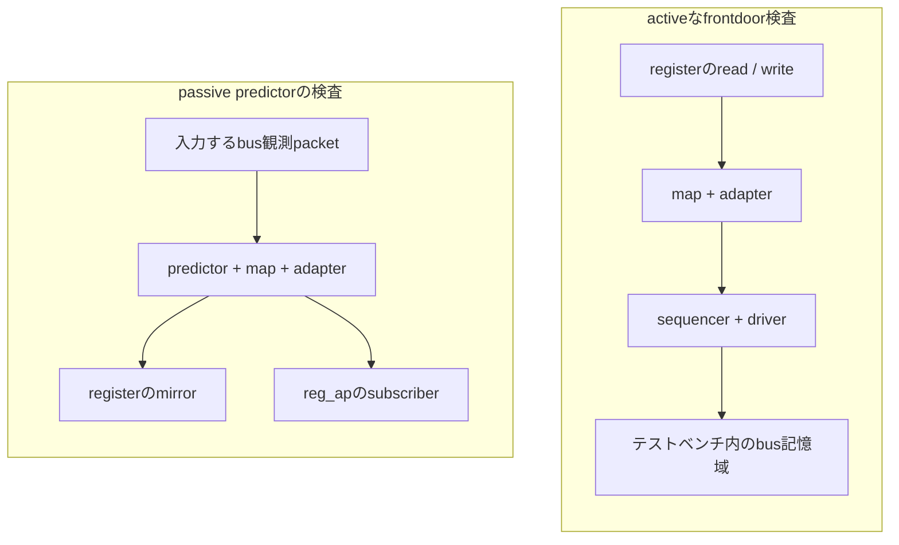

# FAQ

[English](faq.md) · [README](../README.ja.md) · [用語集](glossary.ja.md)

現在のランナーの動作を説明します。件数と測定範囲は[README](../README.ja.md#現在の実行結果)、
個別の制約は[既知差分](known-differences.ja.md)にまとめています。

## 最初の実行

### Q1. kirimasim-testsとの違いは何ですか

kirimasim-testsはIEEE 1800-2023のSystemVerilog言語を検査します。
こちらはシミュレータが固定版UVMライブラリを実行したときの動作をIEEE 1800.2-2020と照合します。
UVMの不一致を言語だけで再現できる最小例はkirimasim-testsに置きます。
UVMの不一致にはシミュレータ・ライブラリ・テストそれぞれの可能性があります。

### Q2. 必要な環境とUVMの取得元は何ですか

Python 3.10以降と、UVMを実行できるシミュレータが必要です。固定版のoracleはVerilator 5.052です。
モデルのビルドにはC++ツールチェーンとmakeも必要です。
Ubuntuでの準備は[Checkのworkflow](../.github/workflows/check.yml)にあります。

`python3 tools/fetch_uvm.py`で、lockに指定したAccellera UVMを取得します。
`python3 tools/fetch_uvm.py --check`は取得済みのファイル数と内容の指紋を照合します。
ライブラリは取得するもので、このリポジトリにはコミットしません。

### Q3. まず1件だけ動かすにはどうしますか

Verilator 5.052をPATHに置き、リポジトリのrootから実行します。

```sh
python3 tools/fetch_uvm.py
python3 tools/run_verilator.py --seeds 1 73 --build-jobs 2 -j 1 \
  --json out/verilator-smoke.json tests/u09/test_common_phases_run_in_order.sv
```

`--seeds`は複数の値を受け取るため、例のようにseedの後、テストのパスより前に`--build-jobs`などの
optionを置きます。パスを明示した場合は、そのテストだけが対象です。これは全件実行ではなくスモークテストです。

### Q4. specのみのテストも含めるにはどうしますか

パスを指定しないVerilator実行は、X・Zに依存せず`verilator@5.052`のタグがあるテストを選びます。
すべての2値のテストを含めるには`--all`を付けます。

```sh
python3 tools/run_verilator.py --all --seeds 1 73 --build-jobs 2 -j 2 \
  --json out/verilator-all.json
```

kirimasimとGhostは既定で全件を選びます。`--all`はVerilatorランナーのoptionで、他のランナーの共通optionではありません。

## 結果の読み方

### Q5. pass・fail・known・unsupportedはどう違いますか

| ステータス | 意味 | 記録するランナー |
| --- | --- | --- |
| `pass` | 期待出力と、必須の終了・診断の条件が一致 | 3つのランナーすべて |
| `fail` | 出力などの条件が合わない、またはビルド・実行に失敗 | kirimasim・Ghost、oracleタグ付きのVerilator |
| `known` | oracleタグのないVerilatorケースの不一致やビルド・実行失敗。成功には数えない | Verilatorのみ |
| `unsupported` | 所定の未対応診断と終了コードを返した | kirimasimのみ |

Ghostの不一致は、同梱ライブラリの差も含めて`fail`として記録します。
kirimasimでも、それ以外のコンパイル失敗は`fail`になる場合があります。
失敗したテスト数を、そのまま異なる不具合の個数と解釈しないでください。

### Q6. KNOWNがあるのにVerilatorコマンドが成功するのはなぜですか

終了コードは、固定版oracleタグ付きのテストの回帰を検出するためのものです。
タグのないテストの不一致はJSONに`known`として記録し、コマンドを失敗させません。
タグがなくても一致すればJSONでは`pass`ですが、端末のoracle付きテストの分母には含めず、
タグも自動では追加しません。kirimasimは`fail`・`unsupported`、Ghostは`fail`があれば失敗終了します。
終了コードだけでなく、JSONの分類も確認してください。

### Q7. なぜUVMの全メッセージを比較せずUT行だけを比べるのですか

UVMの既定の表示形式・パス・行番号・時刻の形式は変わり得ます。
ランナーは行頭が正確に`UT: `で始まる行だけを選び、順序・空白・値を保持して比較します。
テストはreport件数など、規格が定める動作をこの行で観測し、必要なら終了・診断の条件も指定します。
[何を観測するか](../README.ja.md#何を観測するか)を参照してください。

必須のUVMエラーを起こす操作を意図的に行い、その件数を確認するテストもあります。
そのエラーだけで失敗にはならず、要求する観測結果と終了条件で判定します。

### Q8. specのみの期待値をライブラリの出力に合わせないのはなぜですか

期待値の根拠は規格で、ライブラリやシミュレータの差によって変更しません。
現在はtransactionの初期状態、無効なfield_opのアクセス、report reset、objector一覧、
応答の制御、USER arbitrationなどをspecのみで保持しています。
phaseの子タスク終了の差分は、シミュレータとライブラリのどちらが原因か未確定です。
対象範囲とテストへのリンクは[既知差分](known-differences.ja.md)にあります。

### Q9. Checkが緑ならkirimasimでもUVMが成功したということですか

[Check](../.github/workflows/check.yml)はメタデータ・ツール・固定版ライブラリ・Verilatorのoracleを検査します。
kirimasim・Ghostは実行せず、specのみの一致も成功条件にはしていません。
現在のkirimasimの記録では、大半が`uvm_object_wrapper`未実装で停止し、残りはそれより前に
ライブラリAPIの欠落で失敗します。いずれも、そのコンパイル上の障害より後の動作を検査できた結果ではありません。

### Q10. Nightlyや公開の結果ダッシュボードはどこにありますか

このリポジトリには、現在Nightlyや結果の自動公開はありません。バッジはCheckとライセンスへリンクします。
kirimasim-testsには独自のNightlyがありますが、こちらのUVMスイートの結果ではありません。
`out/`のJSONは明示的に共有するまではローカルのもので、テストをpushしても自動では公開しません。

## 実行条件

### Q11. Ghostの結果は何を確認し、なぜ仮名なのですか

Ghostは公開前のシミュレータの仮名です。実行ファイルの識別情報・版・パス・profile・診断は非公開にし、
公開JSONには一般化した理由と内容の指紋を使います。

| モード | UVMの供給元 | 結果が対象にする組み合わせ |
| --- | --- | --- |
| `pinned` | ランナーが固定版をコンパイルし、profileで同梱UVMの自動読み込みを無効にする | シミュレータと固定版ライブラリ |
| `bundled` | profileでライブラリのtreeを供給するか、UVMの組み込みを宣言する | シミュレータと供給されたライブラリ。固定版での実行証拠にはならない |

同梱版の識別にはtreeの指紋または組み込みの宣言を使います。
同梱版の不一致だけでシミュレータとライブラリのどちらが原因かは決まりません。
[Ghostの設定](../README.ja.md#ghost)を参照してください。

### Q12. uvm_dpi: yesだけでDPIを使うビルドが完成しますか

既定のマクロ一覧から`UVM_NO_DPI`を外す指定です。UVMのC/C++実装の供給・リンクは行いません。
現在のVerilatorランナーはそのソースを追加しません。現在の全テストは`UVM_NO_DPI`を使っており、
DPIに依存するテストを実行証拠にするには、対応する実装と実行環境が必要です。
DPIなしのglobによる照合も、完全な正規表現への対応とは異なります。

### Q13. ビルドが重い理由と2種類の並列数の違いは何ですか

各テストのモデルにUVMパッケージ全体を含めるためです。`-j`は同時に実行するテスト数、
`--build-jobs`はVerilatorの各C++ビルド内の並列数です。`--seeds`ならビルドは一度で、
seedごとに新しいプロセスを使います。事前コンパイル済みヘッダーにビルド先の絶対パスが入るため、
そのまま別の場所へ再利用できないccacheはランナーのビルド環境で無効にしています。

### Q14. seedを2つ変えれば決定性や4値の動作も証明できますか

できません。seed 1・73は、乱数を使う初期化条件を変えて固定版の期待値を確認するもので、
乱数そのものは表示しません。Verilatorの既定の対象からはX・Zに依存するテストを除きます。
2値の実行は4値の動作の確認にはならず、2つのseedの成功ですべての実行の正しさも示せません。
複数seedのテストは最初の不一致で止まるため、実行時の既知差分はseed 1の記録で、seed 73の結果ではありません。
ビルドできないケースには、実行時のseed結果がありません。

### Q15. 過去の結果を現在も使えるか、どう確認しますか

テスト入力とランナーの指紋、設定、シミュレータの版、ライブラリの識別情報を比較します。
JSONには`inputs_sha256`・`runner_sha256`・`runner_changed`・`configuration`・`generated_at`を記録します。
実行中に入力が変わったテストは、有効な入力指紋の代わりに`inputs_changed`を記録します。
Ghostはさらに実行ファイル・profile・供給されたライブラリの指紋を記録します。
条件が変われば新しい証拠が必要です。同じ条件の結果は出所を残して合算できますが、
全件を一緒に再ビルドしたという意味にはなりません。

## 範囲・照合・修正

### Q16. M1・M2・M3は完了していますか。件数は何の網羅を示しますか

M1・M2には条項ごとの目標に未達があります。M3はbusモデルのfrontdoor経路を含め72件まで追加した段階で、未完です。
次の段階の開始によって、それまでの段階が完了したとは扱いません。
範囲と残りの作業は[進め方](../README.ja.md#進め方)にあります。
件数はテストの本数で、規格の全要求や組み合わせの棚卸しではありません。
引用条項だけでは要求の網羅は示せず、要求台帳と分母の承認はM4の作業です。

### Q17. spec_check: aiは人によるレビューや証明を意味しますか

AIが引用した規格と期待値を照合した記録です。人によるレビューや全要求の証明ではありません。
現在は全テストがこの値です。固定版シミュレータでの再現は、別の`:oracle:`に記録します。

### Q18. 期待値の誤りはどう報告・修正しますか

テスト、引用した条項、期待する観測、実行条件を特定します。テストに必要な修正と、シミュレータや
ライブラリの差分を分けて扱い、Ghostの非公開情報を守ります。修正後はメタデータとツールを検査し、
固定版のoracleは両seedで再現します。[テストの追加・修正](../README.ja.md#テストの追加修正)を参照してください。

照合に使うIEEEのPDFはローカルに置き、Gitの対象にしません。本文や例を転載せず、自分の言葉で
動作を説明して条項番号を引用します。UVMライブラリはApache-2.0で別に取得します。
このスイートのライセンスはApache-2.0 WITH LLVM-exceptionです。

## lockとnonblocking transport

### Q19. lockとgrabはどう違い、所有者がblockedになることはありますか

lockは通常の要求の仲裁に加わり、grabは先頭に入ります。どちらも、互換性のないlockやgrabが
取得を妨げている間は待ちます。親がlockを持ったままでも、子の所有によって親が一時的に
blockedになる場合があります。`has_lock`と`is_blocked`を別々に確認してください。
入れ子の所有で現在実行できるsequenceは`current_grabber`が示します。

現在のテストは所有、子の解放による復帰、待機中の取得、実際のdriverへのitemの排他を検査します。
先に待っているFIFO要求を追い越さないことと、取得済みitemの完了を待つことの2件は、specのみで保持します。
固定版ライブラリではlockを早く付与してしまうためです。[既知差分](known-differences.ja.md)を参照してください。

### Q20. nonblocking transportはどうやって即時に応答できますか

受理した要求のanalysis通知を同期的に受けたtargetが、その場で応答を計算し、
`nb_transport`から戻る前にresponse put portへ書き込めます。テストはこの経路を公開APIで接続し、
呼び出し後に受理済みの要求を回収して容量を再利用します。

即時完了できない場合の戻り値は0です。期待値では、その出力引数の値や、要求の一部がキューへ
入ったかは指定しません。再実行のテストは`try_get`で残った要求があれば回収し、
その成否自体は検査せず、新しいtransactionを実行します。

### Q21. killされたsequenceのbodyやhookはどうなりますか

実行中のbodyを停止し、状態を`UVM_STOPPED`にして、待っている`start`を復帰させます。
sequencerの要求や所有も後処理します。規格は停止hookの`do_kill`に加えて、`post_body`・`post_start`も
実行するように定めています。固定版はこの2つのpost hookを呼ばないため、sequencerあり・なしの
テストで必須動作をspecのみの期待値として保持します。

直接のkillによる自動objectionのdropと、`stop_sequences`後のsequencerの再利用も検査します。
stopでも自動objectionを解除する必要がありますが、固定版のrootを停止する経路ではdropしません。
単独・親子のケースで必須動作をspecのみで保持します。[既知差分](known-differences.ja.md)を参照してください。
この操作で破棄されたdriver保持中の要求には後から完了通知せず、新しい要求を取り出してから、
その要求について`item_done`を呼びます。

### Q22. default phase sequenceはどう選ばれますか

phase開始時に、sequencerの完全名とphase名のscopeで`default_sequence` resourceを検索します。
例は`uvm_test_top.sequencer.main_phase`です。対象の型は`uvm_sequence_base`と`uvm_object_wrapper`です。
優先度でresourceを選び、選択したnullは無効化を示します。instanceはそのまま使い、wrapperは
sequencerのパスとwrapper型名を生成の文脈にしてfactoryを呼びます。

sequencerと開始phaseを設定し、無効化しない限りrandomizeしてから実行します。
phase終了時も実行中ならkillします。wrapperがsequence以外を生成した場合は、エラーを出して
defaultを開始しません。固定版はwarningだけを出すため、必須エラーをspecのみで保持します。

### Q23. 終了・停止したsequenceへ遅れて応答が来たらどうなりますか

元のsequenceが`UVM_FINISHED`または`UVM_STOPPED`なら、`put_response`は応答を捨ててwarningを出します。
実際の要求からIDをコピーしてからsequenceを終了させ、warningと不達の両方を検査します。
queueは時間を区切って待ち、handlerは呼ばれないことを確認します。別の生存sequenceへの応答は、
1つのsequenceをkillしても正常に届く必要があります。

transaction IDだけが配送の識別情報ではありません。新しいsequenceでそのIDを再利用しても、
停止したsequenceへの古い応答が混入してはいけません。この検査は遅れた配送を対象とし、
stop前にすでに配送された応答の消去を含む、あらゆる後処理を検証したとは扱いません。

### Q24. defaultに指定したinstanceはwrapperより必ず優先されますか

されません。`uvm_sequence_base`と`uvm_object_wrapper`のresourceだけを残し、最高のprecedenceを選びます。
同じならlookupのキューに残った最初の要素を使います。不適合な型を除いても、有効な要素同士の
相対的な順序を保つ必要があります。無関係な型のnull `uvm_object`は除外し、受け入れる型の
選択されたnullだけがdefaultを無効化します。

同一優先度のテストは別々のresourceを作り、公開pool APIの低優先度の追加で順序を明示しています。
同じ設定を更新する場合がある`config_db::set`の繰り返しから、キュー順を推測していません。

### Q25. TLMのdelay annotationを変えるとシミュレーション時刻も進みますか

annotationはoffsetを持つobjectで、その変更だけでは待機しません。targetは同じシミュレーション時刻で
注記を増やして返すことも、blocking実装の処理として明示的に待つこともできます。
テストは注記値とシミュレーション時刻の同一性を別々に確認します。絶対変換は1単位の秒数を明示し、
scaled操作は対応するtime literalを使います。テストの100秒のscaleは変換の基準で、100秒待つ指定ではありません。

realは小さな許容差で比較し、resolution未満の丸め・負の時刻・浮動小数点の内部表現は指定しません。
固定版の既定名とsetter欠落は[既知差分](known-differences.ja.md)に残します。
setterのケースはビルド不可であり、seedを実行して失敗した結果ではありません。

### Q26. 二段socketのbackwardをテスト内で接続し直さないのはなぜですか

nonblocking socketの`connect` APIがbackwardを自動で接続するためです。手動の接続ではその動作を
迂回してしまうので、二段initiatorは規格の経路を保持します。固定版では2つのbackward exportの
接続方向が逆になり、binding検査に失敗します。forwardは子portから親portへの正しい階層を使っています。

他の経路の成功は、そのtransactionについてpayload・delayの同一性、注記、戻り値、phase参照の伝搬を
確認した結果です。protocolやtimingのあらゆる合法な組み合わせを保証しません。
callback iteratorも、位置の整数値を決めつけず、公開APIで走査・再開します。

## push転送・sequence操作・payloadのpack

### Q27. push sequencerのitemはいつ完了しますか

IEEE 1800.2-2020の15.6.3.3では、driverのblocking `put`から戻った後に、sequenceの
item完了待ちが戻ります。push driverはpull portの`item_done`を使いません。
正の遅延を使うテストでは、`put`が処理中の間は`finish_item`が戻らないことを確認します。
別のテストで3要求の転送と、共通APIの要求・応答履歴を確認します。
固定版ライブラリの複数要求に関する制限は[既知の差分](known-differences.ja.md)に記録しています。

### Q28. sequence操作マクロはすべて引数を乱数化しますか

`uvm_create`はitemや子sequenceの生成とcontext設定だけを行います。
`uvm_send`は乱数化せず実行し、`uvm_rand_send`は乱数化してから実行します。
ただし子sequenceの乱数化が無効なら、その乱数化を省略します。
`uvm_do`は生成と乱数化付きの実行を組み合わせます。子sequenceは`call_pre_post`を0にして
開始するため、`body`は実行しますが、`pre_body`と`post_body`は呼びません。
テストでは解が1つの制約とcallback回数を使い、乱数の選択による期待値の変化を避けています。

### Q29. generic payloadのpackには何が含まれますか

規格で順序を定めたscalarフィールドと、data・byte-enableの有効長までのbyteを含みます。
配列の余分なbyteやextensionは、既定のpack対象ではありません。
有効長より配列が短い場合はfatalを報告します。そのテストはreport catcherがfatalを観測した時点で
終了し、fatalを抑制した後の実行については期待値を定めません。
往復変換と公開packer APIでの読み出しを使い、特定のバイナリ表現に依存しないようにしています。

## sequence libraryとマクロの制御

### Q30. libraryのinstance登録とtypewide登録はどう違いますか

`add_sequence`と`add_sequences`は1つのlibraryへ登録します。staticのtypewide版は、
以降に生成するlibraryへ反映され、既存instanceは変更しません。重複する型は警告なしで無視します。
`get_sequences`は呼び出し元のqueueの既存要素の後へ一覧を追記します。
テストは型の所属を比較し、明記されていない挿入順を決めつけません。

削除は別の規則です。static登録された型を削除した場合は全instanceを更新し、未登録の型を
削除した場合はwarningを出します。固定版は呼び出したinstanceだけから削除し、未登録時のwarningも
出しません。どちらも[既知差分](known-differences.ja.md)に規格の期待値を保持します。

### Q31. sequence libraryの一部テストがseed実行前に失敗するのはなぜですか

IEEE 1800.2-2020には、選択mode・乱数化回数の下限と上限を設定・取得するAPIと、
`get_num_sequences_executed`があります。固定版にはこの7つのmethodがありません。
6件は規格の呼び出しを保持するためビルドできず、実行時のseed結果を持ちません。
必須APIを旧来の公開fieldへ置き換えません。登録や選択hookの直接呼び出しが成功しても、
実行modeや実行回数の適合を確認できたことにはなりません。

### Q32. itemの乱数fieldを無効にすると乱数化callbackも省略しますか

fieldの`rand_mode(0)`はその変数の値を維持しますが、itemの`randomize`はcallbackを呼びます。
子sequence全体の乱数化を無効にした場合は、操作マクロが`randomize`の呼び出し自体を省略します。
テストはこの違い、生成時のfactory置換、乱数化とdriver転送を囲む親のhook順序を確認します。
型付きsequencerの宣言を検査するケースは、明示的なcast後にsubtypeのmemberへアクセスし、
自動的な初期化方針を仮定しません。

## 低水準のsequence送信とtransportの委譲

### Q33. grant・送信・item完了はどの順に行いますか

itemのcontextを設定した後、`wait_for_grant`を呼び、シミュレーション時間を進めずに
`send_request`を呼びます。その後、必要なら完了を待ちます。既定の送信は乱数化せず、
rerandomize引数を1にした場合はdriverへ渡す前に乱数化します。

完了は`item_done`、または`get`の暗黙の通知で伝わります。特定のtransaction IDの待機は
その完了通知より前に開始する必要があり、後から待つと停止したままになる場合があります。
[2要求のケース](../tests/u14/test_sequence_wait_for_item_done_matches_each_explicit_transaction_id.sv)は
個別に完了を通知し、2つ目のitemを保持している間の状態を観測します。完了通知自体は応答を供給しません。

### Q34. 分割したmaster／slave impの呼び出しはどのcomponentが処理しますか

impのconstructorの要求側・応答側引数が、実装する兄弟componentを選びます。
親はimpを所有しますが、転送methodを実装する必要はありません。
masterは要求を書いて応答を読み、slaveは要求を読んで応答を書きます。読み出しにはpeekも含みます。

[masterの混在操作ケース](../tests/u12/test_master_combined_imp_routes_mixed_operations_to_split_implementations.sv)は
要求をint、応答をstringとし、blocking・nonblocking操作と独立した領域の再利用を検査します。
別のケースでexport経由、利用可否、容量を確認します。失敗した読み出しの未規定の出力値は検査しません。

### Q35. 通常のTLM 2 exportもbackwardを自動接続しますか

通常のforward・backward経路は個別に接続します。portからexportの連鎖を通ってimpへ到達すると、
指定した実装が呼ばれます。往復のテストは両方向を明示的に接続し、socket接続の副作用には頼りません。

[custom型のforwardケース](../tests/u12/test_tlm2_nested_forward_exports_preserve_custom_transaction_and_phase_types.sv)は
独自のtransactionとphase enumを2つのexportへ渡します。handleの同一性、型付きphase参照の更新、
annotationを確認します。この汎用接続の結果だけで、あらゆるphase・timingの組み合わせが
base protocolとして合法であることを示すものではありません。

## FIFOの通知と実行対象の指定

### Q36. FIFOをpeekしたときもget_apへ通知しますか

IEEE 1800.2-2020の12.2.8.1.6はget操作だけでなく、`peek`と成功した`try_peek`も含めています。
peekはitemを残すため、通知は取り除いたことを意味しません。2つのpeekケースは、消費する前に2回の
通知を観測します。固定版は両方のpeek通知を省略するため、必要な件数を
[既知差分](known-differences.ja.md)に保持します。

別のケースで複数subscriberへの配信、受け入れたput、成功したget、objectの同一性を検査します。
失敗した読み出しの出力値は検査せず、利用できなかった転送は通知件数に加えません。

### Q37. start_itemはどのsequencerと優先度を使いますか

明示的なsequencer引数、itemのsequencer、実行中sequenceのsequencerの順で選びます。
[3つのcontextのケース](../tests/u14/test_sequence_start_item_explicit_sequencer_overrides_item_and_parent_context.sv)は
別々のsequencerとdriverで選択した経路を確認します。優先度が非負ならsequenceの値を上書きし、
負なら-1以外の値でもsequenceから継承します。

nullのitem、`is_item`が0のsequence、3つのsequencer候補がすべてない場合は、ERRORと即時のreturnが
必要です。固定版はFATALを使います。テストはreport catcherで元の重大度を数え、必要なERRORを
[既知差分](known-differences.ja.md)として保持します。

### Q38. 外部objectを指定したマクロはどのcallbackを実行しますか

`uvm_do_obj_callbacks`とそのexit-on版は、渡したobjectを使います。呼び出し元のdispatcherだけに
登録したentryは含めず、適用されるtypewide・指定instanceのentryを実行し、無効なentryは飛ばします。
[contextを切り替えるケース](../tests/uB/test_callback_object_macro_switches_between_explicit_external_contexts.sv)は
1つのdispatcherから2つの外部objectを呼び、それぞれの実行対象を確認します。

exit-onのテストは、trueまたはfalseの最初の一致で停止することを確認します。一致しない場合は、
走査や呼び出しがないことを検査し、関数の不一致時の戻り値や後続文へ進む方針は指定しません。

## TLM実装宣言マクロ

### Q39. imp宣言マクロのsuffixは何を変えますか

別のimp classを生成し、対応する名前の実装methodを選びます。接続したportのinterfaceは変わらず、
たとえば`put`が`_left`のimpを通って`put_left`へ届きます。componentはsuffixなしの`put`を持たずに、
2つの実装を公開できます。

[両対応putのケース](../tests/uB/test_tlm_put_imp_decl_routes_two_suffixes.sv)はblocking・nonblockingの
呼び出し、満杯時の拒否、領域を空けた後の成功を検査します。宣言のケースはAnnex B.5の22系列を、
独立した2つの入力名で検査します。不正な接続やschedulingのあらゆる組み合わせを保証しません。

### Q40. 生成したmaster impでも要求と応答を別objectへ委譲できますか

`REQ_IMP`・`RSP_IMP`は型を表し、constructorの`req_imp`・`rsp_imp`は実際の兄弟instanceを
指定します。suffixはそのobject上のmethod名に付きます。
[分割実装のケース](../tests/uB/test_tlm_master_imp_decl_delegates_suffixed_methods_to_split_sibling_implementations.sv)は
intの要求とstringの応答を使い、親には転送methodを設けません。
blocking・nonblockingの両方で、正しい兄弟とsuffixへ届く必要があります。

別のanalysisケースでは、suffix付きwriteへ元のclass handleを渡します。同一性と入力別の件数を
比較し、暗黙の複製やtransactionの変更は要求しません。

### Q41. B.5.11のケースでget／peekのマクロ名を使うのはなぜですか

見出しは`uvm_nonblocking_get_peek_imp_decl`で、本文もnonblocking get／peek両対応のclassを
説明しています。一方、呼び出し例はB.5.8と同じpeek専用の表記です。
[B.5.11のケース](../tests/uB/test_tlm_nonblocking_get_peek_imp_decl_routes_two_suffixes.sv)は見出しと
説明されたclassに従う解釈で、getとpeekの両方を呼びます。

この解釈はテストのコメントに記録し、レビュー項目として残します。固定版での一致は再現の記録であり、
規格の表記の不一致を解消したり、人のレビューに代わったりはしません。
現在の他のテストと同じく、`spec_check: ai`を保持します。

## libraryの構築・itemの完了・extensionの識別

### Q42. libraryの構築直後にstatic所属を検査するのはなぜですか

規格のsubtypeの例はutilitiesマクロと、`super.new`を呼ぶconstructorを使っています。
その型やbaseにstatic登録したmemberは、構築後に利用できる必要があります。4件で2つのinstance、
2種類のlibrary、継承、static所属と並ぶinstance内の追加を検査します。

固定版はこれらのsubtypeの一覧を構築時に取り込みません。テストは公開の一覧を使い、実装固有の追加の
初期化methodを呼びません。[既知差分](known-differences.ja.md)を参照してください。
別の成功ケースはinstance登録と既定のRANDで10回の子の実行を確認します。選択変数への単一解の制約で、
乱数の分布や登録順への依存を避けています。これで欠落したAPIが検証済みになるわけではありません。

### Q43. driverへ要求が届いてもfinish_itemの呼び出しを観測するのはなぜですか

14.2.6.3はsequenceのvirtualな`send_request`・`wait_for_item_done`を呼び、再乱数化を0にし、
itemの明示的なtransaction IDを待機へ渡すことを定めています。固定版はsequencerを直接呼び、
完了IDに-1を使います。テストはvirtual methodの実行と引数の伝搬を区別します。
追加の3つの不正入力ではERRORと即時のreturnが必要ですが、固定版の経路は参照時に終了する場合があります。
これらはAPI欠落のビルド失敗ではなく、[既知差分](known-differences.ja.md)に記録する実行時の差分です。

[hook順序のケース](../tests/u14/test_sequence_finish_item_orders_mid_mutation_before_send_and_post_after_ack.sv)では、
mid-doの変更が送信時に見え、post-doが遅延した完了通知を観測することも確認します。
catcherは重大度を書き換えずに数え、fatal後の継続の方針は指定しません。

### Q44. extensionのtype keyはinstance名と同じですか

`uvm_tlm_extension_base::get_type_handle`が返すkeyはextensionの型を識別します。
同じ型のinstanceは改名後もkeyを共有し、異なる型はinstance名が同じでも別のkeyを持ちます。
type-handle名は特定の修飾形式を要求せず、同じ型での安定性と別の型との相違を比較します。

payloadへの登録・置換・削除はその不透明なkeyを使います。
[短いaliasのケース](../tests/u12/test_tlm2_gp_alias_shares_payload_and_polymorphic_extension_state.sv)は、
`uvm_tlm_gp`と`uvm_tlm_generic_payload`のhandleが同じpayloadの登録状態を見ることも確認します。
型の数値IDや暗黙のcloneは要求しません。

## レジスタモデルの基本

### Q45. set・predict・resetはDUTへアクセスしますか

M3の初回はモデル内の操作です。desiredはモデルが書き込みたい値、mirroredはモデルが現在記録している値です。
今回の表では処理中ではないfieldを使い、predictionの種類は`UVM_PREDICT_DIRECT`とします。

| 操作 | desired値 | mirrored値 | DUTへのアクセス |
| --- | --- | --- | --- |
| `set(value)` | 設定したaccess policyを適用 | 変えない | なし |
| `predict`（DIRECT） | 計算値に置き換える | 計算値に置き換える | なし |
| `reset(kind)` | その種類のreset値があれば復元 | その種類のreset値があれば復元 | なし |

ROの`set`はdesiredを変えず、W1Cの`set`は指定した1のbitをdesiredから消します。
直接のpredictionはaccess policyにかかわらず値を更新し、値を設定していない種類のresetはfieldを変えません。
`needs_update`は書き込み可能なdesired値との整合を取る必要があるかを調べるもので、それ自体は転送しません。
[fieldのset](../tests/u18/test_reg_field_set_changes_desired_without_predicting_mirror.sv)と
[再帰reset](../tests/u18/test_reg_block_reset_recurses_into_child_registers.sv)はbusやHDL backdoorなしで状態を観測します。

### Q46. mapのアドレスはbyte単位ですか。配列が逆順になるのはなぜですか

アドレス単位は`byte_addressing`で決まり、有効なら1 byte、無効なら設定したbus幅です。
registerのlocal offsetと、外部から見た物理アドレスは別の値です。
[word単位のケース](../tests/u18/test_reg_map_word_addressing_translates_offsets_in_bus_units.sv)では、
複数回のbus転送に対応する連続したwordアドレスを確認します。

`get_addresses`は、データの下位側から順に物理アドレスを返します。
big endianのmapでは数値として降順になる場合があります。
[little endian](../tests/u18/test_reg_map_little_endian_wide_register_lists_addresses_in_data_order.sv)と
[big endian](../tests/u18/test_reg_map_big_endian_wide_register_lists_addresses_in_data_order.sv)のケースは、
6 byteのregisterを2 byteずつの3回へ分けます。submapは親へのoffsetを加え、rootまでの最小bus幅を使います。
これらはアドレスの計算であり、実際のbus転送は行いません。

### Q47. M3の初回で何を検査していますか

第18章にfieldを8件、register／blockを8件、mapを8件の計24件を追加しました。
field名検索とmapの幅・変換結果の4件はspecのみで保持し、lock前のケースにはlock後の比較も加えます。
構築、fieldのpolicyと配置、resetの種類、desired／mirrored値、再帰resetとlock、
mapの単位・権限・endian順序・再配置・階層を検査します。

以後の追加でmemory・policy・mapと、下記のadapter・predictor・busモデルのfrontdoorを検査しています。
memoryの転送やvirtual register、追加のpolicy／mapやbus／predictorの組み合わせ、
backdoor／DPIの環境、register callback、付録Eのsequenceは今後の作業です。
register・memoryのmap検索では引数を明示します。配布物の複数mapに関する注記とnull時のmap解決は
[既知差分](known-differences.ja.md)で説明します。
全件が`spec_check: ai`で、初回の追加をレジスタ層の要求の網羅としては扱いません。

## memory・prediction・mapの制御

### Q48. memoryもregisterのようにmirrorを持ちますか。offsetは何を表しますか

`uvm_mem`は連続したlocationを表しますが、全locationのmirror値は保持しません。
構築時にlocationの数とbit幅を記録し、1 locationのbyte幅は端数を切り上げます。
現在のmemoryテストは配置とアドレスを調べ、memoryのデータを読み書きしません。

location番号が変わるとlocal offsetと外部アドレスも変わります。byte単位の2 byte locationは2ずつ、
4 byte bus上のword単位の4 byte locationは1ずつ進みます。
固定版の`get_offset`はlocationを使わないため、[locationのoffset検査](../tests/u18/test_mem_location_offsets_include_the_location_index_stride.sv)は
規格の期待値を保持し、外部アドレスが進むことも別に観測します。

非共有memoryの権限問い合わせは18.6.4.5のRWです。実効accessの問い合わせは別で、18.6.4.6に従って
指定mapの制限を反映します。[単一mapのaccess検査](../tests/u18/test_mem_intrinsic_readonly_policy_and_map_rights_are_distinct.sv)は
この区別を既知差分として保持します。

[2つのinterfaceのケース](../tests/u18/test_mem_two_interface_maps_preserve_membership_addresses_and_rights.sv)では、
明示したmapへの所属、独立したアドレスとRO／WO権限、エラーがないことを検査します。
この結果が対象とするのは兄弟mapの構成です。共有mapの階層や配布物の複数mapの注記は、別途照合が必要です。

### Q49. READ／WRITE predictionはbus転送を実行しますか

predictionは計算値や観測値をモデルへ渡す操作です。`UVM_PREDICT_DIRECT`はpolicyの効果を適用せず値を写し、
READ／WRITEは観測した操作に応じた効果を適用します。fieldのprediction検査は観測値を模擬し、driverやDUTは動かしません。

READ predictionは読み出し後のRCを0、RSを全bit 1にします。
WRITE predictionはW1C／W1S／W1Tで1のbitを消去・設定・反転し、W0C／W0Sでは0のbitを使います。
2回の操作で前の状態を引き継ぐことも確認します。
[write-onceのケース](../tests/u18/test_reg_field_write_once_prediction_rearms_only_after_hard_reset.sv)は、
SOFT resetが設定値を復元しても書き込み保護を維持し、HARD resetが次の初回書き込みを許すことを調べます。
各ケースでdesiredとmirroredの両方を観測します。

### Q50. 新しいmapの制御では何を検査しますか

registerとmemoryの再配置で、物理アドレスとlock済みの検索結果が更新されることを検査します。
検索のケースはroot baseを0にします。同じアドレスのRO／WO registerは読み書きの方向で選び分け、
fieldとmapの権限が矛盾する場合はNOACCESSになります。いずれもbus転送を伴わないモデルの問い合わせです。

mapの`reset()`の既定値はSOFTで、register・fieldのHARDとは異なります。
[map単位のreset](../tests/u18/test_reg_map_reset_defaults_to_soft_and_preserves_other_maps_registers.sv)では、
別mapのregisterが変わらないことも確認します。不正入力の検査は元の重大度、必須の戻り値、呼び出し元の配列の維持を観測します。
auto-predictの検査はmapごとのmode flagだけを扱い、下記のfrontdoor検査ではbusモデルの読み書きに伴う効果も確認します。

## adapter・predictor・frontdoorの経路

### Q51. adapterと操作記述子では何を検査しますか

7件で標準TLM adapterのcommand・address・byte長・独立した生成・byte enable・成功／エラー応答の変換・
callback外のcontextを検査します。同じdata byteを使って数値上のbyte順を固定せず、失敗したreadのdataも指定しません。
[操作の値配列](../tests/u19/test_reg_item_value_array_resize_preserves_prefix_and_zero_fills_growth.sv)は、
19.1.1.2.4の既定サイズ、既存要素の維持、拡張や縮小後の再拡張で新しい要素が0になることを確認します。

activeなcontext検査では、`reg2bus`内で`get_item`を読み取り、register・map・extension・操作種別・doorを観測します。
返されたitemは変更しません。callback外では`bus2reg`内も含めてnullである必要があります。

### Q52. passive predictorとfrontdoorのauto-predictionはどう違いますか

別々の検査系を使います。frontdoorはsequencer／driverを通じてregisterアクセスを開始し、
passive側はmap・adapterを設定したpredictorへ、analysis portから観測packetを入力します。



predictorはRW／RO・RC／W1Cの効果、公開する操作の情報、両endianでの幅の広いregisterの組み立て、
memoryと未登録アドレスの無視を検査します。必要なbus wordが揃うまでは公開しません。
hookの転送先変更は19.3.3.2の転送先と値の変更を期待値に保持します。[既知差分](known-differences.ja.md)を参照してください。

### Q53. frontdoorはRTLのDUTやbusの全組み合わせを検査しますか

テストベンチ内の記憶域モデルと実際のsequencer／driver接続を使い、正の遅延後に完了を通知します。
auto-predictionの有効／無効、別のresponse item、狭いbusへのwriteの対応関係、adapter contextを検査します。
addressとdataの対応を確認し、規定されていない転送順序は要求しません。
big endianの幅の広いreadは標準TLM adapterを使い、同じpayload byteから値を復元する規格の期待値をspecのみで保持します。

RTLのDUTやDPIを使わない、選択したUVM経路の検査です。実際のbus信号protocol、より広い応答・エラー・timingの
組み合わせ、memory転送、monitorとpredictorをつないだ実転送は今後の作業です。
