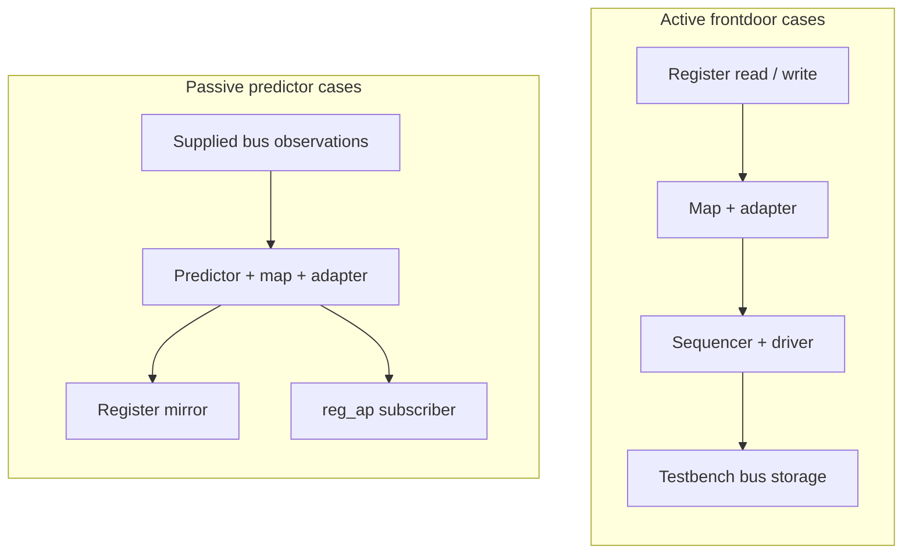

# FAQ

[日本語](faq.ja.md) · [README](../README.md) · [Glossary](glossary.md)

This guide describes the current runners. Counts and measurement scope are
kept in the [README](../README.md#current-results); specific limitations are
in [known differences](known-differences.md).

## Getting started

### Q1. How does this differ from kirimasim-tests?

kirimasim-tests checks SystemVerilog language behavior against IEEE 1800-2023.
This suite checks UVM behavior against IEEE 1800.2-2020 while a simulator runs
the pinned UVM library. A language-only reproduction of a UVM failure belongs
in kirimasim-tests; a UVM mismatch may involve the simulator, library or test.

### Q2. What do I need, and where does UVM come from?

Use Python 3.10 or later and a simulator able to run UVM. The fixed oracle is
Verilator 5.052, whose model builds also require a C++ toolchain and make.
The [Check workflow](../.github/workflows/check.yml) contains its Ubuntu setup.

Run `python3 tools/fetch_uvm.py` to fetch the locked Accellera UVM release.
`python3 tools/fetch_uvm.py --check` verifies the existing tree against its
file count and content digest. The library is fetched, not committed.

### Q3. How can I run one test first?

From the repository root, with Verilator 5.052 on PATH:

```sh
python3 tools/fetch_uvm.py
python3 tools/run_verilator.py --seeds 1 73 --build-jobs 2 -j 1 \
  --json out/verilator-smoke.json tests/u09/test_common_phases_run_in_order.sv
```

Put an option such as `--build-jobs` after the seed list and before a test
path, as shown: `--seeds` accepts multiple values. Explicit paths select only
those tests. This is a smoke test, not a full-suite run.

### Q4. How do I include spec-only cases?

Without paths, Verilator selects tests tagged `verilator@5.052` that do not
depend on X/Z. Add `--all` to include every two-state case:

```sh
python3 tools/run_verilator.py --all --seeds 1 73 --build-jobs 2 -j 2 \
  --json out/verilator-all.json
```

kirimasim and Ghost select all tests by default. `--all` belongs to the
Verilator runner; it is not a shared option for the other runners.

## Understanding a result

### Q5. What do pass, fail, known and unsupported mean?

| Status | Meaning | Recorded by |
| --- | --- | --- |
| `pass` | Expected output and required exit/diagnostic conditions match | All three runners |
| `fail` | Output or another condition differs, or building/running failed | kirimasim, Ghost; Verilator for tagged oracles |
| `known` | An untagged Verilator case differs or fails to build/run; not a pass | Verilator only |
| `unsupported` | The recognized unsupported-feature diagnostic and exit code are returned | kirimasim only |

Ghost records mismatches as `fail`, including bundled-library differences.
Other kirimasim compilation failures can still be `fail`.
Do not interpret the number of failed tests as the number of distinct bugs.

### Q6. Why can Verilator exit successfully with KNOWN results?

Its exit status tracks regressions in tagged fixed-release oracles. An untagged
mismatch is recorded as `known` in JSON and does not make the command fail.
An untagged match is recorded as `pass`, but remains outside the terminal's
tagged-oracle denominator and does not automatically receive an oracle tag.
kirimasim exits unsuccessfully for either failures or unsupported results;
Ghost does so for failures. Read JSON statuses as well as the command exit code.

### Q7. Why compare UT lines rather than all UVM messages?

Default UVM report layout, paths, line numbers and time formatting vary.
The runner selects only lines beginning exactly with `UT: ` and preserves
their order, spaces and values. Tests expose specified behavior through those
lines, including report counts. They may also specify exit/diagnostic checks.
See [what is observed](../README.md#what-is-observed).

Some tests intentionally request an operation that must report a UVM error,
then check the resulting count. That error alone does not make a test fail;
its required outcome and termination conditions decide the result.

### Q8. Why keep spec-only tests instead of copying the library's output?

The standard determines the expectation. A library or simulator discrepancy
does not redefine it. The current spec-only cases include initial transaction
state, invalid field-operation access, report reset, objector membership,
response controls and USER arbitration. The phase-task termination difference
has not been assigned to either the simulator or library. See
[known differences](known-differences.md) for scope and linked tests.

### Q9. Why does a green Check not mean kirimasim passes UVM?

[Check](../.github/workflows/check.yml) checks metadata, tools, the pinned
library and tagged Verilator oracles. It does not run kirimasim or Ghost and
does not require spec-only cases to match. Most cases in the current kirimasim
run stop at `uvm_object_wrapper` as unsupported; the remaining cases fail
earlier on missing library APIs. Neither result establishes behavior beyond
those compilation blockers.

### Q10. Where is Nightly or the public results dashboard?

This repository currently has no Nightly workflow or automatic results
publication. Its badges link to Check and the license. kirimasim-tests has its
own Nightly, which does not report this UVM suite. Runner JSON under `out/`
stays local unless deliberately shared; pushing tests does not publish it.

## Execution conditions

### Q11. What does the Ghost result cover, and why an alias?

Ghost is an unreleased simulator participating under an alias. Its executable
identity, version, paths, profiles and diagnostics stay private. Public JSON
uses generic reasons and content fingerprints.

| Mode | UVM supplied by | What the result covers |
| --- | --- | --- |
| `pinned` | Runner compiles the locked library; profile disables automatic bundled UVM | Simulator with the locked library |
| `bundled` | Profile supplies a library tree or declares embedded UVM | Simulator with the supplied library; not evidence for the locked library |

A bundled library is identified by its tree digest or embedded-library
declaration. A bundled mismatch does not by itself distinguish a simulator
problem from a library problem.
See [Ghost setup](../README.md#ghost).

### Q12. Does uvm_dpi: yes automatically enable a working DPI build?

It removes `UVM_NO_DPI` from the default macro list. It does not supply or link
UVM's C/C++ implementation. The current Verilator runner does not add those
sources. All current tests use `UVM_NO_DPI`; a DPI-dependent test needs an
appropriate implementation and execution setup before it can be used as evidence.
Glob matching without DPI is also not the same as full regular-expression support.

### Q13. Why is compilation heavy, and what do the two job options control?

Every test builds the UVM package as part of its model. `-j` controls the number
of concurrent tests; `--build-jobs` controls C++ jobs within each Verilator build.
Using `--seeds` builds once and runs a fresh process for each seed. The runner
disables ccache through the build environment because the model's precompiled
header records an absolute build-directory path and cannot be reused that way.

### Q14. Do two seeds prove determinism or four-state correctness?

No. Seeds 1 and 73 check the fixed-release expectation under different
randomized initialization conditions; tests do not print random values.
Verilator's default selection excludes X/Z-dependent cases. A two-state run
does not establish four-state behavior, and two passing seeds do not prove all
possible executions. A multi-seed test stops at its first mismatch; the current
runtime known records establish seed 1 differences, not seed 73 results for
those cases. A case that cannot build has no runtime seed result.

### Q15. How do I know whether an old result still applies?

Compare test input hashes, runner hashes, configuration, simulator version and
library identity. JSON records `inputs_sha256`, `runner_sha256`,
`runner_changed`, `configuration` and `generated_at`; an input changed during
a run is marked `inputs_changed` instead of receiving a valid input hash.
Ghost additionally fingerprints its executable, profile and supplied library.
Changed inputs or conditions require new evidence; unchanged records can be
combined, while preserving their batch provenance. A combined result is not
a claim that every test was rebuilt together.

## Scope, review and contributions

### Q16. Are M1, M2 or M3 complete, and what does the test count cover?

M1 and M2 still have open clause targets. M3 now has 72
register-layer cases, including testbench frontdoor paths; it is also incomplete. Starting a stage does not complete
the preceding stages.
The [plan](../README.md#plan) identifies current scope and remaining work.
Counts are test cases, not a reviewed inventory of every requirement or
combination in the standard. Clause citations alone do not establish coverage;
the requirement ledger and its approved denominator are M4 work.

### Q17. Does spec_check: ai mean human review or proof?

It records AI comparison of the expectation with the cited standard. It is
neither human review nor a proof of full coverage. All current tests have this
value. Fixed-release reproduction is a separate record in `:oracle:`.

### Q18. How should I report or correct a wrong expectation?

Identify the test, cited clause, expected observation and execution conditions.
Separate changes needed in the test from simulator or library discrepancies.
Preserve privacy for Ghost. After a correction, run metadata and tool checks,
then reproduce any fixed-release oracle with both seeds. See
[adding or correcting a test](../README.md#adding-or-correcting-a-test).

The IEEE PDFs used for review remain local and ignored by Git; do not copy
their text or examples into the suite. Describe behavior in your own words
and cite clause numbers. The UVM library is fetched separately under Apache-2.0;
the suite is Apache-2.0 WITH LLVM-exception.

## Locking and nonblocking transport

### Q19. How do lock and grab differ, and can a lock owner be blocked?

Lock joins regular request arbitration; grab enters at the front. Both wait
when an incompatible existing lock or grab prevents acquisition. A child's
ownership can temporarily block its parent even when the parent still owns
a lock. Inspect `is_blocked` as well as `has_lock`; `current_grabber` identifies
the sequence currently allowed to act under nested ownership.

Current tests cover ownership, nested release, waiting acquisitions and real
driver item exclusion. Two lock-order cases retain spec-only expectations:
FIFO order behind an earlier pending item and waiting for an already granted
item's completion. The pinned library grants these locks too early; see
[known differences](known-differences.md).

### Q20. How can nonblocking transport return a response immediately?

A target can compute a response synchronously when the accepted request's
analysis notification is delivered, then write it through the response put
port before `nb_transport` returns. The tests connect this path through public
interfaces and retire the accepted request afterwards so the slot can be reused.

When completion is not immediate, the return value is 0. These expectations
do not prescribe its response output argument or whether a partial request
was queued. The recovery case drains any residual request through `try_get`
before a fresh transaction, without asserting that drain's return value.

### Q21. What happens to a sequence's body and hooks when it is killed?

Kill terminates active body work, changes the state to `UVM_STOPPED` and
releases the waiting `start` call. It also cleans up the sequence's sequencer
requests and ownership. The standard requires the post-body and post-start
hooks as well as the `do_kill` termination hook. The pinned library omits the
two post hooks; bound and unbound tests preserve that required behavior as
spec-only expectations.

Tests check direct-kill automatic-objection drop and sequencer reuse after
`stop_sequences`. The stop operation must drop automatic objections too,
but its pinned root stop path omits the drop. Standalone and parent/child
cases retain that requirement as spec-only; see [known differences](known-differences.md).
A driver-held request flushed by that operation is not
acknowledged afterwards; the test retrieves a new request before calling
`item_done` for it.

### Q22. How is a default phase sequence selected?

At phase start, the sequencer looks up `default_sequence` resources at its
full path plus the phase name, such as `uvm_test_top.sequencer.main_phase`.
Relevant resource types are `uvm_sequence_base` and `uvm_object_wrapper`.
Precedence selects the resource; a selected null disables the default.
An instance is used directly, while a wrapper uses the factory with the
sequencer path and wrapper type name as its creation context.

The sequence receives its sequencer and starting phase, is randomized unless
disabled and is killed if it outlives the phase. A wrapper creating a
non-sequence must report an error and start no default. The pinned library
only warns in that case, so the required error is retained as spec-only.

### Q23. What should happen to a response sent after its sequence finishes or stops?

`put_response` must drop it and report a warning when the original sequence
is `UVM_FINISHED` or `UVM_STOPPED`. Tests copy IDs from real requests, then
retire the sequence and check both the warning and non-delivery. Queue probes
use a bounded wait; handler probes verify no callback. A killed sequence must
not prevent another active sequence from receiving its own response.

A transaction ID is not the whole routing identity. Reusing it in a new
sequence must not let a stale response from the stopped sequence contaminate
the fresh route. These checks concern late delivery, not every possible aspect
of clearing replies that were already delivered before stop.

### Q24. Does a specific default-sequence instance always outrank a wrapper?

No. First keep only `uvm_sequence_base` and `uvm_object_wrapper` resources,
then choose highest precedence. For a tie, choose the first remaining entry
in the lookup queue. Removing wrong-type resources must preserve the relative
order of the valid entries. An unrelated null `uvm_object` resource is filtered;
only a selected null of an accepted resource type disables the default.

The equal-precedence tests create separate resources and insert them through
the public pool API with low priority, in explicit order. They do not infer
that order from repeated `config_db::set` calls that may update one setting.

### Q25. Does a TLM delay annotation advance simulation time?

The annotation object carries an offset; changing it does not wait. A target
can add an annotation and return in the same simulation time slot, or explicitly
wait as part of a blocking implementation. Tests observe annotation values and
simulation-time equality separately. Absolute conversion uses an explicit
seconds-per-unit argument. Scaled operations use the matching time literal;
the tests' 100-second scale is only a conversion reference, not a simulation delay.

Real values are compared with a small tolerance. Sub-resolution rounding,
negative times and a particular floating-point encoding are not prescribed by
these cases. The pinned library's default name and missing standard setter
remain in [known differences](known-differences.md); the setter case cannot
build and is not described as a failed seed execution.

### Q26. Why not repair the nested socket backward path inside the test?

The nonblocking socket `connect` API is responsible for the automatic backward
connections. Manual wiring would bypass that behavior. The nested initiator
case therefore keeps the required route, even though the pinned library wires
the two backward exports in the opposite direction and fails binding checks.
The forward hierarchy uses child ports connected to parent ports as required.

Passing the other paths verifies payload/delay identity, annotations, return
status and phase-reference propagation for those transactions. It does not
certify every legal base-protocol or timing combination. Callback iterator
tests likewise leave integer positions opaque and restart through public APIs.

## Push delivery, sequence actions and payload packing

### Q27. What completes an item sent through a push sequencer?

IEEE 1800.2-2020 15.6.3.3 requires the sequence's optional item-completion
wait to return after the driver's blocking `put` returns. The push driver
does not use a pull port's `item_done`. A positive-delay test checks that
`finish_item` remains blocked while `put` is still processing the request.
Separate cases send three requests and inspect delivery and common request
and response histories. See [known differences](known-differences.md) for
the pinned library's repeated-request limitation.

### Q28. Do all sequence action macros randomize their argument?

No. `uvm_create` only creates the item or child sequence and sets its context.
`uvm_send` executes it without randomization. `uvm_rand_send` randomizes before
execution, except when a child sequence has randomization disabled. `uvm_do`
combines creation with randomized execution. Child-sequence execution passes
`call_pre_post` zero, suppressing `pre_body` and `post_body`, while still
running `body`. The tests use singleton constraints and callback counts, so
their expected values do not depend on which legal random value is selected.

### Q29. What is included when a generic payload is packed?

The standard specifies an ordered set of scalar fields and the active data
and byte-enable prefixes. Backing-array bytes beyond the declared lengths
and extensions are excluded by default. A declared length larger than the
corresponding array requires a fatal report. The fatal tests finish inside
a report catcher as soon as that severity is observed; they make no claim
about execution after a fatal has been suppressed. Round trips and decoding
through the public packer API avoid prescribing a binary stream encoding.

## Sequence libraries and macro controls

### Q30. How do instance and typewide library registration differ?

`add_sequence` and `add_sequences` affect one library. The static typewide
forms affect libraries constructed afterwards; existing instances are not
updated by an addition. Duplicate sequence types are silently ignored.
`get_sequences` appends the registered list after any existing caller prefix.
Tests compare membership without imposing an undocumented insertion order.

Removal has a different rule: removing a statically registered type must
update all instances, and removing an absent type must warn. The pinned
library removes only from the receiving instance and omits the absent-type
warning. Both required behaviors remain in
[known differences](known-differences.md).

### Q31. Why do some sequence-library tests fail before a seed is run?

IEEE 1800.2-2020 defines getters/setters for selection mode and minimum/maximum
random counts, plus `get_num_sequences_executed`. These seven methods are
absent from the pinned library. Six cases keep those standard calls and
cannot build; they have no runtime seed result. Legacy public fields are not
substituted for required APIs. Passing registration and direct-selector cases
does not establish execution-mode or execution-counter conformance.

### Q32. Does disabling an item's random field skip randomization callbacks?

No. A field's `rand_mode(0)` keeps that field's assigned value, while the
item's `randomize` operation still invokes its callbacks. Disabling child
sequence randomization instead makes the action skip that operation entirely.
The macro tests distinguish those controls, check factory overrides at
creation, and trace parent hooks around randomization and driver delivery.
The typed-sequencer declaration test uses an explicit cast before accessing
the subtype member; it does not assume an automatic initialization policy.

## Low-level sequence submission and transport delegation

### Q33. How are grant, submission and item completion ordered?

After establishing the item's context, a sequence calls `wait_for_grant`,
then `send_request` without a simulation-time delay. It may then wait for
completion. The default send does not rerandomize; setting its rerandomize
argument to 1 requests that operation before driver delivery.

Completion comes from `item_done` or implicitly from `get`. A waiter for a
specific transaction ID must start before that item's acknowledgement;
waiting afterwards can hang. The
[two-request case](../tests/u14/test_sequence_wait_for_item_done_matches_each_explicit_transaction_id.sv)
uses separate acknowledgements and samples while the second item is held.
Completion notification does not itself supply a response transaction.

### Q34. Which component handles a split master/slave imp call?

The imp's request and response constructor arguments select the sibling
implementations. The parent owns the imp but need not implement their
transfer methods. A master puts requests and gets/peeks responses; a slave
gets/peeks requests and puts responses.

The [mixed master case](../tests/u12/test_master_combined_imp_routes_mixed_operations_to_split_implementations.sv)
uses integer requests and string responses, mixes blocking/nonblocking calls
and checks independent storage reuse. Separate cases exercise exports,
availability and capacity. Failed reads do not assert an unspecified output.

### Q35. Do ordinary TLM 2 exports connect the backward path automatically?

Ordinary forward and backward paths are connected separately. A port can
traverse an export chain to its imp, which invokes the selected implementation.
The round-trip test explicitly binds both directions; it does not rely on
socket connection side effects.

The [custom forward case](../tests/u12/test_tlm2_nested_forward_exports_preserve_custom_transaction_and_phase_types.sv)
uses a custom transaction and phase enum through two exports. It checks
handle identity, typed phase-reference updates and annotations. Those generic
binding results do not establish a legal base-protocol exchange for every
phase or timing combination.

## FIFO notifications and explicit execution contexts

### Q36. Does peeking at a FIFO publish a get_ap notification?

Yes. IEEE 1800.2-2020 12.2.8.1.6 includes `peek` and successful `try_peek`,
as well as get operations. Peeking retains the item; notification does not
mean removal. The two peek cases observe two notifications before consuming
the value. The pinned library omits both kinds of peek notification, so the
required counts remain in [known differences](known-differences.md).

Other cases check fanout to independent subscribers, accepted puts,
successful gets, and shared object identity. Failed reads do not assert their
output value, and unavailable transfers do not supply a transaction to publish.

### Q37. Which sequencer and priority does start_item use?

It chooses the explicit sequencer argument first, then the item's sequencer,
then the current sequence's sequencer. The
[three-context case](../tests/u14/test_sequence_start_item_explicit_sequencer_overrides_item_and_parent_context.sv)
uses separate sequencers and drivers to observe the selected path. A
nonnegative priority overrides the sequence priority; every negative value
inherits it, including values other than -1.

A null item, a sequence whose `is_item` returns zero, or the absence of all
three sequencer contexts requires ERROR and an immediate return. The pinned
library uses FATAL instead. Tests count the original severity with a report
catcher and retain the required ERROR in
[known differences](known-differences.md).

### Q38. Which callbacks run when a macro names an external object?

`uvm_do_obj_callbacks` and its exit-on form use the supplied object. Entries
registered only on the calling dispatcher are excluded. Applicable typewide
and selected-instance entries participate, with disabled entries skipped.
The [context-switch case](../tests/uB/test_callback_object_macro_switches_between_explicit_external_contexts.sv)
uses one dispatcher with two external objects and checks each chosen context.

Exit-on tests stop at the first matching true or false result. When no
callback matches, the tests check traversal or the absence of calls without
prescribing the enclosing function's no-match result or fallthrough policy.

## TLM implementation declaration macros

### Q39. What does the suffix of an imp declaration macro change?

It creates a distinct imp class and selects correspondingly named
implementation methods. The connected port keeps its ordinary interface:
`put` reaches `put_left` through a `_left` imp, for example. The component can
therefore expose two implementations without an unsuffixed `put` method.

The [combined put case](../tests/uB/test_tlm_put_imp_decl_routes_two_suffixes.sv)
checks both blocking and nonblocking calls, rejection while full, and
successful reuse after a lane is freed. The declaration cases cover the 22
Annex B.5 families with two independently named inputs. They do not establish
every illegal binding or scheduling combination.

### Q40. Can a generated master imp use separate request and response objects?

Yes. `REQ_IMP` and `RSP_IMP` describe their types; the constructor's `req_imp`
and `rsp_imp` arguments select the sibling instances. The suffix applies to
the methods on those objects. The
[split implementation case](../tests/uB/test_tlm_master_imp_decl_delegates_suffixed_methods_to_split_sibling_implementations.sv)
uses integer requests, string responses and a parent with no transfer methods.
Blocking and nonblocking operations must reach the correct sibling and suffix.

Separate analysis cases pass original class handles through suffixed write
methods. The tests compare identity and per-input counts without requiring
implicit cloning or transaction mutation.

### Q41. Why does the B.5.11 case use the get/peek macro spelling?

The clause heading names `uvm_nonblocking_get_peek_imp_decl`, and its prose
describes the combined nonblocking get/peek class. Its displayed invocation
instead uses the peek-only spelling from B.5.8. The
[B.5.11 case](../tests/uB/test_tlm_nonblocking_get_peek_imp_decl_routes_two_suffixes.sv)
follows the heading and described class, exercising both get and peek.

This interpretation is recorded in the test comment and remains a review
item. Matching the pinned library records fixed-release reproduction; it
does not resolve the standard's spelling inconsistency or replace human
review. The case retains `spec_check: ai` like the rest of the current suite.

## Library construction, item completion and extension identity

### Q42. Why test static library membership immediately after construction?

The standard's library-subtype pattern uses the utilities macro and a
constructor calling `super.new`. Static members registered with the subtype
or its bases must then be available. Four cases check two instances, two
library types, inherited members and a local addition beside static members.

The pinned library leaves these subtype lists unpopulated. The tests keep
public enumeration and do not invoke an additional implementation-specific
initialization method; see [known differences](known-differences.md).
Separate positive cases use instance registration and default RAND execution
for ten children. Singleton selection constraints avoid distribution or
registration-order assumptions. These results do not validate missing APIs.

### Q43. Why observe finish_item calls when requests already reach the driver?

Clause 14.2.6.3 requires the sequence's virtual `send_request` and
`wait_for_item_done` calls, with rerandomization zero and the item's explicit
transaction ID. The pinned library calls the sequencer directly and uses -1
for the completion ID. Tests distinguish virtual-method dispatch from
argument forwarding. Three additional guards require ERROR and an immediate
return for invalid input; faulty pinned paths can terminate on dereference.
These are runtime known differences, described in
[known differences](known-differences.md), rather than missing-API builds.

The [hook-order case](../tests/u14/test_sequence_finish_item_orders_mid_mutation_before_send_and_post_after_ack.sv)
also checks that a mid-do mutation is visible at submission and post-do sees
the delayed acknowledgement. Report catchers count severity without rewriting
it; no post-fatal continuation policy is prescribed.

### Q44. Is an extension type key the same as its instance name?

The type key returned through `uvm_tlm_extension_base::get_type_handle`
identifies the extension type. Same-type instances share the key, including
after an instance is renamed; different types retain different keys even if
their instance names match. Type-handle names are compared for stable and
distinct type identity without requiring a particular qualified spelling.

Payload insertion, replacement and clearing use those opaque keys. The
[short-alias case](../tests/u12/test_tlm2_gp_alias_shares_payload_and_polymorphic_extension_state.sv)
also verifies that `uvm_tlm_gp` and `uvm_tlm_generic_payload` handles observe
the same payload bindings. No numeric type ID or implicit clone is required.

## Register model basics

### Q45. Do set, predict and reset access the DUT?

The first M3 cases use model-only operations. Desired state is what the model
wants to write; mirrored state is what it currently records for the register.
For the idle fields used here, prediction uses `UVM_PREDICT_DIRECT`:

| Operation | Desired state | Mirrored state | DUT access |
| --- | --- | --- | --- |
| `set(value)` | Applies the configured access policy | Unchanged | None |
| `predict` (DIRECT) | Replaced by the computed value | Replaced by the computed value | None |
| `reset(kind)` | Restored if that reset kind exists | Restored if that reset kind exists | None |

Read-only `set` leaves desired state unchanged; W1C `set` clears the selected
one bits in it. Direct prediction ignores access policy. A reset kind with no
configured value leaves the field unchanged. `needs_update` checks the need
to reconcile writable desired state; it does not itself perform an update.
The [field set case](../tests/u18/test_reg_field_set_changes_desired_without_predicting_mirror.sv)
and [recursive reset case](../tests/u18/test_reg_block_reset_recurses_into_child_registers.sv)
observe these states without a bus or HDL backdoor.

### Q46. Are map addresses bytes, and why can the returned list run backwards?

Address units depend on `byte_addressing`: one byte when enabled, otherwise
the configured bus width. A register's local offset and external physical
address have separate meanings. The
[word-address case](../tests/u18/test_reg_map_word_addressing_translates_offsets_in_bus_units.sv)
uses consecutive word addresses for successive bus transfers.

`get_addresses` lists physical addresses in order of least-significant data
first. A big-endian map can therefore return numerically descending addresses.
The [little-endian](../tests/u18/test_reg_map_little_endian_wide_register_lists_addresses_in_data_order.sv)
and [big-endian](../tests/u18/test_reg_map_big_endian_wide_register_lists_addresses_in_data_order.sv)
cases each split a six-byte register across three two-byte accesses.
A submap adds its parent offset and uses the narrowest bus on the route to
the root. These calculations do not execute those bus transfers.

### Q47. What does the first M3 increment establish?

It adds 24 chapter 18 cases: eight field cases, eight register/block cases,
and eight map cases. Four retain spec-only expectations for field lookup and
map width/translation results; pre-lock probes include post-lock controls.
It also checks construction, field policies and layout, reset kinds,
desired/mirrored values, recursive reset and locking, and map
units, rights, endian ordering, relocation and hierarchy.

Later increments add memory/policy checks and the adapter, predictor and
testbench frontdoor cases described below.
Memory transfers and virtual-register models, broader policy/map conditions,
broader bus/predictor combinations, backdoor/DPI setups, callbacks and
annex E sequences remain future work. Register and memory map queries use
explicit arguments. The release's multiple-map note and null-map resolution
are discussed in
[known differences](known-differences.md). All cases retain `spec_check: ai`;
the initial batch is not a reviewed register-layer coverage inventory.

## Memory, prediction and map controls

### Q48. Are memories mirrored like registers, and what do their offsets mean?

`uvm_mem` describes contiguous locations without storing a mirror for every
location. Construction records the number and bit width of locations; each
location's byte width rounds up independently. Current memory tests inspect
layout and addresses, without reading or writing memory data.

The location index selects a different local offset and external address.
Byte-addressed two-byte locations advance by two address units; word-addressed
four-byte locations on a four-byte bus advance by one. The pinned library
ignores the location in `get_offset`, so its
[location-offset case](../tests/u18/test_mem_location_offsets_include_the_location_index_stride.sv)
retains the normative expectation even though external addresses advance.

For an unshared memory, the rights query is RW under 18.6.4.5. Effective
access is a separate query: 18.6.4.6 requires the supplied map's restrictions.
The [single-map access case](../tests/u18/test_mem_intrinsic_readonly_policy_and_map_rights_are_distinct.sv)
retains that distinction as a known difference.

A [two-interface case](../tests/u18/test_mem_two_interface_maps_preserve_membership_addresses_and_rights.sv)
checks explicit map membership, independent addresses and RO/WO rights with
no errors. This result concerns that sibling-map setup; shared-map hierarchy
behavior and the release's multiple-map note need separate review.

### Q49. Do READ and WRITE predictions perform bus transactions?

No. A prediction supplies a computed or observed value to the model.
`UVM_PREDICT_DIRECT` copies it without access-policy effects; READ and WRITE
predictions apply the effects associated with that observed operation.
The field prediction cases synthesize observations, without executing a driver or DUT.

READ prediction leaves RC state cleared and RS state set after the sampled
read. WRITE prediction applies selected-bit clearing, setting or toggling
for W1C/W1S/W1T and zero-selected changes for W0C/W0S. Two successive writes
check accumulated state. The
[write-once case](../tests/u18/test_reg_field_write_once_prediction_rearms_only_after_hard_reset.sv)
checks that a SOFT reset restores its configured value while retaining write
protection, and HARD reset permits a new first write. Desired and mirrored
values are observed separately in every case.

### Q50. What do the new map controls establish?

Register and memory relocation refresh both physical addresses and locked
lookup results. Lookup probes use a zero root base. A shared RO/WO address
selects a different register for reads and writes, and conflicting field/map
permissions produce NOACCESS. These are model queries, without bus traffic.

Map `reset()` defaults to SOFT, while register and field reset default to HARD.
The [scoped reset case](../tests/u18/test_reg_map_reset_defaults_to_soft_and_preserves_other_maps_registers.sv)
checks that another map's register stays unchanged. Negative probes observe
original warning/error severities, required return values and an unchanged
caller array. The auto-predict case checks independent mode flags only;
the frontdoor cases below additionally check its effect during bus-model reads and writes.

## Adapter, predictor and frontdoor paths

### Q51. What do the adapter and operation-descriptor cases check?

Seven cases exercise the standard TLM adapter's command, address, byte
length, allocation, byte enables, successful/error response conversion and
out-of-callback context. Uniform data bytes avoid a numeric byte-order
assumption; failed reads do not prescribe returned data. The
[operation-array case](../tests/u19/test_reg_item_value_array_resize_preserves_prefix_and_zero_fills_growth.sv)
checks the default size, prefix preservation and zero initialization during
growth and shrink/regrowth, as specified by 19.1.1.2.4.

The active context case reads `get_item` during `reg2bus` without modifying
it. It observes the selected register, map, extension, access kind and door.
The accessor must be null outside that callback, including in `bus2reg`.

### Q52. How do passive prediction and frontdoor auto-prediction differ?

These tests use separate fixtures. Frontdoor cases initiate register accesses
through a sequencer and driver; passive cases inject observed packets through
an analysis port into a predictor configured with its map and adapter.



Predictor tests check RW/RO and RC/W1C effects, published operation metadata,
wide-register accumulation in both endian modes, and ignored memory/unmapped
addresses. A wide operation publishes only when all required bus words arrive.
The hook-redirection case retains the target and value changes required by
19.3.3.2; see [known differences](known-differences.md).

### Q53. Do the frontdoor cases test an RTL device or every bus combination?

They use a testbench storage model with real sequencer/driver handshakes and
positive-delay acknowledgements. The tests check read/write results with
auto-prediction enabled and disabled, a separate response item, narrow-bus
write associations and adapter context. Address/data associations are checked
without imposing an unspecified transfer order. The big-endian wide-read case
uses the standard TLM adapter and retains required reconstruction of repeated
payload bytes as spec-only.

These fixtures establish selected UVM paths without an RTL DUT or DPI. Actual
bus signal protocols, broader response/error and timing combinations, memory
transfers and integrated monitor/predictor traffic remain future work.
