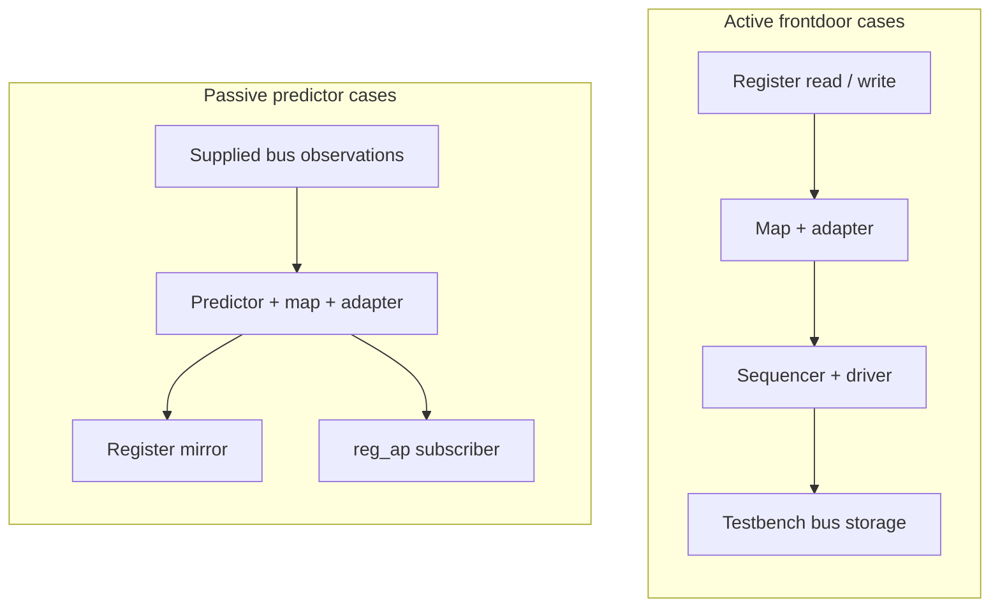
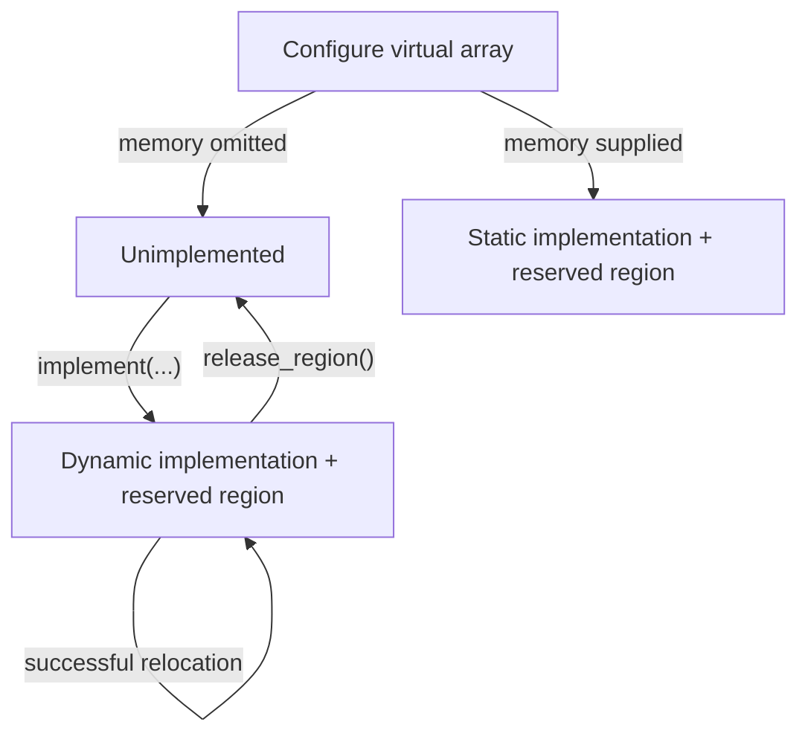

# FAQ

[日本語](faq.ja.md) · [README](../README.md) · [Glossary](glossary.md)

This guide describes the current runners. Counts and measurement scope are
kept in the [README](../README.md#current-results); specific limitations are
in [known differences](known-differences.md).

## Getting started

### Q1. How does this differ from kirimasim-tests?

kirimasim-tests checks SystemVerilog language behavior against IEEE 1800-2023.
This suite checks UVM behavior against IEEE 1800.2-2020 while a simulator runs
the pinned UVM library. A language-only reproduction of a UVM failure belongs
in kirimasim-tests; a UVM mismatch may involve the simulator, library or test.

### Q2. What do I need, and where does UVM come from?

Use Python 3.10 or later and a simulator able to run UVM. The fixed oracle is
Verilator 5.052, whose model builds also require a C++ toolchain and make.
The [Check workflow](../.github/workflows/check.yml) contains its Ubuntu setup.

Run `python3 tools/fetch_uvm.py` to fetch the locked Accellera UVM release.
`python3 tools/fetch_uvm.py --check` verifies the existing tree against its
file count and content digest. The library is fetched, not committed.

### Q3. How can I run one test first?

From the repository root, with Verilator 5.052 on PATH:

```sh
python3 tools/fetch_uvm.py
python3 tools/run_verilator.py --seeds 1 73 --build-jobs 2 -j 1 \
  --json out/verilator-smoke.json tests/u09/test_common_phases_run_in_order.sv
```

Put an option such as `--build-jobs` after the seed list and before a test
path, as shown: `--seeds` accepts multiple values. Explicit paths select only
those tests. This is a smoke test, not a full-suite run.

### Q4. How do I include spec-only cases?

Without paths, Verilator selects tests tagged `verilator@5.052` that do not
depend on X/Z. Add `--all` to include every two-state case:

```sh
python3 tools/run_verilator.py --all --seeds 1 73 --build-jobs 2 -j 2 \
  --json out/verilator-all.json
```

kirimasim and Ghost select all tests by default. `--all` belongs to the
Verilator runner; it is not a shared option for the other runners.

## Understanding a result

### Q5. What do pass, fail, known and unsupported mean?

| Status | Meaning | Recorded by |
| --- | --- | --- |
| `pass` | Expected output and required exit/diagnostic conditions match | All three runners |
| `fail` | Output or another condition differs, or building/running failed | kirimasim, Ghost; Verilator for tagged oracles |
| `known` | An untagged Verilator case differs or fails to build/run; not a pass | Verilator only |
| `unsupported` | The recognized unsupported-feature diagnostic and exit code are returned | kirimasim only |

Ghost records mismatches as `fail`, including bundled-library differences.
Other kirimasim compilation failures can still be `fail`.
Do not interpret the number of failed tests as the number of distinct bugs.

### Q6. Why can Verilator exit successfully with KNOWN results?

Its exit status tracks regressions in tagged fixed-release oracles. An untagged
mismatch is recorded as `known` in JSON and does not make the command fail.
An untagged match is recorded as `pass`, but remains outside the terminal's
tagged-oracle denominator and does not automatically receive an oracle tag.
kirimasim exits unsuccessfully for either `fail` or `unsupported` results;
Ghost does so for `fail` results. Read JSON statuses as well as the command exit code.

### Q7. Why compare UT lines rather than all UVM messages?

Default UVM report layout, paths, line numbers and time formatting vary.
The runner selects only lines beginning exactly with `UT: ` and preserves
their order, spaces and values. Tests expose specified behavior through those
lines, including report counts. They may also specify exit/diagnostic checks.
See [what is observed](testing.md#what-is-observed).

Some tests intentionally request an operation that must report a UVM error,
then check the resulting count. That error alone does not make a test fail;
its required outcome and termination conditions decide the result.

### Q8. Why keep spec-only tests instead of copying the library's output?

The standard determines the expectation. A library or simulator discrepancy
does not redefine it. The current spec-only cases include initial transaction
state, invalid field-operation access, report reset, objector membership,
response controls and USER arbitration. The phase-task termination difference
has not been assigned to either the simulator or library. See
[known differences](known-differences.md) for scope and linked tests.

### Q9. Why does a green Check not mean kirimasim passes UVM?

[Check](../.github/workflows/check.yml) checks metadata, tools, the pinned
library and tagged Verilator oracles. It does not run kirimasim or Ghost and
does not require spec-only cases to match. Most cases in the current kirimasim
run stop at `uvm_object_wrapper` as unsupported; the remaining cases fail
earlier on missing library APIs. Neither result establishes behavior beyond
those compilation blockers.

### Q10. Where is Nightly or the public results dashboard?

This repository currently has no Nightly workflow or automatic results
publication. Its badges link to Check and the license. kirimasim-tests has its
own Nightly, which does not report this UVM suite. Runner JSON under `out/`
stays local unless deliberately shared; pushing tests does not publish it.

## Execution conditions

### Q11. What does the Ghost result cover, and why an alias?

Ghost is an unreleased simulator participating under an alias. Its executable
identity, version, paths, profiles and diagnostics stay private. Public JSON
uses generic reasons and content fingerprints.

| Mode | UVM supplied by | What the result covers |
| --- | --- | --- |
| `pinned` | Runner compiles the locked library; profile disables automatic bundled UVM | Simulator with the locked library |
| `bundled` | Profile supplies a library tree or declares embedded UVM | Simulator with the supplied library; not evidence for the locked library |

A bundled library is identified by its tree digest or embedded-library
declaration. A bundled mismatch does not by itself distinguish a simulator
problem from a library problem.
See [Ghost setup](testing.md#ghost).

### Q12. Does uvm_dpi: yes automatically enable a working DPI build?

It removes `UVM_NO_DPI` from the default macro list. It does not supply or link
UVM's C/C++ implementation. The current Verilator runner does not add those
sources. All current tests use `UVM_NO_DPI`; a DPI-dependent test needs an
appropriate implementation and execution setup before it can be used as evidence.
User-defined `uvm_reg_backdoor` handlers can operate without HDL DPI (Q67).
Glob matching without DPI is also not the same as full regular-expression support.

### Q13. Why is compilation heavy, and what do the two job options control?

Every test builds the UVM package as part of its model. `-j` controls the number
of concurrent tests; `--build-jobs` controls C++ jobs within each Verilator build.
Using `--seeds` builds once and runs a fresh process for each seed. The runner
disables ccache through the build environment because the model's precompiled
header records an absolute build-directory path and cannot be reused that way.

### Q14. Do two seeds prove determinism or four-state correctness?

No. Seeds 1 and 73 check the fixed-release expectation under different
randomized initialization conditions; tests do not print random values.
Verilator's default selection excludes X/Z-dependent cases. A two-state run
does not establish four-state behavior, and two passing seeds do not prove all
possible executions. A multi-seed test stops at its first mismatch; the current
runtime known records establish seed 1 differences, not seed 73 results for
those cases. A case that cannot build has no runtime seed result.

### Q15. How do I know whether an old result still applies?

Compare test input hashes, runner hashes, configuration, simulator version and
library identity. JSON records `inputs_sha256`, `runner_sha256`,
`runner_changed`, `configuration` and `generated_at`; an input changed during
a run is marked `inputs_changed` instead of receiving a valid input hash.
Ghost additionally fingerprints its executable, profile and supplied library.
Changed inputs or conditions require new evidence; unchanged records can be
combined, while preserving their batch provenance. A combined result is not
a claim that every test was rebuilt together.

## Scope, review and contributions

### Q16. Are M1, M2 or M3 complete, and what does the test count cover?

M1 and M2 still have open clause targets. M3 now has 238
register-layer cases, including testbench frontdoor paths; it is also incomplete. Starting a stage does not complete
the preceding stages.
The [plan](../README.md#plan) identifies current scope and remaining work.
Counts are test cases, not a reviewed inventory of every requirement or
combination in the standard. Clause citations alone do not establish coverage;
M4 now has an [initial ledger and census](requirements.md); normative
decomposition and denominator approval remain open.

### Q17. Does spec_check: ai mean human review or proof?

It records AI comparison of the expectation with the cited standard. It is
neither human review nor a proof of full coverage. All current tests have this
value. Fixed-release reproduction is a separate record in `:oracle:`.

### Q18. How should I report or correct a wrong expectation?

Identify the test, cited clause, expected observation and execution conditions.
Separate changes needed in the test from simulator or library discrepancies.
Preserve privacy for Ghost. After a correction, run metadata and tool checks,
then reproduce any fixed-release oracle with both seeds. See
[adding or correcting a test](testing.md#adding-or-correcting-a-test).

The IEEE PDFs used for review remain local and ignored by Git; do not copy
their text or examples into the suite. Describe behavior in your own words
and cite clause numbers. The UVM library is fetched separately under Apache-2.0;
the suite is Apache-2.0 WITH LLVM-exception.

## Locking and nonblocking transport

### Q19. How do lock and grab differ, and can a lock owner be blocked?

Lock joins regular request arbitration; grab enters at the front. Both wait
when an incompatible existing lock or grab prevents acquisition. A child's
ownership can temporarily block its parent even when the parent still owns
a lock. Inspect `is_blocked` as well as `has_lock`; `current_grabber` identifies
the sequence currently allowed to act under nested ownership.

Current tests cover ownership, nested release, waiting acquisitions and real
driver item exclusion. Two lock-order cases retain spec-only expectations:
FIFO order behind an earlier pending item and waiting for an already granted
item's completion. The pinned library grants these locks too early; see
[known differences](known-differences.md).

### Q20. How can nonblocking transport return a response immediately?

A target can compute a response synchronously when the accepted request's
analysis notification is delivered, then write it through the response put
port before `nb_transport` returns. The tests connect this path through public
interfaces and retire the accepted request afterwards so the slot can be reused.

When completion is not immediate, the return value is 0. These expectations
do not prescribe its response output argument or whether a partial request
was queued. The recovery case drains any residual request through `try_get`
before a fresh transaction, without asserting that drain's return value.

### Q21. What happens to a sequence's body and hooks when it is killed?

Kill terminates active body work, changes the state to `UVM_STOPPED` and
releases the waiting `start` call. It also cleans up the sequence's sequencer
requests and ownership. The standard requires the `post_body` and `post_start`
hooks as well as the `do_kill` termination hook. The pinned library omits the
two post hooks; bound and unbound tests preserve that required behavior as
spec-only expectations.

Tests check direct-kill automatic-objection drop and sequencer reuse after
`stop_sequences`. The stop operation must drop automatic objections too,
but its pinned root stop path omits the drop. Standalone and parent/child
cases retain that requirement as spec-only; see [known differences](known-differences.md).
A driver-held request flushed by that operation is not
acknowledged afterwards; the test retrieves a new request before calling
`item_done` for it.

### Q22. How is a default phase sequence selected?

At phase start, the sequencer looks up `default_sequence` resources at its
full path plus the phase name, such as `uvm_test_top.sequencer.main_phase`.
Relevant resource types are `uvm_sequence_base` and `uvm_object_wrapper`.
Precedence selects the resource; a selected null disables the default.
An instance is used directly, while a wrapper uses the factory with the
sequencer path and wrapper type name as its creation context.

The sequence receives its sequencer and starting phase, is randomized unless
disabled and is killed if it outlives the phase. A wrapper creating a
non-sequence must report an error and start no default. The pinned library
only warns in that case, so the required error is retained as spec-only.

### Q23. What should happen to a response sent after its sequence finishes or stops?

`put_response` must drop it and report a warning when the original sequence
is `UVM_FINISHED` or `UVM_STOPPED`. Tests copy IDs from real requests, then
retire the sequence and check both the warning and non-delivery. Queue probes
use a bounded wait; handler probes verify no callback. A killed sequence must
not prevent another active sequence from receiving its own response.

A transaction ID is not the whole routing identity. Reusing it in a new
sequence must not let a stale response from the stopped sequence contaminate
the fresh route. These checks concern late delivery, not every possible aspect
of clearing replies that were already delivered before stop.

### Q24. Does a specific default-sequence instance always outrank a wrapper?

No. First keep only `uvm_sequence_base` and `uvm_object_wrapper` resources,
then choose highest precedence. For a tie, choose the first remaining entry
in the lookup queue. Removing wrong-type resources must preserve the relative
order of the valid entries. An unrelated null `uvm_object` resource is filtered;
only a selected null of an accepted resource type disables the default.

The equal-precedence tests create separate resources and insert them through
the public pool API with low priority, in explicit order. They do not infer
that order from repeated `config_db::set` calls that may update one setting.

### Q25. Does a TLM delay annotation advance simulation time?

The annotation object carries an offset; changing it does not wait. A target
can add an annotation and return in the same simulation time slot, or explicitly
wait as part of a blocking implementation. Tests observe annotation values and
simulation-time equality separately. Absolute conversion uses an explicit
seconds-per-unit argument. Scaled operations use the matching time literal;
the tests' 100-second scale is only a conversion reference, not a simulation delay.

Real values are compared with a small tolerance. Sub-resolution rounding,
negative times and a particular floating-point encoding are not prescribed by
these cases. The pinned library's default name and missing standard setter
remain in [known differences](known-differences.md); the setter case cannot
build and is not described as a failed seed execution.

### Q26. Why not repair the nested socket backward path inside the test?

The nonblocking socket `connect` API is responsible for the automatic backward
connections. Manual wiring would bypass that behavior. The nested initiator
case therefore keeps the required route, even though the pinned library wires
the two backward exports in the opposite direction and fails binding checks.
The forward hierarchy uses child ports connected to parent ports as required.

Passing the other paths verifies payload/delay identity, annotations, return
status and phase-reference propagation for those transactions. It does not
certify every legal base-protocol or timing combination. Callback iterator
tests likewise leave integer positions opaque and restart through public APIs.

## Push delivery, sequence actions and payload packing

### Q27. What completes an item sent through a push sequencer?

IEEE 1800.2-2020 15.6.3.3 requires the sequence's optional item-completion
wait to return after the driver's blocking `put` returns. The push driver
does not use a pull port's `item_done`. A positive-delay test checks that
`finish_item` remains blocked while `put` is still processing the request.
Separate cases send three requests and inspect delivery and common request
and response histories. See [known differences](known-differences.md) for
the pinned library's repeated-request limitation.

### Q28. Do all sequence action macros randomize their argument?

No. `uvm_create` only creates the item or child sequence and sets its context.
`uvm_send` executes it without randomization. `uvm_rand_send` randomizes before
execution, except when a child sequence has randomization disabled. `uvm_do`
combines creation with randomized execution. Child-sequence execution passes
`call_pre_post` zero, suppressing `pre_body` and `post_body`, while still
running `body`. The tests use singleton constraints and callback counts, so
their expected values do not depend on which legal random value is selected.

### Q29. What is included when a generic payload is packed?

The standard specifies an ordered set of scalar fields and the active data
and byte-enable prefixes. Backing-array bytes beyond the declared lengths
and extensions are excluded by default. A declared length larger than the
corresponding array requires a fatal report. The fatal tests finish inside
a report catcher as soon as that severity is observed; they make no claim
about execution after a fatal has been suppressed. Round trips and decoding
through the public packer API avoid prescribing a binary stream encoding.

## Sequence libraries and macro controls

### Q30. How do instance and typewide library registration differ?

`add_sequence` and `add_sequences` affect one library. The static typewide
forms affect libraries constructed afterwards; existing instances are not
updated by an addition. Duplicate sequence types are silently ignored.
`get_sequences` appends the registered list after any existing caller prefix.
Tests compare membership without imposing an undocumented insertion order.

Removal has a different rule: removing a statically registered type must
update all instances, and removing an absent type must warn. The pinned
library removes only from the receiving instance and omits the absent-type
warning. Both required behaviors remain in
[known differences](known-differences.md).

### Q31. Why do some sequence-library tests fail before a seed is run?

IEEE 1800.2-2020 defines getters/setters for selection mode and minimum/maximum
random counts, plus `get_num_sequences_executed`. These seven methods are
absent from the pinned library. Six cases keep those standard calls and
cannot build; they have no runtime seed result. Legacy public fields are not
substituted for required APIs. Passing registration and direct-selector cases
does not establish execution-mode or execution-counter conformance.

### Q32. Does disabling an item's random field skip randomization callbacks?

No. A field's `rand_mode(0)` keeps that field's assigned value, while the
item's `randomize` operation still invokes its callbacks. Disabling child
sequence randomization instead makes the action skip that operation entirely.
The macro tests distinguish those controls, check factory overrides at
creation, and trace parent hooks around randomization and driver delivery.
The typed-sequencer declaration test uses an explicit cast before accessing
the subtype member; it does not assume an automatic initialization policy.

## Low-level sequence submission and transport delegation

### Q33. How are grant, submission and item completion ordered?

After establishing the item's context, a sequence calls `wait_for_grant`,
then `send_request` without a simulation-time delay. It may then wait for
completion. The default send does not rerandomize; setting its rerandomize
argument to 1 requests that operation before driver delivery.

Completion comes from `item_done` or implicitly from `get`. A waiter for a
specific transaction ID must start before that item's acknowledgement;
waiting afterwards can hang. The
[two-request case](../tests/u14/test_sequence_wait_for_item_done_matches_each_explicit_transaction_id.sv)
uses separate acknowledgements and samples while the second item is held.
Completion notification does not itself supply a response transaction.

### Q34. Which component handles a split master/slave imp call?

The imp's request and response constructor arguments select the sibling
implementations. The parent owns the imp but need not implement their
transfer methods. A master puts requests and gets/peeks responses; a slave
gets/peeks requests and puts responses.

The [mixed master case](../tests/u12/test_master_combined_imp_routes_mixed_operations_to_split_implementations.sv)
uses integer requests and string responses, mixes blocking/nonblocking calls
and checks independent storage reuse. Separate cases exercise exports,
availability and capacity. Failed reads do not assert an unspecified output.

### Q35. Do ordinary TLM 2 exports connect the backward path automatically?

Ordinary forward and backward paths are connected separately. A port can
traverse an export chain to its imp, which invokes the selected implementation.
The round-trip test explicitly binds both directions; it does not rely on
socket connection side effects.

The [custom forward case](../tests/u12/test_tlm2_nested_forward_exports_preserve_custom_transaction_and_phase_types.sv)
uses a custom transaction and phase enum through two exports. It checks
handle identity, typed phase-reference updates and annotations. Those generic
binding results do not establish a legal base-protocol exchange for every
phase or timing combination.

## FIFO notifications and explicit execution contexts

### Q36. Does peeking at a FIFO publish a get_ap notification?

Yes. IEEE 1800.2-2020 12.2.8.1.6 includes `peek` and successful `try_peek`,
as well as get operations. Peeking retains the item; notification does not
mean removal. The two peek cases observe two notifications before consuming
the value. The pinned library omits both kinds of peek notification, so the
required counts remain in [known differences](known-differences.md).

Other cases check fanout to independent subscribers, accepted puts,
successful gets, and shared object identity. Failed reads do not assert their
output value, and unavailable transfers do not supply a transaction to publish.

### Q37. Which sequencer and priority does start_item use?

It chooses the explicit sequencer argument first, then the item's sequencer,
then the current sequence's sequencer. The
[three-context case](../tests/u14/test_sequence_start_item_explicit_sequencer_overrides_item_and_parent_context.sv)
uses separate sequencers and drivers to observe the selected path. A
nonnegative priority overrides the sequence priority; every negative value
inherits it, including values other than -1.

A null item, a sequence whose `is_item` returns zero, or the absence of all
three sequencer contexts requires ERROR and an immediate return. The pinned
library uses FATAL instead. Tests count the original severity with a report
catcher and retain the required ERROR in
[known differences](known-differences.md).

### Q38. Which callbacks run when a macro names an external object?

`uvm_do_obj_callbacks` and its exit-on form use the supplied object. Entries
registered only on the calling dispatcher are excluded. Applicable typewide
and selected-instance entries participate, with disabled entries skipped.
The [context-switch case](../tests/uB/test_callback_object_macro_switches_between_explicit_external_contexts.sv)
uses one dispatcher with two external objects and checks each chosen context.

Exit-on tests stop at the first matching true or false result. When no
callback matches, the tests check traversal or the absence of calls without
prescribing the enclosing function's no-match result or fallthrough policy.

## TLM implementation declaration macros

### Q39. What does the suffix of an imp declaration macro change?

It creates a distinct imp class and selects correspondingly named
implementation methods. The connected port keeps its ordinary interface:
`put` reaches `put_left` through a `_left` imp, for example. The component can
therefore expose two implementations without an unsuffixed `put` method.

The [combined put case](../tests/uB/test_tlm_put_imp_decl_routes_two_suffixes.sv)
checks both blocking and nonblocking calls, rejection while full, and
successful reuse after a lane is freed. The declaration cases cover the 22
Annex B.5 families with two independently named inputs. They do not establish
every illegal binding or scheduling combination.

### Q40. Can a generated master imp use separate request and response objects?

Yes. `REQ_IMP` and `RSP_IMP` describe their types; the constructor's `req_imp`
and `rsp_imp` arguments select the sibling instances. The suffix applies to
the methods on those objects. The
[split implementation case](../tests/uB/test_tlm_master_imp_decl_delegates_suffixed_methods_to_split_sibling_implementations.sv)
uses integer requests, string responses and a parent with no transfer methods.
Blocking and nonblocking operations must reach the correct sibling and suffix.

Separate analysis cases pass original class handles through suffixed write
methods. The tests compare identity and per-input counts without requiring
implicit cloning or transaction mutation.

### Q41. Why does the B.5.11 case use the get/peek macro spelling?

The clause heading names `uvm_nonblocking_get_peek_imp_decl`, and its prose
describes the combined nonblocking get/peek class. Its displayed invocation
instead uses the peek-only spelling from B.5.8. The
[B.5.11 case](../tests/uB/test_tlm_nonblocking_get_peek_imp_decl_routes_two_suffixes.sv)
follows the heading and described class, exercising both get and peek.

This interpretation is recorded in the test comment and remains a review
item. Matching the pinned library records fixed-release reproduction; it
does not resolve the standard's spelling inconsistency or replace human
review. The case retains `spec_check: ai` like the rest of the current suite.

## Library construction, item completion and extension identity

### Q42. Why test static library membership immediately after construction?

The standard's library-subtype pattern uses the utilities macro and a
constructor calling `super.new`. Static members registered with the subtype
or its bases must then be available. Four cases check two instances, two
library types, inherited members and a local addition beside static members.

The pinned library leaves these subtype lists unpopulated. The tests keep
public enumeration and do not invoke an additional implementation-specific
initialization method; see [known differences](known-differences.md).
Separate positive cases use instance registration and default RAND execution
for ten children. Singleton selection constraints avoid distribution or
registration-order assumptions. These results do not validate missing APIs.

### Q43. Why observe finish_item calls when requests already reach the driver?

Clause 14.2.6.3 requires the sequence's virtual `send_request` and
`wait_for_item_done` calls, with rerandomization zero and the item's explicit
transaction ID. The pinned library calls the sequencer directly and uses -1
for the completion ID. Tests distinguish virtual-method dispatch from
argument forwarding. Three additional guards require ERROR and an immediate
return for invalid input; faulty pinned paths can terminate on dereference.
These are runtime known differences, described in
[known differences](known-differences.md), rather than missing-API builds.

The [hook-order case](../tests/u14/test_sequence_finish_item_orders_mid_mutation_before_send_and_post_after_ack.sv)
also checks that a mid-do mutation is visible at submission and post-do sees
the delayed acknowledgement. Report catchers count severity without rewriting
it; no post-fatal continuation policy is prescribed.

### Q44. Is an extension type key the same as its instance name?

The type key returned through `uvm_tlm_extension_base::get_type_handle`
identifies the extension type. Same-type instances share the key, including
after an instance is renamed; different types retain different keys even if
their instance names match. Type-handle names are compared for stable and
distinct type identity without requiring a particular qualified spelling.

Payload insertion, replacement and clearing use those opaque keys. The
[short-alias case](../tests/u12/test_tlm2_gp_alias_shares_payload_and_polymorphic_extension_state.sv)
also verifies that `uvm_tlm_gp` and `uvm_tlm_generic_payload` handles observe
the same payload bindings. No numeric type ID or implicit clone is required.

## Register model basics

### Q45. Do set, predict and reset access the DUT?

The first M3 cases use model-only operations. Desired state is what the model
wants to write; mirrored state is what it currently records for the register.
For the idle fields used here, prediction uses `UVM_PREDICT_DIRECT`:

| Operation | Desired state | Mirrored state | DUT access |
| --- | --- | --- | --- |
| `set(value)` | Applies the configured access policy | Unchanged | None |
| `predict` (DIRECT) | Replaced by the computed value | Replaced by the computed value | None |
| `reset(kind)` | Restored if that reset kind exists | Restored if that reset kind exists | None |

Read-only `set` leaves desired state unchanged; W1C `set` clears the selected
one bits in it. Direct prediction ignores access policy. A reset kind with no
configured value leaves the field unchanged. `needs_update` checks the need
to reconcile writable desired state; it does not itself perform an update.
The [field set case](../tests/u18/test_reg_field_set_changes_desired_without_predicting_mirror.sv)
and [recursive reset case](../tests/u18/test_reg_block_reset_recurses_into_child_registers.sv)
observe these states without a bus or HDL backdoor.

### Q46. Are map addresses bytes, and why can the returned list run backwards?

Address units depend on `byte_addressing`: one byte when enabled, otherwise
the configured bus width. A register's local offset and external physical
address have separate meanings. The
[word-address case](../tests/u18/test_reg_map_word_addressing_translates_offsets_in_bus_units.sv)
uses consecutive word addresses for successive bus transfers.

`get_addresses` lists physical addresses in order of least-significant data
first. A big-endian map can therefore return numerically descending addresses.
The [little-endian](../tests/u18/test_reg_map_little_endian_wide_register_lists_addresses_in_data_order.sv)
and [big-endian](../tests/u18/test_reg_map_big_endian_wide_register_lists_addresses_in_data_order.sv)
cases each split a six-byte register across three two-byte accesses.
A submap adds its parent offset and uses the narrowest bus on the route to
the root. These calculations do not execute those bus transfers.

### Q47. Which register-model foundations are covered?

The suite checks field/register/block construction and layout, access
policies, reset kinds, desired/mirrored state, recursive reset and locking,
and map units, rights, endianness, relocation and hierarchy. Pre-lock field
lookup and map width/translation cases retain spec-only expectations;
pre-lock probes include post-lock controls.

Memory, adapter, predictor, frontdoor, callback and virtual-register cases
are described below. Remaining work includes broader packing/error and
policy/map conditions, integrated prediction, more frontdoor/callback
combinations, HDL-path/DPI setups, broader allocation-policy conditions and
broader annex E conditions.
Q68 covers selected built-in test sequences and dispatch masks. Register
and memory map queries use explicit arguments.
The release's multiple-map note and null-map resolution are explained in
[known differences](known-differences.md). All cases retain `spec_check: ai`;
this is not a reviewed register-layer requirement-coverage inventory.

## Memory, prediction and map controls

### Q48. Are memories mirrored like registers, and what do their offsets mean?

`uvm_mem` describes contiguous locations without storing a mirror for every
location. Construction records the number and bit width of locations; each
location's byte width rounds up independently. Current memory tests inspect
layout and addresses; the frontdoor additions also transfer data through a
testbench driver, as described in Q54.

The location index selects a different local offset and external address.
Byte-addressed two-byte locations advance by two address units; word-addressed
four-byte locations on a four-byte bus advance by one. The pinned library
ignores the location in `get_offset`, so its
[location-offset case](../tests/u18/test_mem_location_offsets_include_the_location_index_stride.sv)
retains the normative expectation even though external addresses advance.

For an unshared memory, the rights query is RW under 18.6.4.5. Effective
access is a separate query: 18.6.4.6 requires the supplied map's restrictions.
The [single-map access case](../tests/u18/test_mem_intrinsic_readonly_policy_and_map_rights_are_distinct.sv)
retains that distinction as a known difference.

A [two-interface case](../tests/u18/test_mem_two_interface_maps_preserve_membership_addresses_and_rights.sv)
checks explicit map membership, independent addresses and RO/WO rights with
no errors. This result concerns that sibling-map setup; shared-map hierarchy
behavior and the release's multiple-map note need separate review.

### Q49. Do READ and WRITE predictions perform bus transactions?

No. A prediction supplies a computed or observed value to the model.
`UVM_PREDICT_DIRECT` copies it without access-policy effects; READ and WRITE
predictions apply the effects associated with that observed operation.
The field prediction cases synthesize observations, without executing a driver or DUT.

READ prediction leaves RC state cleared and RS state set after the sampled
read. WRITE prediction applies selected-bit clearing, setting or toggling
for W1C/W1S/W1T and zero-selected changes for W0C/W0S. Two successive writes
check accumulated state. The
[write-once case](../tests/u18/test_reg_field_write_once_prediction_rearms_only_after_hard_reset.sv)
checks that a SOFT reset restores its configured value while retaining write
protection, and HARD reset permits a new first write. Desired and mirrored
values are observed separately in every case.

### Q50. What do the map controls establish?

Register and memory relocation refresh both physical addresses and locked
lookup results. Lookup probes use a zero root base. A shared RO/WO address
selects a different register for reads and writes, and conflicting field/map
permissions produce NOACCESS. These are model queries, without bus traffic.

Map `reset()` defaults to SOFT, while register and field reset default to HARD.
The [scoped reset case](../tests/u18/test_reg_map_reset_defaults_to_soft_and_preserves_other_maps_registers.sv)
checks that another map's register stays unchanged. Negative probes observe
original warning/error severities, required return values and an unchanged
caller array. The auto-predict case checks independent mode flags only;
the frontdoor cases below additionally check its effect during bus-model reads and writes.

## Adapter, predictor and frontdoor paths

### Q51. What do the adapter and operation-descriptor cases check?

Seven cases exercise the standard TLM adapter's command, address, byte
length, allocation, byte enables, successful/error response conversion and
out-of-callback context. Uniform data bytes avoid a numeric byte-order
assumption; failed reads do not prescribe returned data. The
[operation-array case](../tests/u19/test_reg_item_value_array_resize_preserves_prefix_and_zero_fills_growth.sv)
checks the default size, prefix preservation and zero initialization during
growth and shrink/regrowth, as specified by 19.1.1.2.4.

The active context case reads `get_item` during `reg2bus` without modifying
it. It observes the selected register, map, extension, access kind and door.
The accessor must be null outside that callback, including in `bus2reg`.

### Q52. How do passive prediction and frontdoor auto-prediction differ?

These tests use separate fixtures. Built-in frontdoor cases initiate register accesses
through a sequencer and driver; passive cases inject observed packets through
an analysis port into a predictor configured with its map and adapter.



Predictor tests check RW/RO and RC/W1C effects, published operation metadata,
wide-register accumulation in both endian modes, and ignored memory/unmapped
addresses. A wide operation publishes only when all required bus words arrive.
The hook-redirection case retains the target and value changes required by
19.3.3.2; see [known differences](known-differences.md).

### Q53. Do the frontdoor cases test an RTL device or every bus combination?

The built-in fixtures use testbench storage with real sequencer/driver handshakes and
positive-delay acknowledgements. The tests check read/write results with
auto-prediction enabled and disabled, a separate response item, narrow-bus
write associations and adapter context. Address/data associations are checked
without imposing an unspecified transfer order. The big-endian wide-read case
uses the standard TLM adapter and retains required reconstruction of repeated
payload bytes as spec-only.

These fixtures establish selected UVM paths without an RTL DUT or DPI. Actual
bus signal protocols, broader response/error and timing combinations, and
integrated monitor/predictor traffic remain future work. Q54–Q56 describe
the memory, update/mirror, error-status and access-hook additions.

## Memory transfers and register access hooks

### Q54. Which memory transfers are now tested?

Eight frontdoor cases check byte-wide reads/writes at nonzero location
indices, separate driver responses, little-endian 32-bit locations on a
byte-wide bus, word addressing, and three-location burst reads/writes.
The driver acknowledges requests after a positive delay and stores physical
address/data pairs. There is no RTL memory or per-location UVM mirror.

For the burst fixtures, memory width, bus width and `uvm_reg_data_t` width
are all 64 bits. Each array element fills one location, avoiding partial-beat
packing assumptions. Narrow-memory array packing, partial final beats,
big-endian memory transfers and memory-error combinations remain open.
The driver's storage is fixture state, not a mirror maintained by `uvm_mem`.
The burst pair retains spec-only expectations: 19.1.2.1 requires physical
bus descriptors to use READ/WRITE, but pinned UVM passes burst kinds to the
adapter. See [known differences](known-differences.md).

### Q55. How do update, mirror and bus errors behave in these cases?

`set` changes desired state without a transfer. `update` writes only when
needed; successful auto-prediction makes the next update a no-op. The W1C
and W1S cases separately observe the physical write mask and resulting
mirror, because the command data and policy result can differ.

`mirror(UVM_CHECK)` reads, reports a mismatch and refreshes the mirror.
A field with comparison disabled contributes no mismatch error. The catcher
counts original error severity and consumes the expected diagnostic without
rewriting it. Two further cases return a bus error through the adapter,
then verify that a successful retry completes. They make no assertion about
failed-read data or the mirror at the failed-operation boundary.

### Q56. Which access hooks and ordering rules are covered?

Register method overrides check pre-write value replacement, pre-read and
pre-write rejection before any bus request, post-read value replacement,
and post-read/post-write status replacement. The post-read value case checks
the caller result without prescribing the mirror after the hook.

Clauses 18.4.8.1/.3 and 18.5.6.1/.3 place register hooks before field hooks.
The two ordering cases expect `RF`; pinned UVM runs `FR`, so they retain
spec-only oracles. See [known differences](known-differences.md).
These eight tests override inherited methods. Q58 describes the added
registered callbacks; redirection, field/register ordering with registered
callbacks and further post-hook combinations remain separate work.

## Custom frontdoors, registered callbacks and virtual registers

### Q57. How are the custom frontdoor cases different from the built-in path?

Eight cases associate a `uvm_reg_frontdoor` sequence with a register or
memory. Its body receives `rw_info`, waits a positive delay and reads or
writes its own storage. These cases check register/memory data and status,
an unmapped register, element/map/extension context, the executing sequencer,
and replacing a register's map-specific handler.

The sequence body models the custom-access seam; it does not send adapter
items to a bus driver. The earlier built-in cases exercise that separate
sequencer/driver path. Neither fixture establishes an RTL protocol.
See the [operation-context case](../tests/u19/test_reg_custom_frontdoor_receives_extension_map_element_and_sequencer_context.sv).

### Q58. What do registered callbacks for registers add?

Seven instance-specific `uvm_reg_cb` cases check pre-write value replacement,
pre-read rejection, post-read value replacement, post-write status replacement,
removal, and ordering relative to the same register's inherited pre/post
methods. The pre method runs before the registered callback; the registered
post callback runs before the post method. These are distinct from the earlier
register-versus-field ordering cases.

An eighth case registers a field `post_predict` callback. It observes the
previous mirror and a READ prediction, then changes the resulting predicted
value. That fixture supplies an observation without bus traffic. Registration
on further memory/backdoor objects, encode/decode chains, redirection and
more field/register ordering combinations remain open.

### Q59. What do the virtual-register cases establish?

Eight cases check parent/unimplemented-memory state, static arrays with
packed or explicit increments, memory-map membership and external addresses,
virtual-field parent/width/position, field ordering and name lookup, and byte
width in a wider implementing memory. Virtual fields use factory creation.
Those eight cases query models. Q60–Q62 add transfers, selected dynamic
implementation paths and memory-manager operations. Q65 adds supplied-policy allocation; broader allocation-policy behavior and
protection against direct manager release of virtual-owned regions remain open.

For the explicit-stride fixture, each 16-bit element occupies two byte-wide
memory locations. The base location is 2 and the increment is 3 memory words:
`location(i) = 2 + 3*i`. A byte-addressed map base of `0x100` and memory offset
of `0x20` give the following layout; the address case observes element 2.

| Array index | Memory locations occupied | First external address |
| --- | --- | --- |
| 0 | 2–3 | `0x122` |
| 1 | 5–6 | `0x125` |
| 2 | 8–9 | `0x128` |

The [address case](../tests/u18/test_vreg_static_array_inherits_memory_map_membership_and_external_address.sv)
uses explicit map arguments. Clause 18.9.1.2.9 makes the reported byte width
an integral number of implementing memory locations. A 16-bit virtual register
in 32-bit memory therefore reports four bytes. Pinned UVM reports two, so
that case retains its required result as spec-only; see
[known differences](known-differences.md).

## Virtual-register transfers and memory regions

### Q60. Which virtual-register and region transfers are now exercised?

Seven cases access virtual-register/field data through the existing adapter,
sequencer and positive-delay testbench driver. They check packed-element
reads/writes, an explicit stride with untouched padding, a partial-field
write preserving other bits, a field read spanning memory locations, and
16-bit memory locations split over a byte-wide bus. A failed virtual read
is followed by a successful retry without asserting failed-read data.

An eighth case writes and reads a `uvm_mem_region` using an offset relative
to the region. A region starting at memory location 12 and relative offset 2
selects location 14, at physical byte address `0x2e` in that fixture.
These are selected frontdoor paths without an RTL DUT, virtual-register
mirror or backdoor integration.

### Q61. What does dynamic virtual-register implementation cover?

Eight cases check implementation and region geometry, moving within one
memory or to another memory in the same block, dynamic release and reuse,
static release rejection, overlap rejection, resize with an omitted memory
argument, and the region's virtual-array owner query.



The diagram shows successful lifecycle paths; static implementations retain
their reservation when dynamic release is attempted. Dynamic cases release
through `uvm_vreg`, not directly through the manager. Direct manager release
protection, in-place growth with explicit memory and further failure conditions
remain open. Q65 covers `allocate` with supplied singleton policies.

Two cases retain required results as spec-only. Clause 18.9.1.1.3 permits
omitting memory when resizing an existing array while keeping its placement;
pinned UVM rejects the null argument. Clause 18.12.7.2.7 requires the region
to return its implementing virtual array; pinned UVM leaves that owner null.
See [known differences](known-differences.md).

### Q62. What do the memory-manager cases check?

Eight standalone-manager cases cover byte requests rounded to memory-location
units, overlap and address bounds, per-region release and reuse, iteration
and reset, release-all, compatible reconfiguration, and a supplied allocation
policy. Iterator checks require each region once without imposing an address
order. Reconfiguration checks values rather than descriptor identity.

The request policy constrains the starting offset to one legal location,
so both seeds have the same result. This establishes policy handoff and
reservation, not statistical allocation behavior, GREEDY/THRIFTY differences
or BROAD/NEARBY locality. Standalone regions have no memory or virtual-array
owner. Direct region data accesses are covered by the attached-memory case
in Q60. Negative reservation cases do not require a diagnostic severity that
the cited clause does not prescribe.

## Commercial simulator and Issue reporting policy

### Q63. Does this project run or reuse results from commercial simulators?

The project does not run or compare commercial SystemVerilog simulators.
Their results, outputs and diagnostics, including material obtained by third
parties, are not used to derive expectations, design tests or make
implementation decisions. Keeping results private does not by itself establish
permission to use them. This operational policy avoids contractual issues
around publication, product-behavior analysis and competing-product development;
it is not a claim that ordinary testing is always prohibited. Conditions
vary by product, contract and jurisdiction.

Expectations come from IEEE 1800.2-2020 clauses and independently written
models. The `verilator@5.052` oracle records fixed-release reproduction;
kirimasim and publication-ready guest Ghost results describe only their recorded
conditions. Ghost is the project's pre-release guest, not a way to submit
commercial results under an alias. Commercial executability and agreement
are not established by this suite.

This follows the reporting policy of
[kirimasim-tests](https://github.com/kurochan001/kirimasim-tests), adapted to
this suite's UVM standard and supported runners. See
[expectation derivation](testing.md#where-the-expected-outputs-come-from) and
[current evidence scope](results.md).

### Q64. May an Issue include commercial simulator output or diagnostics?

No. The policy covers Issue bodies and comments, logs, attachments,
screenshots, waveforms, external pastes and execution-environment links.
Do not include anonymized excerpts or summaries, or repost third-party
commercial results. The project does not ask reporters to run a commercial
simulator and does not reuse prohibited material as evidence.

Use IEEE 1800.2-2020 clause numbers, your own explanation and an independently
written minimal reproducer. Permitted execution evidence is limited to
Verilator, kirimasim and publication-ready results from the project's guest
Ghost; include the tool version and suite commit, while preserving Ghost's
private identity. Do not copy standard text or include personal data.

The bilingual [Issue form](../.github/ISSUE_TEMPLATE/report.yml) provides a
notice, a required confirmation and fields for the report, suite revision and
independent reproducer. [Template configuration](../.github/ISSUE_TEMPLATE/config.yml)
sets `blank_issues_enabled: false`. This encourages ordinary contributors to
use the form; it does not inspect content or prevent maintainer/API/CLI posts,
later comments or attachments. See
[GitHub's template documentation](https://docs.github.com/en/communities/using-templates-to-encourage-useful-issues-and-pull-requests/configuring-issue-templates-for-your-repository).
If prohibited material appears, do not reproduce, summarize or incorporate it;
ask its author or a maintainer to handle it.

## Virtual allocation, callbacks and user backdoors

### Q65. What does virtual-register allocation establish?

Eight cases call `uvm_vreg::allocate` with a supplied policy whose start has
one legal value. They check returned-region identity and geometry, array
placement/address, release and reuse, relocation within one memory or to
another in the same block, a contradictory policy, static reallocation
rejection, and wide-memory reservation units. An allocation releases through
the virtual array rather than directly through the manager.

These are controlled policy handoffs, not statistical checks of default
allocation, GREEDY/THRIFTY reuse or BROAD/NEARBY locality. Allocation of arrays with existing padded strides, in-place growth and wider
failure combinations remain open.

### Q66. Which virtual-register and field callbacks are covered?

Eight cases check virtual-register pre-write value replacement, post-read
value replacement and post-write status replacement; field-slice replacement
on a parent write/read; and write-hook ordering through both the parent and
the standalone field API. Callbacks are attached through `uvm_vreg_cb` and
`uvm_vreg_field_cb`.

For virtual write hooks, the field runs before its register on pre-write;
the register runs before its field on post-write. Registered pre callbacks
follow their inherited method, and registered post callbacks precede it.
The parent-operation controls expect `FfRr` and `rRfF`, where uppercase marks
inherited methods and lowercase marks registered callbacks.

The standalone field-write case expects `cM`, but pinned UVM runs `Mc`.
Clauses 18.10.6.2.2 and 18.10.5.2 require the callback before the method;
that case remains spec-only. The parent virtual-write path is a positive
control. See [known differences](known-differences.md). Read-hook ordering
and further callback combinations are separate work.

### Q67. Do user backdoors require HDL DPI, and how do peek/poke differ?

Eight cases use a `uvm_reg_backdoor` subclass with positive-delay reads and
writes into testbench storage. The overrides call the required pre helpers
first and post helpers last. They check raw register poke/peek, physical-style
RO/W1C writes and RC reads, memory-location poke/peek, block inheritance with
local override, and failure status followed by retry. No HDL path, vendor
backend or RTL DUT is involved; all cases keep `UVM_NO_DPI`.

`peek` samples and `poke` deposits directly. Register `read`/`write` through
a backdoor mimic physical access-policy effects: the RO write retains bits,
the W1C write applies its mask, and the RC read returns sampled data before
clearing storage. With auto-prediction explicitly enabled, that case also
requires the post-read mirror to be zero (18.2.5.2, 18.4.4.15, 18.5.5.17).
Pinned UVM instead mirrors the sampled `0xa6`; the case remains spec-only,
with the sampled return value and cleared storage as positive controls. See
[known differences](known-differences.md). Failed-read data remains unconstrained. These cases do not establish built-in HDL-path/DPI access,
automatic backdoor update threads or every backdoor callback combination.

## Annex E built-in test sequences

### Q68. Which built-in register and memory test sequences are covered?

Fifty-four cases in `tests/uE/` cover the following families. The combined
wrapper has three fixtures; bit bash and register access also check
user-defined unknown policies, and register access checks a block exclusion:

| Family | Sequence classes | Selected observations |
| --- | --- | --- |
| Reset | `uvm_reg_hw_reset_seq` | Model reset, matching/mismatching storage, maps, hierarchy and exclusions |
| Bit bash | `uvm_reg_single_bit_bash_seq`, `uvm_reg_bit_bash_seq` | Both bit values, maps, a stuck bit, hierarchy and exclusions |
| Register access | `uvm_reg_single_access_seq`, `uvm_reg_access_seq` | Both access paths, disagreement, RO/no-backdoor skips, hierarchy and exclusions |
| Memory walk | `uvm_mem_single_walk_seq`, `uvm_mem_walk_seq` | Location coverage, a stuck bit, maps, hierarchy and exclusions |
| Memory access | `uvm_mem_single_access_seq`, `uvm_mem_access_seq` | Four-location frontdoor/backdoor checks, disagreement, hierarchy and exclusions |
| Shared register | `uvm_reg_shared_access_seq`, `uvm_reg_mem_shared_access_seq` | Two/three maps, cross-map observations, disagreement and exclusions |
| Shared memory | `uvm_mem_shared_access_seq`, `uvm_reg_mem_shared_access_seq` | Four locations through two/three maps, disagreement, hierarchy and exclusions |
| Combined access | `uvm_reg_mem_access_seq` | Both model families, child hierarchy and block exclusion with direct controls |
| Test selection | `uvm_reg_mem_built_in_seq` | Default/zero masks, individual flags and ordered OR selection |

See the [reset](../tests/uE/test_hw_reset_sequence_restores_model_reset_before_comparing_storage.sv),
[bit-bash](../tests/uE/test_single_bit_bash_sequence_exercises_both_values_of_every_rw_bit.sv),
[register-access](../tests/uE/test_single_register_access_sequence_cross_checks_frontdoor_and_user_backdoor.sv)
and [memory-walk](../tests/uE/test_single_memory_walk_sequence_reads_and_writes_every_location.sv)
fixtures. This is selected sequence behavior, not a complete annex E inventory.

### Q69. Do these sequences test an RTL DUT or require HDL DPI?

The sequences run against positive-delay testbench storage. Custom frontdoor
sequences and user backdoors share storage for register access checks, while
shared-map checks and memory walks use frontdoors. Memory access also uses
user backdoors. All cases keep `UVM_NO_DPI`. Reset cases initialize
storage to declared reset values before starting; they check model reset and
comparison of prepared storage. Physical DUT reset behavior remains untested.

Each fault case first runs a working model without errors, then injects a
wrong reset bit, a stuck register bit, disagreement between register paths or
a stuck memory bit or inconsistent memory/interface read data. The catcher
counts additional warning/error diagnostics
without changing their severity or prescribing IDs, text or exact counts.
Traffic counters and bit masks restart for each fault or direct-control
observation. RO and missing-backdoor skips constrain traffic, not diagnostic severity.
Bit-bash checks observe both bit values; memory-walk checks observe all four
locations. They do not prescribe library-specific patterns or within-family transaction
order. The selected dispatcher combination checks the family order that
17.2.2.10 prescribes (Q75).

### Q70. How do exclusion resources affect these sequences?

The tests install `uvm_resource_db#(bit)` entries in the `REG::` namespace.
Selected exclusions are `NO_REG_TESTS`, `NO_REG_HW_RESET_TEST`,
`NO_REG_BIT_BASH_TEST`, `NO_REG_ACCESS_TEST`, `NO_MEM_WALK_TEST`,
`NO_MEM_ACCESS_TEST`, `NO_REG_SHARED_ACCESS_TEST` and `NO_MEM_SHARED_ACCESS_TEST`.
An exact register/memory scope leaves a peer testable; an exact block scope
excludes its traversal without making a directly selected child/element match
the resource. Positive controls check that the remaining target still runs.
These cases use exact scopes and do not establish wildcard combinations.

Clause E.6.2 requires block-scoped `NO_MEM_WALK_TEST` to skip the block. Pinned
UVM checks `NO_MEM_ACCESS_TEST` in that guard instead, so the wrapper accesses
the memory despite the walk exclusion. The case retains its required skip as
spec-only, followed by a successful direct single-memory walk. See
[known differences](known-differences.md).

### Q71. What remains open in annex E?

HDL-path checking (E.7), the full walking-ones algorithm and broader
policy/status/mask combinations remain open. E.3.3 has direct combined-wrapper
fixtures; unknown-policy skips are checked for single bit bash and single
register access, without exhausting other policy conditions. The dispatcher
checks selected flags and one OR combination; its default all-tests mask is
inspected without executing every combination. Physical DUT reset, mixed map
rights, further field-policy combinations, wildcard exclusions and broader hierarchy
shapes remain separate work. No case uses a commercial simulator, vendor
backend or HDL DPI. All retain `spec_check: ai`; counts and two matching seeds
do not establish human review, four-state correctness or full coverage.

## Memory access, shared maps and test selection

### Q72. What do the memory frontdoor/backdoor access sequences check?

Six cases cover four locations through both paths, read-data disagreement,
a missing-backdoor skip, the individual-memory exclusion, root/child traversal
and a block exclusion with a direct control. Positive-delay handlers share
storage; no RTL or HDL DPI is involved. Coverage masks and diagnostic changes
are observed instead of random payloads or exact transaction counts. See the
[memory-access fixture](../tests/uE/test_single_memory_access_sequence_cross_checks_all_locations_through_both_paths.sv).

E.5.1 names `NO_MEM_SHARED_ACCESS_TEST` for an individual memory. Pinned UVM
checks `NO_MEM_ACCESS_TEST` instead, so that case retains the required skip
as spec-only with an independent peer control. E.5.2 separately names
`NO_MEM_ACCESS_TEST` for a block; the two scopes and names are not treated as
interchangeable. See [known differences](known-differences.md).

### Q73. How is register visibility between maps observed?

Six cases use two or three RW maps, a corrupted interface read, an individual
register exclusion, the shared block wrapper and a block exclusion with
direct controls. Each interface records which other interface last wrote
the value it reads. The two-map and three-map cases require every directed
cross-map pair, without fixing map iteration order. There is no RTL bus.
See the [three-map fixture](../tests/uE/test_shared_register_sequence_checks_all_pairs_of_three_maps.sv).

### Q74. Are shared memories given a per-location mirror?

No. Six cases check two/three maps over four locations, corrupt one interface
read, apply either shared-access exclusion to an individual memory, and walk
a hierarchy through the shared wrapper. Both directions, or all six directed
pairs for three maps, must be observed at every location. Sequence comparisons
use transient expected data; the fixture adds no persistent memory mirror.
See the [shared-memory fixture](../tests/uE/test_shared_memory_sequence_checks_all_location_pairs_across_three_maps.sv).

The fault runs begin with a clean control. Observation masks, counts and
last-writer metadata restart before the fault or direct control, while storage
remains shared. Exact scope exclusions keep the independent peer testable.
Read/write rights combinations and unknown policies remain open.

### Q75. Which dispatcher selections are covered?

Six cases extend `uvm_reg_mem_built_in_seq`, which the standard declares
virtual. They inspect the 64-bit default `UVM_DO_ALL_REG_MEM_TESTS`, then check
zero selection with a reset control; `UVM_DO_REG_HW_RESET`,
`UVM_DO_REG_ACCESS`, `UVM_DO_MEM_ACCESS`; and
`UVM_DO_REG_BIT_BASH | UVM_DO_MEM_WALK`.

The individual flags require activity only in the selected model family.
The OR case checks both families and that register activity finishes before
memory activity begins, as ordered by 17.2.2.10. Internal access patterns and
exact counts are unconstrained. See the
[ordered selection fixture](../tests/uE/test_built_in_test_dispatcher_ored_flags_run_bit_bash_before_memory_walk.sv).
The default mask is inspected without running all flags together; the shared
wrapper is tested directly rather than through its dispatcher flag.

## Requirement ledger and M4

### Q76. Does a clause citation mean its requirements are tested?

No. The first UVM citation is a primary-focus label and later citations often
support setup. The [ledger](requirements.md) requires explicit requirement,
condition and expected-observation links; it does not promote citations to
coverage or roll child references up to parent clauses. A control link is
not a direct test of the requirement.

### Q77. Why is there no coverage percentage after starting M4?

The 490 AI drafts cover only a partial decomposition: 486 requirements link
directly to 555 tests, 4 have no direct test, and one separate test is a control.
Another 329 tests are not mapped yet. The 2,504 clause identifiers are not normative requirement units.
The scope is proposed, the inventory incomplete and the denominator unapproved;
starting M4 approves none of those. Known differences and HDL/DPI limitations
do not silently exclude obligations. See the [approval path](requirements.md#remaining-m4-work-and-approval).

### Q78. What should I do when the test index becomes stale?

Run `python3 tools/requirements.py check`, then generate a separate proposal
with `python3 tools/requirements.py sync --output out/test-index-proposal.json`.
Recheck the affected requirement, source and expected observations before
updating linked fingerprints. Sync preserves existing linked snapshots so
adopting it alone cannot certify a changed mapping. Inputs include expected
files, helpers and the library lock; see the [update procedure](requirements.md#updating-a-test-or-mapping).
The ledger does not read execution results or add measured passes.

### Q79. How can I find the next M4 review items?

Use `python3 tools/requirements.py backlog --root E --lang ja`, optionally
adding `--json out/requirements-backlog-E.json`. Omit `--root` for all roots.
The terminal prints counts; JSON contains the item lists. The output separates requirements without direct tests, tests without either
link role, and unassessed identifiers. A control-only requirement remains in
the first group, while its control test is already mapped. Requirements use
their own clause root and tests use their primary citation root. The
[queue guide](requirements.md#review-work-queue-and-root-totals) explains those
counts. Empty queues do not certify complete normative decomposition.

### Q80. How can I identify the ledger behind a generated report?

The JSON records `ledger_inputs_sha256`, shared by full and filtered reports
from the same validated scope, ledger, test index and catalog. It changes
with semantic input changes, including requirement wording, review and links;
JSON formatting and repository location do not change it. Compare schema and
selection too, since this identifies inputs rather than an entire output file.
See [report identity](requirements.md#generated-report-identity). It does not
approve a denominator, record human review or replace execution fingerprints.

## Foundation and cleanup fixtures

### Q81. What do the new database, pool, agent and utility fixtures establish?

Database fixtures override connection hooks, observe failed/successful open,
repeated open/close and independent instance state. They do not open streams or
an external backend. Pool checks count distinct keys through replacement,
missing-key creation and deletion; the default-value fixture uses an explicitly
two-state element type. Agent checks use derived agents and enum-valued
configuration before child build, without driver traffic.

String splitting keeps consecutive, leading and trailing empty fields,
including an empty input, while replacing prior queue contents. Command-line
queries check literal suffix membership, no-match clearing and repeated
replacement without assuming argument enumeration order. Their pinned-library
run cannot enumerate passed arguments under `UVM_NO_DPI`; these remain
spec-only. See the [database](../tests/u07/test_database_repeated_open_close_preserves_peer_state_and_hook_counts.sv),
[pool](../tests/u11/test_pool_num_tracks_implicit_creation_deletion_and_instance_scope.sv),
[agent](../tests/u13/test_agent_activity_uses_independent_enum_configuration.sv),
[string](../tests/uF/test_string_split_preserves_consecutive_and_edge_empty_fields.sv) and
[argument](../tests/uG/test_command_arg_values_collect_matching_suffixes_without_stale_entries.sv) fixtures.

### Q82. How is pending ownership cleanup distinguished from an idle stop?

An owner first holds the sequencer. A positive delay establishes that a lock
or grab waiter has entered but has not acquired ownership. Killing that
waiter must leave it stopped and allow a real subsequent driver transfer.
A two-waiter case also checks that killing one pending lock preserves the
other. The sequencer-wide stop case cancels the owner and both kinds of
waiter, then transfers through a fresh sequence. See the
[surviving-waiter](../tests/u14/test_sequence_kill_of_queued_lock_preserves_another_waiter.sv)
and [stop](../tests/u15/test_stop_sequences_cancels_queued_lock_and_grab_before_fresh_transfer.sv) cases.

These fixtures inspect public ownership/state and payload delivery, without
reading private arbitration queues. They check cleanup separately from the
required post-kill hooks, which retain their own known differences (Q21).
They do not establish every response/default-resource or fairness condition.

### Q83. What does the combined register/memory access wrapper add?

The direct `uvm_reg_mem_access_seq` fixtures require both model families to
use frontdoor and user-backdoor paths, including a child hierarchy. They
check every memory location through masks while aggregating the available
frontdoor maps; they do not require access through every map for this
wrapper. See the [root](../tests/uE/test_combined_access_wrapper_checks_register_and_memory_paths.sv)
and [hierarchy](../tests/uE/test_combined_access_wrapper_recurses_into_child_registers_and_memories.sv) cases.

An exact block `NO_REG_ACCESS_TEST` case requires no combined-window accesses,
then separately runs single-register and single-memory controls. Observation
counters and masks restart between windows. The pinned library still tests
memory in that wrapper window, so the
[exclusion case](../tests/uE/test_combined_access_wrapper_honors_block_exclusion_with_direct_controls.sv)
retains the E.3.3 skip expectation as spec-only. These are no-DPI testbench
storage checks, not physical DUT reset or complete annex E coverage.

### Q84. Is an unknown access policy just a misspelled policy name?

The fixtures register a custom name through `uvm_reg_field::define_access`
before configuring the field. It is a valid user-defined policy, but its
behavior is unknown to the built-in checking algorithm. Each skip test
observes no accesses and then runs a known-RW peer as a working control,
without prescribing skipped diagnostics. The
[single-access case](../tests/uE/test_single_register_access_sequence_skips_user_defined_unknown_policy.sv)
matches the E.3.1 skip. The
[bit-bash case](../tests/uE/test_single_bit_bash_sequence_skips_user_defined_unknown_policy.sv)
retains the E.2.1 skip as spec-only because the pinned library still accesses
the custom-policy register. Mixed policies and broader map rights remain open.

## Error contracts and partial transfers

### Q85. How do the core error and cleanup fixtures go beyond control getters?

Report-server copying starts with independent servers containing destination-only,
source-only and overlapping IDs with unequal counts. It checks cumulative merge,
including repeated copy and explicitly copied zero severity counts. The
[merge case](../tests/u06/test_report_server_copy_merges_disjoint_and_overlapping_ids.sv)
uses public message execution without replacing the global server.

Objection clear checks both an overridden dropped method and a registered
callback. A normal partial drop proves the probes work; clear must reset counts
without increasing either probe, including after a source argument is supplied.
See the [clear/control case](../tests/u10/test_objection_clear_omits_dropped_hooks_before_and_after_partial_drop.sv).
Positive delays also expose callbacks incorrectly deferred beyond clear's return.

Other cases require original ERROR severity for a
[null active-object push](../tests/u16/test_policy_null_active_push_preserves_two_existing_stack_entries.sv),
[reference-mode copy](../tests/u16/test_copier_reference_copy_reports_error_for_an_aliased_object.sv)
and [oversize integral pack](../tests/u16/test_packer_integral_size_65_reports_error_before_independent_boundary_control.sv).
They do not prescribe diagnostic IDs or text. The null push must preserve the
public stack; invalid copy results and invalid packed state are left uninspected.
Fresh independent objects or policies provide valid controls. These observations
do not establish object-side policy synchronization or all error/recovery paths.

### Q86. Why check unchanged outputs after failed FIFO reads despite output formals?

IEEE 1800.2-2020 12.2.4.2.6 and 12.2.4.2.8 state that unavailable nonblocking
reads leave the output unchanged, while declaring the parameter as `output`.
SystemVerilog 13.5 copies the formal output value back at return; it does not
copy the caller's sentinel in. That signature/prose tension needs review.
The fixtures retain the stated unchanged-output postcondition and do not
attribute a mismatch to a simulator bug.

An empty FIFO receives a nondefault two-state value or nonnull handle.
A subsequent successful get/peek uses a different queued transaction to show
that the FIFO works, with occupancy zero after get or one after peek. See the
[value get](../tests/u12/test_tlm_fifo_failed_try_get_preserves_two_state_value_before_success.sv)
and [handle peek](../tests/u12/test_tlm_fifo_failed_try_peek_preserves_object_handle_before_success.sv) cases.
This explicit TLM postcondition is not inferred for register/memory read errors;
those fixtures leave failed-read data unconstrained.

### Q87. What do the twenty-bit memory and failure/retry cases establish?

Two adjacent twenty-bit locations use an eight-bit little-endian bus. Each
location needs three addresses; the two accesses must preserve their location
boundary. Interpreting `n_bits` as logical model bits expects widths 8, 8 and 4.
That sub-byte interpretation versus rounded physical-byte width needs review;
the tests retain it explicitly, with address, direction and width observations
separated rather than assigning a confirmed library bug. The
[write](../tests/u18/test_mem_frontdoor_twenty_bit_write_preserves_location_boundaries_and_partial_width.sv)
checks valid beat data and unchanged neighboring storage. The
[read](../tests/u18/test_mem_frontdoor_twenty_bit_read_assembles_declared_bits_and_partial_width.sv)
checks declared model bits even when the last physical byte has nonzero padding.
Unused beat bits and returned bits above the declared width remain unconstrained.
This is a partial physical beat, not a partial final element in burst-array packing.

The byte-aligned [24-bit write](../tests/u18/test_mem_frontdoor_twenty_four_bit_write_uses_one_byte_in_final_bus_word.sv)
and [read](../tests/u18/test_mem_frontdoor_twenty_four_bit_read_uses_one_byte_in_final_bus_word.sv)
use a sixteen-bit bus and expect widths 16 and 8. Public address lists prepare
storage for these controls; they do not independently certify translation.

Separate single-byte memory
[write](../tests/u18/test_mem_frontdoor_write_propagates_failure_before_successful_retry.sv)
and [read](../tests/u18/test_mem_frontdoor_read_propagates_failure_without_constraining_failed_data.sv)
cases return an adapter failure before a successful fresh retry. They inspect
status and real request counts; failed-read data is not inspected. The driver
chooses to preserve storage on its rejected write, which is a fixture control
rather than a universal guarantee about failed hardware. These remain testbench
adapter/sequencer/driver checks without RTL or HDL DPI.

## Output, limits and routed observations

### Q88. How do printer tests inspect output without fixing its layout?

Built-in table and line printers render a unique field name and decimal value.
The [name-emission case](../tests/u16/test_printer_name_enable_changes_emitted_field_membership.sv)
checks name presence with the control enabled and absence when disabled, while
the value remains visible. A second policy and changed-value reuse check local
settings and stale output. They do not prescribe columns, whitespace or punctuation.

Field-macro arrays exercise negative begin and end bounds through actual
emission, checking every distinct element. Updated middle values and
[empty/refilled reuse](../tests/u16/test_printer_negative_end_renders_all_elements_without_stale_empty_output.sv)
provide controls. Finite-window middle omission is optional in 16.2.6, so these
cases do not require that omission. This covers selected integer-array emission,
not every type, radix or recursive format.

### Q89. What do comparison, quit and phase limits actually bound?

Comparer fixtures cause three field failures without short-circuiting and count
individual reports only during `do_compare`; later framework rollups are outside
the window. A cap of one is an upper-bound check, and a cap-five control emits
three reports while all three failures remain recorded. The
[zero-cap case](../tests/u16/test_comparer_zero_message_limit_suppresses_reports_before_a_visible_control.sv)
expects no individual reports. Pinned UVM instead treats zero as unlimited; its
normative expectation remains spec-only.

The [quit-limit case](../tests/u06/test_report_quit_limit_2_terminates_at_boundary_through_pre_abort.sv)
uses `UVM_COUNT` at finite boundaries, observes real `pre_abort` traversal and
checks that a later time step is never reached. It does not constrain execution
ordering within the evaluation that requests simulation finish. F.7.3.2's hook
is the component method in 13.1.4.6; its printed reference to 13.1.4.1.6 instead
names extract phase. The COUNT action interpretation remains explained in the
[ledger guide](requirements.md#review-work-queue-and-root-totals).

For the [ready-iteration cap](../tests/u13/test_phase_ready_iteration_cap_2_bounds_repeated_raise_drop_callbacks.sv),
every callback pairs a raised objection with a delayed drop. The callback would
re-arm forever without a limit; configured bounds two and three stop further
callbacks and reach `phase_ended`. These cases do not require ending a phase
while a user permanently retains an objection or cover sibling-phase conditions.

### Q90. What do the response-wait cases add to queued response selection?

A [targeted waiter](../tests/u14/test_sequence_targeted_response_wait_ignores_two_unmatched_arrivals.sv)
stays blocked through two nonmatching arrivals, then receives its requested ID
and retrieves the retained replies in FIFO order. Another case retrieves both
responses sharing an explicit transaction ID, checks membership without imposing
a matching tie order, and keeps the other ID. Empty FIFO waits also block again
after consuming the first reply.

Two [live receivers](../tests/u15/test_sequencer_response_routes_separate_live_sequences_with_the_same_transaction_id.sv)
use equal transaction IDs but distinct sequence origins. Delivering one response
must wake only its intended sequence. All replies copy routing IDs from real
acknowledged requests; positive delays establish waiting, and handle identity
checks distinguish routing from coincidentally equal data. No private queues,
response tie ordering or broader fairness conditions are assumed.

### Q91. How are partial predictor values and byte enables checked?

Two wide registers receive interleaved bus words on little- and big-endian maps.
The [interleaving case](../tests/u19/test_reg_predictor_interleaved_little_endian_registers_keep_partial_values_independent.sv)
requires each incomplete register to retain its mirror, then publish only its own
assembled value at completion. The big-endian case also supplies the less
significant word before the lower physical address, without assuming address
arrival order or inspecting private pending state.

The [write-mask case](../tests/u19/test_reg_predictor_write_byte_enables_preserve_unobserved_fields.sv)
and [read-mask case](../tests/u19/test_reg_predictor_read_byte_enables_preserve_unobserved_fields.sv)
select low-only, high-only and all-disabled lanes of two byte-aligned fields.
RW writes and RO reads update only enabled fields; an all-disabled observation
leaves the mirror unchanged but still publishes the matched transaction through
`reg_ap`. These are passive analysis observations, with active prediction off.
RTL timing, incomplete-check diagnostics, sub-field byte masks and every access
policy remain separate work.

## Containers, waiting FIFOs and memory hooks

### Q92. Do container counts establish iteration, global sharing and empty behavior?

Counts alone do not. The
[forward traversal](../tests/u11/test_pool_forward_iteration_visits_each_key_and_preserves_the_exhausted_cursor.sv)
and backward counterpart check every key once, associated values, boundary
return values and an unchanged exhausted cursor. Empty/singleton checks preserve
reference sentinels. A fresh traversal after deletion checks the surviving set,
without adding a required visit order or mutating an active traversal.

Global pool/queue accessors must return shared singleton handles. Independent
local containers provide controls for replacement, deletion and indexed/keyed
access. Valid queue insertions shift entries; insertion at or above size warns
without mutation. Empty front/back pops must warn and return the two-state
zero default; these two warning cases remain spec-only. Front/back insertion
waits cover an empty queue, an unrelated peer, a non-consuming wakeup, immediate
return on a nonempty queue and a fresh wait after draining. See the
[queue wait](../tests/u11/test_queue_wait_until_not_empty_reblocks_after_draining_and_front_insertion.sv)
and [known differences](known-differences.md#pinned-library-limitations).

### Q93. Do simultaneous FIFO waiters have to wake in a fixed order?

These fixtures require no winner or fairness between pending readers.
[Two consumers](../tests/u12/test_tlm_fifo_two_waiting_consumers_remove_distinct_arrivals_without_assuming_a_winner.sv)
must consume distinct arrivals exactly once; after the first arrival exactly
one is complete. Two pending peeks both observe one new head and retain it
for a later get. Positive delays establish the blocked states and avoid
assertions about ordering within one scheduler evaluation.

A [flush case](../tests/u12/test_tlm_fifo_flush_releases_capacity_to_an_already_blocked_producer.sv)
starts a put against a full bounded FIFO. Removing its old contents must free
capacity for that pending put, whose new value remains available afterward.
Two analysis FIFOs separately wake only for their own writes, then block again
after consumption. These cases add concurrency observations, not all possible
flush races, cancellation or scheduling combinations.

### Q94. What do the memory hook fixtures establish beyond register callbacks?

They operate on `uvm_mem` through deterministic testbench custom frontdoors.
A [pre-write composition](../tests/u18/test_mem_registered_pre_write_callback_changes_offset_and_follows_the_method_value_change.sv)
requires the method before its callback, composes noncommuting data changes,
and changes the written offset. Pre-read redirects both offset and map between
distinct storage banks. Pre-read/pre-write failure hooks must prevent a
transfer; a clean retry demonstrates that later access still works. Failed
read data is not constrained by the abort case.

The [post-read case](../tests/u18/test_mem_post_read_callback_and_method_compose_returned_data_and_status_in_order.sv)
requires callback before method and returns their composed value/final status
without modifying storage. Post-write similarly checks callback before method,
final status and the absence of a new transfer after descriptor edits.
Deleting callbacks supplies working controls. Pre-read map redirection and
post-write order remain spec-only for the pinned library; their expectations
are retained. These fixtures establish selected UVM hook behavior, not RTL
protocols, HDL DPI, bursts or every callback combination.
