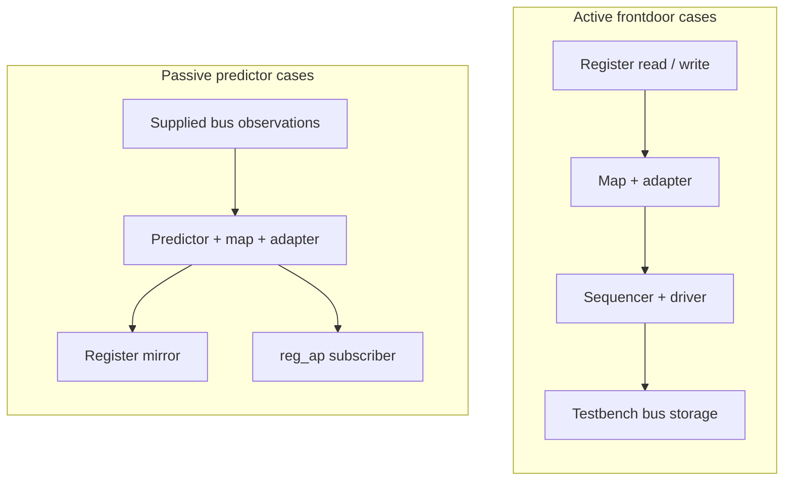
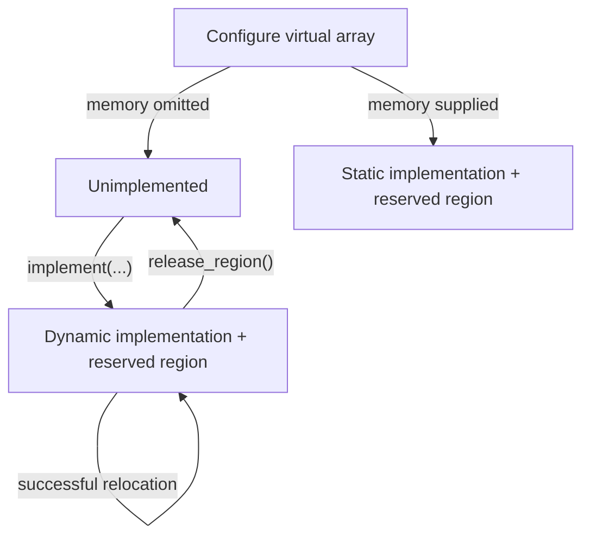
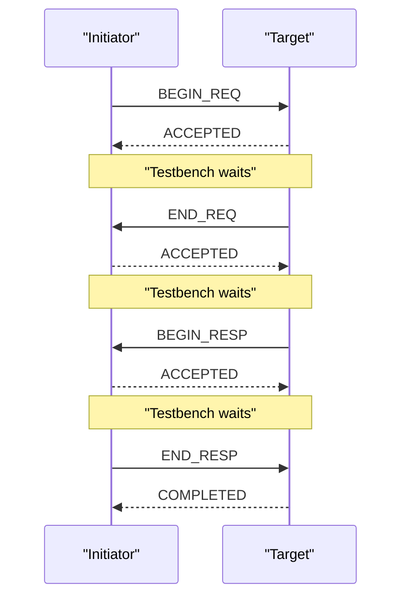
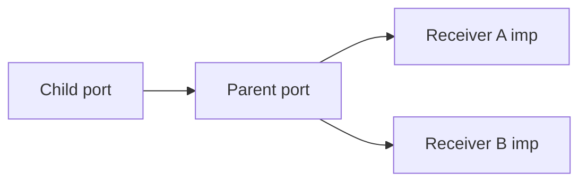
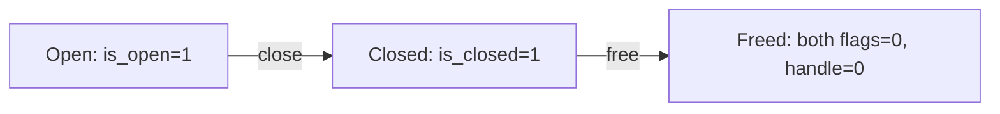
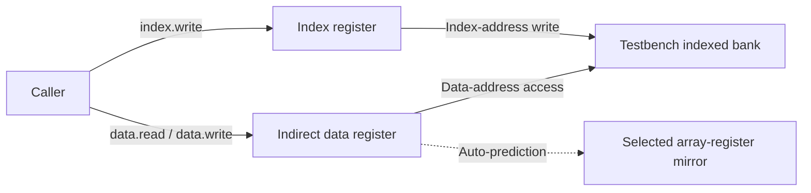
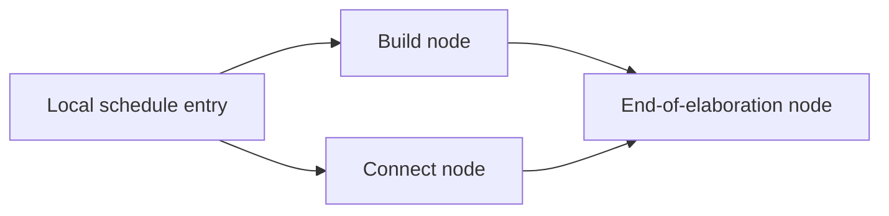
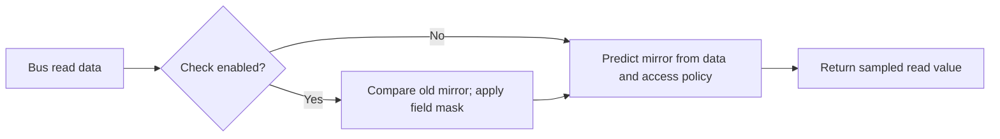
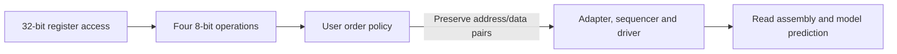
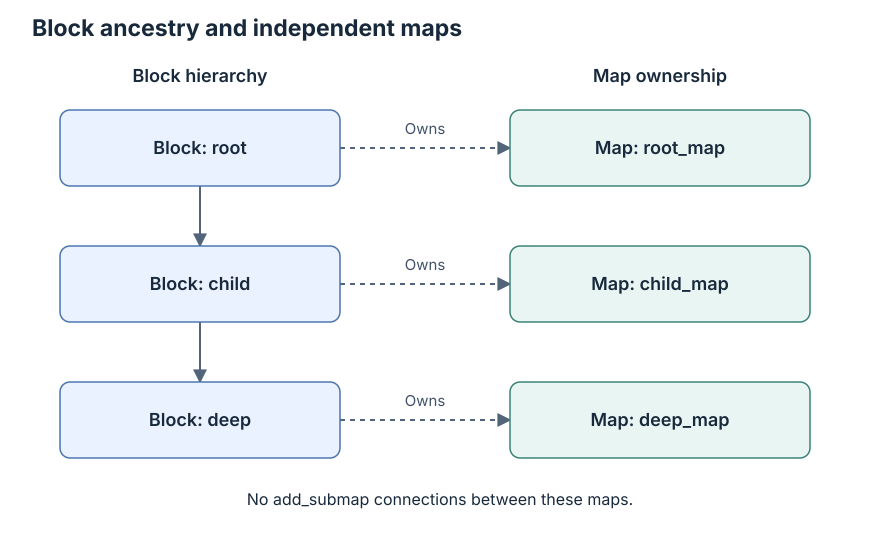

# FAQ

[日本語](faq.ja.md) · [README](../README.md) · [Glossary](glossary.md)

If you do not yet know which question applies, [the reading guide](reading-guide.md) connects the first run, result labels and progress counts.

This guide describes the current runners. Counts and measurement scope are
kept in the [README](../README.md#current-results); specific limitations are
in [known differences](known-differences.md).

## Find an explanation

The questions are grouped by topic, so use the entry matching your task and follow its links to the detailed guide.

- Preparing a first run: [getting started](#getting-started) and [runner commands](testing.md#running-the-suite).
- Interpreting output or an exit code: [result labels](#understanding-a-result) and [measurement conditions](results.md#interpretation).
- Interpreting compiler diagnostics: [rejection and legal controls](#compiler-rejection-and-legal-controls) and [test metadata](testing.md#metadata).
- Understanding sequences and communication: [locking and transport](#locking-and-nonblocking-transport) and [TLM terms](glossary.md#transaction-level-communication).
- Understanding register tests: [model basics](#register-model-basics) and [register terms](glossary.md#register-model).
- Checking progress or changing a mapping: [M4 questions](#requirement-ledger-and-m4) and [the ledger update procedure](requirements.md#updating-a-test-or-mapping).
- Reporting a problem: [posting policy](#commercial-simulator-and-issue-reporting-policy) and [source provenance](provenance.md#library-and-standards).

## Getting started

### Q1. How does this differ from kirimasim-tests?

kirimasim-tests checks SystemVerilog language behavior against IEEE 1800-2023.
This suite checks UVM behavior against IEEE 1800.2-2020 while a simulator runs
the pinned UVM library. A language-only reproduction of a UVM failure belongs
in kirimasim-tests; a UVM mismatch may involve the simulator, library or test.

### Q2. What do I need, and where does UVM come from?

Use Python 3.10 or later and a simulator able to run UVM. The fixed oracle is
Verilator 5.052, whose model builds also require a C++ toolchain and make.
The [Check workflow](../.github/workflows/check.yml) contains its Ubuntu setup.

Run `python3 tools/fetch_uvm.py` to fetch the locked Accellera UVM release.
`python3 tools/fetch_uvm.py --check` verifies the existing tree against its
file count and content digest. The library is fetched, not committed.

### Q3. How can I run one test first?

From the repository root, with Verilator 5.052 on PATH:

```sh
python3 tools/fetch_uvm.py
python3 tools/run_verilator.py --seeds 1 73 --build-jobs 2 -j 1 \
  --json out/verilator-smoke.json tests/u09/test_common_phases_run_in_order.sv
```

Put an option such as `--build-jobs` after the seed list and before a test
path, as shown: `--seeds` accepts multiple values. Explicit paths select only
those tests. A smoke run checks one selected case; [Execution and result records](glossary.md#execution-and-result-records) explains its seed and result labels.

### Q4. How do I include spec-only cases?

Expanding selection with `--all` does not supply a DPI implementation, so [Q12](#q12-does-uvm_dpi-yes-automatically-enable-a-working-dpi-build) explains when a separate backend runner is needed.

Without paths, Verilator selects tests tagged `verilator@5.052` that do not
depend on X/Z. Add `--all` to include every two-state case:

```sh
python3 tools/run_verilator.py --all --seeds 1 73 --build-jobs 2 -j 2 \
  --json out/verilator-all.json
```

kirimasim and Ghost select all tests by default. `--all` belongs to the
Verilator runner; it is not a shared option for the other runners.

## Understanding a result

Result labels describe the runner judgment for a stated condition, and [Interpretation](results.md#interpretation) explains why a difference does not identify its cause.

### Q5. What do pass, fail, known and unsupported mean?

For an illegal-design case, a match means rejection with the required diagnostic rather than a successful simulation; [Q199](#q199-why-does-a-compiler-rejection-count-as-a-match) explains that expectation.

| Status | Meaning | Recorded by |
| --- | --- | --- |
| `pass` | Expected output and required exit/diagnostic conditions match | All three runners |
| `fail` | Output or another condition differs, or building/running failed | kirimasim, Ghost; Verilator for tagged oracles |
| `known` | An untagged Verilator case differs or fails to build/run; not a pass | Verilator only |
| `unsupported` | The recognized unsupported-feature diagnostic and exit code are returned | kirimasim only |

Ghost records mismatches as `fail`, including bundled-library differences.
Other kirimasim compilation failures can still be `fail`.
Do not interpret the number of failed tests as the number of distinct bugs.

### Q6. Why can Verilator exit successfully with KNOWN results?

Its exit status tracks regressions in tagged fixed-release oracles. An untagged
mismatch is recorded as `known` in JSON and does not make the command fail.
An untagged match is recorded as `pass`, but remains outside the terminal's
tagged-oracle denominator and does not automatically receive an oracle tag.
kirimasim exits unsuccessfully for either `fail` or `unsupported` results;
Ghost does so for `fail` results. Read JSON statuses as well as the command exit code.

### Q7. Why compare UT lines rather than all UVM messages?

Default UVM report layout, paths, line numbers and time formatting vary.
The runner selects only lines beginning exactly with `UT: ` and preserves
their order, spaces and values. Tests expose specified behavior through those
lines, including report counts. They may also specify exit/diagnostic checks.
See [what is observed](testing.md#what-is-observed).

Some tests intentionally request an operation that must report a UVM error,
then check the resulting count. That error alone does not make a test fail;
its required outcome and termination conditions decide the result.

### Q8. Why keep spec-only tests instead of copying the library's output?

The standard determines the expectation. A library or simulator discrepancy
does not redefine it. The current spec-only cases include initial transaction
state, invalid field-operation access, report reset, objector membership,
response controls and USER arbitration. The phase-task termination difference
has not been assigned to either the simulator or library. See
[known differences](known-differences.md) for scope and linked tests.

### Q9. Why does a green Check not mean kirimasim passes UVM?

[Check](../.github/workflows/check.yml) checks metadata, tools, the pinned
library and tagged Verilator oracles. It does not run kirimasim or Ghost and
does not require spec-only cases to match. Most cases in the current kirimasim
run stop at `uvm_object_wrapper` as unsupported; the remaining cases fail
earlier on missing library APIs. Neither result establishes behavior beyond
those compilation blockers.

### Q10. Where is Nightly or the public results dashboard?

This repository currently has no Nightly workflow or automatic results
publication. Its badges link to Check and the license. kirimasim-tests has its
own Nightly, which does not report this UVM suite. Runner JSON under `out/`
stays local unless deliberately shared; pushing tests does not publish it.

## Execution conditions

### Q11. What does the Ghost result cover, and why an alias?

Ghost is an unreleased simulator participating under an alias. Its executable
identity, version, paths, profiles and diagnostics stay private. Public JSON
uses generic reasons and content fingerprints.

| Mode | UVM supplied by | What the result covers |
| --- | --- | --- |
| `pinned` | Runner compiles the locked library; profile disables automatic bundled UVM | Simulator with the locked library |
| `bundled` | Profile supplies a library tree or declares embedded UVM | Simulator with the supplied library; not evidence for the locked library |

A bundled library is identified by its tree digest or embedded-library
declaration. A bundled mismatch does not by itself distinguish a simulator
problem from a library problem.
See [Ghost setup](testing.md#ghost).

### Q12. Does uvm_dpi: yes automatically enable a working DPI build?

It removes `UVM_NO_DPI` from the default macro list. It does not supply or link
UVM's C/C++ implementation. The current Verilator runner does not add those
sources. There are 2332 `UVM_NO_DPI` cases and thirty-four explicit HDL-DPI cases.
Eighteen more fixtures explicitly enable command-line/regex DPI with HDL disabled.
The [command-line runner](testing.md#verilator-command-line-subset) links that separate backend.
The [separate VPI runner](testing.md#verilator-vpi-hdl-subset) links the original
limited backend; results apply only to that declared execution condition.
User-defined `uvm_reg_backdoor` handlers can operate without HDL DPI (Q67).
Glob matching without DPI is also not the same as full regular-expression support.

### Q13. Why is compilation heavy, and what do the two job options control?

With `-j 2 --build-jobs 2`, up to two tests build concurrently with two C++ build jobs each; [the runner guide](testing.md#running-the-suite) explains how to choose those limits for your machine.

Every test builds the UVM package as part of its model. `-j` controls the number
of concurrent tests; `--build-jobs` controls C++ jobs within each Verilator build.
For runtime tests, using `--seeds` builds once and runs a fresh process for each seed. The runner
disables ccache through the build environment because the model's precompiled
header records an absolute build-directory path and cannot be reused that way.

### Q14. Do two seeds prove determinism or four-state correctness?

No. Seeds 1 and 73 check the fixed-release expectation under different
randomized initialization conditions; tests do not print random values.
Verilator's default selection excludes X/Z-dependent cases. A two-state run
does not establish four-state behavior, and two passing seeds do not prove all
possible executions. A multi-seed test stops at its first mismatch; the current
runtime known records establish seed 1 differences, not seed 73 results for
those cases. A case that cannot build has no runtime seed result.

### Q15. How do I know whether an old result still applies?

Compare test input hashes, runner hashes, configuration, simulator version and
library identity. JSON records `inputs_sha256`, `runner_sha256`,
`runner_changed`, `configuration` and `generated_at`; an input changed during
a run is marked `inputs_changed` instead of receiving a valid input hash.
Ghost additionally fingerprints its executable, profile and supplied library.
Changed inputs or conditions require new evidence; unchanged records can be
combined, while preserving their batch provenance. A combined result is not
a claim that every test was rebuilt together.

The identity checklist in [Evidence assembly](results.md#evidence-assembly) explains what to compare before combining saved results.

## Scope, review and contributions

Execution success and requirement review are separate records, so use [Read coverage and progress](reading-guide.md#read-coverage-and-progress) when reading completion or coverage answers.

### Q16. Are M1, M2 or M3 complete, and what does the test count cover?

M1 and M2 still have open clause targets. M3 now has 796
register-layer cases, including testbench frontdoor paths; it is also incomplete. Starting a stage does not complete
the preceding stages.
The [plan](../README.md#plan) identifies current scope and remaining work.
Counts are test cases, not a reviewed inventory of every requirement or
combination in the standard. Clause citations alone do not establish coverage;
M4 now has an [initial ledger and census](requirements.md); normative
decomposition and denominator approval remain open.

### Q17. Does spec_check: ai mean human review or proof?

It records AI comparison of the expectation with the cited standard. It is
neither human review nor a proof of full coverage. All current tests have this
value. Fixed-release reproduction is a separate record in `:oracle:`.

### Q18. How should I report or correct a wrong expectation?

Identify the test, cited clause, expected observation and execution conditions.
Separate changes needed in the test from simulator or library discrepancies.
Preserve privacy for Ghost. After a correction, run metadata and tool checks,
then reproduce any fixed-release oracle with both seeds. See
[adding or correcting a test](testing.md#adding-or-correcting-a-test).

The IEEE PDFs used for review remain local and ignored by Git; do not copy
their text or examples into the suite. Describe behavior in your own words
and cite clause numbers. The UVM library is fetched separately under Apache-2.0;
the suite is Apache-2.0 WITH LLVM-exception.

## Locking and nonblocking transport

Sequences supply transactions and sequencers arbitrate them; [the UVM building blocks](glossary.md#uvm-building-blocks) introduce those roles before the ownership and transport questions below.

### Q19. How do lock and grab differ, and can a lock owner be blocked?

Lock joins regular request arbitration; grab enters at the front. Both wait
when an incompatible existing lock or grab prevents acquisition. A child's
ownership can temporarily block its parent even when the parent still owns
a lock. Inspect `is_blocked` as well as `has_lock`; `current_grabber` identifies
the sequence currently allowed to act under nested ownership.

Current tests cover ownership, nested release, waiting acquisitions and real
driver item exclusion. Two lock-order cases retain spec-only expectations:
FIFO order behind an earlier pending item and waiting for an already granted
item's completion. The pinned library grants these locks too early; see
[known differences](known-differences.md).

### Q20. How can nonblocking transport return a response immediately?

A target can compute a response synchronously when the accepted request's
analysis notification is delivered, then write it through the response put
port before `nb_transport` returns. The tests connect this path through public
interfaces and retire the accepted request afterwards so the slot can be reused.

When completion is not immediate, the return value is 0. These expectations
do not prescribe its response output argument or whether a partial request
was queued. The recovery case drains any residual request through `try_get`
before a fresh transaction, without asserting that drain's return value.

### Q21. What happens to a sequence's body and hooks when it is killed?

Kill terminates active body work, changes the state to `UVM_STOPPED` and
releases the waiting `start` call. It also cleans up the sequence's sequencer
requests and ownership. The standard requires the `post_body` and `post_start`
hooks as well as the `do_kill` termination hook. The pinned library omits the
two post hooks; bound and unbound tests preserve that required behavior as
spec-only expectations.

Tests check direct-kill automatic-objection drop and sequencer reuse after
`stop_sequences`. The stop operation must drop automatic objections too,
but its pinned root stop path omits the drop. Standalone and parent/child
cases retain that requirement as spec-only; see [known differences](known-differences.md).
A driver-held request flushed by that operation is not
acknowledged afterwards; the test retrieves a new request before calling
`item_done` for it.

### Q22. How is a default phase sequence selected?

At phase start, the sequencer looks up `default_sequence` resources at its
full path plus the phase name, such as `uvm_test_top.sequencer.main_phase`.
Relevant resource types are `uvm_sequence_base` and `uvm_object_wrapper`.
Precedence selects the resource; a selected null disables the default.
An instance is used directly, while a wrapper uses the factory with the
sequencer path and wrapper type name as its creation context.

The sequence receives its sequencer and starting phase, is randomized unless
disabled and is killed if it outlives the phase. A wrapper creating a
non-sequence must report an error and start no default. The pinned library
only warns in that case, so the required error is retained as spec-only.

### Q23. What should happen to a response sent after its sequence finishes or stops?

`put_response` must drop it and report a warning when the original sequence
is `UVM_FINISHED` or `UVM_STOPPED`. Tests copy IDs from real requests, then
retire the sequence and check both the warning and non-delivery. Queue probes
use a bounded wait; handler probes verify no callback. A killed sequence must
not prevent another active sequence from receiving its own response.

A transaction ID is not the whole routing identity. Reusing it in a new
sequence must not let a stale response from the stopped sequence contaminate
the fresh route. These checks concern late delivery, not every possible aspect
of clearing replies that were already delivered before stop.

### Q24. Does a specific default-sequence instance always outrank a wrapper?

No. First keep only `uvm_sequence_base` and `uvm_object_wrapper` resources,
then choose highest precedence. For a tie, choose the first remaining entry
in the lookup queue. Removing wrong-type resources must preserve the relative
order of the valid entries. An unrelated null `uvm_object` resource is filtered;
only a selected null of an accepted resource type disables the default.

The equal-precedence tests create separate resources and insert them through
the public pool API with low priority, in explicit order. They do not infer
that order from repeated `config_db::set` calls that may update one setting.

### Q25. Does a TLM delay annotation advance simulation time?

The annotation object carries an offset; changing it does not wait. A target
can add an annotation and return in the same simulation time slot, or explicitly
wait as part of a blocking implementation. Tests observe annotation values and
simulation-time equality separately. Absolute conversion uses an explicit
seconds-per-unit argument. Scaled operations use the matching time literal;
the tests' 100-second scale is only a conversion reference, not a simulation delay.

Real values are compared with a small tolerance. Sub-resolution rounding,
negative times and a particular floating-point encoding are not prescribed by
these cases. The pinned library's default name and missing standard setter
remain in [known differences](known-differences.md); the setter case cannot
build and is not described as a failed seed execution.

### Q26. Why not repair the nested socket backward path inside the test?

The nonblocking socket `connect` API is responsible for the automatic backward
connections. Manual wiring would bypass that behavior. The nested initiator
case therefore keeps the required route, even though the pinned library wires
the two backward exports in the opposite direction and fails binding checks.
The forward hierarchy uses child ports connected to parent ports as required.

Passing the other paths verifies payload/delay identity, annotations, return
status and phase-reference propagation for those transactions. It does not
certify every legal base-protocol or timing combination. Callback iterator
tests likewise leave integer positions opaque and restart through public APIs.

## Push delivery, sequence actions and payload packing

### Q27. What completes an item sent through a push sequencer?

A push sequencer delivers a request by calling the driver, and [the TLM terms](glossary.md#transaction-level-communication) introduce this path before the completion rule below.

IEEE 1800.2-2020 15.6.3.3 requires the sequence's optional item-completion
wait to return after the driver's blocking `put` returns. The push driver
does not use a pull port's `item_done`. A positive-delay test checks that
`finish_item` remains blocked while `put` is still processing the request.
Separate cases send three requests and inspect delivery and common request
and response histories. See [known differences](known-differences.md) for
the pinned library's repeated-request limitation.

### Q28. Do all sequence action macros randomize their argument?

No. `uvm_create` only creates the item or child sequence and sets its context.
`uvm_send` executes it without randomization. `uvm_rand_send` randomizes before
execution, except when a child sequence has randomization disabled. `uvm_do`
combines creation with randomized execution. Child-sequence execution passes
`call_pre_post` zero, suppressing `pre_body` and `post_body`, while still
running `body`. The tests use singleton constraints and callback counts, so
their expected values do not depend on which legal random value is selected.

### Q29. What is included when a generic payload is packed?

Packing serializes selected payload fields into a stream, and [the payload terms](glossary.md#transaction-level-communication) explain why a backing array and its active length can differ.

The standard specifies an ordered set of scalar fields and the active data
and byte-enable prefixes. Backing-array bytes beyond the declared lengths
and extensions are excluded by default. A declared length larger than the
corresponding array requires a fatal report. The fatal tests finish inside
a report catcher as soon as that severity is observed; they make no claim
about execution after a fatal has been suppressed. Round trips and decoding
through the public packer API avoid prescribing a binary stream encoding.

## Sequence libraries and macro controls

A sequence library selects among registered sequence types; [the UVM glossary](glossary.md#uvm-building-blocks) introduces library membership and selection before the registration rules below.

### Q30. How do instance and typewide library registration differ?

`add_sequence` and `add_sequences` affect one library. The static typewide
forms affect libraries constructed afterwards; existing instances are not
updated by an addition. Duplicate sequence types are silently ignored.
`get_sequences` appends the registered list after any existing caller prefix.
Tests compare membership without imposing an undocumented insertion order.

Removal has a different rule: removing a statically registered type must
update all instances, and removing an absent type must warn. The pinned
library removes only from the receiving instance and omits the absent-type
warning. Both required behaviors remain in
[known differences](known-differences.md).

### Q31. Why do some sequence-library tests fail before a seed is run?

IEEE 1800.2-2020 defines getters/setters for selection mode and minimum/maximum
random counts, plus `get_num_sequences_executed`. These seven methods are
absent from the pinned library. Six cases keep those standard calls and
cannot build; they have no runtime seed result. Legacy public fields are not
substituted for required APIs. Passing registration and direct-selector cases
does not establish execution-mode or execution-counter conformance.

### Q32. Does disabling an item's random field skip randomization callbacks?

No. A field's `rand_mode(0)` keeps that field's assigned value, while the
item's `randomize` operation still invokes its callbacks. Disabling child
sequence randomization instead makes the action skip that operation entirely.
The macro tests distinguish those controls, check factory overrides at
creation, and trace parent hooks around randomization and driver delivery.
The typed-sequencer declaration test uses an explicit cast before accessing
the subtype member; it does not assume an automatic initialization policy.

## Low-level sequence submission and transport delegation

### Q33. How are grant, submission and item completion ordered?

A grant authorizes submission, while completion acknowledges a request; [the sequence terms](glossary.md#uvm-building-blocks) distinguish both from delivering a separate response.

After establishing the item's context, a sequence calls `wait_for_grant`,
then `send_request` without a simulation-time delay. It may then wait for
completion. The default send does not rerandomize; setting its rerandomize
argument to 1 requests that operation before driver delivery.

Completion comes from `item_done` or implicitly from `get`. A waiter for a
specific transaction ID must start before that item's acknowledgement;
waiting afterwards can hang. The
[two-request case](../tests/u14/test_sequence_wait_for_item_done_matches_each_explicit_transaction_id.sv)
uses separate acknowledgements and samples while the second item is held.
Completion notification does not itself supply a response transaction.

### Q34. Which component handles a split master/slave imp call?

The imp's request and response constructor arguments select the sibling
implementations. The parent owns the imp but need not implement their
transfer methods. A master puts requests and gets/peeks responses; a slave
gets/peeks requests and puts responses.

The [mixed master case](../tests/u12/test_master_combined_imp_routes_mixed_operations_to_split_implementations.sv)
uses integer requests and string responses, mixes blocking/nonblocking calls
and checks independent storage reuse. Separate cases exercise exports,
availability and capacity. Failed reads do not assert an unspecified output.

### Q35. Do ordinary TLM 2 exports connect the backward path automatically?

Ordinary forward and backward paths are connected separately. A port can
traverse an export chain to its imp, which invokes the selected implementation.
The round-trip test explicitly binds both directions; it does not rely on
socket connection side effects.

The [custom forward case](../tests/u12/test_tlm2_nested_forward_exports_preserve_custom_transaction_and_phase_types.sv)
uses a custom transaction and phase enum through two exports. It checks
handle identity, typed phase-reference updates and annotations. Those generic
binding results do not establish a legal base-protocol exchange for every
phase or timing combination.

## FIFO notifications and explicit execution contexts

### Q36. Does peeking at a FIFO publish a get_ap notification?

Peek observes a FIFO head without removing it, and [the FIFO terms](glossary.md#transaction-level-communication) distinguish observation from consumption before the notification rule below.

Yes. IEEE 1800.2-2020 12.2.8.1.6 includes `peek` and successful `try_peek`,
as well as get operations. Peeking retains the item; notification does not
mean removal. The two peek cases observe two notifications before consuming
the value. The pinned library omits both kinds of peek notification, so the
required counts remain in [known differences](known-differences.md).

Other cases check fanout to independent subscribers, accepted puts,
successful gets, and shared object identity. Failed reads do not assert their
output value, and unavailable transfers do not supply a transaction to publish.

### Q37. Which sequencer and priority does start_item use?

It chooses the explicit sequencer argument first, then the item's sequencer,
then the current sequence's sequencer. The
[three-context case](../tests/u14/test_sequence_start_item_explicit_sequencer_overrides_item_and_parent_context.sv)
uses separate sequencers and drivers to observe the selected path. A
nonnegative priority overrides the sequence priority; every negative value
inherits it, including values other than -1.

A null item, a sequence whose `is_item` returns zero, or the absence of all
three sequencer contexts requires ERROR and an immediate return. The pinned
library uses FATAL instead. Tests count the original severity with a report
catcher and retain the required ERROR in
[known differences](known-differences.md).

### Q38. Which callbacks run when a macro names an external object?

`uvm_do_obj_callbacks` and its exit-on form use the supplied object. Entries
registered only on the calling dispatcher are excluded. Applicable typewide
and selected-instance entries participate, with disabled entries skipped.
The [context-switch case](../tests/uB/test_callback_object_macro_switches_between_explicit_external_contexts.sv)
uses one dispatcher with two external objects and checks each chosen context.

Exit-on tests stop at the first matching true or false result. When no
callback matches, the tests check traversal or the absence of calls without
prescribing the enclosing function's no-match result or fallthrough policy.

## TLM implementation declaration macros

An imp supplies the methods called through a TLM port or export; [the TLM glossary](glossary.md#transaction-level-communication) explains these connection roles before the generated method names below.

### Q39. What does the suffix of an imp declaration macro change?

It creates a distinct imp class and selects correspondingly named
implementation methods. The connected port keeps its ordinary interface:
`put` reaches `put_left` through a `_left` imp, for example. The component can
therefore expose two implementations without an unsuffixed `put` method.

The [combined put case](../tests/uB/test_tlm_put_imp_decl_routes_two_suffixes.sv)
checks both blocking and nonblocking calls, rejection while full, and
successful reuse after a lane is freed. The declaration cases cover the 22
Annex B.5 families with two independently named inputs. They do not establish
every illegal binding or scheduling combination.

### Q40. Can a generated master imp use separate request and response objects?

Yes. `REQ_IMP` and `RSP_IMP` describe their types; the constructor's `req_imp`
and `rsp_imp` arguments select the sibling instances. The suffix applies to
the methods on those objects. The
[split implementation case](../tests/uB/test_tlm_master_imp_decl_delegates_suffixed_methods_to_split_sibling_implementations.sv)
uses integer requests, string responses and a parent with no transfer methods.
Blocking and nonblocking operations must reach the correct sibling and suffix.

Separate analysis cases pass original class handles through suffixed write
methods. The tests compare identity and per-input counts without requiring
implicit cloning or transaction mutation.

### Q41. Why does the B.5.11 case use the get/peek macro spelling?

The clause heading names `uvm_nonblocking_get_peek_imp_decl`, and its prose
describes the combined nonblocking get/peek class. Its displayed invocation
instead uses the peek-only spelling from B.5.8. The
[B.5.11 case](../tests/uB/test_tlm_nonblocking_get_peek_imp_decl_routes_two_suffixes.sv)
follows the heading and described class, exercising both get and peek.

This interpretation is recorded in the test comment and remains a review
item. Matching the pinned library records fixed-release reproduction; it
does not resolve the standard's spelling inconsistency or replace human
review. The case retains `spec_check: ai` like the rest of the current suite.

## Library construction, item completion and extension identity

### Q42. Why test static library membership immediately after construction?

The standard's library-subtype pattern uses the utilities macro and a
constructor calling `super.new`. Static members registered with the subtype
or its bases must then be available. Four cases check two instances, two
library types, inherited members and a local addition beside static members.

The pinned library leaves these subtype lists unpopulated. The tests keep
public enumeration and do not invoke an additional implementation-specific
initialization method; see [known differences](known-differences.md).
Separate positive cases use instance registration and default RAND execution
for ten children. Singleton selection constraints avoid distribution or
registration-order assumptions. These results do not validate missing APIs.

### Q43. Why observe finish_item calls when requests already reach the driver?

Clause 14.2.6.3 requires the sequence's virtual `send_request` and
`wait_for_item_done` calls, with rerandomization zero and the item's explicit
transaction ID. The pinned library calls the sequencer directly and uses -1
for the completion ID. Tests distinguish virtual-method dispatch from
argument forwarding. Three additional guards require ERROR and an immediate
return for invalid input; faulty pinned paths can terminate on dereference.
These are runtime known differences, described in
[known differences](known-differences.md), rather than missing-API builds.

The [hook-order case](../tests/u14/test_sequence_finish_item_orders_mid_mutation_before_send_and_post_after_ack.sv)
also checks that a mid-do mutation is visible at submission and post-do sees
the delayed acknowledgement. Report catchers count severity without rewriting
it; no post-fatal continuation policy is prescribed.

### Q44. Is an extension type key the same as its instance name?

An extension attaches additional typed data to a payload, and [the extension terms](glossary.md#uvm-building-blocks) distinguish its type identity from the name of one object.

The type key returned through `uvm_tlm_extension_base::get_type_handle`
identifies the extension type. Same-type instances share the key, including
after an instance is renamed; different types retain different keys even if
their instance names match. Type-handle names are compared for stable and
distinct type identity without requiring a particular qualified spelling.

Payload insertion, replacement and clearing use those opaque keys. The
[short-alias case](../tests/u12/test_tlm2_gp_alias_shares_payload_and_polymorphic_extension_state.sv)
also verifies that `uvm_tlm_gp` and `uvm_tlm_generic_payload` handles observe
the same payload bindings. No numeric type ID or implicit clone is required.

## Register model basics

Desired values, mirrors and accessed storage are distinct states; [Register model](glossary.md#register-model) explains the vocabulary used in the register answers.

### Q45. Do set, predict and reset access the DUT?

The first M3 cases use model-only operations. Desired state is what the model
wants to write; mirrored state is what it currently records for the register.
For the idle fields used here, prediction uses `UVM_PREDICT_DIRECT`:

| Operation | Desired state | Mirrored state | DUT access |
| --- | --- | --- | --- |
| `set(value)` | Applies the configured access policy | Unchanged | None |
| `predict` (DIRECT) | Replaced by the computed value | Replaced by the computed value | None |
| `reset(kind)` | Restored if that reset kind exists | Restored if that reset kind exists | None |

Read-only `set` leaves desired state unchanged; W1C `set` clears the selected
one bits in it. Direct prediction ignores access policy. A reset kind with no
configured value leaves the field unchanged. `needs_update` checks the need
to reconcile writable desired state; it does not itself perform an update.
The [field set case](../tests/u18/test_reg_field_set_changes_desired_without_predicting_mirror.sv)
and [recursive reset case](../tests/u18/test_reg_block_reset_recurses_into_child_registers.sv)
observe these states without a bus or HDL backdoor.

### Q46. Are map addresses bytes, and why can the returned list run backwards?

Data significance and transaction timing are different orders, and [the bus-observation FAQ](#q290-why-sort-the-observed-requests-by-address) explains how an oracle compares completed requests without assuming an unspecified issue order.

Address units depend on `byte_addressing`: one byte when enabled, otherwise
the configured bus width. A register's local offset and external physical
address have separate meanings. The
[word-address case](../tests/u18/test_reg_map_word_addressing_translates_offsets_in_bus_units.sv)
uses consecutive word addresses for successive bus transfers.

`get_addresses` lists physical addresses in order of least-significant data
first. A big-endian map can therefore return numerically descending addresses.
The [little-endian](../tests/u18/test_reg_map_little_endian_wide_register_lists_addresses_in_data_order.sv)
and [big-endian](../tests/u18/test_reg_map_big_endian_wide_register_lists_addresses_in_data_order.sv)
cases each split a six-byte register across three two-byte accesses.
A submap adds its parent offset and uses the narrowest bus on the route to
the root. These calculations do not execute those bus transfers.

### Q47. Which register-model foundations are covered?

The suite checks field/register/block construction and layout, access
policies, reset kinds, desired/mirrored state, recursive reset and locking,
and map units, rights, endianness, relocation and hierarchy. Pre-lock field
lookup and map width/translation cases retain spec-only expectations;
pre-lock probes include post-lock controls.

Memory, adapter, predictor, frontdoor, callback and virtual-register cases
are described below. Remaining work includes broader packing/error and
policy/map conditions, integrated prediction, more frontdoor/callback
combinations, HDL-path/DPI setups, broader allocation-policy conditions and
broader annex E conditions.
Q68 covers selected built-in test sequences and dispatch masks. Register
and memory map queries use explicit arguments.
The release's multiple-map note and null-map resolution are explained in
[known differences](known-differences.md). All cases retain `spec_check: ai`;
this is not a reviewed register-layer requirement-coverage inventory.

## Memory, prediction and map controls

### Q48. Are memories mirrored like registers, and what do their offsets mean?

A location index selects one memory word, while its external address depends on the map; [the register-model terms](glossary.md#register-model) explain these units before the examples below.

`uvm_mem` describes contiguous locations without storing a mirror for every
location. Construction records the number and bit width of locations; each
location's byte width rounds up independently. Current memory tests inspect
layout and addresses; the frontdoor additions also transfer data through a
testbench driver, as described in Q54.

The location index selects a different local offset and external address.
Byte-addressed two-byte locations advance by two address units; word-addressed
four-byte locations on a four-byte bus advance by one. The pinned library
ignores the location in `get_offset`, so its
[location-offset case](../tests/u18/test_mem_location_offsets_include_the_location_index_stride.sv)
retains the normative expectation even though external addresses advance.

For an unshared memory, the rights query is RW under 18.6.4.5. Effective
access is a separate query: 18.6.4.6 requires the supplied map's restrictions.
The [single-map access case](../tests/u18/test_mem_intrinsic_readonly_policy_and_map_rights_are_distinct.sv)
retains that distinction as a known difference.

A [two-interface case](../tests/u18/test_mem_two_interface_maps_preserve_membership_addresses_and_rights.sv)
checks explicit map membership, independent addresses and RO/WO rights with
no errors. This result concerns that sibling-map setup; shared-map hierarchy
behavior and the release's multiple-map note need separate review.

### Q49. Do READ and WRITE predictions perform bus transactions?

No. A prediction supplies a computed or observed value to the model.
`UVM_PREDICT_DIRECT` copies it without access-policy effects; READ and WRITE
predictions apply the effects associated with that observed operation.
The field prediction cases synthesize observations, without executing a driver or DUT.

READ prediction leaves RC state cleared and RS state set after the sampled
read. WRITE prediction applies selected-bit clearing, setting or toggling
for W1C/W1S/W1T and zero-selected changes for W0C/W0S. Two successive writes
check accumulated state. The
[write-once case](../tests/u18/test_reg_field_write_once_prediction_rearms_only_after_hard_reset.sv)
checks that a SOFT reset restores its configured value while retaining write
protection, and HARD reset permits a new first write. Desired and mirrored
values are observed separately in every case.

### Q50. What do the map controls establish?

Register and memory relocation refresh both physical addresses and locked
lookup results. Lookup probes use a zero root base. A shared RO/WO address
selects a different register for reads and writes, and conflicting field/map
permissions produce NOACCESS. These are model queries, without bus traffic.

Map `reset()` defaults to SOFT, while register and field reset default to HARD.
The [scoped reset case](../tests/u18/test_reg_map_reset_defaults_to_soft_and_preserves_other_maps_registers.sv)
checks that another map's register stays unchanged. Negative probes observe
original warning/error severities, required return values and an unchanged
caller array. The auto-predict case checks independent mode flags only;
the frontdoor cases below additionally check its effect during bus-model reads and writes.

## Adapter, predictor and frontdoor paths

An adapter converts register and bus operations, while a predictor updates model state from observed traffic; [the register glossary](glossary.md#register-model) explains how those roles relate to frontdoor access.

### Q51. What do the adapter and operation-descriptor cases check?

Seven cases exercise the standard TLM adapter's command, address, byte
length, allocation, byte enables, successful/error response conversion and
out-of-callback context. Uniform data bytes avoid a numeric byte-order
assumption; failed reads do not prescribe returned data. The
[operation-array case](../tests/u19/test_reg_item_value_array_resize_preserves_prefix_and_zero_fills_growth.sv)
checks the default size, prefix preservation and zero initialization during
growth and shrink/regrowth, as specified by 19.1.1.2.4.

The active context case reads `get_item` during `reg2bus` without modifying
it. It observes the selected register, map, extension, access kind and door.
The accessor must be null outside that callback, including in `bus2reg`.

### Q52. How do passive prediction and frontdoor auto-prediction differ?

These tests use separate fixtures. Built-in frontdoor cases initiate register accesses
through a sequencer and driver; passive cases inject observed packets through
an analysis port into a predictor configured with its map and adapter.



Predictor tests check RW/RO and RC/W1C effects, published operation metadata,
wide-register accumulation in both endian modes, and ignored memory/unmapped
addresses. A wide operation publishes only when all required bus words arrive.
The hook-redirection case retains the target and value changes required by
19.3.3.2; see [known differences](known-differences.md).

### Q53. Do the frontdoor cases test an RTL device or every bus combination?

The built-in fixtures use testbench storage with real sequencer/driver handshakes and
positive-delay acknowledgements. The tests check read/write results with
auto-prediction enabled and disabled, a separate response item, narrow-bus
write associations and adapter context. Address/data associations are checked
without imposing an unspecified transfer order. The big-endian wide-read case
uses the standard TLM adapter and retains required reconstruction of repeated
payload bytes as spec-only.

These fixtures establish selected UVM paths without an RTL DUT or DPI. Actual
bus signal protocols, broader response/error and timing combinations, and
integrated monitor/predictor traffic remain future work. Q54–Q56 describe
the memory, update/mirror, error-status and access-hook additions.

## Memory transfers and register access hooks

### Q54. Which memory transfers are now tested?

Eight frontdoor cases check byte-wide reads/writes at nonzero location
indices, separate driver responses, little-endian 32-bit locations on a
byte-wide bus, word addressing, and three-location burst reads/writes.
The driver acknowledges requests after a positive delay and stores physical
address/data pairs. There is no RTL memory or per-location UVM mirror.

For the burst fixtures, memory width, bus width and `uvm_reg_data_t` width
are all 64 bits. Each array element fills one location, avoiding partial-beat
packing assumptions. Narrow-memory array packing, partial final beats,
big-endian memory transfers and memory-error combinations remain open.
The driver's storage is fixture state, not a mirror maintained by `uvm_mem`.
The burst pair retains spec-only expectations: 19.1.2.1 requires physical
bus descriptors to use READ/WRITE, but pinned UVM passes burst kinds to the
adapter. See [known differences](known-differences.md).

### Q55. How do update, mirror and bus errors behave in these cases?

`set` changes desired state without a transfer. `update` writes only when
needed; successful auto-prediction makes the next update a no-op. The W1C
and W1S cases separately observe the physical write mask and resulting
mirror, because the command data and policy result can differ.

`mirror(UVM_CHECK)` reads, reports a mismatch and refreshes the mirror.
A field with comparison disabled contributes no mismatch error. The catcher
counts original error severity and consumes the expected diagnostic without
rewriting it. Two further cases return a bus error through the adapter,
then verify that a successful retry completes. They make no assertion about
failed-read data or the mirror at the failed-operation boundary.

### Q56. Which access hooks and ordering rules are covered?

Register method overrides check pre-write value replacement, pre-read and
pre-write rejection before any bus request, post-read value replacement,
and post-read/post-write status replacement. The post-read value case checks
the caller result without prescribing the mirror after the hook.

Clauses 18.4.8.1/.3 and 18.5.6.1/.3 place register hooks before field hooks.
The two ordering cases expect `RF`; pinned UVM runs `FR`, so they retain
spec-only oracles. See [known differences](known-differences.md).
These eight tests override inherited methods. Q58 describes the added
registered callbacks; redirection, field/register ordering with registered
callbacks and further post-hook combinations remain separate work.

## Custom frontdoors, registered callbacks and virtual registers

### Q57. How are the custom frontdoor cases different from the built-in path?

Eight cases associate a `uvm_reg_frontdoor` sequence with a register or
memory. Its body receives `rw_info`, waits a positive delay and reads or
writes its own storage. These cases check register/memory data and status,
an unmapped register, element/map/extension context, the executing sequencer,
and replacing a register's map-specific handler.

The sequence body models the custom-access seam; it does not send adapter
items to a bus driver. The earlier built-in cases exercise that separate
sequencer/driver path. Neither fixture establishes an RTL protocol.
See the [operation-context case](../tests/u19/test_reg_custom_frontdoor_receives_extension_map_element_and_sequencer_context.sv).

### Q58. What do registered callbacks for registers add?

Seven instance-specific `uvm_reg_cb` cases check pre-write value replacement,
pre-read rejection, post-read value replacement, post-write status replacement,
removal, and ordering relative to the same register's inherited pre/post
methods. The pre method runs before the registered callback; the registered
post callback runs before the post method. These are distinct from the earlier
register-versus-field ordering cases.

An eighth case registers a field `post_predict` callback. It observes the
previous mirror and a READ prediction, then changes the resulting predicted
value. That fixture supplies an observation without bus traffic. Registration
on further memory/backdoor objects, encode/decode chains, redirection and
more field/register ordering combinations remain open.

### Q59. What do the virtual-register cases establish?

Eight cases check parent/unimplemented-memory state, static arrays with
packed or explicit increments, memory-map membership and external addresses,
virtual-field parent/width/position, field ordering and name lookup, and byte
width in a wider implementing memory. Virtual fields use factory creation.
Those eight cases query models. Q60–Q62 add transfers, selected dynamic
implementation paths and memory-manager operations. Q65 adds supplied-policy allocation; broader allocation-policy behavior and
protection against direct manager release of virtual-owned regions remain open.

For the explicit-stride fixture, each 16-bit element occupies two byte-wide
memory locations. The base location is 2 and the increment is 3 memory words:
`location(i) = 2 + 3*i`. A byte-addressed map base of `0x100` and memory offset
of `0x20` give the following layout; the address case observes element 2.

| Array index | Memory locations occupied | First external address |
| --- | --- | --- |
| 0 | 2–3 | `0x122` |
| 1 | 5–6 | `0x125` |
| 2 | 8–9 | `0x128` |

The [address case](../tests/u18/test_vreg_static_array_inherits_memory_map_membership_and_external_address.sv)
uses explicit map arguments. Clause 18.9.1.2.9 makes the reported byte width
an integral number of implementing memory locations. A 16-bit virtual register
in 32-bit memory therefore reports four bytes. Pinned UVM reports two, so
that case retains its required result as spec-only; see
[known differences](known-differences.md).

## Virtual-register transfers and memory regions

### Q60. Which virtual-register and region transfers are now exercised?

Seven cases access virtual-register/field data through the existing adapter,
sequencer and positive-delay testbench driver. They check packed-element
reads/writes, an explicit stride with untouched padding, a partial-field
write preserving other bits, a field read spanning memory locations, and
16-bit memory locations split over a byte-wide bus. A failed virtual read
is followed by a successful retry without asserting failed-read data.

An eighth case writes and reads a `uvm_mem_region` using an offset relative
to the region. A region starting at memory location 12 and relative offset 2
selects location 14, at physical byte address `0x2e` in that fixture.
These are selected frontdoor paths without an RTL DUT, virtual-register
mirror or backdoor integration.

### Q61. What does dynamic virtual-register implementation cover?

Eight cases check implementation and region geometry, moving within one
memory or to another memory in the same block, dynamic release and reuse,
static release rejection, overlap rejection, resize with an omitted memory
argument, and the region's virtual-array owner query.



The diagram shows successful lifecycle paths; static implementations retain
their reservation when dynamic release is attempted. Dynamic cases release
through `uvm_vreg`, not directly through the manager. Direct manager release
protection, in-place growth with explicit memory and further failure conditions
remain open. Q65 covers `allocate` with supplied singleton policies.

Two cases retain required results as spec-only. Clause 18.9.1.1.3 permits
omitting memory when resizing an existing array while keeping its placement;
pinned UVM rejects the null argument. Clause 18.12.7.2.7 requires the region
to return its implementing virtual array; pinned UVM leaves that owner null.
See [known differences](known-differences.md).

### Q62. What do the memory-manager cases check?

Eight standalone-manager cases cover byte requests rounded to memory-location
units, overlap and address bounds, per-region release and reuse, iteration
and reset, release-all, compatible reconfiguration, and a supplied allocation
policy. Iterator checks require each region once without imposing an address
order. Reconfiguration checks values rather than descriptor identity.

The request policy constrains the starting offset to one legal location,
so both seeds have the same result. This establishes policy handoff and
reservation, not statistical allocation behavior, GREEDY/THRIFTY differences
or BROAD/NEARBY locality. Standalone regions have no memory or virtual-array
owner. Direct region data accesses are covered by the attached-memory case
in Q60. Negative reservation cases do not require a diagnostic severity that
the cited clause does not prescribe.

## Commercial simulator and Issue reporting policy

### Q63. Does this project run or reuse results from commercial simulators?

The project does not run or compare commercial SystemVerilog simulators.
Their results, outputs and diagnostics, including material obtained by third
parties, are not used to derive expectations, design tests or make
implementation decisions. Keeping results private does not by itself establish
permission to use them. This operational policy avoids contractual issues
around publication, product-behavior analysis and competing-product development;
it is not a claim that ordinary testing is always prohibited. Conditions
vary by product, contract and jurisdiction.

Expectations come from IEEE 1800.2-2020 clauses and independently written
models. The `verilator@5.052` oracle records fixed-release reproduction;
kirimasim and publication-ready guest Ghost results describe only their recorded
conditions. Ghost is the project's pre-release guest, not a way to submit
commercial results under an alias. Commercial executability and agreement
are not established by this suite.

This follows the reporting policy of
[kirimasim-tests](https://github.com/kurochan001/kirimasim-tests), adapted to
this suite's UVM standard and supported runners. See
[expectation derivation](testing.md#where-the-expected-outputs-come-from) and
[current evidence scope](results.md).

### Q64. May an Issue include commercial simulator output or diagnostics?

No. The policy covers Issue bodies and comments, logs, attachments,
screenshots, waveforms, external pastes and execution-environment links.
Do not include anonymized excerpts or summaries, or repost third-party
commercial results. The project does not ask reporters to run a commercial
simulator and does not reuse prohibited material as evidence.

Use IEEE 1800.2-2020 clause numbers, your own explanation and an independently
written minimal reproducer. Permitted execution evidence is limited to
Verilator, kirimasim and publication-ready results from the project's guest
Ghost; include the tool version and suite commit, while preserving Ghost's
private identity. Do not copy standard text or include personal data.

The bilingual [Issue form](../.github/ISSUE_TEMPLATE/report.yml) provides a
notice, a required confirmation and fields for the report, suite revision and
independent reproducer. [Template configuration](../.github/ISSUE_TEMPLATE/config.yml)
sets `blank_issues_enabled: false`. This encourages ordinary contributors to
use the form; it does not inspect content or prevent maintainer/API/CLI posts,
later comments or attachments. See
[GitHub's template documentation](https://docs.github.com/en/communities/using-templates-to-encourage-useful-issues-and-pull-requests/configuring-issue-templates-for-your-repository).
If prohibited material appears, do not reproduce, summarize or incorporate it;
ask its author or a maintainer to handle it.

## Virtual allocation, callbacks and user backdoors

### Q65. What does virtual-register allocation establish?

Eight cases call `uvm_vreg::allocate` with a supplied policy whose start has
one legal value. They check returned-region identity and geometry, array
placement/address, release and reuse, relocation within one memory or to
another in the same block, a contradictory policy, static reallocation
rejection, and wide-memory reservation units. An allocation releases through
the virtual array rather than directly through the manager.

These are controlled policy handoffs, not statistical checks of default
allocation, GREEDY/THRIFTY reuse or BROAD/NEARBY locality. Allocation of arrays with existing padded strides, in-place growth and wider
failure combinations remain open.

### Q66. Which virtual-register and field callbacks are covered?

Eight cases check virtual-register pre-write value replacement, post-read
value replacement and post-write status replacement; field-slice replacement
on a parent write/read; and write-hook ordering through both the parent and
the standalone field API. Callbacks are attached through `uvm_vreg_cb` and
`uvm_vreg_field_cb`.

For virtual write hooks, the field runs before its register on pre-write;
the register runs before its field on post-write. Registered pre callbacks
follow their inherited method, and registered post callbacks precede it.
The parent-operation controls expect `FfRr` and `rRfF`, where uppercase marks
inherited methods and lowercase marks registered callbacks.

The standalone field-write case expects `cM`, but pinned UVM runs `Mc`.
Clauses 18.10.6.2.2 and 18.10.5.2 require the callback before the method;
that case remains spec-only. The parent virtual-write path is a positive
control. See [known differences](known-differences.md). Read-hook ordering
and further callback combinations are separate work.

### Q67. Do user backdoors require HDL DPI, and how do peek/poke differ?

Eight cases use a `uvm_reg_backdoor` subclass with positive-delay reads and
writes into testbench storage. The overrides call the required pre helpers
first and post helpers last. They check raw register poke/peek, physical-style
RO/W1C writes and RC reads, memory-location poke/peek, block inheritance with
local override, and failure status followed by retry. No HDL path, vendor
backend or RTL DUT is involved; all cases keep `UVM_NO_DPI`.

`peek` samples and `poke` deposits directly. Register `read`/`write` through
a backdoor mimic physical access-policy effects: the RO write retains bits,
the W1C write applies its mask, and the RC read returns sampled data before
clearing storage. With auto-prediction explicitly enabled, that case also
requires the post-read mirror to be zero (18.2.5.2, 18.4.4.15, 18.5.5.17).
Pinned UVM instead mirrors the sampled `0xa6`; the case remains spec-only,
with the sampled return value and cleared storage as positive controls. See
[known differences](known-differences.md). Failed-read data remains unconstrained. These cases do not establish built-in HDL-path/DPI access,
automatic backdoor update threads or every backdoor callback combination.

## Annex E built-in test sequences

### Q68. Which built-in register and memory test sequences are covered?

A built-in register sequence drives a configured register model, and [the register-model terms](glossary.md#register-model) explain what storage the suite uses before interpreting an access result.

Eighty-eight cases in `tests/uE/` cover the following families, with
constructor/declaration, target/protected-slot and live child-routing probes.
The combined wrapper has three algorithm fixtures; bit bash and register access also check
user-defined unknown policies, and register access checks a block exclusion:

| Family | Sequence classes | Selected observations |
| --- | --- | --- |
| Reset | `uvm_reg_hw_reset_seq` | Model reset, matching/mismatching storage, maps, hierarchy and exclusions |
| Bit bash | `uvm_reg_single_bit_bash_seq`, `uvm_reg_bit_bash_seq` | Both bit values, maps, a stuck bit, hierarchy and exclusions |
| Register access | `uvm_reg_single_access_seq`, `uvm_reg_access_seq` | Both access paths, disagreement, RO/no-backdoor skips, hierarchy and exclusions |
| Memory walk | `uvm_mem_single_walk_seq`, `uvm_mem_walk_seq` | Location coverage, a stuck bit, maps, hierarchy, exclusions and qualified address/data relations (Q134) |
| Memory access | `uvm_mem_single_access_seq`, `uvm_mem_access_seq` | Four-location frontdoor/backdoor checks, disagreement, hierarchy and exclusions |
| Shared register | `uvm_reg_shared_access_seq`, `uvm_reg_mem_shared_access_seq` | Two/three maps, cross-map observations, disagreement and exclusions |
| Shared memory | `uvm_mem_shared_access_seq`, `uvm_reg_mem_shared_access_seq` | Four locations through two/three maps, disagreement, hierarchy and exclusions |
| Combined access | `uvm_reg_mem_access_seq` | Both model families, child hierarchy and block exclusion with direct controls |
| Test selection | `uvm_reg_mem_built_in_seq` | Default/zero masks, individual flags and ordered OR selection |
| HDL paths | `uvm_reg_mem_hdl_paths_seq` | Actual path accessibility, default/explicit representation selection and zero-time checks |

See the [reset](../tests/uE/test_hw_reset_sequence_restores_model_reset_before_comparing_storage.sv),
[bit-bash](../tests/uE/test_single_bit_bash_sequence_exercises_both_values_of_every_rw_bit.sv),
[register-access](../tests/uE/test_single_register_access_sequence_cross_checks_frontdoor_and_user_backdoor.sv)
and [memory-walk](../tests/uE/test_single_memory_walk_sequence_reads_and_writes_every_location.sv)
fixtures. This is selected sequence behavior, not a complete annex E inventory.

### Q69. Do these sequences test an RTL DUT or require HDL DPI?

Most sequence fixtures use positive-delay testbench storage. Four HDL-path
fixtures instead use actual public HDL variables under the
[explicit VPI condition](testing.md#verilator-vpi-hdl-subset). Custom frontdoor
sequences and user backdoors share storage for register access checks, while
shared-map checks and memory walks use frontdoors. Memory access also uses
user backdoors. Those modeled-storage cases keep `UVM_NO_DPI`. Reset cases initialize
storage to declared reset values before starting; they check model reset and
comparison of prepared storage. Physical DUT reset behavior remains untested.

Each fault case first runs a working model without errors, then injects a
wrong reset bit, a stuck register bit, disagreement between register paths or
a stuck memory bit or inconsistent memory/interface read data. The catcher
counts additional warning/error diagnostics
without changing their severity or prescribing IDs, text or exact counts.
Traffic counters and bit masks restart for each fault or direct-control
observation. RO and missing-backdoor skips constrain traffic, not diagnostic severity.
Bit-bash checks observe both bit values; memory-walk checks observe all four
locations without prescribing library-specific patterns or transaction order.
The separate Q134 observer adds qualified historical address/data relations.
The selected dispatcher combination checks the family order that
17.2.2.10 prescribes (Q75).

### Q70. How do exclusion resources affect these sequences?

The tests install `uvm_resource_db#(bit)` entries in the `REG::` namespace.
Selected exclusions are `NO_REG_TESTS`, `NO_REG_HW_RESET_TEST`,
`NO_REG_BIT_BASH_TEST`, `NO_REG_ACCESS_TEST`, `NO_MEM_WALK_TEST`,
`NO_MEM_ACCESS_TEST`, `NO_REG_SHARED_ACCESS_TEST` and `NO_MEM_SHARED_ACCESS_TEST`.
An exact register/memory scope leaves a peer testable; an exact block scope
excludes its traversal without making a directly selected child/element match
the resource. Positive controls check that the remaining target still runs.
These cases use exact scopes and do not establish wildcard combinations.

Clause E.6.2 requires block-scoped `NO_MEM_WALK_TEST` to skip the block. Pinned
UVM checks `NO_MEM_ACCESS_TEST` in that guard instead, so the wrapper accesses
the memory despite the walk exclusion. The case retains its required skip as
spec-only, followed by a successful direct single-memory walk. See
[known differences](known-differences.md).

### Q71. What remains open in annex E?

HDL-path checking (E.7), the full walking-ones algorithm and broader
policy/status/mask combinations remain open. E.3.3 has direct combined-wrapper
fixtures; unknown-policy skips are checked for single bit bash and single
register access, without exhausting other policy conditions. The dispatcher
checks selected flags and one OR combination; its default all-tests mask is
inspected without executing every combination. Physical DUT reset, mixed map
rights, further field-policy combinations, wildcard exclusions and broader hierarchy
shapes remain separate work. No case uses a commercial simulator, vendor
backend or HDL DPI. All retain `spec_check: ai`; counts and two matching seeds
do not establish human review, four-state correctness or full coverage.

## Memory access, shared maps and test selection

### Q72. What do the memory frontdoor/backdoor access sequences check?

Six cases cover four locations through both paths, read-data disagreement,
a missing-backdoor skip, the individual-memory exclusion, root/child traversal
and a block exclusion with a direct control. Positive-delay handlers share
storage; no RTL or HDL DPI is involved. Coverage masks and diagnostic changes
are observed instead of random payloads or exact transaction counts. See the
[memory-access fixture](../tests/uE/test_single_memory_access_sequence_cross_checks_all_locations_through_both_paths.sv).

E.5.1 names `NO_MEM_SHARED_ACCESS_TEST` for an individual memory. Pinned UVM
checks `NO_MEM_ACCESS_TEST` instead, so that case retains the required skip
as spec-only with an independent peer control. E.5.2 separately names
`NO_MEM_ACCESS_TEST` for a block; the two scopes and names are not treated as
interchangeable. See [known differences](known-differences.md).

### Q73. How is register visibility between maps observed?

Six cases use two or three RW maps, a corrupted interface read, an individual
register exclusion, the shared block wrapper and a block exclusion with
direct controls. Each interface records which other interface last wrote
the value it reads. The two-map and three-map cases require every directed
cross-map pair, without fixing map iteration order. There is no RTL bus.
See the [three-map fixture](../tests/uE/test_shared_register_sequence_checks_all_pairs_of_three_maps.sv).

### Q74. Are shared memories given a per-location mirror?

No. Six cases check two/three maps over four locations, corrupt one interface
read, apply either shared-access exclusion to an individual memory, and walk
a hierarchy through the shared wrapper. Both directions, or all six directed
pairs for three maps, must be observed at every location. Sequence comparisons
use transient expected data; the fixture adds no persistent memory mirror.
See the [shared-memory fixture](../tests/uE/test_shared_memory_sequence_checks_all_location_pairs_across_three_maps.sv).

The fault runs begin with a clean control. Observation masks, counts and
last-writer metadata restart before the fault or direct control, while storage
remains shared. Exact scope exclusions keep the independent peer testable.
Read/write rights combinations and unknown policies remain open.

### Q75. Which dispatcher selections are covered?

Six cases extend `uvm_reg_mem_built_in_seq`, which the standard declares
virtual. They inspect the 64-bit default `UVM_DO_ALL_REG_MEM_TESTS`, then check
zero selection with a reset control; `UVM_DO_REG_HW_RESET`,
`UVM_DO_REG_ACCESS`, `UVM_DO_MEM_ACCESS`; and
`UVM_DO_REG_BIT_BASH | UVM_DO_MEM_WALK`.

The individual flags require activity only in the selected model family.
The OR case checks both families and that register activity finishes before
memory activity begins, as ordered by 17.2.2.10. Internal access patterns and
exact counts are unconstrained. See the
[ordered selection fixture](../tests/uE/test_built_in_test_dispatcher_ored_flags_run_bit_bash_before_memory_walk.sv).
The default mask is inspected without running all flags together; the shared
wrapper is tested directly rather than through its dispatcher flag.

## Requirement ledger and M4

The ledger records obligations and intended observations separately from measured matches; [the requirement-evidence guide](requirements.md#citations-requirements-and-execution-evidence) explains the links used in these answers.

### Q76. Does a clause citation mean its requirements are tested?

No. The first UVM citation is a primary-focus label and later citations often
support setup. The [ledger](requirements.md) requires explicit requirement,
condition and expected-observation links; it does not promote citations to
coverage or roll child references up to parent clauses. A control link is
not a direct test of the requirement.

### Q77. Why is there no coverage percentage after starting M4?

The 3911 AI drafts cover only a partial decomposition: 3911 requirements link
directly to 2352 tests; all drafts have direct tests, and thirty-two separate tests have only control links.
All 2384 tests have requirement links. The 2,507 clause identifiers are not normative requirement units.
The scope is proposed, the inventory incomplete and the denominator unapproved;
starting M4 approves none of those. Known differences and HDL/DPI limitations
do not silently exclude obligations. See the [approval path](requirements.md#remaining-m4-work-and-approval).

### Q78. What should I do when the test index becomes stale?

Run `python3 tools/requirements.py check`, then generate a separate proposal
with `python3 tools/requirements.py sync --output out/test-index-proposal.json`.
Recheck the affected requirement, source and expected observations before
updating linked fingerprints. Sync preserves existing linked snapshots so
adopting it alone cannot certify a changed mapping. Inputs include expected
files, helpers and the library lock; see the [update procedure](requirements.md#updating-a-test-or-mapping).
The ledger does not read execution results or add measured passes.

### Q79. How can I find the next M4 review items?

Use `python3 tools/requirements.py backlog --root E --lang ja`, optionally
adding `--json out/requirements-backlog-E.json`. Omit `--root` for all roots.
The terminal prints counts; JSON contains the item lists. The output separates requirements without direct tests, tests without either
link role, and unassessed identifiers. A control-only requirement remains in
the first group, while its control test is already mapped. Requirements use
their own clause root and tests use their primary citation root. The
[queue guide](requirements.md#review-work-queue-and-root-totals) explains those
counts. Empty queues do not certify complete normative decomposition.

### Q80. How can I identify the ledger behind a generated report?

The JSON records `ledger_inputs_sha256`, shared by full and filtered reports
from the same validated scope, ledger, identifier assessments, test index and catalog. It changes
with semantic input changes, including requirement wording, classification rationale, review and links;
JSON formatting and repository location do not change it. Compare schema and
selection too, since this identifies inputs rather than an entire output file.
See [report identity](requirements.md#generated-report-identity). It does not
approve a denominator, record human review or replace execution fingerprints.

## Foundation and cleanup fixtures

### Q81. What do the new database, pool, agent and utility fixtures establish?

Database connection fixtures override connection hooks, observe failed/successful open,
repeated open/close and independent instance state. They do not open streams or
an external backend. Separate [stream cases](#recording-streams-channel-waits-and-field-controls)
check lifecycle metadata. Pool checks count distinct keys through replacement,
missing-key creation and deletion; the default-value fixture uses an explicitly
two-state element type. Agent checks use derived agents and enum-valued
configuration before child build, without driver traffic.

String splitting keeps consecutive, leading and trailing empty fields,
including an empty input, while replacing prior queue contents. Command-line
queries check literal suffix membership, no-match clearing and repeated
replacement without assuming argument enumeration order. Their pinned-library
run cannot enumerate passed arguments under `UVM_NO_DPI`; these remain
spec-only. See the [database](../tests/u07/test_database_repeated_open_close_preserves_peer_state_and_hook_counts.sv),
[pool](../tests/u11/test_pool_num_tracks_implicit_creation_deletion_and_instance_scope.sv),
[agent](../tests/u13/test_agent_activity_uses_independent_enum_configuration.sv),
[string](../tests/uF/test_string_split_preserves_consecutive_and_edge_empty_fields.sv) and
[argument](../tests/uG/test_command_arg_values_collect_matching_suffixes_without_stale_entries.sv) fixtures.

### Q82. How is pending ownership cleanup distinguished from an idle stop?

An owner first holds the sequencer. A positive delay establishes that a lock
or grab waiter has entered but has not acquired ownership. Killing that
waiter must leave it stopped and allow a real subsequent driver transfer.
A two-waiter case also checks that killing one pending lock preserves the
other. The sequencer-wide stop case cancels the owner and both kinds of
waiter, then transfers through a fresh sequence. See the
[surviving-waiter](../tests/u14/test_sequence_kill_of_queued_lock_preserves_another_waiter.sv)
and [stop](../tests/u15/test_stop_sequences_cancels_queued_lock_and_grab_before_fresh_transfer.sv) cases.

These fixtures inspect public ownership/state and payload delivery, without
reading private arbitration queues. They check cleanup separately from the
required post-kill hooks, which retain their own known differences (Q21).
They do not establish every response/default-resource or fairness condition.

### Q83. What does the combined register/memory access wrapper add?

The direct `uvm_reg_mem_access_seq` fixtures require both model families to
use frontdoor and user-backdoor paths, including a child hierarchy. They
check every memory location through masks while aggregating the available
frontdoor maps; they do not require access through every map for this
wrapper. See the [root](../tests/uE/test_combined_access_wrapper_checks_register_and_memory_paths.sv)
and [hierarchy](../tests/uE/test_combined_access_wrapper_recurses_into_child_registers_and_memories.sv) cases.

An exact block `NO_REG_ACCESS_TEST` case requires no combined-window accesses,
then separately runs single-register and single-memory controls. Observation
counters and masks restart between windows. The pinned library still tests
memory in that wrapper window, so the
[exclusion case](../tests/uE/test_combined_access_wrapper_honors_block_exclusion_with_direct_controls.sv)
retains the E.3.3 skip expectation as spec-only. These are no-DPI testbench
storage checks, not physical DUT reset or complete annex E coverage.

### Q84. Is an unknown access policy just a misspelled policy name?

The fixtures register a custom name through `uvm_reg_field::define_access`
before configuring the field. It is a valid user-defined policy, but its
behavior is unknown to the built-in checking algorithm. Each skip test
observes no accesses and then runs a known-RW peer as a working control,
without prescribing skipped diagnostics. The
[single-access case](../tests/uE/test_single_register_access_sequence_skips_user_defined_unknown_policy.sv)
matches the E.3.1 skip. The
[bit-bash case](../tests/uE/test_single_bit_bash_sequence_skips_user_defined_unknown_policy.sv)
retains the E.2.1 skip as spec-only because the pinned library still accesses
the custom-policy register. Mixed policies and broader map rights remain open.

## Error contracts and partial transfers

### Q85. How do the core error and cleanup fixtures go beyond control getters?

Report-server copying starts with independent servers containing destination-only,
source-only and overlapping IDs with unequal counts. It checks cumulative merge,
including repeated copy and explicitly copied zero severity counts. The
[merge case](../tests/u06/test_report_server_copy_merges_disjoint_and_overlapping_ids.sv)
uses public message execution without replacing the global server.

Objection clear checks both an overridden dropped method and a registered
callback. A normal partial drop proves the probes work; clear must reset counts
without increasing either probe, including after a source argument is supplied.
See the [clear/control case](../tests/u10/test_objection_clear_omits_dropped_hooks_before_and_after_partial_drop.sv).
Positive delays also expose callbacks incorrectly deferred beyond clear's return.

Other cases require original ERROR severity for a
[null active-object push](../tests/u16/test_policy_null_active_push_preserves_two_existing_stack_entries.sv),
[reference-mode copy](../tests/u16/test_copier_reference_copy_reports_error_for_an_aliased_object.sv)
and [oversize integral pack](../tests/u16/test_packer_integral_size_65_reports_error_before_independent_boundary_control.sv).
They do not prescribe diagnostic IDs or text. The null push must preserve the
public stack; invalid copy results and invalid packed state are left uninspected.
Fresh independent objects or policies provide valid controls. These observations
do not establish object-side policy synchronization or all error/recovery paths.

### Q86. Why check unchanged outputs after failed FIFO reads despite output formals?

IEEE 1800.2-2020 12.2.4.2.6 and 12.2.4.2.8 state that unavailable nonblocking
reads leave the output unchanged, while declaring the parameter as `output`.
SystemVerilog 13.5 copies the formal output value back at return; it does not
copy the caller's sentinel in. That signature/prose tension needs review.
The fixtures retain the stated unchanged-output postcondition and do not
attribute a mismatch to a simulator bug.

An empty FIFO receives a nondefault two-state value or nonnull handle.
A subsequent successful get/peek uses a different queued transaction to show
that the FIFO works, with occupancy zero after get or one after peek. See the
[value get](../tests/u12/test_tlm_fifo_failed_try_get_preserves_two_state_value_before_success.sv)
and [handle peek](../tests/u12/test_tlm_fifo_failed_try_peek_preserves_object_handle_before_success.sv) cases.
This explicit TLM postcondition is not inferred for register/memory read errors;
those fixtures leave failed-read data unconstrained.

### Q87. What do the twenty-bit memory and failure/retry cases establish?

Two adjacent twenty-bit locations use an eight-bit little-endian bus. Each
location needs three addresses; the two accesses must preserve their location
boundary. Interpreting `n_bits` as logical model bits expects widths 8, 8 and 4.
That sub-byte interpretation versus rounded physical-byte width needs review;
the tests retain it explicitly, with address, direction and width observations
separated rather than assigning a confirmed library bug. The
[write](../tests/u18/test_mem_frontdoor_twenty_bit_write_preserves_location_boundaries_and_partial_width.sv)
checks valid beat data and unchanged neighboring storage. The
[read](../tests/u18/test_mem_frontdoor_twenty_bit_read_assembles_declared_bits_and_partial_width.sv)
checks declared model bits even when the last physical byte has nonzero padding.
Unused beat bits and returned bits above the declared width remain unconstrained.
This is a partial physical beat, not a partial final element in burst-array packing.

The byte-aligned [24-bit write](../tests/u18/test_mem_frontdoor_twenty_four_bit_write_uses_one_byte_in_final_bus_word.sv)
and [read](../tests/u18/test_mem_frontdoor_twenty_four_bit_read_uses_one_byte_in_final_bus_word.sv)
use a sixteen-bit bus and expect widths 16 and 8. Public address lists prepare
storage for these controls; they do not independently certify translation.

Separate single-byte memory
[write](../tests/u18/test_mem_frontdoor_write_propagates_failure_before_successful_retry.sv)
and [read](../tests/u18/test_mem_frontdoor_read_propagates_failure_without_constraining_failed_data.sv)
cases return an adapter failure before a successful fresh retry. They inspect
status and real request counts; failed-read data is not inspected. The driver
chooses to preserve storage on its rejected write, which is a fixture control
rather than a universal guarantee about failed hardware. These remain testbench
adapter/sequencer/driver checks without RTL or HDL DPI.

## Output, limits and routed observations

### Q88. How do printer tests inspect output without fixing its layout?

Built-in table and line printers render a unique field name and decimal value.
The [name-emission case](../tests/u16/test_printer_name_enable_changes_emitted_field_membership.sv)
checks name presence with the control enabled and absence when disabled, while
the value remains visible. A second policy and changed-value reuse check local
settings and stale output. They do not prescribe columns, whitespace or punctuation.

Field-macro arrays exercise negative begin and end bounds through actual
emission, checking every distinct element. Updated middle values and
[empty/refilled reuse](../tests/u16/test_printer_negative_end_renders_all_elements_without_stale_empty_output.sv)
provide controls. Finite-window middle omission is optional in 16.2.6, so these
cases do not require that omission. This covers selected integer-array emission,
not every type, radix or recursive format.

### Q89. What do comparison, quit and phase limits actually bound?

Comparer fixtures cause three field failures without short-circuiting and count
individual reports only during `do_compare`; later framework rollups are outside
the window. A cap of one is an upper-bound check, and a cap-five control emits
three reports while all three failures remain recorded. The
[zero-cap case](../tests/u16/test_comparer_zero_message_limit_suppresses_reports_before_a_visible_control.sv)
expects no individual reports. Pinned UVM instead treats zero as unlimited; its
normative expectation remains spec-only.

The [quit-limit case](../tests/u06/test_report_quit_limit_2_terminates_at_boundary_through_pre_abort.sv)
uses `UVM_COUNT` at finite boundaries, observes real `pre_abort` traversal and
checks that a later time step is never reached. It does not constrain execution
ordering within the evaluation that requests simulation finish. F.7.3.2's hook
is the component method in 13.1.4.6; its printed reference to 13.1.4.1.6 instead
names extract phase. The COUNT action interpretation remains explained in the
[ledger guide](requirements.md#review-work-queue-and-root-totals).

For the [ready-iteration cap](../tests/u13/test_phase_ready_iteration_cap_2_bounds_repeated_raise_drop_callbacks.sv),
every callback pairs a raised objection with a delayed drop. The callback would
re-arm forever without a limit; configured bounds two and three stop further
callbacks and reach `phase_ended`. These cases do not require ending a phase
while a user permanently retains an objection or cover sibling-phase conditions.

### Q90. What do the response-wait cases add to queued response selection?

A [targeted waiter](../tests/u14/test_sequence_targeted_response_wait_ignores_two_unmatched_arrivals.sv)
stays blocked through two nonmatching arrivals, then receives its requested ID
and retrieves the retained replies in FIFO order. Another case retrieves both
responses sharing an explicit transaction ID, checks membership without imposing
a matching tie order, and keeps the other ID. Empty FIFO waits also block again
after consuming the first reply.

Two [live receivers](../tests/u15/test_sequencer_response_routes_separate_live_sequences_with_the_same_transaction_id.sv)
use equal transaction IDs but distinct sequence origins. Delivering one response
must wake only its intended sequence. All replies copy routing IDs from real
acknowledged requests; positive delays establish waiting, and handle identity
checks distinguish routing from coincidentally equal data. No private queues,
response tie ordering or broader fairness conditions are assumed.

### Q91. How are partial predictor values and byte enables checked?

Two wide registers receive interleaved bus words on little- and big-endian maps.
The [interleaving case](../tests/u19/test_reg_predictor_interleaved_little_endian_registers_keep_partial_values_independent.sv)
requires each incomplete register to retain its mirror, then publish only its own
assembled value at completion. The big-endian case also supplies the less
significant word before the lower physical address, without assuming address
arrival order or inspecting private pending state.

The [write-mask case](../tests/u19/test_reg_predictor_write_byte_enables_preserve_unobserved_fields.sv)
and [read-mask case](../tests/u19/test_reg_predictor_read_byte_enables_preserve_unobserved_fields.sv)
select low-only, high-only and all-disabled lanes of two byte-aligned fields.
RW writes and RO reads update only enabled fields; an all-disabled observation
leaves the mirror unchanged but still publishes the matched transaction through
`reg_ap`. These are passive analysis observations, with active prediction off.
RTL timing, incomplete-check diagnostics, sub-field byte masks and every access
policy remain separate work.

## Containers, waiting FIFOs and memory hooks

### Q92. Do container counts establish iteration, global sharing and empty behavior?

Counts alone do not. The
[forward traversal](../tests/u11/test_pool_forward_iteration_visits_each_key_and_preserves_the_exhausted_cursor.sv)
and backward counterpart check every key once, associated values, boundary
return values and an unchanged exhausted cursor. Empty/singleton checks preserve
reference sentinels. A fresh traversal after deletion checks the surviving set,
without adding a required visit order or mutating an active traversal.

Global pool/queue accessors must return shared singleton handles. Independent
local containers provide controls for replacement, deletion and indexed/keyed
access. Valid queue insertions shift entries; insertion at or above size warns
without mutation. Empty front/back pops must warn and return the two-state
zero default; these two warning cases remain spec-only. Front/back insertion
waits cover an empty queue, an unrelated peer, a non-consuming wakeup, immediate
return on a nonempty queue and a fresh wait after draining. See the
[queue wait](../tests/u11/test_queue_wait_until_not_empty_reblocks_after_draining_and_front_insertion.sv)
and [known differences](known-differences.md#pinned-library-limitations).

### Q93. Do simultaneous FIFO waiters have to wake in a fixed order?

These fixtures require no winner or fairness between pending readers.
[Two consumers](../tests/u12/test_tlm_fifo_two_waiting_consumers_remove_distinct_arrivals_without_assuming_a_winner.sv)
must consume distinct arrivals exactly once; after the first arrival exactly
one is complete. Two pending peeks both observe one new head and retain it
for a later get. Positive delays establish the blocked states and avoid
assertions about ordering within one scheduler evaluation.

A [flush case](../tests/u12/test_tlm_fifo_flush_releases_capacity_to_an_already_blocked_producer.sv)
starts a put against a full bounded FIFO. Removing its old contents must free
capacity for that pending put, whose new value remains available afterward.
Two analysis FIFOs separately wake only for their own writes, then block again
after consumption. These cases add concurrency observations, not all possible
flush races, cancellation or scheduling combinations.

### Q94. What do the memory hook fixtures establish beyond register callbacks?

They operate on `uvm_mem` through deterministic testbench custom frontdoors.
A [pre-write composition](../tests/u18/test_mem_registered_pre_write_callback_changes_offset_and_follows_the_method_value_change.sv)
requires the method before its callback, composes noncommuting data changes,
and changes the written offset. Pre-read redirects both offset and map between
distinct storage banks. Pre-read/pre-write failure hooks must prevent a
transfer; a clean retry demonstrates that later access still works. Failed
read data is not constrained by the abort case.

The [post-read case](../tests/u18/test_mem_post_read_callback_and_method_compose_returned_data_and_status_in_order.sv)
requires callback before method and returns their composed value/final status
without modifying storage. Post-write similarly checks callback before method,
final status and the absence of a new transfer after descriptor edits.
Deleting callbacks supplies working controls. Pre-read map redirection and
post-write order remain spec-only for the pinned library; their expectations
are retained. These fixtures establish selected UVM hook behavior, not RTL
protocols, HDL DPI, bursts or every callback combination.

## Event/barrier synchronization and timed transport histories

An event notifies waiters, while a barrier waits for a participant threshold; [the synchronization glossary](glossary.md#synchronization-and-transport-histories) explains how persistence and reset affect repeated waits.

### Q95. Do events and barriers stay released after one trigger or threshold?

For an event, `wait_on` returns immediately while the event stays on;
`wait_off` waits until reset. After reset a new `wait_on` blocks until another
trigger. An ordinary `wait_trigger_data` waits for a fresh trigger if the old
trigger was in an earlier time slice. By contrast,
[the persistent case](../tests/u10/test_event_persistent_trigger_data_is_immediate_only_in_the_triggering_time_slice.sv)
uses `wait_ptrigger_data` immediately after a same-slice trigger, then shows
that a later-slice call needs a new trigger. Default-data setters/getters and
explicit versus omitted trigger arguments are checked separately per event.

A barrier defaults to auto-reset: every round must reach its threshold again.
[Disabling auto-reset](../tests/u10/test_barrier_without_auto_reset_remains_open_until_explicit_reset.sv)
keeps the barrier open until reset. Separate cases lower a threshold below
the pending count and reset with default wakeup, then check reuse. Positive
delays establish waiting states, and no release order is required between
participants. Event delta-one waits, callbacks, cancellation and reset without
wakeup remain separate work.

### Q96. Are the new TLM 2 tests protocol validators or simulator schedulers?

The testbench drives selected protocol histories; sockets forward the calls.
The [four-phase case](../tests/u12/test_tlm2_four_phase_socket_history_preserves_delayed_forward_and_backward_annotations.sv)
sends the following calls through paired pass-through sockets, with positive
waits between calls. Each function must return without advancing simulation
time and preserve the supplied payload/delay handles. Timing annotation is
measured explicitly in nanoseconds and remains separate from those waits.



Other cases return updated phases in each direction, reuse completed
payload/delay handles and accept two transactions before returning their
responses in reverse order. The
[two-context case](../tests/u12/test_tlm2_two_outstanding_socket_responses_keep_reversed_payloads_and_annotations_separate.sv)
ends each request phase before starting the next and finishes one response
before the other. Payload status and accumulated delay stay independent.
Outstanding state and response scheduling belong to the fixture. These checks
do not imply a UVM-owned scheduler, protocol enforcement or every socket
hierarchy and timing combination.

### Q97. Do read-clear/set policy checks perform physical register reads?

These fixtures call field prediction with explicit observed values. They do
not execute a bus or assert what a physical read task returns. WRITE inputs
exercise `WC`, `WS`, `W0T`, `WRC`, `WRS`, `W1SRC`, `W1CRS`, `W0SRC` and `W0CRS`.
READ inputs for the clear/set policies represent the value sampled before
the side effect; desired and mirrored values must then represent the state
after that side effect. Later writes use that new state.

The [one-set/read-clear case](../tests/u18/test_reg_field_write_one_set_read_clear_prediction_preserves_peer_through_write_read_cycles.sv)
and complementary clear/read-set case preserve an adjacent RW field. The
[zero-selected pair](../tests/u18/test_reg_field_zero_selected_write_read_side_effects_keep_complementary_slices_independent.sv)
uses adjacent fields with opposite read effects. Field desired/mirrored values,
the peer mirror and the assembled register mirror are checked across the
selected history. All byte enables are active; restricted maps, partial
masks, backdoors, four-state behavior and other widths remain separate work.

## Hierarchy queries, resolved ports and symbolic HDL paths

### Q98. What do the component hierarchy cases observe?

They construct explicitly named UVM components without executing a phase
schedule. Parent handles, dot-separated full names and depth refer to that
component hierarchy. Two branches reuse the local name slot so that a leaf
name alone cannot stand in for a full path. Relative lookup starts at the
receiver, while a leading dot starts at the implicit component root. Failed
lookups return null and leave the hierarchy available for valid queries.

[Child-list retrieval](../tests/u13/test_component_children_append_preserves_prefix_and_excludes_descendants.sv)
appends immediate children after a caller-owned prefix. Editing that queue
does not delete components. Child iterators check empty/exhausted name
preservation and interleaved parent membership without requiring a visit
order. Wildcard lookup, dynamic renaming and mutation during an active
iteration are outside these fixtures.

### Q99. How can one parent-port connection expose two TLM implementations?

Binding resolution follows the complete port chain. In the
[parent fanout case](../tests/u12/test_hierarchical_put_port_resolves_parent_fanout_to_the_final_implementations.sv),
the child has one direct parent connection but both ports have `size()` two
after elaboration. The diagram shows the connection graph:



The fixtures use `get_if(i)` in `run_phase` after resolution. Returned handle
membership identifies the expected receiver instead of assuming provider
index order. Selected blocking `put`, `get` and `peek` calls preserve
receiver/source identity. Nonblocking `can_put` and `try_put` calls fill
separate one-entry FIFOs, reject replacement while full and retain their
original values. The default put is checked against index zero. No
`set_default_index` call, invalid cardinality or connection-error severity
is prescribed by these tests.

### Q100. Do symbolic HDL paths establish that an HDL object can be accessed?

An HDL path names a design object, whereas a component full name identifies a UVM testbench component; [the hierarchy glossary](glossary.md#hierarchy-binding-and-hdl-descriptions) distinguishes the structures used by these queries.

The path fixtures inspect descriptions without creating HDL variables or
calling DPI. Register/memory kind queries use RTL and GATE descriptions,
a GATE parent default and kind-local clearing. Default clear removes RTL;
subsequent default queries still select GATE. These fixtures inspect path
counts and kind membership, rather than returned element slice geometry.

Block string queries check all eight combinations of duplicated ancestor
paths, a custom separator and an absolute root that overrides RTL ancestry
while preserving GATE. Default-abstraction inheritance has a spec-only
difference in the pinned library. The
[standard concat getter](../tests/u17/test_hdl_concat_standard_get_slices_returns_the_appended_most_to_least_order.sv)
and setter cases retain standard API calls, most-to-least-significant slice
order and nonoverlapping bit ranges; missing methods prevent their build.
The [known differences](known-differences.md#pinned-library-limitations)
keep these expectations visible. The separate [VPI HDL subset](testing.md#verilator-vpi-hdl-subset)
now directly checks actual-storage deposit and annex E path accessibility;
the inaccessible-path sequence retains its warning/no-transfer difference.
Symbolic queries alone do not establish those accesses. Commercial results remain excluded.

The ledger also maps selected existing generic-payload and extension cases.
Address/data/mask state, command/status predicates, type-key identity,
clearing and default packing are separate observations. Their getters do not
establish target transfers, mask application, a streaming engine or DMI access.

## Waiter cancellation, blocking calls and model queries

### Q101. What do the event callback and cancellation cases require?

Typed event callbacks are registered through `uvm_callbacks`, using the
standard pre/post hook declarations. A pre-trigger veto leaves a waiting
process blocked and the event off; an accepted trigger invokes post-trigger
after the event is active with its new data. Disabling the callback must
skip its hooks without suppressing the event itself. The pinned library
still calls disabled hooks, so that expectation stays spec-only.

[Wakeup reset](../tests/u10/test_event_reset_with_wakeup_releases_both_wait_styles_without_callback_dispatch.sv)
must release established `wait_trigger` and `wait_ptrigger` callers without
callback dispatch. The pinned Verilator combination times out at this step;
the simulator/library cause is unassigned. Separate event and barrier
cancellation cases kill one blocked process and explicitly call `cancel`.
They check counts and surviving participants without assuming a release
order. This is explicit accounting after process termination, not automatic
cleanup of killed waiters.

Dedicated event/barrier pools create missing keyed objects, reuse the same
local key binding and keep other keys/local pools independent. Repeated
`get_global_pool` calls share one pool of the selected type. These cases do
not interpret the printed `get_global` return-type inconsistency. Event-pool
counts measure new-key growth without asserting initial membership.

### Q102. What does overlapping blocking TLM 2 traffic establish?

The target implementation deliberately waits longer for one call, so a later
shorter call can finish first. The tests observe both calls pending, the
shorter return and final payload/delay identities, mutations, status and
annotations. They cover a shared socket and separately bound socket pairs.
They use distinct objects to avoid races on a shared transaction.

The endpoint supplies scheduling and results. Blocking transport forwards
the call and returns after that work; annotation values are offsets and are
not automatically consumed as simulation delays. An error/retry case reuses
the same payload/delay through nested exports. A
[custom-transaction case](../tests/u12/test_tlm2_nested_blocking_exports_forward_a_custom_transaction_and_its_completion.sv)
parameterizes the entire port/export/imp chain and returns its own reply and
status fields. None of these calls uses a nonblocking phase or sync enum,
models a bus or establishes arbitrary concurrent transaction safety.

### Q103. How are register hierarchy queries and sequencer history scoped?

The register-model cases inspect configured parent handles, direct/recursive
block/register/field/memory sets and simple-name searches. Fresh queues and
exact handle membership avoid assumptions about traversal order. Local
register/memory names take precedence over descendants; missing, ancestor
and peer-root objects remain outside the receiver's search. Regfile placement
retains both block and enclosing-file identities. No address map, transfer,
HDL variable or DPI is needed for these queries.

[Register lookup](../tests/u18/test_block_register_name_lookup_prefers_local_scope_and_finds_descendants.sv)
retains valid expectations before and after model locking. The pinned
library misses pre-lock registers and still misses a nested-regfile register
after locking. Ordinary post-lock lookups provide a working control.

The ledger separately maps existing sequencer mode/capacity controls,
request/response counts, newest-first histories, current-item lifetimes,
repeated peek/get, direct execution and push delivery. A mode getter is not
an arbitration test, and retained response history is not the sequence
response queue. Push multi-request/history fixtures preserve known
spec-only differences. Mapping these existing tests adds no execution pass
or human review.

## Recording streams, channel waits and field controls

A recording stream owns transaction recorders, and closing it and freeing it have different lifetime effects; [the recording glossary](glossary.md#recording-lifecycle-and-field-metadata) introduces streams and handles before the lifecycle checks below.

### Q104. What do stream close, free and handles establish?

Local database hooks create in-memory streams with explicit database, scope
and record-type metadata. There is no external database or recorder data.
Closing one stream invokes its close hook and leaves its peer open. Freeing
a closed stream invokes its release hook and invalidates its integer handle.
The tested lifecycle is:



[Handle lookup](../tests/u07/test_recording_stream_handles_identify_distinct_streams_across_databases.sv)
retains exact identity across close; a freed handle resolves to null. The
cases do not prescribe numeric IDs, visit order, queue append behavior or
handle reuse. The original stream-only fixtures have no open recorders.
Separate [recorder cases](#recorder-lifecycle-socket-guards-and-indirect-registers)
now exercise cascading cleanup; external recording contents remain untested.

Closed-database stream creation and fresh-stream metadata warnings retain
pinned-library differences. Enumeration keeps queue membership separate
from its returned count: the queue-size prose conflicts with the printed
one-bit unsigned return signature. This remains an interpretation requiring
review; see [known differences](known-differences.md).

Link cases separately count endpoint getter/setter hooks and check prefilled
parent/child, cause/effect and related descriptors with explicit names. A
link descriptor does not establish persistent recording in a database.

### Q105. Can opposite-direction traffic release a channel waiter?

Request and response FIFOs have separate storage. A full request put waits
for request space while a response remains queued; a full response put waits
for response space while a request remains queued. A master response get is
not satisfied by a new request. A slave request peek is not satisfied by a
new response, and the eventual request remains available for get.

The [request-peek case](../tests/u12/test_request_response_channel_slave_peek_waits_for_a_request_and_preserves_its_head.sv)
uses positive delays to establish these blocked states. Each direction has
only one waiting caller, so no waiter selection order is prescribed. The
channel does not automatically match transaction IDs or model a bus protocol.

Existing analysis, port and channel fixtures also have explicit ledger links.
Broadcast checks do not prescribe subscriber order. Split master/slave imps
route typed requests and responses to distinct implementation objects.
Sequential blocking transport checks do not establish multiple-outstanding
request matching; zero-sized queue checks do not prove unlimited resources.

### Q106. Do field policy and reset controls access the DUT?

They inspect model metadata and desired/mirrored values. Access replacement
returns the previous policy; registration normalizes names and distinguishes
valid custom names from built-in policies. No custom access algorithm is
supplied. Volatility and compare setters retain local settings, without
establishing physical value changes or a mirror comparison.

Reset metadata is distinct from applying a reset. Defining HARD/SOFT values
does not change live desired/mirrored data. Deleting one kind reports prior
presence and preserves another kind and peer metadata. A reset with an
undefined/deleted kind leaves both live values unchanged; defined SOFT and
default HARD resets restore both values locally. An absent reset query uses
equal desired/mirrored values to avoid imposing a meaning when they differ.

[Maximum field width](../tests/u18/test_reg_field_maximum_width_tracks_the_largest_configured_field_across_models.sv)
is a static query: a smaller later field does not reduce the maximum. These
cases use no physical reset signal, address-map transfer, RTL storage or DPI.

## Recorder lifecycle, socket guards and indirect registers

### Q107. How do recorder close/free and stream cleanup interact?

The local stream creates concrete recorders with explicit stream, type and
opening-time metadata. A recorder close retains its opening timestamp and
stores the supplied closing timestamp, while its peer remains open. Freeing
an open recorder first closes it with the supplied time, then releases it;
its handle becomes invalid while the containing stream remains open.

[Stream close](../tests/u07/test_stream_close_dispatches_its_hook_before_closing_only_open_recorders.sv)
invokes the stream hook before closing still-open records. A record already
closed is not closed again. Freeing an explicitly closed stream invokes its
release hook before freeing all remaining records. The tests do not require
an order among sibling recorders. Record enumeration checks exact queue
membership, without interpreting the printed return-count width.

Scalar recording calls separately check integral values, widths/radices,
real/string/time values and generic type metadata at the implementation
hooks. Times 17/29/31 are explicit recording timestamps; these cases do not
test omitted-time substitution or actual simulation delays. There is no
external database, vendor attribute macro, object-recursion format or
serialized recording output.

### Q108. What do socket constructor and forbidden-connect checks establish?

All eight blocking/nonblocking terminator/pass-through socket variants
have constructor checks for their implementation/port/export role, parent
and one-to-one minimum/maximum bounds. These are declaration properties
queried before elaboration; they do not count resolved destinations or
establish forward/backward transport execution.

Calling `connect` on a target terminator is forbidden in both modes. The
[blocking case](../tests/u12/test_tlm2_blocking_target_socket_connect_reports_error_for_each_forbidden_call.sv)
and its nonblocking counterpart call it twice with compatible provider
handles and require a new ERROR each time. Neither diagnostic wording nor
an invalid-provider type conversion is prescribed. The constructors use
compatible parent implementation methods, but the cases do not separately
establish default-IMP transport delivery.

The ledger also maps selected existing arbitration and ownership fixtures.
FIFO and strict modes assert their prescribed order. Random mode checks
membership and completion without statistical claims. USER mode exercises
two candidate handles. Nested lock/grab, interchangeable release and
availability checks remain distinct from arbitrary concurrency or cleanup.
Existing FIFO-lock and pre-ack grant differences retain their spec-only oracles.

### Q109. How does an indirect register choose an array element?

The configured index register selects an element; an explicit completed
index write precedes each data-port access. The model uses equal eight-bit
array elements and valid indices zero to two. The driver implements the
indexed storage behavior, and auto-prediction updates the selected array
register mirror:



[Selection and write](../tests/u18/test_indirect_register_write_updates_only_the_index_selected_array_element.sv)
leave other slots intact. Other cases cover readback, reselection, the latest
of two index writes, two independent index/data pairs and optional regfile
placement. Driver-rejected writes do not commit storage; UVM must return the
error and retain the model until retry. Failed-read data is not constrained,
while a successful retry returns and predicts the selected value.

These cases use a testbench adapter/sequencer/driver with explicit map and
auto-prediction settings. They establish no RTL/DPI behavior, out-of-range
index rule, arbitrary concurrent access, indirect backdoor or requirement
for automatically generated array-register frontdoor sequences.

## Phase graphs, typed socket traffic and coverage hooks

### Q110. What does phase graph introspection establish?

Local hierarchy fixtures check explicit parent edges and enclosing domains.
The [full-name case](../tests/u09/test_phase_full_name_includes_domain_and_nested_schedules.sv)
checks names from the domain to a leaf. Separate graph cases add singleton
phase implementations to local
schedules and check node identity, scoped lookup, transitive ordering and a
parallel join:



Neither parallel node is before/after its sibling, while the join is after
both. No phase callbacks run in these cases. This does not establish runtime
scheduling, cross-domain synchronization or arbitrary graph traversal.
The printed get_schedule return type and get_imp NODE/IMP wording remain
outside these assertions.

The pinned library returns an implementation handle when a node calls find
for its own implementation. The normative expectation retains the node
handle; successful neighboring lookup and absent-result controls remain
separate. This is recorded as a known difference, not an oracle match.

### Q111. Do custom transaction types work through the sockets under test?

The [blocking parent-implementation case](../tests/u12/test_tlm2_custom_transaction_blocking_socket_uses_parent_implementation.sv)
uses an object class independent of the generic payload. It checks actual
call delivery when the target socket omits its implementation argument.
A second case supplies a separate child implementation. Both preserve the
transaction and delay handles, carry the request, update reply/completion, and
return after a positive simulation delay. Canonical delay annotation is a
separate observation.

The [pass-through initiator case](../tests/u12/test_tlm2_custom_transaction_passthrough_initiator_routes_both_directions.sv)
and target counterpart use the same custom object with the standard phase
enumeration. They check forward acceptance, automatic backward routing,
phase-reference changes, completion and annotations without waiting. One
pass-through node does not resolve the known nested-initiator limitation.
These are routing checks, not a complete timed base-protocol validator or
coverage of arbitrary custom phase types.

### Q112. Are coverage hooks the same as a measured functional coverage percentage?

The fixtures observe three separate things: declared model availability,
enabled measurement masks and calls to user sampling hooks. No covergroups,
bins or functional coverage percentage are collected. The [control case](../tests/u18/test_coverage_register_and_memory_controls_return_the_previously_enabled_models.sv)
checks unsupported-model filtering and independent peers. Block control
also reaches nested blocks, registers and memories. The standard requires
set_coverage to return the previously enabled mask; the pinned library
returns the new mask, so those return-value checks remain spec-only.

[Register sampling](../tests/u18/test_coverage_register_write_samples_after_bus_completion_before_mirror_update.sv)
observes completed one-byte bus data before auto-prediction updates the
mirror. Separate cases check read data, memory direction/map/completion,
block-relative offsets despite a nonzero map base, and no block sample for
a rejected write before retry. The memory sampling case retains one hook
per completed location; the pinned library samples an extra location.
Memory hook offsets are not interpreted.
User-invoked sample_values overrides call super and count recursive visits
within the selected subtree, without imposing sibling order.

The ledger also links existing set/reset/predict/update cases. A desired
value, mirror value, sampling counter and testbench storage are separate
observations. W1C/W1S update tests observe physical write masks and model
state; their driver storage does not model the hardware access policy.

## Component recording, sequence reporting and read checks

### Q113. How does component recording relate to transaction self-recording?

Component recording defaults off and its enable/database selection is local
to each component. A component can record a transaction through its own
stream while that transaction's self-recording is disabled. The [lifecycle case](../tests/u13/test_component_enabled_recording_defers_properties_until_end_and_honors_free_handle.sv)
obtains the recorder from the begin hook, without prescribing the stream type
chosen internally. Begin opens the record without recording transaction
properties. End updates the transaction, calls the component's post hook,
records properties, then closes or frees the recorder according to free_handle.
Explicit timestamps are metadata; these cases do not wait for those times.

Separate accept/begin/end null guards and time-forwarding cases observe
component hooks, without claiming component-event wakeup or transaction links.
Stream caching distinguishes name/type pairs and component scopes. The
[reference-release case](../tests/u13/test_component_free_recording_stream_invalidates_only_its_cached_pair.sv)
requires a fresh stream on the next matching request while retaining a peer
pair. The pinned release retains the old cache entry for the tested pair;
this remains spec-only. No external recording format is produced.

### Q114. Which reporter handles sequence messages, and what does context mean?

The [report-object case](../tests/u14/test_sequence_reporting_object_follows_current_sequencer_and_returns_to_root.sv)
checks exact sequencer identity after binding/rebinding, and the implicit
root reporter after clearing that reference. Verbosity queries use the
current reporter and its ID/severity settings. This differs from the dotted
sequence path, which follows sequence parents rather than component parents.

A message-construction probe intercepts virtual processing to inspect fields
and filtering; it does not execute handler actions, including FATAL.
The separate [preformed-message case](../tests/u14/test_sequence_reporting_preformed_messages_use_sequence_path_or_preserve_explicit_context.sv)
uses real handlers and a catcher. Empty context becomes parent_sequence.item;
manual context is preserved even when the reporter changes.

M4 also maps existing start/finish/grant/submission fixtures. An item grant,
sequencer acknowledgement and physical driver completion are different
observations. Known invalid-input severity, virtual-dispatch and explicit-ID
differences retain their normative expectations.

### Q115. What does check-on-read compare, and when is the mirror updated?

Check-on-read defaults off. Calling its setter without an argument enables
comparison for the map and existing submaps. The [enabled mismatch case](../tests/u18/test_check_on_read_default_enable_argument_reports_mismatch_before_replacing_the_mirror.sv)
requires an ERROR for a mismatch against the old mirror. Matching data and
explicitly disabled comparisons produce no new discrepancy report. Independent
interface maps keep their own settings, and a field with comparison disabled
does not hide a neighboring field's mismatch.



All root interfaces in these fixtures explicitly enable auto-prediction.
Turning comparison off does not turn prediction off. The [read-clear case](../tests/u18/test_check_on_read_read_clear_compares_returned_data_before_predicting_the_clear.sv)
compares sampled 5a against mirror 5a without an ERROR and predicts zero;
the caller receives the original 5a. This models the post-read effect; the
driver is simple storage and does not establish an RTL clear. A discrepancy report is separate
from a failed bus transfer. Passive predictor integration is outside these cases.

## Core defaults, library indices and register transaction order

### Q116. What do the core-service default tests establish?

The core service is the common access point for global UVM services. The
[default-printer case](../tests/uF/test_core_service_default_printer_replacement_and_null_fallback.sv)
and packer/comparer/copier counterparts select two explicit policies and
then pass null. Queries must return the selected handles, then a non-null
implementation default. The tests do not require a particular default class
or restoration of the original default handle.

Factory, report-server and recording-database cases replace valid service
instances and restore saved handles. They do not exercise object creation,
report-count migration or database I/O. The [seed case](../tests/uF/test_core_service_global_seed_is_immutable_within_one_simulation.sv)
checks only that repeated global-seed queries agree within one simulation,
despite random draws, object construction and a delay. It fixes no numeric
seed and requires no equality between separate seed-1/seed-73 processes.
Custom core-service initialization remains outside these fixtures.

### Q117. Does a library wrapper lookup execute a sequence?

The [index case](../tests/u14/test_sequence_library_index_lookup_matches_public_enumeration_and_repeated_identity.sv)
queries registered type wrappers, without constructing or executing member
sequences. Valid indices are compared with fresh public enumeration, so no
registration order is assumed. Other cases check independent libraries and
lookup after removal. Invalid probes use count plus one and maximum unsigned;
each requires ERROR/null while valid membership stays intact. Empty and
printed equal-count index boundaries are not established by these probes.

M4 separately maps existing registration, selector and execution fixtures.
Calling the default selector directly establishes its fixed-range return
sequence and independent position, not USER-mode execution. Actual default
RAND fixtures retain a legal ten-child budget; constrained alpha/beta and
single/unforced choices do not establish a random distribution. Missing
standard mode/count/counter APIs remain build differences. No legacy fields
replace those required standard calls in the corresponding fixtures.

### Q118. Can register bus accesses be reordered without changing the value?

A register transaction-order policy receives a queue of physical operation
structs and may reorder complete operations. The [little-endian write](../tests/u18/test_reg_order_policy_little_endian_write_uses_requested_bus_order.sv)
sorts four eight-bit operations into descending address order for one
32-bit register. Address/data pairs stay together: addresses 23/22/21/20
carry bytes 12/34/56/78 for logical value 12345678 hex.

The intended path for a configured policy is:



The [reordered read](../tests/u18/test_reg_order_policy_little_endian_read_uses_requested_bus_order.sv)
observes the requested bus order and byte data, but the pinned library
assembles 78563412 rather than 12345678 hex. Big-endian write/read cases also
retain the existing full-width byte-swap limitation; the big-endian read
combines both causes. These three retain their normative spec-only oracles.

Separate controls check an unconfigured peer interface, replacing a policy,
and clearing it without losing bytes. Clearing does not prescribe a default
transfer order. The sorting algorithm is fixture code; the conformance
observations concern library dispatch, bus order and data preservation.
There are no memory bursts, partial bus words, concurrent accesses or
child-map inheritance claims.

## Visitors, blocking transport and register sequence helpers

### Q119. Which traversal orders do the visitor tests require?

The [top-down](../tests/uF/test_visitor_top_down_adapter_visits_each_node_in_the_required_partial_order.sv)
and [bottom-up](../tests/uF/test_visitor_bottom_up_adapter_visits_each_node_in_the_required_partial_order.sv)
cases check opposite ancestor/descendant relations. The
[by-level case](../tests/uF/test_visitor_by_level_adapter_visits_each_node_in_the_required_partial_order.sv)
requires both direct children before both grandchildren. Each of the five
nodes is visited once; no sibling order is fixed. Begin/end callbacks
bracket each default traversal. Disabling those callbacks retains all visits,
and a reused visitor can traverse only the selected subtree on a later call.

A custom proxy also supplies a small noncomponent tree. These fixtures use
finite acyclic trees. Selecting/restoring the core component visitor proves
handle selection, without establishing automatic traversal or name checking.

### Q120. Does blocking transport correlate replies by packet contents?

The [delayed-reply case](../tests/u12/test_blocking_transport_waits_for_response_and_preserves_both_object_handles.sv)
checks that transport waits, enqueues the exact request object and returns
the exact response object. The channel's request/response FIFOs are the
mechanism; these fixtures do not claim protocol-based correlation. Sequential
calls reuse one channel. A prequeued response can be returned while the
original request remains available on the request side; the test does not
assert zero elapsed time. Two independent channels complete according to
their own delayed replies. Overlapping callers on one channel remain open.

### Q121. What do the register-sequence convenience APIs add to direct access?

The eight wrappers invoke register/memory accesses with the calling sequence
as parent. The [write_reg case](../tests/u19/test_reg_sequence_write_reg_forwards_parent_map_priority_and_extension.sv)
observes that exact parent, element and extension, plus explicit map and
priority. Memory cases also observe the location offset. Poke/peek use a
user backdoor and retain the requested kind, testing RO deposit and RC
sampling without a read-clear write. Update writes dirty desired state once,
then skips the clean access. Mirror checks explicit mismatch reporting and
the default no-check behavior separately.

The default specialization runs as a virtual sequence with no sequencer;
its map supplies a delayed adapter/sequencer/driver bus. The user backdoor
models storage with pre/post hooks, without RTL or DPI. These cases do not
exercise the default translation body or arbitrary BASE specializations.

## Matching, response clearing and register descriptors

### Q122. Which string matching and enum conversion behavior is checked?

Simplified matching uses star for zero or more characters, plus for one or
more, and question for exactly one. The fixtures check the complete string
and literal dots/brackets/parentheses. The [plus case](../tests/uF/test_is_match_plus_requires_at_least_one_character.sv)
retains the standard expectation: the pinned no-DPI fallback treats plus
literally. It remains spec-only; POSIX expressions and DPI-enabled execution
are outside these fixtures.

Enum conversion requires exact case-sensitive names. Sparse signed values,
lowercase/padded/extended/empty names, independent types and the default
active/passive specialization are checked. Only successful calls have their
output enum inspected. A failed conversion must return zero, but these tests
do not prescribe the output reference after failure.

### Q123. What happens after a sequence response queue is cleared?

The [clear-and-wait case](../tests/u14/test_sequence_clear_response_queue_discards_pending_replies_and_waits_for_a_fresh_reply.sv)
queues two real-request replies, clears them, then waits for a fresh third
reply. The first two must not return. Other cases retain a live peer's queue,
refill bounded capacity after repeated clearing, and preserve separately
selected controls. Control preservation compares before/after values; the
known error-enable default difference is documented separately.

The [matching-ID wait](../tests/u14/test_sequence_get_response_waits_for_a_matching_reply_and_retains_earlier_nonmatches.sv)
starts with two nonmatching replies, waits until its selected ID arrives,
and then retrieves the original nonmatches in arrival order. Routing IDs
come from real requests. No concurrent clear/delivery race or selection
order among multiple equal IDs is claimed.

### Q124. Do register-item tests prove a physical register access?

They exercise descriptor metadata and array APIs directly. The
[defaults case](../tests/u19/test_reg_item_documented_defaults_exclude_undefined_enum_and_data_values.sv)
reads only specified defaults. Undefined initial enum/data values are omitted.
Explicitly assigning HAS_X checks a status enumeration, not four-state data.
Other cases replace/clear exact model, map, parent and extension handles,
retain independent metadata and copy arrays without caller aliasing.
Empty arrays may grow back with zero-initialized values. Invalid set/get
indices must warn; writes are ignored and reads return zero. The pinned
library expands invalid writes and omits warnings, so these expectations
remain spec-only. Separate items and small indices isolate the observations.

These checks do not execute a sequence, bus or DUT. Source filenames are
plain metadata strings. Separate integration fixtures establish physical
access and forwarding behavior. Shared expected-output lines can support
several draft obligations without making each observation independent.

## Component searches, state waits and memory helpers

### Q125. Does a scoped component search use relative names?

Root searches compare the component full name with the pattern, even when
starting from a subtree. The [scoped search](../tests/uF/test_root_find_all_scoping_keeps_full_name_matching_and_preserves_a_nonmatch.sv)
leaves the caller prefix intact for relative leaf text, then appends the
full-name match. Other cases check starting-node inclusion, peer exclusion,
exact handles and repeated append. Membership is checked without sibling
order; find/find_all agreement is required only for a unique match.

### Q126. What do the new sequence-state waits establish?

An OR mask accepts any selected state. The [BODY-or-FINISHED case](../tests/u14/test_sequence_state_or_mask_returns_at_body_before_finished.sv)
returns during BODY before its delayed exit. Other cases wait for STOPPED
after kill, return when already STOPPED, keep two instance waiters separate
and observe a second execution on the same handle. These are unbound
virtual sequences using public state methods. No driver, task-phase run,
initial state, polling count or kill post-hook order is inferred.

### Q127. How do memory sequence helpers preserve access context?

The [poke_mem case](../tests/u19/test_reg_sequence_poke_mem_deposits_readonly_data_with_parent_offset_and_extension.sv)
and peek counterparts supply the calling sequence as parent, with exact
memory, offset, extension and explicit backdoor kind. User backdoors model
sixteen-bit locations. Tests also cover independent locations, nondestructive
peeks, status failure/retry, null-extension defaults, inert debug arguments
and two concurrent sequences on distinct memories. Failed-read data and
default-kind resolution are not prescribed. No HDL/DPI, physical bus or
memory mirror is claimed. All twenty additions match Verilator; fresh
kirimasim/Ghost results are unavailable for this increment.

## After mapping all existing tests

### Q128. Does zero unmapped tests mean M1–M4 are complete?

No. `tests_without_requirement_links` is zero: every current test has an
explicit direct or control link. The separate counter
`requirements_without_direct_tests` is zero. The memory-walk link uses the
qualified historical interpretation in Q134. It is not approval of missing
IEEE detail. HDL deposit and accessibility use explicit VPI fixtures. Another 99
catalog identifiers remain unassessed; decomposition and human review are
incomplete, and the denominator remains unapproved.

The [new policy test](../tests/u16/test_policy_object_stack_tracks_nested_active_policy_push_and_pop.sv)
closes the previous object-side synchronization mapping gap using the standard
getter, which is missing from the pinned library. Its build is `known`, not
`pass`. Mapping existing evidence does not create a fresh run or convert a
known difference into success. See the [current ledger](requirements.md).

## Explicit HDL backend and port-base observations

### Q129. How can HDL behavior be tested without commercial simulator results?

Thirty-four fixtures use the [separate VPI runner](testing.md#verilator-vpi-hdl-subset)
and original backend to access real public HDL storage. Existing deposit/read
checks cover selected variables and peers; three memory inputs also cover actual
array cells, split banks and ROM write versus poke. Nine new inputs check
force/release on public forceable 8/40-bit reg/wire signals, immediate release/read,
opposing/later updates and missing/uninstrumented failure controls.

Eight positive-duration force_time inputs add timed hold/release and sequential
reuse observations; six new register whole/split inputs add public read, peek
and poke. Thirty-three match both seeds; the inaccessible-path
sequence retains its E.7
warning/no-transfer expectation but reports ERROR and attempts reads at seed 1.
All thirty-four remain `:oracle: spec` under ordinary runs, which do not link the
backend; strict HDL mismatches are `fail`. General arrays/selects/types,
broader timed/cross-unit conditions and four-state behavior remain open. These are
overlapping supplied-backend results; [the HDL FAQ](#hdl-force-and-release-conditions)
explains their scope, not a vendor-overlay, kirimasim or Ghost claim.

### Q130. What do the port-base and export-index tests establish?

Concrete base subclasses query names, parents, role/type and bounds without
overriding those queries. A separate constructor omits the base bounds to
observe its actual defaults. Membership checks use exact provider/client
handles without prescribing string keys or iteration order. Export fanout
is queried only after elaboration. A blocking export identifies each resolved
index by handle before testing default selection and reselection, so no
provider ordering is assumed.

Generic type names omit the required prefix in the pinned library, and the
tested default-index setter does not redirect calls. Both retain normative
expectations. Queries alone do not establish all connection diagnostics,
relationship checks or interface traffic.

## Container semantics, bidirectional exports and interpreted algorithms

### Q131. What additional container behavior is observed?

[Pool defaults](../tests/u11/test_pool_constructor_names_and_default_type_keep_local_instances_independent.sv)
and [queue defaults](../tests/u11/test_queue_constructor_names_and_front_back_insertion_preserve_local_order.sv)
use explicit specialized aliases to verify default types and shared storage.
Names, local-instance isolation, keyed replacement/noninserting membership,
front/back insertion, occupancy, nonconsuming gets, exact nonempty pop handles
and indexed/default deletion have distinct observations. Out-of-range gets
check warnings and missing-entry values for two-state vectors and objects;
negative get indexes and four-state defaults are not inferred.

### Q132. Are all nine bidirectional export types tested for transport delivery?

No. All nine have concrete constructor checks, including default bounds and
name/parent/role identity. Slave interfaces reverse request/response method
direction, so the constructor probe avoids a common-base cast. Nested blocking
and nonblocking transport cases separately observe custom request/response
handles, blocking return, completion bits, failure and reuse. Existing mixed
master/slave fixtures provide separate directional checks. Constructor queries
alone do not establish delivery, arbitrary binding diagnostics or concurrency.

### Q133. Does zero-time force_time require force/release backend support?

No. For an omitted or explicit zero time, 19.6.2.4 delegates to deposit.
[Default](../tests/u19/test_hdl_force_time_default_time_delegates_to_deposit_without_force_or_release.sv)
and [explicit-zero](../tests/u19/test_hdl_force_time_explicit_zero_time_delegates_to_deposit_without_force_or_release.sv)
cases observe a real storage change, one deposit, no force/release/read calls
and no elapsed time. Selected positive durations are now measured separately, as described in [the timing FAQ](#positive-duration-force_time-observations); zero-time observations alone do not establish them.
The printed return-value prose conflicts with the declared task; these tests
invent no task return assertion. Separate path cases verify that a nonempty
abstraction list selects its entries and an empty list uses the block default,
leaving an invalid alternative unvisited.

### Q134. How is the memory-walk algorithm interpreted?

IEEE E.6.1 names the algorithm without detailing it. The
[official UVM 1.2 LRM, 27.7, printed p.730](https://accellera.org/images/downloads/standards/uvm/UVM_Class_Reference_Manual_1.2.pdf#page=739)
provides historical context. The [original observer](../tests/uE/test_memory_walk_address_data_relations_follow_the_documented_historical_interpretation.sv)
checks address-dependent initial/read/retirement values and their local order
on two maps of one four-location, eight-bit memory. It does not generate the
walk or derive expectations from implementation output.

This is an AI interpretation requiring review, not an IEEE amendment or a
proof for all sizes/maps. Location masks and stuck-bit detection alone remain
insufficient. Frontdoor protection warnings are outside this algorithm oracle;
ERROR and the observed relationships remain checked. Zero direct-test gaps
counts the linked draft, not approval of its historical interpretation.

### Q135. Can a heading be removed from the unassessed queue?

Yes, after individual reading records a bilingual rationale and AI/human review
in [identifier assessments](../coverage/assessments.json). Structural headings
have no related requirements; contextual descriptions name existing requirements.
An unreviewed record, guessed classification or parent rollup cannot do this.
The generated state is `assessed`, separate from `partial` requirement clauses.
411 classifications currently exist, with no denominator approval or new pass.
Chapter 11's zero unassessed identifiers still does not complete its requirements.

### Q136. Does explicit strict configuration make the new cases pass?

No. The pinned default mode skips custom resources that are absent from its
field-name filtering. An explicit `UVM_COMPONENT_CONFIG_MODE_DEFAULT=CONFIG_STRICT`
build finds them, but directly calls set_local without the required UVM_SET
operation. Both conditions retain standard-derived dispatch/suppression
expectations as spec-only. Strict is a library build condition, not an IEEE
API or evidence for the default build. Separately, the port warning probe
counts actionable reports only: UVM_NO_ACTION internal reports are excluded.
A present zero-valued relationship resource still incorrectly emits a warning.

### Q137. What do the registry initialization tests observe?

Repeated get returns the same proxy for one specialization, while different
Tname specializations remain distinct. Explicit names and the `<unknown>`
default are observed without constructing a represented instance. Separate
cases select a fresh factory, explicitly initialize the proxy and verify exact
registration/name lookup, then create through that factory and restore the
original selection. No static-initialization order or global registry count is
prescribed; users do not directly call the factory's creation callback.

### Q138. Do zero history capacity and item delivery depend on each other?

The new sequencer cases keep request/response delivery while capacity is zero,
then enable two entries and send three fresh items before checking newest-first
history. Strictly out-of-range indexes are used; immediate resize eviction and
the n-equals-capacity boundary are not inferred. Separate peer tests check
exact handles and source mutation, with peer data unchanged. Response IDs come
from consumed requests and replies pass through rsp_export.

### Q139. Does testing block locking establish bus or HDL behavior?

No. These are model-structure observations: recursive lock flags and map
lookups, propagated modes, unlock/add/relock, waiting for completion and
absolute/relative block search. No bus transaction or HDL access is involved.
Root listings use exact fixture membership without global counts. Search
queues are fresh, iteration order is not prescribed and the single-block
query uses an unambiguous name. Waiters register before completion; a new
post-completion call is outside this oracle. Standard API omissions remain visible as
spec-only build results; private library state is not substituted.

### Q140. What do the abstract-registry cases cover?

Virtual represented types use abstract registries. The tests check singleton
identity, explicit/default names, registration with the selected factory,
concrete type and relative instance overrides, and error/null creation without
an override. The factory boundary avoids assuming a callback overload from
the inconsistent abstract-object signature and instance-override cross-reference.
No text correction or human approval is claimed. Parent-present and parentless
component cases are separate: the pinned parentless diagnostic dereferences
null; its parent-present and abstract-object controls match.

### Q141. How do ID-copy and parent-change checks avoid internal APIs?

Two live sequences wait for targeted replies. set_id_info copies IDs before
the driver changes source transaction IDs to 99; reversed reply delivery still
reaches the exact waiting sequences with IDs 11/22 and unchanged payload/names.
There are no internal sequence-ID getters/setters. Separately, inactive parent
replacement/clearing checks exact parents, roots, paths and automatic depth.
Without an explicit set_depth, the required depth follows 3/2/1; the pinned
cache remains three, so that expectation is spec-only.

### Q142. What does block map removal establish?

Before locking, block unregister removes one disjoint map's registers,
memories and static virtual-register overlays from block listings while keeping
another map. A same-named child map/register remains intact and appears in
hierarchical queries. No removed-map query, shared-map ownership rule,
post-removal default-map choice, bus transfer or HDL behavior is inferred.
Separate cases check map construction/address units, local map lists/default
reselection and explicitly set frontdoor/backdoor replacement.

### Q143. What do the recording callback tests add?

A failed backend close leaves the database open until retry succeeds. Stream/
recorder backends first return null, then a preconstructed candidate: only a
successful result initializes/registers it. Exact names, scopes, types, stream
handles and explicit recording time 17 are observed. Live link endpoints may
be closed without being freed; the exact relation still reaches the database
hook. These are in-memory callbacks, with no external recording file. Queue
contents are checked while the conflicting unsigned count return is ignored.
Four unchanged hook fixtures also gain explicit callback requirement links.

### Q144. What changes between reused sequence executions?

For a normally completed child start with a parent, the hook controls compare
as follows. Each cell applies to both methods or all three callbacks listed.

| Hook or callback | `call_pre_post = 0` | `call_pre_post = 1` |
| --- | --- | --- |
| Child `pre_body` / `post_body` | Skipped | Called once per start |
| Child `pre_start` / `post_start` | Called once per start | Called once per start |
| Parent `pre_do` / `mid_do` / `post_do` | Called once per start | Called once per start |

Reusing the child under another parent observes exact child arguments and
current parent identity, without imposing a global hook interleaving. Separate
cases set main/shutdown/null starting phases across completed starts and select
automatic objections one/zero/one; pre_start counts match and every completed
start releases its objection. Controls are changed only between completed executions.

### Q145. Why distinguish block hierarchy from map hierarchy?

The sketch shows one map per block from the name-query fixture. Solid arrows
show block ancestry; dashed arrows show map ownership. None of these maps is
connected to another by add_submap.



A block owns child blocks, while a map independently owns submaps. The new
map-name query searches registered child-block maps even when they are not
installed as local map submaps, as 18.1.3.13 requires; the pinned run misses
them. The block-name case uses valid simple names and misses the tested
grandchild from the root despite direct-child controls. Virtual-register/field
queries separately match local/default/explicit subtree membership and names.
Map unregister clears local registers, memories and submaps while preserving
an independent map's exact content; no bus or HDL behavior is established.

### Q146. Which constructor naming conditions are observed?

Omitted, explicit and explicitly empty names are separate inputs. Concrete
extensions call super.new() without an argument to expose abstract-base
defaults; separate named extensions forward the supplied string. Tests cover
recording databases/streams, all three link constructors, sequence items/base/
typed sequences/libraries and register files. Prefilled-link helpers also keep
their specified pc_link/ce_link/ce_link defaults and independent endpoints.
The related-link ce_link spelling is specified in both 7.3.4.2.2 signature and
prose. Naming controls do not establish sequence execution, backend recording,
factory construction or unspecified initial field values.

### Q147. Which HDL abstraction default does a register-file query use?

The API contracts select defaults differently:

| API | Design-abstraction selection |
| --- | --- |
| `add_hdl_path` / `clear_hdl_path` | Omitted kind means `RTL` |
| `has_hdl_path` / `get_hdl_path` | Omitted kind uses the nearest enclosing register-file/block default |
| `get_default_hdl_path` | Current-file explicit default; otherwise nearest ancestor default, with `RTL` as fallback |
| `get_full_hdl_path` | Omitted kind uses the current file's default abstraction |

The presence control deliberately selects GATE on the current file while its
block retains RTL: clearing RTL makes omitted-kind presence false even though
explicit GATE presence stays true. Separate fixtures retain two pinned-library
differences: a file default that was not explicitly set stays RTL instead of following GATE/CPU,
and an omitted full-path kind misses the flattened parent's GATE selection.
Explicit local overrides and explicit RTL/GATE flattening are matching controls.
See [known differences](known-differences.md#pinned-library-limitations).

### Q148. Do eight full register-file paths establish duplicated HDL storage?

They are symbolic strings: two block alternatives, two outer-file alternatives
and two inner-file alternatives produce eight full combinations. Fresh queues
are checked for exact membership and size without fixing enumeration order.
The local query still has only two components. Flattened files contribute no
logical-name segment. These observations do not look up storage, use DPI or
perform bus transfers. Actual HDL access has a separate
[backend and execution condition](testing.md#verilator-vpi-hdl-subset).

## Heartbeats, payload dispatch and abstract FIFOs

### Q149. Does an omitted heartbeat start event replace the selected event?

In `start()`, a null event reuses the previously selected event. A different
explicit event is an error while running, and is accepted after stop. The
fixture observes stopped reuse and explicit same-event controls before the
running omitted-event call. The pinned running guard dereferences that null
argument while formatting an error; the normative reuse expectation remains.
See [known differences](known-differences.md#pinned-library-limitations).

Mode tests query after explicit selection. `UVM_NO_HB_MODE` is used with
`set_mode` as a query, and the return value of a mode-changing call is not
asserted. Healthy `UVM_ALL_ACTIVE` windows include participant removal and
addition. These cases leave missing-participant failure modes and diagnostic
severity, ONE/ANY window combinations and broader concurrency open.

### Q150. Why call payload accessors through a base-typed handle?

A `uvm_tlm_generic_payload` handle bound to a derived instance observes the
API's virtual dispatch. Fourteen selected setter/getter overrides count direct
public calls and forward values to the standard implementation. Counters reset
after construction. Address/command, array and width/DMI/status fixtures each
preserve their selected values. Eleven existing setter observations also gain
explicit requirements without additional measurements. Transport, target
ownership, packing and DMI grants remain separate obligations; see
[requirement links](requirements.md#citations-requirements-and-execution-evidence).

### Q151. Why are inline and subtype-declared FIFO constraints recorded separately?

Both fixtures retain the inherited FIFO capacity requirement. Their seed-1
observations differ under Verilator 5.052 with the pinned UVM library:

| Constraint condition, capacity 3 | Required observation | Measured observation |
| --- | --- | --- |
| Inline `fifo.size() == 3` | Success; size 3 | Success; size 0 |
| Inline `fifo.size() == 4` | Rejected | Rejected |
| Subtype-declared `fifo.size() == 3` | Success; size 3 | Success; size 3 |
| Subtype-declared `fifo.size() == 4` | Rejected | Reports success |

See the [inline fixture](../tests/u18/test_reg_fifo_randomization_accepts_capacity_and_rejects_an_oversized_queue.sv)
and [subtype-bound fixture](../tests/u18/test_reg_fifo_capacity_constraint_applies_to_subtype_declared_queue_sizes.sv).
These observations do not assign cause to simulator or library. Other FIFO
cases observe constructor metadata, a public queue refinement, instance
isolation and a non-popping get. Direct queue preparation/pop is fixture
stimulus. FIFO bus reads/writes, update, comparison, prediction and their
initialization conditions remain open; no DUT FIFO storage is exercised.

## Catcher issue, sequence printing and separate responses

### Q152. How do catcher helper reports differ from issue followed by THROW?

The selected helpers generate a supplementary report while bypassing the
catching callback chain. The outer report can continue. `issue()` instead emits
the current message, including its changed ID. Callback disposition determines
whether normal processing also emits it. In the original two-catcher fixtures:

| First-catcher operation | First visits | Tail visits | Server emissions |
| --- | --- | --- | --- |
| INFO, ERROR or generic WARNING helper, then THROW | 1 | 1 | 1 helper + 1 outer |
| issue, then CAUGHT | 1 | 0 | 1 current |
| issue, then THROW | 1 | 1 | 2 current |

Counts use explicit DISPLAY actions; they do not fix diagnostic text or test
fatal exit. The [caught](../tests/u06/test_report_catcher_issue_counts_the_current_message_before_it_is_caught.sv)
and [thrown](../tests/u06/test_report_catcher_issue_counts_the_current_message_before_it_is_thrown.sv)
fixtures distinguish the two dispositions.

### Q153. Does default sequence printing require a fixed req/rsp text format?

No fixed layout is asserted. The sequence keeps its default `do_print`;
explicit DEEP recursion and unlimited depth allow the current typed `req` and
`rsp` item hooks to record visits. Request-only and response-only fixtures
separate their presence. A [replacement fixture](../tests/u14/test_sequence_default_print_visits_replacement_items.sv)
checks new items after replacement, then no stale visits after clearing.
These observations do not establish sequence execution, null-field formatting
or traversal counts for two fields sharing the same object.

### Q154. How is a separate driver response distinguished from an in-place result?

The adapter selects `provides_responses = 1`. The original driver returns fresh
objects with copied routing IDs, while leaving contradictory data/status in
the request. Each `bus2reg` object must be that exact response, and `get_item`
is null during response conversion. Successful writes, changing repeated reads,
a failed-write retry and a failed-memory-read retry preserve status/data scope.
The [memory recovery fixture](../tests/u19/test_adapter_separate_response_controls_failed_memory_read_retry.sv)
does not constrain failed-read data. The bus is an original testbench model;
these observations establish no HDL DUT transfer, byte-enable support or
parent-sequence cloning contract.

## Catcher state, sequence releases and field byte lanes

### Q155. Does changing a caught message alter the next report?

The mutation belongs to the current message. Six original fixtures separately
change severity, verbosity, ID, text, action or context in the first catcher.
The next catcher must see the change. A second explicitly initialized report
uses the original value in both callbacks; filename and line remain as supplied.
The tail catches both reports, so these tests make no claim about server output,
post-change filtering or concurrent messages. See the [context fixture](../tests/u06/test_report_catcher_context_mutation_reaches_tail_without_leaking_to_next_report.sv).

### Q156. Can sequence unlock/ungrab release ownership on another default?

Omitting the sequencer argument uses the sequence's assigned default. Explicit
release targets the supplied sequencer without replacing that default. Two
fixtures hold ownership on both and release one at a time. `ungrab` can release
a lock, and `unlock` can release a grab; a [queued-peer fixture](../tests/u14/test_sequence_cross_release_releases_selected_ownership.sv)
observes the waiting call return only after release. These idle-sequencer
conditions do not establish nested ownership, active-body termination or the
missing-default fatal path. Existing `do_kill` observations gain requirements
without changing their separate required post-hook differences.

### Q157. Does a byte-enabled field access preserve its neighbor?

For the tested byte-isolated fields and supported physical interface, field
read/write accesses select the field's byte. Without support, a field read
updates the whole register mirror, and a field write uses other fields' mirrors
in its whole-register fallback. Live storage can differ from those mirrors:

| Condition | Required observation | Verilator / pinned UVM observation |
| --- | --- | --- |
| Supported low write, live word 0xabcd, mirror 0x1234 | Mask 1; live word 0xab5a | Mask 3; live word 0x125a |
| Supported high read, live word 0xabcd, mirror 0x1234 | Mask 2; low mirror 0x34 | Mask 3; low mirror 0xcd |
| Unsupported high read, then low write with changed live high byte | Full masks; write uses high mirror | Matches both seeds |

The pinned library rejects two fields sharing the bus word even when their
bytes are distinct and byte enables are supported. The first two rows retain
normative expectations as [known differences](known-differences.md#pinned-library-limitations).
The [fallback control](../tests/u18/test_field_byte_enable_fallback_selects_individual_or_whole_register_access.sv)
separately matches. These observations use an original bus model, not HDL DUT
storage or side-effecting access policies.

## Preformed messages, fatal guards and field layout

### Q158. Can a private catcher field replace missing get_report_message?

Keep the standard public API. The three fixtures specify current-message
identity, live setters and sequential origin/action rebinding. The pinned
library omits `get_report_message`, so they have build results and no runtime
result. Their ledger links are expected observations, not passes. See
[known differences](known-differences.md#pinned-library-limitations).

### Q159. Why do the missing-default ownership tests expect nonzero exit?

They observe original UVM_FATAL severity, print the controlled observation and
end using their own fatal sentinel. `:expected_exit: nonzero` plus
`:expected_stderr_regex:` distinguish that intentional end from a missing
observation or unrelated crash. No library diagnostic text or fatal exit code
is fixed, and execution after fatal is not required. Signals remain failures.
See the [lock fixture](../tests/u14/test_sequence_lock_without_a_default_sequencer_reports_fatal.sv).

### Q160. Which additional field layouts are checked?

| Condition | Required behavior | Recorded scope |
| --- | --- | --- |
| Two nibbles in one byte | Whole-register fallback preserves peer mirror on write and updates it on read | Matches both seeds |
| Eight-bit target starting at bit 4 | Merge mirrored neighbors; extract logical field bits | Matches both seeds |
| Byte-isolated fields, one-byte little-endian bus | High address 0x21, low address 0x20 | Matches both seeds |
| Byte-isolated fields, one-byte big-endian bus | High address 0x20, low address 0x21 | Seed-1 address/data difference |

These use original RW-field bus models with auto-prediction. They do not
establish HDL storage, access-policy side effects or unused data-lane values.
The [big-endian fixture](../tests/u18/test_field_access_big_endian_respects_layout_and_physical_bus_width.sv)
retains its configured byte order; eligibility alone does not prove a correct
physical transfer.

## Handler dispatch, relevance waits and TLM adapter scope

### Q161. What does the installed-handler capture establish?

An original `process_report_message` override receives the supplied preformed
object or the generated message fields. Shared and replaced handlers receive
the selected report objects' traffic. It returns without forwarding to the
server, so this checks delegation and identity, not formatted output or the
missing catcher getter. See the [preformed fixture](../tests/u06/test_report_handler_preformed_dispatch_preserves_message_and_reporter.sv).

### Q162. How are relevance waits checked beyond a single closed gate?

| Condition | Observation |
| --- | --- |
| Both pending requests irrelevant | Both wait methods participate; only the opened gate proceeds |
| One eligible peer | It finishes while the closed peer waits, then the peer can resume |
| Same sequence restarted | A newly closed gate requires a new wait before the fresh item completes |

Positive delays and explicit gates establish those orders. Exact internal
polling or wait-call counts are not asserted. The [all-waiters fixture](../tests/u14/test_sequence_relevance_all_waiters_releases_only_eligible_requests.sv)
does not establish tie-breaking, locks or arbitrary scheduling combinations.

### Q163. Does payload byte length uniquely recover a partial-byte valid-bit count?

This batch leaves that inverse correspondence open. Payload data length is in
bytes, while a generic operation carries the extent of abstract-value bits being
transferred. The reused-operation fixture therefore asserts command, address,
valid data, enabled lanes and status without fixing reconstructed `n_bits`.
It checks neither a forced byte-length-times-eight value nor an observed stale
bit count. Error data and unused upper bits remain outside its oracle.
The [active frontdoor fixture](../tests/u19/test_reg_tlm_adapter_frontdoor_reads_use_fresh_payloads_and_operation_context.sv)
uses a full sixteen-bit operation and uniform bytes, with original driver storage.

## Type identity, reporting state and nonuniform conversions

### Q164. Are static type proxies and default type lookup the same observation?

No. A registered base's static proxy remains nominal while factory creation
can produce a child with its own dynamic proxy. Separately, the default
`get_object_type` implementation resolves the current virtual type name:
unknown, registered and unknown again. Renaming an instance changes its leaf
name without changing its type proxy. Factory context does not add hierarchy
to a plain object's full name. The direct printing hook checks each supplied
policy without claiming outer printing lifecycle or fixed text formatting.
See the [type-lookup fixture](../tests/u05/test_object_default_type_lookup_tracks_the_current_registered_type_name.sv).

### Q165. What do nonuniform adapter roundtrips establish?

The [alternating-lane fixture](../tests/u19/test_reg_tlm_adapter_alternating_lanes_roundtrip_preserves_valid_operation_fields.sv)
checks the source operation's enabled valid bits, address, command, mask and
status after both conversions. Full-word and nine-bit final-byte cases add
different valid extents; a separate case checks independent payload arrays
across source reuse and public array mutation. A paired roundtrip can conceal
matching one-way mistakes, so it does not independently prove absolute payload
byte order, one-way lane correlation, padding values or inverse `n_bits`.

### Q166. Why can a sequence-report admission case differ from report-object behavior?

The retained 14.1.3.3 interpretation requires each sequence-interface method
to stop when its enabled query is false. The pinned implementation filters
HIGH INFO but sends HIGH WARNING, ERROR and FATAL to the virtual processing
method even when their explicit enabled queries are false. The fixture
captures processing without server output and resets counters before an
at-limit control. This is distinct from 6.3.3.3, where report objects ignore
verbosity for non-INFO severities. See [known differences](known-differences.md#pinned-library-limitations)
and the [report-object control](../tests/u06/test_reporting_verbosity_filters_info_but_not_warning_error_or_fatal.sv).
This remains class-contract interpretation work, not an assigned simulator bug.

### Q167. How are recursive report-file settings checked without fixed file numbers?

The [hierarchical fixture](../tests/uD/test_report_file_hierarchy_propagates_each_scope_and_preserves_outside_peers.sv)
keeps four files open and compares effective handles for a branch, child and
leaf. ID selection is observed before installing the more specific severity/ID
pair; the pair then takes precedence. A child-subtree update changes only that
subtree while preserving pair precedence and an outside peer's settings.
Numeric descriptors, output formatting and written file contents are outside
the oracle. This annex D case extends M1 reporting.

## Register-global declarations and completion boundaries

### Q168. Do logic typedef widths and the unknown-status symbol prove four-state behavior?

No. The [configured-width fixture](../tests/u17/test_register_global_configured_widths_match_public_type_declarations.sv)
checks public typedef extents under selected library macro values; the default
fixture separately checks documented defaults. The logic aliases are checked
for width, and enum fixtures check symbol availability. None establishes X/Z
storage, propagation, unknown-result handling or register-operation semantics.
Those conditions remain open even when the declaration clause has a draft.

### Q169. Why do the concat tests keep missing methods and constructor arguments?

The standard provides named construction and slice accessors. The pinned
library has a different public interface. The [constructor fixture](../tests/u17/test_hdl_concat_standard_constructor_accepts_explicit_and_empty_instance_names.sv)
checks explicit, empty and omitted arguments without inventing a name getter.
The replacement/append fixtures use only standard accessors on valid metadata.
Their build failures remain spec-only, with no runtime claim. They establish
neither invalid-description rejection nor actual HDL storage access. Using a
legacy member would exercise another interface and leave these obligations open.

### Q170. Does zero unassessed chapter 17 material finish the persistent goal?

No. The chapter's 30 identifiers are now 22 partial decompositions and eight
explicit AI assessments. A structural heading or contextual declaration is
classified only after individual reading with recorded rationale. Four-state
behavior, enum-controlled operations, coverage allocation, constructor-name
observability and independent checks remain. The goal spans all M1–M4 and
requires auditing those remaining conditions as well as unassessed material.
See the [goal handoff](handoff.md#persistent-goal-and-completion-audit).

## Actual command lines and separate execution conditions

### Q171. Does the new bridge make the ordinary no-DPI argument fixtures pass?

No. The original two inputs and their ordinary runtime differences remain
unchanged. Eighteen new fixtures explicitly enable a separate VPI argument
bridge and pinned UVM regex DPI. Their ordinary runs cannot link that backend;
the separate condition reproduces seventeen at seeds 1 and 73 and retains one
quit-warning difference. See the [command-line runner](testing.md#verilator-command-line-subset).
Neither overlapping result count is added to the ordinary pass total.

### Q172. Why is the locked quit limit correct while the test still differs?

G.2.6 requires a warning if user code tries to change a limit locked by NO.
The [fixture](../tests/uG/test_command_max_quit_count_rejects_a_later_user_setting.sv)
observes seven before and after the attempted change, but the warning probe
sees no WARNING: the pinned server emits INFO. The YES control accepts nine.
The generic expected output keeps the warning requirement. No diagnostic text,
ID, unrelated report count or quit termination is fixed by this oracle.

### Q173. Does zero unassessed annex G material establish complete command-line coverage?

No. Its 22 identifiers are eighteen partial decompositions and four explicit
structural assessments. The declarations and selected built-in options have
actual observations, including one phase default sequence, but regex suffix
extraction, malformed expressions/options, duplicate variants, wildcard/ALL
combinations, equal-time ordering, non-run phases and wider resource precedence
remain. The separate [condition marker](testing.md#verilator-command-line-subset)
selects reproduced checks without redefining the requirement scope or goal.

## Sequence declarations, cyclic fields and cancellation

### Q174. Does observing the protected execution counter replace its missing getter?

No. Clause 14.4.4.5 explicitly declares a protected counter, so an original
subtype may observe that field. The [gated fixture](../tests/u14/test_sequence_library_protected_counter_excludes_gated_children_and_preserves_a_peer.sv)
checks zero before execution, excludes the active child, counts completed
children and preserves a peer. It uses bound sequencer context and the default
ten-child budget without driver items. Existing public-getter fixtures retain
their missing-API builds; no getter success is inferred. Unbound-library
applicability and counter reset on restart remain separate review conditions.

### Q175. Do cyclic field draws establish RANDC-mode library execution?

No. The [three-index fixture](../tests/u14/test_sequence_library_randc_field_preserves_cycles_for_three_indices.sv)
checks the standard sixteen-bit randc field, valid registered indices and two
complete nonrepeating cycles. Singleton and extension-subset fixtures vary
its legal domain without fixing random order. A subtype probe names the
inherited field in the randomize call. These are direct field observations;
the missing standard mode APIs are not replaced with a legacy mode member,
and RANDC-mode selection/execution remains open.

### Q176. What do kill and stop add while a request is waiting for relevance?

The driver first enters the custom relevance wait. Killing that sequence must
remove its pending request, release start and preserve an unrelated waiter.
The survivor or a fresh peer then completes a real item transfer. The
[nested-stop fixture](../tests/u15/test_stop_sequences_cancels_a_child_relevance_wait_and_allows_fresh_traffic.sv)
checks a parent/child active tree, both stopped states and kill hooks, followed
by fresh traffic. No private request queue or exact polling/hook count is
used. Required post-body/post-start hooks remain separate spec-only differences;
these successful cleanup cases do not make the whole kill contract pass.

## User backdoors and configured predictors

### Q177. What do the default user-backdoor read fixtures establish?

They invoke the inherited library read task through a base handle. An original
function supplies storage data/status, and original hooks/callbacks expose the
order: pre hook, registered pre callback, function, registered post callback,
post hook. The same descriptor carries offset/value changes. Success, failure
and removal/readdition of the same callback are checked; failed-read data is
unconstrained. These are user-backdoor checks without physical HDL or a new
DPI backend. Separate delayed task-read fixtures now check first/last helper placement
through a base handle in success/failure cases. Encode/decode-array propagation
has separate fixtures, including retained spec-only differences; the default
read trace alone does not establish it.

### Q178. Does a passing user write settle its printed visibility declaration?

No. The standard's write declaration and extension prose need further review.
The fixtures call an original public virtual extension through a real register
model and place the standard protected helpers first/last. They check hook/
callback order, transformed data reaching original storage and returned status.
This validates that selected extension path without certifying a default
base-write implementation or resolving visibility/virtuality from observed
library behavior. The ambiguity remains recorded in the draft limitations.

### Q179. What do the predictor map and adapter checks establish?

Both configurations are set before run, as required. Independent maps isolate
register lookup and publication at different addresses; independent decoders
on a shared map turn the same raw item into different selected mirror and
publication values. Original producers and sinks observe real predictor ports
and register mirrors. A separate constructor case checks component identity,
parent/name and exact selected port types. Packet factory registration is setup
for the pinned library; the oracle remains standard-derived. These checks do
not establish live reconfiguration, physical bus traffic, default-int conversion
usability or an unspecified pending-transaction diagnostic severity.

## Callback value pipelines and register translation

A callback can transform data, so correct call order alone does not establish that the next callback receives the changed values; [the pipeline glossary](glossary.md#pipeline-and-translation-evidence) explains the separate observations.

### Q180. Does correct callback order prove encode/decode value propagation?

No. The two-element user-backdoor fixtures separately observe invocation
order, clear-text pre/post data, intermediate arrays and final stored/returned
values. XOR then increment is deliberately noncommutative; decoding reverses
the callbacks and operations. The pinned run has the required order but loses
array changes before the next callback/final value path. Four cases retain
the standard-derived values as spec-only differences. Calling the actual
default encoder/decoder succeeds without changing data; that control does not
establish a transforming pipeline. Test code never repairs the helper arrays.

### Q181. What is added by actual register translation sequence checks?

An upstream producer submits abstract register items, the default translation
body pulls them, a configured adapter creates bus packets and an actual
sequencer/driver handshake completes each delayed operation. Separate direct
cases invoke do_reg_item, including a failed write, old-data read and successful
retry. This tests the translation route beyond convenience-method delegation.
A user test incorrectly calling super.body without upstream produces a warning
and stays blocked until cleanup. Separate virtual-model tests use an overridden
body and run without a sequencer. These observations do not certify arbitrary
bus widths, physical DUT traffic, fairness or all termination hooks.

### Q182. Do HDL width-parameter checks establish force/release support?

The no-DPI probes check only the declared integer parameter and equality with
the selected macro using omitted configuration and an explicit 256 configuration.
They do not fix the implementation's numeric macro default. Separate HDL
force/release evidence now checks selected 8/40-bit reg/wire operations, as
described in [the HDL FAQ](#hdl-force-and-release-conditions); parameter-only
matches supply no execution evidence for those routines. Broader types and
broader positive-duration force_time conditions remain open.

## Synchronization state, data and reset evidence

### Q183. How are raw and persistent event waits distinguished?

The raw case establishes an early waiter before triggering, then calls a late
raw wait sequentially after trigger in that same slice. The early call should
return for the first trigger; the late call needs a fresh one. The measured
early call returns only on the second, so its normative expectation remains
spec-only. A separate persistent case returns immediately in the trigger slice
but blocks in a later slice even while the event remains on. Positive settling
delays and public counts avoid fixing release order or an implementation
scheduler. Time/state tests also distinguish accepted triggers, veto and reset.

### Q184. Does no-wakeup reset have the same count contract for events and barriers?

No. Barrier reset explicitly clears its count, retains threshold and, with
wakeup zero, keeps old callers blocked until a fresh group reaches threshold.
That selected control matches both seeds. The event waiter query instead
reports processes actually waiting: its three callers stay blocked after
reset without wakeup, but the pinned query reports zero. A fresh event trigger
still releases all three; no stranding is observed. Object payload tests keep
ordinary live handle aliases, while scalar tests keep copied values, so these
data conditions are separate from waiter accounting.

### Q185. Are pool initial membership and global access fully covered?

Initial event-pool membership has a dedicated test: begin, accept and end
must already exist before any get could create them. The pinned pool lacks
those entries; earlier growth tests deliberately ignore initial size and
remain valid. Constructors and exact generic base types have positive checks.
Both dedicated get_global clauses print a pool return type while their prose
describes an item return. Both identifiers now have partial requirements, but
the return-type conflict remains open; [the current lookup evidence](results.md#evidence-assembly)
separates printed pool receivers from item-typed operational controls.
Passing get_global_pool followed by get does not resolve that conflict.
No constructor/name check certifies default contents or arbitrary global scope.

## Objection propagation and callback parameters

### Q186. What do the default and registered objection hook checks establish?

The actual objection implementation reaches original component hooks and an
explicitly enabled registered callback. Both receive the selected objection/
source/description/count context across raise, partial drop and final drop.
At the source, positive drain precedes both delayed task hooks; root total
remains held while either executes and becomes zero after completion. No
relative order between component and registered bodies is fixed. Separate
raised/draining mode-change tests require ERROR, preserved mode and later idle
success, using real outstanding/drain state rather than a private state probe.

### Q187. Does propagation mode zero remove intermediate descendant totals?

The standard says it skips intermediate callbacks, while the total-query
contract still includes the object's own and descendant objections. The
fixture therefore retains intermediate totals two then one. The pinned run
returns zero there, even though source/root totals and selected callback
routing match. The entire fixture stays spec-only at its first difference;
the default-mode control is a separate match. Query definitions and callback
routing are distinct obligations and neither observation substitutes for the
other. This remains partial coverage of mode and concurrency conditions.

### Q188. Which callback defaults are checked, and which remain unresolved?

Constructor names and declared T/CB parameter defaults have positive type
checks. A valid registered pair can omit CB for add/delete and still use typed
enumeration and actual typed dispatch. is_enabled follows explicit zero/one
changes and ignores other non-toggle arguments. The callback_mode declaration
shows an omitted value of -1 while its prose requires 1; that interpretation
remains unresolved and new cases always supply the argument. No initial
callback enable state, invalid-pair diagnostic severity or undocumented
objection-callback constructor omission is inferred from the pinned library.

## TLM type defaults and FIFO queries

### Q189. Why is the REQ-only bidirectional port case a build difference?

Clause 12.2.3.3 declares independent integer defaults for REQ and RSP. With
REQ explicitly string and RSP omitted, the exact expected interface is
string/int. The pinned port defaults RSP to REQ instead, so its type cannot
match. The fixture retains the standard declaration; explicitly supplying RSP
would remove the condition being tested. All-int defaults and explicitly
different request/response transfer types are separate passing controls.
This is a declaration-default build failure, with no runtime seed evidence,
and is counted separately from missing APIs and unlinked DPI.

### Q190. What do the FIFO query and interface-view tests establish?

Positive bounded capacity is kept distinct from current occupancy. Fill,
rejection, peek, get and flush exercise size, used, is_empty and is_full.
Bound get/peek ports report availability without consuming the object head,
including live handle data and independent peer storage. Public FIFO export
views also delegate combined blocking/nonblocking methods; analysis writes
through a bound port and an interface view preserve arrival order. Failed
output preservation and peek-analysis notifications remain separate contracts.
A type/base view or constructor probe alone does not establish resolved binding.

### Q191. Is zero-capacity FIFO fullness fully settled?

No. A size of zero explicitly means no capacity limit; is_full is also
worded as equality between entries and size. Their interaction at an empty
unbounded FIFO needs review. The selected unbounded probe checks size zero,
occupancy growth/consumption and availability without asserting is_full.
Positive finite-size fullness has a separate direct test. The unresolved
condition stays open rather than taking the pinned implementation as the
oracle. Broader protocol, concurrency and malformed-size conditions also remain.

## Classification changes and compatible records

A clause classification records an interpretation, while a compatible execution record can support result reuse; [the evidence guide](results.md#evidence-assembly) explains the identity checks for that reuse.

### Q192. Can a contextual classification be corrected later?

Yes. Re-reading 12.2.9.2 found that the coupled transport channel fixes both
FIFO sizes to one. The earlier contextual record is replaced by two direct
requirements and an actual bound-interface capacity test. It does not reduce
the unassessed count or approve an exclusion. All earlier requirements remain.

### Q193. Why did the compatible guest subset decrease to 1082?

Three original inputs have new fingerprints: the command enum citation, the
Boolean rerandomization observation and the virtual-field configuration citation.
All three were remeasured on Verilator; their stale guest records are excluded.
The historical 1085-record source files remain intact. Current reuse covers
1082 inputs, with 1302 unmeasured: 1299 additions and three revised originals.
This is record filtering, not a guest rerun; see [the evidence assembly](results.md#evidence-assembly).

## Interface delegation and socket topology

A port calls an interface, an export forwards it and an implementation supplies its methods; [the TLM glossary](glossary.md#transaction-level-communication) explains those roles before the topology questions below.

### Q194. May a predicate implementation delegate to another virtual query?

Yes, unless the standard constrains that internal algorithm. The response
query fixture counts only selected external calls to the virtual OK predicate;
it allows the error predicate to delegate internally. All seven response
statuses are checked. The original response-string prefix checks virtual
dispatch and does not prescribe the underlying string format.

### Q195. What do the blocking relay provider-list probes mean?

Clauses 12.3.5.7.4/12.3.5.8.4 print nonblocking providers under blocking
headings. Two qualified literal-list probes retain expected acceptance but
observe rejection at seed 1. A separate actual blocking path matches both
seeds. It does not settle the conflicting list or authorize changing the
expected provider names. Both differences need standard review.

### Q196. Does an ERROR with a retained provider entry prove a socket defect?

No. The qualified same-kind probe expects no direct entry after the forbidden
call. Initiators report ERROR but keep an entry; targets leave none. The general
restriction does not explicitly state the direct-list post-condition after an
invalid call. Keep the interpretation and mismatch visible; a raw entry does
not establish a resolved executable connection or a proven defect.

### Q197. Is chapter 12 complete now that no identifiers are unassessed?

No. It has 169 partially decomposed identifiers and 45 AI assessments
(29 structural/16 contextual).
Class defaults and selected calls do not cover every member ownership,
abstract/invalid-use condition, protocol/timing history, payload bus rule or
wording conflict. Scope and denominator remain unapproved; M1–M4 remain open.

### Q198. What do explicit implementation and custom-phase tests establish?

Actual socket pairs distinguish explicit worker hooks from compatible parent
hooks selected when IMP is omitted. Actual custom transaction/phase relays
preserve both paths and reference phase updates. These positive declaration
and forwarding probes do not certify nominal IMP=int or literal printed
connect signatures that omit P. Original backend algorithms are setup.

## Compiler rejection and legal controls

An illegal-design check expects rejection before simulation; [negative-test metadata](testing.md#metadata) explains how the required compiler diagnostic is declared.

### Q199. Why does a compiler rejection count as a match?

Thirty-five selected abstract-construction fixtures deliberately instantiate classes
that the standard declares virtual. The required result is rejection with an
error identifying the fixture and class. A matching rejection is a successful
negative check without runtime seeds, distinct from the 116 unexpected builds
among simulation cases. Pure-method and const-reference checks are additional
negative conditions, each judged by its own declared oracle.

The [metadata rules](testing.md#metadata) show how a negative test declares its intended rejection and the diagnostic the runner must match.

### Q200. Does ledger schema 2 change older output links?

No. Schema 2 retains the output-link form and adds a compile-stage diagnostic
form with the exact declared regex. It requires illegal elaboration metadata
without runtime expectations. Schema 1 remains readable; mixed/unknown fields
and stale patterns are rejected. Validation does not consume compiler results.
Individual requirement reviews may add direct anchors while preserving existing
links and identifying those changes explicitly.

### Q201. Did all 2384 tests run at two seeds?

No. There are 2287 simulation and 97 elaboration fixtures. Ordinary evidence
has 1922 two-seed runtime matches, 92 expected compiler rejections, 365 known
simulation differences and five known illegal compile acceptances. None of the
97 illegal designs executes a runtime seed, even when compilation accepts it.

### Q202. What do the older legal controls establish?

Earlier concrete/proxy construction fixtures retain unchanged runtime evidence
as controls for their associated abstract-construction checks. The new complete
report-server constructor control is measured separately. Each control remains
separate from direct compiler evidence and keeps its own input identity. Stub
method bodies only enable legal constructor/signature checks. No guest run,
human review or scope/denominator approval is inferred.

### Q203. Why are the missing subscriber/visitor methods still spec-only?

The [subscriber](../tests/u13/test_subscriber_concrete_subclass_must_implement_write.sv) and
[visitor](../tests/uF/test_visitor_concrete_subclass_must_implement_visit.sv) fixtures instantiate concrete subtypes
with write/visit missing. The standard declares those methods pure; SystemVerilog
requires concrete classes to provide implementations. The native tool accepts
these two inputs. Keep rejection as the oracle and record known differences;
no illegal binary runs. This result does not assign a simulator/library cause.

### Q204. What do inherited-implementation controls prove?

Three selected runtime fixtures show legal inherited recording hooks, subscriber
delivery through its public analysis export, and exact adapter converter
signatures with const/ref effects. They pair with isolated illegal declarations.
Their original recording/copying algorithms are setup; they do not establish
arbitrary adapter correctness, every subclass, physical buses or complete
abstract-interface coverage. Both seeds match, while negative expectations
remain independent.

## Report routing and printer state

Report routing chooses output destinations, while printer policies expose selected values and formatting state; [the UVM glossary](glossary.md#uvm-building-blocks) introduces those separate roles.

### Q205. Does the shared reset now restore every verbosity key?

No. The [new condition](../tests/u06/test_reporting_shared_reset_restores_all_threshold_keys_before_live_filtering.sv) observes general and ID
thresholds restored, but the severity/ID value remains. Keep the default reset
expectation and known status; no seed 73 result is claimed. Correct pre-reset
queries do not make the whole fixture pass or resolve older severity overrides.

### Q206. Do real log files and summaries certify the default report format?

No. Four LOG routes use actual handler-selected files and an original formatter;
each payload reaches only its effective file. The pipeline override separately
observes catcher/compose/execute order and exact arguments. The summary check
observes a nonempty selected destination and an empty peer file. These establish
selected routing/dispatch conditions, leaving default text, full statistical
content, message recording, all action combinations and full printer output open.

### Q207. Do report print tests require private field names or a default layout?

No. An original printer observes supplied common message values and selected
handler configuration. It accepts raw integers and decimal generic values and
uses its own emission marker. The second print checks current values without
the selected stale values. This does not certify every field, representation,
configuration category or built-in format. The physical printer formats have
separate structure/prefix/selected separator controls.

### Q208. Which new printer observations remain known?

Eight fixtures retain SHALLOW recursion, depth, disabled radix-prefix, root-default
and format-control flush differences. Each first differs at seed 1 without
seed 73. The entry-depth boundary matrix is a qualified reading; the separately
already-exceeded scope does not depend on equality. See [known differences](known-differences.md).

### Q209. Does zero unassessed in chapter 6 complete reporting or M1–M4?

No. Chapter 6 has 98 partial and 19 assessed identifiers. Selected print probes
do not finish its remaining conditions. Overall 99 identifiers remain
unassessed. Printer subclause 16.2 retains the table-format overview; chapter 16
has 1 unassessed identifier after individually assessing introduction 16 as contextual. Scope and denominator
are unapproved; zero link queues do not complete the goal.

### Q210. Does flush have the same configuration rule for every printer control?

No. Keep each cited control's rule. The table/tree indentation and tree/line
separator clauses explicitly state defaults after flush when no later setter
runs. The new fixtures retain those expectations even when the pinned library
keeps changed values. Older base-control observations do not override the
format-specific clauses or approve all flush/formatting behavior.

## Recorder hooks and handle observations

A hook is a method supplied by a recorder implementation, and a returned attribute handle is a token; [the recorder terms](glossary.md#recorders-and-indirect-access) explain the boundary between observing a call and recording data.

### Q211. Do pure recorder hooks use runtime failure as their oracle?

No. Each illegal concrete subtype omits one required pure hook while supplying
the others. A targeted compile diagnostic is the direct oracle; no runtime
seed executes, even if a compiler accepts the illegal design. A separate legal
recorder provides a construction control. Callback behavior has separate tests.

### Q212. Does an attribute-handle override prove tool compatibility?

No. The original override returns dummy token 4343 to observe virtual dispatch
through a recorder base view. It does not call a vendor macro or validate any
proprietary handle or recording backend. Default support and handle equality
are separate public-API observations.

## Region delegation and burst declarations

A region observer can check translated arguments without accessing physical storage; [the register-model glossary](glossary.md#register-model) explains the model and access layers.

### Q213. Do region delegation tests establish real memory or HDL transfers?

No. The [delegation observer](../tests/u18/test_memory_region_read_delegates_relative_offsets_context_data_and_status.sv)
is an original memory subtype that receives region-translated offsets/context
and supplies response data/status. It checks the region wrapper, not physical
storage. The older [real-frontdoor control](../tests/u18/test_memory_region_frontdoor_access_translates_region_relative_offsets.sv)
remains a separate condition. Failed read data is not asserted.

### Q214. Are the burst declarations fully consistent?

No. The memory burst-write declaration omits offset while its prose requires a
starting offset. The region burst-read array uses output where the memory API
uses ref. The selected original observers retain these qualified readings;
they do not certify every burst-length rule or resolve the printed discrepancies.

## Revised sequence inputs and guest records

Editing a sequence test can invalidate its older guest record without another guest run; [Evidence assembly](results.md#evidence-assembly) explains which records remain reusable.

### Q215. Why did the compatible guest subset shrink without a guest run?

The [rerandomization fixture](../tests/u14/test_sequence_send_request_rerandomize_uses_request_constraint_once.sv)
now accepts any positive callback count rather than requiring exactly one.
Its input fingerprint changed, so its old failing/unsupported guest record is
excluded alongside the citation-revised command and virtual-field configuration inputs. The original
1085-record files remain intact. Current reuse covers 1082 inputs; this is
filtering, not a new pass, failure or simulator improvement.

### Q216. Do the new sequencer cases close its remaining contracts?

No. Typed interface flow, base grant/send/done and selected recording controls
have probes, but [three differences](known-differences.md) remain. The interface
introduction/type relationship and zero-time relevance guard have partial requirements.
All partial type, topology, priority, recording-event and protocol conditions
remain open; the waiting interpretation is qualified.

## Component lifecycle and convenience interfaces

A phase task and a thread started by a callback can have different lifetimes; [the component-lifetime terms](glossary.md#component-lifetime-and-convenience-hooks) explain which threads each observation follows.

### Q217. Do the component domain and protocol probes certify arbitrary execution?

No. The [domain probe](../tests/u13/test_component_domain_selection_inherits_by_default_and_distinguishes_local_updates.sv)
checks public selected/default handles and hierarchical/local updates. Empty
and custom schedules have separate structural observations. The
[protocol probe](../tests/u13/test_component_suspend_resume_dispatch_to_the_original_protocol_through_a_base_view.sv)
checks virtual dispatch to user implementations, as required by the standard.
It does not establish a generic library suspension mechanism, every schedule
node, asynchronous domains or an external DUT protocol.

### Q218. What ordering and error recovery do the new observers require?

The phase chain exists before phasing. Each component observes start, matching
method and end. Function phases follow their top-down/bottom-up direction;
concurrent task entry order is not fixed. Objections keep selected task phases
alive. Separate exit hooks observe descendant-before-ancestor pre_abort.
Duplicate-child and default-put probes terminate inside their own generic error
catchers, so they require no invalid-call return, recovery state or exact error
text/severity. These selected contracts do not complete chapter 13 or M1–M4.

### Q219. Do phase-task and callback threads have the same lifetime?

No. The [runtime task probe](../tests/u13/test_component_runtime_phase_kills_a_nonreturning_task_and_its_forked_descendant.sv)
expects unfinished phase tasks and descendants to end with the phase. The
[callback probe](../tests/u13/test_component_phase_callback_threads_survive_their_runtime_phase_end.sv)
expects callback-spawned threads to survive it. The pinned combination retains
differences in both selected conditions. The
[printed hook probe](../tests/u13/test_component_printed_all_dropped_function_signature_dispatches_through_a_base_view.sv)
separately preserves the component function declaration versus task conflict as
build evidence; it executes no runtime seed. No confirmed cause is assigned.

### Q220. Do convenience helpers remove constructor and severity rules?

No. The [object omission probe](../tests/uD/test_component_factory_create_object_preserves_explicit_and_omitted_names.sv)
uses an empty original constructor default; it does not constrain every user's
fallback name. The [typed override probe](../tests/uD/test_component_factory_typed_type_override_forwards_default_and_explicit_replace.sv)
retains replace-zero behavior for subsequent name creation as a difference.
The [hierarchical report probe](../tests/uD/test_component_hierarchical_id_and_pair_verbosity_preserve_subtree_precedence_and_live_filtering.sv)
distinguishes configuration queries from actual WARNING calls, whose verbosity
is ignored. Its three INFO/six WARNING deliveries follow the cited rule,
leaving all other override/report combinations partial.

## Recording callbacks and register forwarding

A declaration, a recorded timestamp and a storage transfer are different observations; [the observation rules](testing.md#what-is-observed) explain how selected effects become expected output.

### Q221. Do selected error/event timestamps certify every recording backend?

No. The [error](../tests/u13/test_component_error_recording_selected_backend_marks_explicit_default_and_zero_times.sv)
and [event](../tests/u13/test_component_event_recording_selected_backend_marks_explicit_default_and_zero_times.sv)
probes interpret timestamps through original public backend callbacks. They
do not standardize returned handles, strings or keep-active use. Error zero
length is observed on that backend before free. The
[object wrapper probe](../tests/u05/test_object_record_ignores_null_policies_and_delegates_the_same_object_to_a_supplied_recorder.sv)
separately checks actual null-policy silence and same-object delegation; info
user-hook suppression belongs to the recorder implementation-hook contract.

### Q222. Are null alias markers callback execution evidence?

No. The [declaration probe](../tests/uD/test_callback_phase_objection_and_report_iterator_aliases_match_declared_specializations.sv)
calls a generic function that requires both implicit class conversions to the
exact specialization. Its null equality only marks successful compilation.
The [printed alias](../tests/uD/test_printed_report_callback_typedef_name_matches_the_declared_specialization.sv)
retains the report_db/report_cb conflict as build evidence. The
[forbidden type_id access](../tests/uD/test_callback_iterator_forbidden_type_id_access_is_rejected.sv)
is a separate compiler-rejection fixture and executes no runtime seed. None
certifies callback delivery, all iterator traversal or complete milestone coverage.

### Q223. Do forwarding observers establish real frontdoor behavior?

The [forwarding probe](../tests/uD/test_named_register_write_forwards_lookup_defaults_context_status_and_debug_invariance.sv)
checks the named wrapper against an original target response; that target does
not implement DUT transport. The separate
[frontdoor case](../tests/uD/test_named_register_access_uses_real_frontdoor_storage_and_preserves_debug_and_retry_results.sv)
uses inherited register operations with an actual adapter/sequencer/driver path
to original storage. The [block update case](../tests/u18/test_block_update_writes_changed_local_and_nested_registers_and_skips_clean_values.sv)
also counts selected physical writes without prescribing sibling order.
Together they retain different applicability conditions, not complete hardware,
invalid-map, failed-data or all-policy coverage.

### Q224. Why do D.3 files count toward M3, and is annex D complete now?

The primary clause decides the directory, so named register/memory D.3 fixtures
live in uD. Their functional subject is the register layer, so the six named
access fixtures count as M3. Chapter-based census and milestone grouping are
different views of the same tests. Annex D has zero unassessed identifiers but
39 partial ones. Its conditions and the original M1–M4 targets remain open;
overall, 99 identifiers remain unassessed.

## Block and register query boundaries

Model queries report selected state and configuration; [the register glossary](glossary.md#register-model) distinguishes those values from actual DUT access.

### Q225. Does block coverage metadata measure covergroups?

No. The [construction probe](../tests/u18/test_block_build_coverage_intersects_requested_models_with_exact_scope_inclusion.sv)
checks requested/included model masks, and the
[enabled-mask probe](../tests/u18/test_block_get_coverage_checks_all_requested_enabled_models_and_default_all_mask.sv)
checks current measurement settings. Neither samples covergroup bins or proves
a coverage percentage. The peer is explicitly disabled, and the independent
set_coverage previous-mask requirement remains unchanged.

### Q226. Do inherited backdoor and HDL-kind probes have the same result?

The [backdoor replacement case](../tests/u18/test_block_inherited_backdoor_queries_follow_later_ancestor_replacement_without_local_assignment.sv)
matches both seeds after earlier inherited queries. The separate inherited
HDL-kind presence case retains a known difference: its nearest-ancestor oracle
is unchanged. Actual original storage accesses validate selected backdoor
definitions, while symbolic HDL path metadata does not establish physical
transport. Zero unassessed under 18.1 does not finish its partial obligations.

### Q227. Are two map-width fixtures two independently isolated bugs?

No. The [empty-map case](../tests/u18/test_map_address_units_distinguish_bytes_and_the_printed_default_effective_word_width.sv)
and [populated-map case](../tests/u18/test_map_populated_word_addressing_separates_effective_bus_width_from_local_address_units.sv)
both retain the same effective-width obligation under different applicability
conditions. Whole-fixture known counts are not defect counts. Their word-unit
expectation is a qualified reading of the printed get_n_bytes reference and
its HIER default; a numeric unit mismatch does not isolate another defect when
the effective-width result already differs.

### Q228. What remains unverified for clone_and_update?

The [public call/source control](../tests/u18/test_map_clone_and_update_accepts_rights_and_preserves_the_original_map_contract.sv)
matches both seeds without assuming a returned handle. The separate
[literal declaration probe](../tests/u18/test_map_clone_printed_implicit_return_type_supports_a_scalar_override_and_base_dispatch.sv)
retains a signature build difference: the printed empty implicit return type is
scalar logic under SystemVerilog 13.4, whereas the available declaration returns
a map. New-map identity, contents/rights and the observation route remain open
partial duties. Zero unassessed is not complete clone conformance.

### Q229. How do model-only getters prove that storage was not read?

The [model query case](../tests/u18/test_register_model_value_queries_preserve_debug_invariance_and_do_not_read_original_storage.sv)
sets different desired, mirrored and original backend values. Getter results
are checked with zero backend reads/writes, then a real peek observes the
backend value and increments its read counter. This validates the live observer
under the selected RW conditions without claiming every field policy or HDL path.

### Q230. How is is_busy observed during an operation?

The [gated busy case](../tests/u18/test_register_is_busy_tracks_gated_reads_writes_failure_completion_and_an_idle_peer.sv)
waits for original driver request arrival and holds completion while an
independent thread queries the register. It checks write/read activity, return
after success/failure, a later successful access and an idle peer. It does not
certify killed-thread semaphore recovery or every overlapping-caller history.

## Phase types and synchronization

A receiver may convert a returned value to its own type; [the declaration terms](glossary.md#expression-types-and-registry-declarations) explain why assignment alone does not prove the declared return type.

### Q231. Why does accepting a string receiver not prove get_schedule returns string?

An argument may be converted to the receiver's type. The qualified probe also
queries the expression with `$typename`; that observation differs from the
printed string prototype. The same clause describes returning a parent node,
so the type conflict remains explicit. Matching single-parent name queries do
not resolve it. See [known differences](known-differences.md).

### Q232. Does zero unassessed in chapter 9 complete phasing?

No. Chapter 9 has 94 partially decomposed and 22 assessed identifiers. The
new direct-delegate matrices have eight function and thirteen task rows, but
are two shared fixtures. Timing, traversal and domain controls add selected
conditions; all graph shapes, active synchronization mutation, invalid jumps,
inheritance variants and task cleanup remain audits. Existing signature/prose
conflicts and known lifetime differences are retained. Overall 99 identifiers
remain unassessed and the original M1–M4 goal remains active.

### Q233. Which timeout clause is used when the run-phase cross-reference differs?

The run paragraph points to F.7.2.3, while the actual `set_timeout` heading is
F.7.3.3. The fixtures cite that definition and the run requirement separately.
They observe a locked absolute limit producing FATAL and an omitted overridable
argument permitting replacement. No implementation-specific default timeout,
report ID or text is invented.

## Factory output and registry declarations

Factory output and registry declarations check different interfaces; [the factory terms](glossary.md#uvm-building-blocks) explain how wrappers and registered types relate.

### Q234. Do factory print begin/end markers prove the inventory was printed?

No. The whole verdict also requires `expected_stderr_regex` to find selected
names and reject excluded names within the union of separately framed stdout
and stderr. Required content may be split between the streams. Empty markers
or names only outside the frames fail. The fixture fingerprint binds this regex;
ledger anchor membership alone does not prove content. No table format or
reporting route is prescribed.

### Q235. Why do some builtin type_id fixtures have no runtime result?

The rule requires the builtin's own registry specialization for its class
kind and parameters. The declared alias is statically assigned to and from the
required registry; no runtime cast hides an incompatible type. A member inherited from a base can exist yet have the
wrong represented type. Two fixtures fail that compatibility check; two others
cannot resolve type_id. These are legal simulation builds, not negative compiler
expectations. The isolated sequence-base fixture matches independently and does
not pass the blocked shared matrix or every builtin type.

## Memory visibility and callback delivery

A wrapper can expose an inherited operation without proving its original access level; [the memory and callback terms](glossary.md#memory-locations-and-callback-delivery) explain these controls.

### Q236. Do derived memory wrappers prove public backdoor task accessibility?

No. The public-read declaration cannot compile because the pinned library marks
backdoor_read protected; the independent public-write declaration matches.
Those unused task bodies test the legal compile surface, not transfers. Separate
original wrappers call inherited base implementations and actual HDL arrays;
their results do not repair the public contract. See [results](results.md).

### Q237. What do memory coverage-control matches and differences establish?

Availability and measurement masks describe selected models, not covered bins.
The derived constructor makes the selected union available and gates absent
models, but set_coverage returns the new mask instead of the required previous
mask. That whole fixture remains spec-only. Exact hierarchical include resources
and requested-model intersections are checked independently.

### Q238. Do callback add/delete return values prove correct notification membership?

No. The return-value fixture matches, but deleting a later handle still lets
that removed handle receive notifications and fails active-peer count checks.
Actual run delivery has a separate fixture. Another fixture without deletion
isolates the PRE_RUN state mismatch; neither difference is hidden by the other.
See [known differences](known-differences.md).

### Q239. Why is the integral shift stored before comparison?

SystemVerilog comparison context can make a shift expression unsigned when the
other operand is an unsigned based literal. The corrected UVM-type fixture
stores the arithmetic shift in its declared signed receiver first, then compares
the saved value. Its obsolete fixture difference is excluded from current known
results. Two-state matches do not prove X/Z preservation.

## Resource precedence and modification notifications

Priority affects queue position, whereas precedence affects value selection; [the resource terms](glossary.md#resource-and-sequence-ordering) explain why each needs its own observation.

### Q240. Are resource priority and precedence interchangeable?

No. Priority changes name/type queue position; numeric precedence selects a
maximum for name lookup under the explicit type exception. Name/type/both
priority and override fixtures match. Local/global numeric-selection fixtures
retain 3/9 but choose the first name match, so both remain spec-only. The broader
lookup wording about type precedence remains a qualified conflict. See
[known differences](known-differences.md).

### Q241. Do equal or rejected resource writes notify modification waiters?

The selected fixtures require no notification for an equal-value write or a
read-only rejected write. A changed write releases both pending waiters and
updates the stored value. They begin with an unwritten two-state default resource
and use positive delays, without asserting waiter order or a persistent-event
history. See [testing](testing.md).

### Q242. Why does a legal resource-base extension fail while the pure-hook negative matches?

The legal extension implements the hook listed by the standard but the fixed
library also requires unlisted pure helpers. It remains a build difference.
The negative adds original compatibility bodies for m_value_type_name,
m_value_as_string and set_priority, so only the required get_type_handle is
missing and compiler rejection can be isolated. Its match
does not pass the unqualified legal extension. See
[known differences](known-differences.md).

## Sequence relevance and transaction completion

A sequence becoming eligible, sending a request and completing a transaction are distinct events; [the sequence terms](glossary.md#resource-and-sequence-ordering) explain these checkpoints.

### Q243. Is a zero-time relevance error required at one exact callback count?

The selected qualified interpretation permits the configured bound or its first
excess, and accepts ERROR or FATAL as the unspecified notification. It does not
fix private counter initialization, report identity, negative bounds or recovery.
The positive-time bound-three fixture observes five and remains spec-only;
time-zero controls match independently. See [known differences](known-differences.md).

### Q244. Does releasing finish_item establish transaction completion?

A modeled pipelined driver can acknowledge early. The sequence then waits on
its item-pool end event; a later explicit component end_tr releases it. Separate
custom address/data events demonstrate intermediate gates. These tests match,
but they do not certify a physical DUT protocol. See [testing](testing.md).

### Q245. Did the derived sequence library omit its required utils macro?

No. The existing subtype already names its own exact type in the required macro.
Its empty static-membership difference remains, along with the other unchanged
macro cases. A new requirement link is not a new execution result, and no extra
implementation initialization helper is added. See [requirements](requirements.md).

## Builtin sequence declarations and child slots

A child-slot check identifies the running child, while an algorithm check observes its work; [the sequence-slot terms](glossary.md#resource-and-sequence-ordering) explain this boundary.

### Q246. Do matching legal builtin extensions pass all constructor/declaration checks?

No. Two single-memory constructors retain different omitted names, and direct
construction of the printed virtual dispatcher is illegally accepted without
runtime. Legal extensions and explicit names are separate controls. The initial
sibling-handle C++ build is replaced by a measured common-base-view control,
not counted as a UVM difference. See [known differences](known-differences.md).

### Q247. Is a live child-slot probe a builtin access-algorithm test?

It checks that the wrapper's executing child is the declared protected slot and
receives the selected targets. Original factory-child bodies audit routing only.
They do not prove the actual bit-bash/access/walk algorithm or sibling order.
The derived accessors are fixture helpers, not new UVM APIs. See [testing](testing.md).

### Q248. Does zero unassessed in annex E complete register test sequences?

No. It has 74 partial and 20 assessed identifiers, with 114 AI drafts. Physical
reset/access, historical walking-ones interpretation and further skip/error/
abort/concurrency conditions remain. Overall 99 identifiers are unassessed;
all original M1–M4 targets remain open. See [requirements](requirements.md).

## Base classes, recording and canonical time

A canonical time value is interpreted using the calling scope's time units; [the time-unit glossary](glossary.md#time-units-and-constructor-premises) explains why the caller matters when comparing observations.

### Q249. Does a valid transaction recorder handle prove that object recording occurred?

No. The new default-policy and explicit-DEEP cases observe a valid associated
handle, registry identity and end/free cleanup, but the original recorder's
do_record_object callback does not receive the transaction at seed 1. The
explicit-DEEP case confirms its selected mode. Those matching observations
do not pass either whole fixture. Four independent enable/disable interval
probes also retain missing ERROR/FATAL notifications. The default-on flag probe
is a qualified reading of the explicit parenthetical sentence.

### Q250. Why distinguish caller-unit time conversion from the secs default?

The time API receives and returns quantities in the caller's units; scaled and
secs describe conversion rather than making every input a nanosecond value.
Corrected scaling and explicit-seconds decrement controls match both seeds.
The separate omitted-secs decr call remains a legal build difference without
runtime because the library requires the printed optional argument. Its
default-name observation is another runtime difference, not a missing class.

### Q251. Does zero unassessed in chapter 5 complete the base classes?

No. Its 172 drafts and twelve individual assessments leave 99 partially
decomposed identifiers and zero unassessed ones. Four active-policy probes are
still blocked by missing methods in the measured library. Initiator printing/recording, complete
transaction links/ordering, pure-method/default-body conflicts, older override
formal names and broader lifecycle/error conditions remain audit work. Overall
99 identifiers remain unassessed; original M1–M4 targets are still open.

## Resource collection, sorting and config aliases

### Q252. Is first-maximum selection the same as equal-precedence sorting?

No. The pool helper selects the first maximum in its supplied queue. The sort
clause separately says equal precedence is ordered most recently set first.
The new sort probe explicitly interprets this as observed insertion history;
that qualified interpretation differs at seed 1 and needs review. Distinct
precedence sorting matches independently. Neither outcome resolves every
meaning of recent set or all precedence/lookup_type conflicts.

### Q253. Can an untyped maximum helper replace the missing typed DB helper?

No. Three direct mixed-type/tie/default calls to the printed typed DB helper
cannot build and have no runtime result. An untyped helper or original
testbench filter would exercise a different interface. The normative API and
type-filtered first-maximum expectations stay spec-only.

### Q254. Do passing collection and alias checks complete annex C?

No. Named/anonymous scope sets, literal names, four config aliases and selected
virtual-interface values match under their measured conditions. Regex alternation
and base virtual dispatch retain runtime differences. The original override
probe certifies no builtin collection algorithm. Annex C is 71 partial,
13 assessed and zero unassessed with 98 drafts; overall 99 identifiers remain
unassessed. Broader types, queue/error/lifecycle conditions, automatic component
configuration and original milestone targets remain open.

## Memory-map diagnostics and FIFO initialization controls

### Q255. Why retain constructor-only FIFO failures after a build control matches?

The printed FIFO API lists no build initializer. Twelve inputs using listed
construction/configuration stop on null internal fields in the pinned release.
After their expectations were fixed, Apache-source diagnosis identified its
additional initializer. Twelve separately indexed inputs explicitly call it;
their ledger role is control only. This explores the premise and subsequent
algorithms without replacing direct tests or declaring that IEEE requires the
extra method. Seven controls match; five retain differences.

### Q256. What do the remaining initialized FIFO differences establish?

Direct write is rejected with Needs Update despite no external FIFO set, and
external observation duplicates abstract data without a bus write. Preload and
repeated updates retain extra entries/transfers. A checked matching public
queue/DUT pair pops but reports a comparison against internal zero. The last
case explicitly qualifies the public-queue interpretation; it is not a proven
private-field contract. These are separately measured conditions, not an
independent defect count. The original normal-register control matches.

### Q257. Does zero unassessed in 18.6–18.8 complete the goal?

No. The new memory/indirect/FIFO duties remain partial; [the current root totals](requirements.md#review-work-queue-and-root-totals)
track chapter 18's remaining review. Overall 99 identifiers remain unassessed.
The suite has 2352 directly linked tests and thirty-two
control-only tests. Coverage of failures, concurrency, backdoor applicability,
field/virtual-register contracts and the original M1–M4 targets remains open.

## Core-service declarations and global effects

### Q258. Why explicitly implement an unlisted hook in negative declaration tests?

The locked Apache library adds a pure phase-hopper hook beyond the 26 printed
methods. Leaving it unimplemented would confound every selected omission.
Each final negative input supplies that hook and all other printed methods;
its compiler error identifies only the intended omission. The separate
listed-only complete input retains a legal-build difference. A control that
supplies the hook reaches all 26 original dispatch slots but does not pass
that original premise or define an IEEE prerequisite.

### Q259. Does a matching core limit getter prove that the phase uses the limit?

No. The core stores seven/nine while the phase default and newly constructed
node retain twenty. Real main readiness repeats twenty times despite a core
maximum of three. Getter, propagation and actual reentry are separate duties.
The final delayed-drop completion count is diagnostic only. These observations
are related conditions, not a proven count of independent bugs; remaining
phase graphs and live configuration histories stay partial.

## Field-macro type arguments and paired operation flags

### Q260. Why keep collection-typedef enum inputs after element-enum controls match?

The static/dynamic/queue enum prose describes T as a collection type. The
literal collection-typedef inputs fail to build, while three controls keep
the same property storage and pass the element enum type. Both interpretations
stay explicit; a control match does not pass the original premise or resolve
the wording. Scalar enum and selected integral/string/object shapes have
separate copy and positive/negative comparison observations.

### Q261. Does the explicit UNPACK control close the PACK-only duty?

No. The printed contract says PACK enables both directions. The PACK-only
input packs data but fails to restore the selected value/count; a separate
control adds UNPACK and matches the unchanged expectation. Both remain indexed.
The suppressed target sentinel also remains unchanged, but compatible roundtrip
does not independently establish all one-way packing suppression or a layout.
Print, record, configuration, empty/null/alias and wider flag conditions remain
partial; the overall unassessed count is 99.

## Field access order, map changes and physical neighbors

### Q262. Do matching field post hooks close a complete callback-order check?

No. Containing-register write/read expect RCFDBcrdf and observe FDRCBcrdf.
The separate crdf post observation matches, but the pre-order difference
remains in each complete input. Both expectations are retained; the observation
does not establish a separate defect count.

### Q263. Why keep explicit second-map controls alongside callback map changes?

The callback-driven field read/write inputs change the requested map to B
but still use provider A. Separate controls explicitly select B before access
and match. They directly check routing under that different premise and also
act as controls; they do not pass the callback-mutation duties. The original
independent buffers distinguish providers without physical alias-coherence claims.

### Q264. Why must physical neighbors differ from their register-model reset values?

Equal values can hide the replacement of neighboring bits. With model A/3
and physical B/D, the read-only write keeps slice 75 but changes B75D to A753.
The whole-word expectation is a qualified best-effort interpretation, not an
unconditional guarantee. Poke after an explicit B75D reset and a standalone
read-only poke deposit B39D. The corrected fixture is remeasured; a superseded
seed-73 log stays archived under its old input fingerprint and is excluded.
The overall backlog remains 99 unassessed identifiers and partial contracts.

## Predefined protection and prediction callbacks

### Q265. Are protection callbacks equivalent to a field access policy?

No. These probes use RW fields and add a predefined callback to the register
and its two fields. Read-only rejects writes and write-only rejects reads;
the opposite directions remain operational. Register and both field targets
use separate frontdoor/backdoor checks. ERROR presence and UVM_NOT_OK are
required without fixing message IDs or counts. Rejected read data is unspecified.

### Q266. Does removing a guard clear all callbacks or all protected registers?

No. Membership checks retain unrelated sentinel handles on the register and
both fields. Removing one registration preserves another register's guard;
removing one protection family preserves the other family. A removed direction
succeeds later, and re-adding that guard rejects again without a new transfer.
These selected histories do not certify arbitrary races or null targets.

### Q267. Does every successful field prediction invoke post-predict?

The selected successful read/write predictions supply exact field, previous/
latest data, kind, path and map context, and callback replacement changes the
mirror. Explicit and omitted direct kinds update as supplied without read/write
callback delivery. Disable/delete histories stop a later mutation. These probes
perform no physical storage transfer. The backlog still has 99 unassessed
identifiers; callback 18.11 remains partial despite zero unassessed identifiers.

## CI shards and execution time

A shard is one partition of the workflow's selected tests; [the CI guide](results.md#continuous-integration) explains which selections contribute to Check and how its result differs from local measurements.

### Q268. Does dividing Check into shards reduce the required test scope?

No. The current 2014 tagged checks form 8 disjoint shards with at most 4 concurrent
jobs. The previous unsharded run reached its 150-minute limit. The 17 command-line
checks now run once on shard 0 before ordinary checks. Runtime seeds 1/73 and
92 expected compiler rejections keep their original judgment. Partition
validation proves neither hosted CI success nor conformance; use the README badge
for the current workflow result. The 370 known cases remain outside the ordinary default CI selection.

## Recording and scalar-macro conditions

Packing turns selected values into a stream whose layout need not be universal; [the scalar-macro glossary](glossary.md#scalar-macro-and-traversal-controls) explains what independent packing and unpacking observations establish.

### Q269. Why use public scalar APIs in the other packing direction?

A macro-pack/API-unpack input and an API-pack/macro-unpack input separately
observe the selected value and seven-bit trailer. This avoids letting two
macros conceal the same directional mistake. Selected widths, enum values,
empty/nonempty strings and negative/zero reals do not prescribe serialized
layout or close collection and invalid-size conditions. The [fixture notes](testing.md#example)
explain the separate input identities.

### Q270. Do passing compatibility controls resolve the printed macro signatures?

No. Six attribute captures retain the printed three-argument definition, while
the pinned caller supplies a fourth recorder argument. Six separate controls
permit that extra argument and match, but remain control-only. The printed
one-argument enum-unpack signature also conflicts with prose requiring a type;
a valid printed enumN interface has a separate direct duty and control link.
Both original premises remain spec-only. See [known differences](known-differences.md).

### Q271. Does a peer attribute result establish an unconditional routing defect?

No. B.2.3.1 asks for passing TR_HANDLE to an accessor whose 16.4.6.9 declaration
has zero arguments. The original probes retain raw-string generic delivery and
selected/peer isolation under an explicit qualified reading. The pinned macro
formats the string and uses the surrounding recorder context; no accessor query
is observed. These are related measured conditions requiring interpretation
review, as recorded in [the ledger](requirements.md#citations-requirements-and-execution-evidence).

### Q272. Why keep the small-integer macro difference when direct recording matches?

Default/explicit 33-bit macros enter the integer hook while the stated fallback
names record_field. A separate direct record_field input reaches the field hook
with default BIN and explicit HEX, so it helps isolate the premise without
passing the macro inputs. Resolving an omitted radix to its configured default
is allowed; substituting a different hook remains the observed difference.
See [control-link roles](glossary.md#scope-and-coverage) when reading these passes.

## Traversal declarations and defaults

A traversal adapter visits structure nodes and calls a visitor; [the traversal glossary](glossary.md#traversal-and-access-wrappers) explains the visitor and proxy roles used in the declaration checks below.

### Q273. Do derived constructor defaults substitute for the tested base defaults?

The proxy/base-adapter wrappers call the actual base using either super.new()
or an explicit name; they do not supply their own default name to that call.
The concrete builtin adapters and component proxy are constructed directly.
Names and base/object identity are separate observations. These selected
conditions do not certify all constructors or subclasses; see [fixture notes](testing.md#example).

### Q274. Do the dependent VISITOR build differences prove a wrong library declaration?

No. STRUCTURE-only top-down/bottom-up/by-level inputs retain the printed
VISITOR dependency, but their builds report component-versus-node69 calls.
The inspected fixed declarations express the correct dependency. Explicit
VISITOR inputs match separately and have direct duties plus control links.
The measurements do not assign a simulator/library cause or three independent
defects; [known differences](known-differences.md) retains all three originals.

### Q275. Why preserve accepted proxy/adapter omission inputs without running them?

The declared get_immediate_children and accept methods are pure. A concrete
subtype omitting the selected method therefore retains a compiler-rejection
oracle. Both inputs are accepted in the measured condition, so they are known
illegal acceptances without runtime. Complete legal controls do not pass them.
The printed non-virtual adapter class versus pure accept is separately qualified
in [the ledger](requirements.md#citations-requirements-and-execution-evidence).

### Q276. Does zero unassessed in F.5 complete traversal coverage?

No. Four headings were individually read as structural and three overviews
linked to explicit declaration/method duties. Fourteen other identifiers gained
partial decompositions. Selected names, type defaults, empty hooks and acyclic
trees leave graph/alias/null/concurrency conditions and wording conflicts open.
Overall 99 identifiers remain unassessed; [review states](requirements.md#review-work-queue-and-root-totals)
explain why classification and links do not certify the original M1–M4 goal.

## Virtual-register queries and declaration boundaries

These queries inspect model metadata; [the register glossary](glossary.md#register-model) explains the distinction from a storage access.

### Q277. Why keep incompatible overview and declaration base types?

The overviews name uvm_reg/uvm_reg_field, but the explicit virtual class
declarations extend uvm_object. Literal static-base inputs retain the overview
premise and fail to build; object-base controls match separately. This is a
qualified wording conflict, not an unconditional defect finding or permission
to replace the original input. See [the retained differences](known-differences.md).

### Q278. Are virtual-element offsets, byte widths and external addresses the same unit?

No. A 40-bit virtual element over 16-bit memory needs three complete memory
locations. With base offset 5 and increment 7, element 2 starts at memory word
19. A byte-addressed map with base 0x1000 and memory offset 0x80 gives 0x10a6;
a two-byte-word map with base 0x200 and memory offset 0x40 gives 0x253.
The get_n_bytes constructor observation uses a separate rounded-width duty;
the narrow profile differs without identifying an internal constructor cause.
See [the model-query measurements](results.md#evidence-assembly).

### Q279. Can a correct RW fallback pass an unrelated-map rights query?

The rights clause also requires ERROR. The current input returns RW but
observes no ERROR during the query, so its complete result remains known.
Fallback and diagnostic duties use separate expected rows. An unrelated
get_address query instead requires WARNING; its returned address is not fixed.
Reports keep their original severity and no exact vendor text/count is assumed.
See [the requirement-to-observation rules](requirements.md#citations-requirements-and-execution-evidence).

### Q280. Do region and field-query matches establish real memory transfers?

No. The helper supplies model objects, maps and manager reservations without a
storage handler. Region observations compare the sole reserved descriptor or
null before implementation/after release; they avoid the separately known
region-owner getter. Field configuration/getters inspect selected parent,
width, position and explicit-map policy. Queue order, lifecycle failures and
actual data transfers remain separate work. See [the query fixture](testing.md#example).

## Dedicated global lookups and mapping corrections

A global pool shares keyed item handles, and [the execution guide](testing.md#example) explains why a static-type probe and a live-state fixture establish different observations.

### Q281. Does dedicated get_global return a pool or an item?

The dedicated signatures print a pool return type, while their prose and generic
get_global describe the item. Pool-typed receiver inputs retain the printed
premise and cannot build; item-typed lookup/state/wait inputs match separately.
A declaration marker only witnesses static admission, not the returned value.
The conflict remains qualified rather than resolved by the passing controls;
see [the retained differences](known-differences.md).

### Q282. Do these static lookup tests prove missing-key creation or full synchronization?

No. Keys are explicitly added or obtained through instance get before static
lookup. Deletion/recreation uses instance get to repopulate the key. Actual event
waiting and two barrier arrivals verify selected shared handles and positive-time
release, not absent-key static semantics, all initial pool contents or complete
concurrent lifecycles. See [the measured conditions](results.md#evidence-assembly).

### Q283. Why change the existing virtual-field requirement mapping?

The old fixture configures a five-bit field at LSB seven, but its description,
primary citation and bundled metadata duty named constructor 18.10.2.1.
They now use configure 18.10.2.2. The stable duty is narrowed to parent; width
and LSB add separate links under their existing duties. The same combined
expected row can support those columns without becoming three tests or three
measured passes. See [the requirement-link rules](requirements.md#citations-requirements-and-execution-evidence).

### Q284. Why did the compatible Ghost match count fall from 207 to 206?

The corrected citation changes the exact input hash despite an unchanged body
and oracle. Its old guest record is excluded: 1083 compatible records become
1082, leaving Ghost 206 matches/876 failures per seed and kirimasim 1073
unsupported/nine failures. No guest was rerun. The 1302 unmeasured inputs are
1299 additions and three revised originals. This filter is not evidence of
guest improvement or regression; see [the evidence assembly](results.md#evidence-assembly).

### Q285. Why capture the field constructor name inside a factory-created subtype?

The original subtype calls the actual omitted/explicit super.new form and
captures the public name immediately afterward. This observes the base
constructor while following factory creation advice; it does not constrain
arbitrary derived constructors or factory post-processing. Separate builtin
factory profiles check fresh instances. See [the constructor helper](testing.md#example).

## Recorder link lifetime

Closing ends a recorded transaction, while freeing ends its link lifetime; [the lifecycle glossary](glossary.md#recorder-link-lifetime) explains the distinction before these results.

These are `simulation` cases that check a UVM API call at runtime; [the metadata guide](testing.md#metadata) distinguishes them from `elaboration` compiler-rejection cases.

### Q286. Can a closed recorder still be a link endpoint?

Yes. The link interval in 16.4.4 ends at free, rather than close. The eight
positive inputs use actual recorders, three relation kinds, selected same/cross-stream
shapes, record/stream close and an unrelated freed peer. They match both seeds.
They do not certify every relation/backend/lifecycle combination; see [the setup guide](testing.md#example).

### Q287. Why stop inside the error catcher for a freed endpoint?

The required error does not define recovery or post-error return behavior.
The original catcher finishes on ERROR/FATAL only during the actual establish_link
call, after public state/handle checks. No diagnostic text/count or backend
rollback is fixed. The six cases currently return without the required error;
WARNING is not enough. They keep seed-1 differences without seed 73; see
[the measured interpretation](results.md#interpretation).

### Q288. Do matching open/closed links close the recorder requirements?

No. They have their own direct duties, and five also provide controls for the
freed-endpoint inputs. A control match does not pass a differing original.
16.4.4 is partially decomposed, not classified away; chapter 16 still has 175
partial and one unassessed identifier. All original M1–M4 targets, backend and
concurrency conditions, human review and denominator approval remain open;
see [the requirement links](requirements.md#citations-requirements-and-execution-evidence).

## Canonical bus operations

A canonical bus operation describes one bus-width portion of an abstract access; [the bus-observation glossary](glossary.md#canonical-bus-observations) explains the numeric-word fixture and address-sorted rows.

### Q289. What does the numeric-word bus fixture measure?

It observes actual map-to-adapter descriptors before the original adapter copies
them into testbench packets. Independent read storage returns through bus2reg on
the same request; the response count does not mean separate driver packets.
The profiles are 64/64 bits (one operation), 64/32 bits (two full operations),
and 48/32 bits (one full and one partial operation), for registers and the first
memory location in both directions and endian modes. Existing builtin TLM-byte
expectations and records remain intact; see [the setup guide](testing.md#example).

### Q290. Why sort the observed requests by address?

19.1.2 constrains value portions and aligned addresses without prescribing every
temporal access order. The helper sorts completed observer copies only; it does
not reorder the real bus calls. A 48-bit big-endian address view can therefore
show the 16-bit high portion before the 32-bit low portion, without asserting
which ran first. General memory strides and RTL timing are separate; see
[the test-observation rules](testing.md#what-is-observed).

### Q291. Can a correct request count pass a case with different data?

No. The complete expected output must match. Twelve big-endian cases currently
retain seed-1 value differences, even when count and width columns match.
The standard-derived oracles remain unchanged. Of eight single-cycle controls,
four match both seeds and four remain known; a control never replaces a split
premise. These results do not establish twelve independent bugs or their cause;
see [the measured scope](results.md#interpretation).

### Q292. Why add register tests to the older memory-width requirement ID?

UVM-MEMORY-PARTIAL-BEAT-WIDTH already states the canonical descriptor's valid-bit
obligation. Its stable ID and statement remain; new register/memory conditions
and links extend that same behavior rather than duplicating it. All four old
links and the sub-byte 20-bit qualification remain. Shared row anchors do not
make their other columns independent tests, and ledger review does not refresh
unchanged execution records; see [the mapping rules](requirements.md#citations-requirements-and-execution-evidence).

### Q293. Why remeasure after correcting only supporting citations?

The source header contributes to `inputs_sha256`, even when the body and expected
output are unchanged. The register-write support was corrected from a mirrored-value
getter reference to the actual write clause, and all 24 supporting lists were
reviewed against the used setup/API calls. Every final source is freshly measured
with the same bodies, helpers, expectations and tag partition. Earlier records
retain their original identities; see [evidence assembly](results.md#evidence-assembly).

## Policy substitution and typed object streams

A supplied policy chooses how an object operation runs without changing the object's class definition; [the policy glossary](glossary.md#policy-substitution-and-typed-object-streams) explains the A/B/A and fresh-recorder conditions.

### Q294. What does alternating policies on one object add?

The same subject alternates print/compare or copy/record operations, selecting
subtypes A/B/A instead of testing a single supplied policy once. Own emit text,
comparison masks, exact policy/copy argument handles and current values expose
stale routing across operations. Copy and unpack deliberately change data; the
class definition remains fixed. Existing single-operation inputs and their direct
roles are retained; [the helper guide](testing.md#example) describes the setup.

### Q295. Do the typed pack/unpack cases prescribe a common stream encoding?

No. Each bit/byte/int/longint stream is produced and consumed using the same
compatible policy instance and matching stream type. Getter/setter flags and
monotonic original ticks independently observe selected routing and the required
field/state order; the pack return is compared with get_packed_size before state
consumption. The roundtrip guards current values but is not independent codec
proof. Recorders are freshly opened for each record, avoiding an invented history
reset rule; see [the measured conditions](results.md#evidence-assembly).

### Q296. Does classifying introduction 16 complete policy coverage?

No. The individually read introduction summarizes operational roles, configurable
parameters and derived subtypes already decomposed in linked child requirements.
Its contextual record names those duties; it neither removes a behavior for its
title nor adds duplicate parent duties. Five distinct wrapper duties and four
qualified existing-duty extensions add selected evidence. Chapter 16 remains
175 partial/32 assessed/1 unassessed, including the table-format overview 16.2.10;
all original milestone targets remain open. See [the current ledger](requirements.md#review-work-queue-and-root-totals).

## Printer attributes and emission controls

Printer elements store textual attributes separately from output layout; [the attribute glossary](glossary.md#printer-attributes-and-emission-controls) explains why visibility can be checked without fixed table columns.

### Q297. Why pass textual size attributes rather than match printed numbers?

The public print_generic_element API accepts name, type, size and value as
strings. Distinct original strings expose whether each attribute is included
without assuming a numeric base, whitespace, headings or punctuation. Six
before/after-collection inputs and four explicit-peer controls exercise all eight
visibility masks across actual table/tree/line printers; [the helper guide](testing.md#example)
explains the setup. This is not a numeric size-conversion or complete format test.

### Q298. What do post-collection controls and the peer differences establish?

The controls govern emit, so the after-collection path first collects fields
under the opposite mask and then changes the controls before emission. All main
visibility/current-value checks match, but fresh tree/line peers report type-name
and size defaults zero rather than one. Four original inputs retain seed-1 known
differences without seed 73; separate explicitly enabled peer controls match both
seeds. Those matches do not pass omitted defaults or assign four independent bugs.
16.2.10 remains unassessed; see [the evidence scope](results.md#evidence-assembly).

## Adapter sequence contexts

An adapter can select a sequence base required by its driver, while a register item's parent records where an operation originated; [the context glossary](glossary.md#adapter-sequence-contexts) explains the separate roles.

### Q299. Which parent does the adapter sequence requirement describe?

The adapter's parent_sequence member supplies the sequence base needed to execute
its bus items. The original driver checks the actual item's public parent handle,
its required base and a current fixture tag. Register/memory read and write cases
alternate A/B/A prototypes; paired cases use separate concurrently active routes.
This is distinct from register-item parent metadata; [the helper notes](testing.md#example)
describe the one-byte original protocol and independently seeded reads.

### Q300. Does the fixture define a standard do_clone signature?

No. The clause says the assigned sequence needs do_clone but supplies no prototype.
The original sequence implements a fixture bridge invoked by its public clone
override; the test does not assert which internal helper UVM calls, a clone count,
identity or generated name. Explicit caller parents are omitted, leaving their
separate register/memory child rules open rather than assuming an override; see
[the current conditions](requirements.md#citations-requirements-and-execution-evidence).

### Q301. Why leave predictor check_phase unassessed?

The printed void callback checks for pending transactions but does not specify a
diagnostic severity. This increment does not invent an ERROR-only oracle or claim
that a mirror/publication check proves the final pending check. It remains a
separate review item; the three HDL force/release entries now have partial
duties and separate-backend measurements, while all partial conditions remain open. See [the remaining-work guide](handoff.md#remaining-work-and-suggested-order).

## HDL force and release conditions

Force overrides normal updates until released, while release/read also returns the post-release HDL value; [the HDL glossary](glossary.md#hdl-force-and-release-conditions) explains the reg/wire distinction and the backend premise.

### Q302. What does forceable mean in these fixtures?

It is an explicit compiler integration premise on selected public HDL signals,
not an IEEE UVM requirement on every target. The original backend checks the
documented public capability marker before using standard VPI force/release
flags on a real handle. It does not directly write the marker or maintain a
path/value mock. [The setup guide](testing.md#verilator-vpi-hdl-subset) links the
public interface documentation and records the exactly 5.052 measurements.
Missing or uninstrumented targets return failure in this limited backend;
that limitation does not remove broader normative obligations.

### Q303. Why do reg and wire release/read return different values?

The supplied 19.6.2.5 distinguishes a procedurally assigned reg, which retains
the forced value until a new assignment, from a continuously driven wire,
which immediately resolves to its driver value. The original 8/40-bit fixtures
check returned data immediately, inspect settled HDL state and then change
the assignment or driver, with an independent peer. [The current measurement](results.md#interpretation)
is for selected two-state scalar signals; broader timed/cross-unit conditions,
undriven nets, general selects/types and four-state cases remain open.

### Q304. Why remeasure eleven older HDL inputs after a backend change?

Their declared backend is an input even when the ordinary runner does not link
it. Sources and expectations are unchanged, but fingerprints change and all
affected mappings need review. The backend-change batch freshly measured twenty
ordinary and twenty separate-HDL records. Eight later timed inputs extend the
current HDL condition, together with six register inputs, to thirty-three matches and the retained E.7 seed 1
difference; ordinary builds remain known. No old record
is relabeled with a current input hash. [The evidence guide](results.md#evidence-assembly)
records the backend-change batch and the currently retained ordinary inputs,
plus unchanged guest, compiler and command-line evidence.

## Positive-duration force_time observations

A positive period needs timed observers beyond the zero-time deposit branch; [the interval glossary](glossary.md#positive-duration-force_time-observations) explains the observation windows used here.

### Q305. Does a timed force_time fixture assert its return value or return time?

Neither. The printed task declaration and return-value prose remain inconsistent.
Independent observers check force at offsets 1,3,duration-1 for periods 5/13,
post-period state at duration+1 and a subsequent normal update. A watchdog bounds
completion without prescribing when the task returns or ordering processes at
the exact expiration instant. [The setup guide](testing.md#verilator-vpi-hdl-subset)
distinguishes these eight real-HDL inputs from zero-time delegation and primitive
release/read tests.

### Q306. Why use sequential same-target and distinct-target histories?

The same target is forced with new data after an earlier interval has ended;
the distinct-target variant also preserves the completed target while selecting
another. A dormant forceable target and an independent peer expose unintended
changes. Calls do not overlap: static package-task argument lifetime and broader
overlap/cancellation/failure behavior remain separate review work. [The requirements](requirements.md#citations-requirements-and-execution-evidence)
record the shared compilation-default time unit; cross-unit conversion and
rounding are not inferred.

### Q307. Can partial coverage improve without reducing unassessed?

An already partial clause can gain duties and conditions while the unassessed
queue stays unchanged. First decomposition or a reasoned classification changes
that queue; additional tests alone need not. Current 3911 duties link directly
to 2352 tests, with 1997 partial and 99 unassessed identifiers. [The inventory guide](requirements.md#review-work-queue-and-root-totals)
explains these separate progress measures.

## Register HDL paths and observation premises

A symbolic path query describes a location, while physical access reads or changes actual HDL storage; [the path glossary](glossary.md#register-hdl-paths-and-observation-premises) explains the two observation layers.

### Q308. Why keep standard views and member-view controls separate?

Standard inputs inspect returned concatenations through get_slices; eight new
cases stop at the existing missing-getter barrier. Explicit controls use the
nonstandard public slices member instead. Seven controls match and one retains
the mixed-ancestor-default difference. Their tags record only that declared
premise, without passing the standard getter or changing any direct obligation.
[The helper notes](testing.md#example) identify the original fixtures and their
input declarations; one shared blocker is not eight independent defects.

### Q309. What do the six physical register cases establish?

They use actual 16/40-bit whole variables with -1/-1 descriptors and independent
high/low variables with legal ordered, nonoverlapping slices. Public module-scope
backdoor_read calls, separate peek controls and poke operations check fresh data,
read counters and neighboring storage through the unchanged VPI backend. Peek alone does not
prove entry into the exact task or public accessibility; the direct calls assess
those separately. [The HDL setup](testing.md#verilator-vpi-hdl-subset) records all
six both-seed matches and their separate ordinary DPI-link failures.

### Q310. Why does the mixed-default control remain spec-only?

The literal full-path rule uses each ancestor's own default when kind is omitted.
The original model supplies ROOT_A at its root and CHILD_B at its child, expecting
dut_A.bank_B.reg_B. The current member control returns no matching result at
seed 1 while both defaults remain configured; no seed 73 result is recorded. A
separate explicit COMMON query matches but does not pass the omitted-kind rule.
[The 79th expansion history](history.md#seventy-ninth-thin-area-expansion-register-hdl-paths-and-actual-storage)
records those twenty-two inputs, their distinct conditions and retained evidence.

## Register coverage construction and sampling

Available models, enabled measurement and sampled bins are different observations; [the coverage-construction glossary](glossary.md#coverage-construction-and-sampling) explains the boundary before interpreting these results.

### Q311. Does coverage construction measure functional coverage bins?

No. The new fixtures query construction masks selected by exact full names or
simple hierarchical patterns, and models added only during derived construction.
One inclusion selects block, register and memory instances. The register builder
is read with its inclusion API and the explicit block analogue; this is a
recorded AI interpretation. Resource-storage namespace, overlapping priorities,
full POSIX expressions and actual covergroups remain open. See [the helper notes](testing.md#example).

### Q312. Does a correct enabled mask pass the added-model fixture?

No. The new fixture explicitly disables measurement, then selects all available
models on two independently extended registers. Availability, enabled unions and
absent-model checks match, but the previous-mask return flags are zero instead
of one at seed 1; there is no seed 73 result. The original expected row remains.
This extends the existing return-contract condition rather than identifying a
separate root cause; [the result guide](results.md#interpretation) distinguishes a matching observation from a passing case.

### Q313. What do sample_values observers establish?

Original register overrides count calls and capture current modeled field values.
User calls through a base register receiver check virtual dispatch; the actual
inherited block method supplies recursive calls across two branches. Repetition
and an outside peer check fresh values and selected routing without imposing
visit order. No observer supplies a builtin covergroup implementation or physical
HDL transfer. Two separate protected-access cases expect compiler rejection and
run no runtime seed; [the metadata guide](testing.md#metadata) explains that judgment.

## Reporting macros and INFO boundaries

A reporting macro expands into caller code, and [the macro glossary](glossary.md#reporting-macro-observations) explains how the associated reporter and an explicit RO affect the observation.

### Q314. What do the reporting-macro observers measure?

The actual macros route through UVM to an original execution hook that snapshots
severity, verbosity, ID, body, reporter identity and file/line fields. Independent
call-site tokens provide the expected location. Basic forms use the calling
report object; explicit-context forms select a separately configured report object.
The hook does not execute default DISPLAY/COUNT/EXIT actions, so these are not
default fatal-termination or report-count tests. See [the helper notes](testing.md#example).

### Q315. Why are equal-verbosity INFO macro cases spec-only?

B.1.1.1 uses a strict lower-than phrase; B.1.1.5 refers to the same behavior with
an explicit context. The report API in 6.3.3.2/.3 admits equality. Two qualified
literal macro probes therefore retain suppression expectations at equality, but
both execute and evaluate MSG at seed 1, without seed 73. Strictly lower controls
match without resolving the wording. This is reviewable interpretation evidence,
not a proven root cause or erratum; [the known differences](known-differences.md#pinned-library-limitations)
keep that boundary distinct.

### Q316. Does suppression skip MSG evaluation for every severity?

Early verbosity/action filtering before MSG evaluation is asserted for INFO.
For warning/error/fatal, the blocked action is observed at delivery without
prescribing an early-formatting policy. Visible MSG flags mean a positive
evaluation count, not exactly one; ID-expression counts are not prescribed.
Unbraced if/else and positive caller time provide separate statement/timing
observations. Explicit report-object RO arguments leave the contradictory
optional/report-message wording open; see [the evidence scope](results.md#evidence-assembly).

## Callback registration and dispatch macros

A callback is a registered hook object invoked for a caller, and [the callback macro terms](glossary.md#callback-macro-premises) explain registration and dispatch separately.

### Q317. What does the unregistered-instance delete difference establish?

The fresh empty-queue input terminates with a null-reference diagnostic and exit
1 at seed 1 before its post-call UT observer; it has no seed 73 result. Warning
presence is therefore unobserved, rather than proven absent. The other three
unregistered-call windows observe WARNING presence without prescribing text,
ID or count. Neither outcome establishes invalid-pair acceptance or queue state;
see [the recorded difference](known-differences.md#pinned-library-limitations).

### Q318. Why use typedefs for parameterized callbacks?

B.4.1 calls for a typedef when a callback type is parameterized. Separate global
and class-local aliases check selected legal macro use and typed dispatch without
requiring private registration bits or factory utility macros. B.4's overview
names a different callback base from 10.7.2.2.2, so that wording stays unassessed;
see [the requirement inventory](requirements.md#review-work-queue-and-root-totals).

### Q319. What do the dispatch traces and METHOD negatives prove?

The actual macro dispatches enabled callbacks for the selected caller and type.
Original affine hooks produce AB/33 or BA/37 to expose order and shared reference
arguments; these values are not a standard UVM algorithm. Explicit mode changes,
completed-call registration changes and isolated peers retain their own premises.
No active-iteration mutation or unspecified cross-queue ordering is asserted.
Missing/wrong-arity METHOD inputs must reject with the selected hook diagnostic
and execute no runtime seed; see [the helper and oracle notes](testing.md#example).

## Size defines and version identification

A reserved region belongs to implementation-defined flags, and [the size/version terms](glossary.md#size-and-version-premises) explain how user extensions and version identifiers are observed separately.

### Q320. Does the flag test prescribe a reserved bit count or layout?

No. The public parameter supplies the reserved count, and the union test
zero-extends the declared radix/recursion values and listed field-operation flags.
Selected extents use that count plus 17 or 129, keeping user tags above it.
The smaller extension matches; the larger build reports unsupported enum methods
over 64 bits and has no runtime result. Neither outcome fixes lower-bit encoding
or certifies every field operation; see [the known differences](known-differences.md#pinned-library-limitations).

### Q321. Does retaining 32768 bits pass the missing packer minimum macro?

No. Separate unmodified packers retain the default minimum through nonuniform
8/64-bit fields, matching all decoded values and remaining-bit counts. They
prescribe no opaque state-array encoding, allocation or maximum capacity.
The macro-presence input independently stops because UVM_PACKER_MIN_BITS is
undefined; its standard-derived expectation stays unchanged. See [the evidence scope](results.md#evidence-assembly).

### Q322. Are the standard version and implementation version the same value?

The standard macro supplies 2020, the package string identifies an implementation,
and POST_2017 is a presence indicator rather than a numeric version value.
The string tests require a nonempty constant and reject procedural assignment
with the selected parameter diagnostic; they do not prescribe vendor text or
prove its complete accuracy. Other historical ladder conditions remain open;
see [the observation notes](testing.md#example).

## Report enums and sequence state

An enum names a value without fixing its numeric encoding here, and [the report/state terms](glossary.md#report-and-sequence-state-premises) distinguish named levels, state masks and callback evidence.

### Q323. Do the direct INFO matches resolve every verbosity interpretation?

No. Direct INFO uses the inclusive API boundary at standard levels and selected
ID/severity-ID limits; the earlier strict macro-boundary probes remain separate.
F.2.2.4 says NONE cannot be disabled by verbosity, while the API compares its
zero level against an ID limit that may be negative. The qualified literal input
retains delivery at that limit, but the native run filters it at seed 1 with no
seed 73. Its stored-limit and API-bound query rows match without passing the
whole input. This is interpretation evidence, not a proven erratum or root cause;
see [the reporting differences](known-differences.md#pinned-library-limitations).
The [observation notes](testing.md#example) explain the exact-message call window
and same-observer zero-limit control that keep setup or extra diagnostics from
determining the result.

### Q324. Do 512 matching state masks certify all sequence timing?

No. Nine named one-hot states retain every selected subset in the public integer
mask without fixing bit positions. Separate actual starts observe stable hook
states, CREATED/FINISHED and time-preserving already-matching waits, including optional
hook suppression. They do not fix transient ENDED sampling or every scheduler
interleaving or delta-cycle ordering. The five uF sequence-state fixtures count as M2 by behavior;
see [the scope terms](glossary.md#scope-and-coverage).

### Q325. Does matching STOPPED and reuse pass the required kill post-hooks?

No. One input checks STOPPED, peer survival, body cancellation and later reuse.
The separate literal 14.2.5.11 input also requires zero-delay post_body/post_start
callbacks. At seed 1 its state/kill/body rows match while both post counters stay
zero, with no seed 73. Existing bound/unbound differences stay unchanged; this
does not establish another independent defect. Hook-state/order during cancellation
is not prescribed by these observers; see [the fixture notes](testing.md#example).
