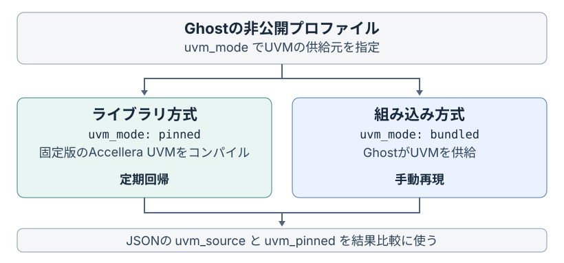

# Ghost両方式検証の引き継ぎ

[English](ghost-dual-handoff.md) · [引き継ぎの入口](../HANDOFF.md) · [README](../README.ja.md)

2026年11月27日に、スイート `6a75c747` の2,794件をGhostのライブラリ方式と組み込み方式で実行しました。同じ固定ビルドを使い、シード1・73で計11,176試行が完了しました。 [検証集計（ローカル）](../out/ghost-dual-20261127-073024.RQI6Dl/verified-summary.json)

今後の定期回帰は固定版ライブラリ方式で実行します。以下の組み込み方式の手順は、過去の結果を手動で再現するためのものです。 [テストガイド](testing.ja.md#ghost)

## 全件測定の結果

- **ライブラリ方式（固定Accellera UVM 2020.3.1）**は各シードで2,311件通過、483件失敗。失敗480件は前回の原因判定と一致しました。バックドア3件は修正後の呼び出し履歴と終了コードがVerilator 5.054と一致し、固定版UVMが変換済みの値を書き戻さない差分で引き続き失敗します。 [固定版UVMの差分の根拠](../out/library-retest-20261126/STATUS.ja.md#既存台帳を使った差分確認)
- **組み込み方式**は各シードで618件通過、2,176件失敗。失敗の先頭差分と終了コードを記録しました。うち1,915件は個別の原因確定が残っています。 [テスト別の判定（ローカル）](../out/ghost-dual-20261127-073024.RQI6Dl/triage-index.json)
- **起票は43件**で、組み込み方式42件、ライブラリ方式1件です。11月27日22:07 JSTの確認では43件すべてがクローズ済みでした。全件集計の測定後に入った修正の効果は、新しい固定ビルドで確認します。 [Issueと最小再現の索引（ローカル）](../out/ghost-dual-20261127-073024.RQI6Dl/issued.json)

## 修正後の再検証

1. 起票一覧から修正と最小再現を確認し、次に測る実行ファイル、DPIライブラリ、UVM、シード別プロファイルを固定します。新しい測定は別の出力先に保存します。 [Ghostの実行手順](testing.ja.md#ghost)
2. 最小再現を該当方式のシード1・73で確認します。ライブラリ方式では、`config_db#(int)::get()` でローカル変数 `value` に19を取得し、別の変数を渡す `config_db#(bit)::get()` が失敗した後も `value` が19を保持することを確かめます。組み込み方式では、先に旧ビルドでも再検証できたフィールドマクロの比較と、`typedef` したコールバック特殊化の回帰を確認します。 [Issue一覧（ローカル）](../out/ghost-dual-20261127-073024.RQI6Dl/issued.json)
3. 両方式で全件を実行し、方式とシードごとに入力指紋が一致するケースを比較します。通過から失敗へ変わったテストを優先し、最初に変わった観測行、終了コード、実行条件を照合します。コンパイル拒否テストは該当箇所の診断まで確認します。 [判定と入力指紋の扱い](results.ja.md#記録の合算)
4. 個別原因が未確定の組み込みケースは、`triage-index.json` から対象を選びます。既存Issueと固定ライブラリ方式の観測を照合し、差分を最小例に絞ってから判断します。 [最初の観測差分と終了コード（ローカル）](../out/ghost-dual-20261127-073024.RQI6Dl/failure-observations.json)

## 保存先と関連リリース

Git対象外の `out/ghost-dual-20261127-073024.RQI6Dl/` に、4つの方式・シード別JSONと全試行の `attempts.jsonl`、最小再現の `repro/`、個別実行の `probes/` があります。別のチェックアウトでは既存のランナーと承認済みのローカル設定を使って測定を再開できます。公開記録では名前にGhostを使い、実行ファイルとプロファイルの詳細、生の診断はローカルに保ちます。 [Ghostの記録方法](testing.ja.md#ghost)

関連する `kirimasim` の v0.3.0 は11月27日07:23 JSTに公開済みです。確認時点のリモート `main` は `b1ad0cb9`、リリースタグの指すコミットは `f0abaff2` です。 [v0.3.0のリリース](https://github.com/kurochan001/kirimasim/releases/tag/v0.3.0) · [mainの確認時点のコミット](https://github.com/kurochan001/kirimasim/commit/b1ad0cb96a408893f99c78f2131f8e430f37b82a)
