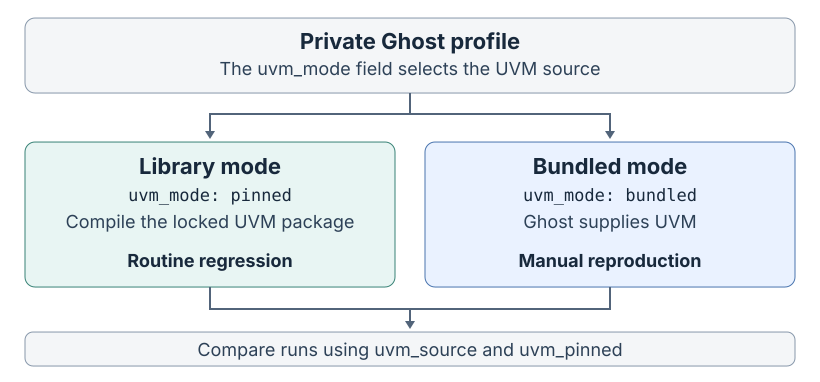

# Ghost dual-mode verification handoff

[日本語](ghost-dual-handoff.ja.md) · [Handoff index](../HANDOFF.md#english) · [README](../README.md)

On November 27, 2026, Ghost completed all 11,176 trials across the 2,794 tests at suite revision `6a75c747`. Both library and bundled mode used the same fixed build and seeds 1 and 73. [Verification summary (local)](../out/ghost-dual-20261127-073024.RQI6Dl/verified-summary.json)

Routine Ghost regression runs use the pinned library profile. The bundled steps below document how to reproduce the historical results manually. [Testing guide](testing.md#ghost)

## Verification after the fixes

On November 28, all 92 reproducer trials verified the fixes for the 43 reported issues. Of the 45 original tests, 44 passed on both seeds 1 and 73. The remaining test emitted its intended UVM error. Its expected exit code was 0, and the simulator returned 2 to reflect the reported error. [Issue-by-issue verification (local)](../out/ghost-fix-verification-20261128-010942.LLeYu6/issue-repro-results.json) · [Original tests (local)](../out/ghost-fix-verification-20261128-010942.LLeYu6/issue-original-results.json)

All 2,794 library-mode verdicts matched the earlier run. Each seed had 2,311 passes and 483 failures. For routine regression, compare cases with matching input fingerprints against the November 28 `pinned-1.json` and `pinned-73.json` for their respective seeds. [Comparison (local)](../out/ghost-fix-verification-20261128-010942.LLeYu6/comparison.json) · [Seed 1 (local)](../out/ghost-fix-verification-20261128-010942.LLeYu6/pinned-1.json) · [Seed 73 (local)](../out/ghost-fix-verification-20261128-010942.LLeYu6/pinned-73.json)

## November 27 full-suite results

- **Library mode with pinned Accellera UVM 2020.3.1** had 2,311 passes and 483 failures per seed. Of the failures, 480 matched the previous findings. The call traces and exit codes for three backdoor tests matched Verilator 5.054 after the fix. The tests still fail because the pinned UVM library does not write back the transformed values. [Evidence for the pinned-library behavior (local, Japanese)](../out/library-retest-20261126/STATUS.ja.md#既存台帳を使った差分確認)
- **Bundled mode** had 618 passes and 2,176 failures per seed. The first difference and exit status are recorded for each failure. Individual causes remain unresolved for 1,915 tests. [Per-test triage (local)](../out/ghost-dual-20261127-073024.RQI6Dl/triage-index.json)
- **43 issues were filed**, 42 for bundled mode and one for library mode. All 43 were closed when checked at 22:07 JST on November 27. [Issue and reproducer index (local)](../out/ghost-dual-20261127-073024.RQI6Dl/issued.json)

## Reproducing the historical comparison

1. Use the issue index to find the fixes and minimal reproducers. Freeze the executable, DPI library, UVM library, and per-seed profiles for the next run. Save the new measurements to a separate location. [Running Ghost](testing.md#ghost)
2. Run the minimal reproducers in the affected mode with seeds 1 and 73. For library mode, fetch `19` into a local variable named `value` with `config_db#(int)::get()`. Verify that `value` stays `19` after a failed `config_db#(bit)::get()` that takes a separate variable. For bundled mode, start with the field macro comparison regression and the `typedef`-aliased callback specializations. Both also have passing controls on an older build. [Issue index (local)](../out/ghost-dual-20261127-073024.RQI6Dl/issued.json)
3. Run the full suite in both modes. Compare matching input fingerprints within each mode and seed. Prioritize pass-to-fail changes and check the first changed observation, exit status, and execution conditions. For compile-rejection tests, check that the diagnostic identifies the intended error. [Verdicts and input fingerprints](results.md#evidence-assembly)
4. Use `triage-index.json` to pick bundled cases whose causes remain unresolved. Check the existing issue history and library-mode observations, then reduce the differences to minimal reproducers. [First observations and exit statuses (local)](../out/ghost-dual-20261127-073024.RQI6Dl/failure-observations.json)

## Saved evidence and related release

The Git-ignored `out/ghost-dual-20261127-073024.RQI6Dl/` directory holds four mode-and-seed result files, the full `attempts.jsonl` log, standalone examples under `repro/`, and targeted runs under `probes/`. On another checkout, use the tracked runner and authorized local configuration to resume measurements. Use the Ghost alias in public records and keep executable details, profiles, and raw diagnostics local. [Ghost results and configuration](testing.md#ghost)

The related `kirimasim` v0.3.0 release was published on November 26 at 22:23 UTC. At the time of verification, remote `main` was at `b1ad0cb9` and the release tag pointed to `f0abaff2`. [v0.3.0 release](https://github.com/kurochan001/kirimasim/releases/tag/v0.3.0) · [Verified main commit](https://github.com/kurochan001/kirimasim/commit/b1ad0cb96a408893f99c78f2131f8e430f37b82a)
