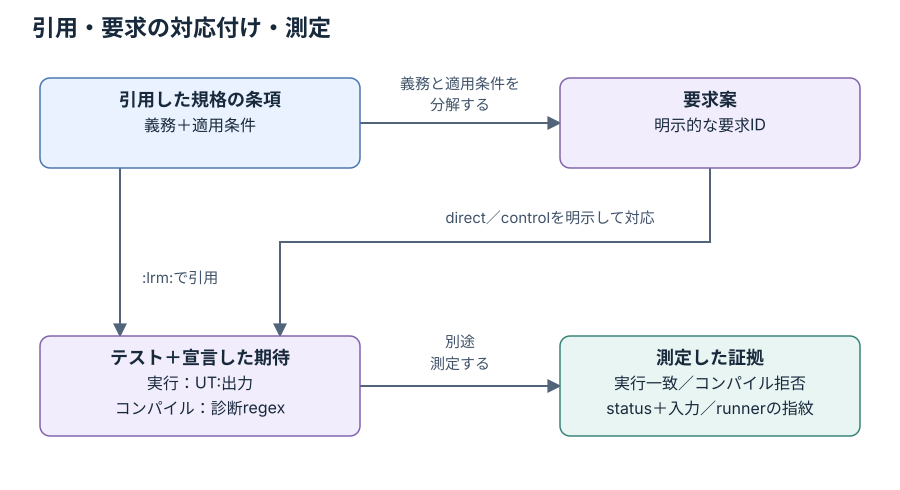

# 要求台帳の案とカバレッジの棚卸し

[English](requirements.md) · [README](../README.ja.md) · [テストと開発のガイド](testing.ja.md)

## 現在の状態

M4を進めています。[対象範囲の案](../coverage/scope.json)、[要求台帳](../coverage/requirements.json)、
[番号の分類](../coverage/assessments.json)、[テスト索引](../coverage/test_index.json)を版管理します。AI要求案2084件は、すべて1407テストへ直接対応し、
追加の1テストはcontrolです。全1408テストに要求の対応付けがあります。
直接テストとテスト対応付けのqueueは両方0件です。memory-walkのoracleは、レビューが必要な歴史的解釈を明示し、
IEEE全体のcoverageを認定しません。人による照合記録はありません。

条項catalogの番号は2,507件です。1174件は要求を一部分解し、182件はAIで明示的に分類（構造131件・文脈51件）、残る1,151件は未評価です。
いずれも完了を示しません。M4の開始は、範囲や分母の承認、M1〜M3の完了を意味しません。
`approved_denominator`と`coverage_percentage`は`null`のままです。

## 計数単位と対象範囲の案

適用条件を伴う、観測可能な規範的義務を1要求とする案です。methodの1条項にも、成功、失敗、default引数、
順序、副作用など、複数の要求が必要な場合があります。見出し自体は義務ではありません。
2084件の要求案は複数領域にわたりますが、その条項内の全義務を列挙したものではありません。

既存の番号catalogのすべてのrootを、1つずつ次に割り当てます。

| 区分 | Root | 番号の件数 | 意味 |
| --- | --- | --- | --- |
| 対象候補 | 5〜19、B〜G | 2,482 | 規範的な動作を読んで要求に分解する |
| 文脈 | 1〜4 | 16 | 範囲、参照、定義、略語。解釈には引き続き使う |
| 保留 | H | 9 | 非推奨APIの範囲は別途決定。除外の承認ではない |

これは要求数ではなく番号の件数です。付録Aは参考情報で、このcatalogにはありません。
この棚卸し自体はcatalogの完全性を独立に保証しません。規範／非規範の区別には規格を読む必要があります。
ライブラリの欠落、既知差分、未実装のHDL／DPI、backendの利用可否によって対象候補の義務を暗黙に削除しません。
SystemVerilog言語自体の要求はkirimasim-testsで扱い、言語やHDL機能に依存するUVMの要求は候補に残します。

分解にはユーザー提供のIEEE 1800.2-2020を使います。要求文は条項番号を伴う独自の日英の要約であり、
規格本文の転載や実装から導いた期待値ではありません。商用シミュレータの結果は
[投稿方針](faq.ja.md#商用シミュレータとissueの投稿方針)に従って引き続き除外します。
台帳のツールはシミュレータの実行結果を読み込みません。

## 引用・要求・実行の証拠

次の図では、条項の引用、レビューした要求の対応付け、測定結果の関係を示します。
台帳は期待出力への対応を検査し、実行記録は測定したstatusと条件を保持します。



テストの最初のUVM `:lrm:`参照を**主引用**、後続のUVM参照を**補助引用**と呼びます。
catalogのうち主引用がある番号は722件、どちらかの引用がある番号は1,401件です。
補助引用は準備に使うAPIの場合もあります。引用から要求の対応付けを自動生成せず、子条項の参照を親条項へ自動集約もしません。

対象候補2,482件について、従来の「各条項2テスト」の主引用の棚卸しは、0件が1,760、1件が433、2件以上が289です。
これはテストの配置を測るだけで、2つの独立した検査があること、規範的な義務を分解したこと、実行が成功したことを示しません。
承認された要求の分母ではなく、主引用0件の全条項が不足だと宣言するものでもありません。

`UVM-CLONE-DISTINCT`などの要求IDは、テストのfilenameとは独立した安定した名前です。
5.3.5.2の2つの要求は同じ条項を使い、別handleの生成と、後続のscalar変更の独立性を別々に検査できます。
callbackの要求`UVM-VREG-FIELD-POST-WRITE-ORDER`は、field単独のテストを直接、親virtual registerのwriteをcontrolとして対応付けます。
controlは検査系を評価する助けになりますが、その要求の直接の対応には数えません。

対応には、汎用の期待出力にある正確な`UT: `行を登録します。この**期待する観測**は期待値への対応であり、
実行成功の観測ではありません。1行に別の義務の観測が含まれていても、この要求がすべてを検査する意味にはなりません。
checkerは参照、field、期待行の存在、入力の同一性を検査しますが、実際に要求を実行することやassertionの十分性は証明しません。
テスト、構成、規格のレビューが必要です。期待出力の順序はrunnerが検査し、台帳で行の存在を確認するだけでは順序や反復回数を保証しません。
同じ期待行の繰り返しはanchorに1回だけ登録し、runnerは引き続き期待する全行の並びを比較します。

[実行の証拠](results.ja.md)は別に扱い、入力、runner、ライブラリ、設定の同一性が必要です。
直接の対応先にもspecのみの既知差分があり得ます。対応自体は成功や適合性の主張ではありません。
現在の1408件には新たに測定した検査系を含みます。変更していない既存テストの対応付け自体は、追加の実行結果ではありません。

## 版管理するデータと生成する棚卸し

正本のJSONはUTF-8、schema versionは1で、生成するinventory／backlogのschema versionは2です。未知のfield、重複key、重複する要求ID、未知の条項／テストを拒否します。

- `coverage/scope.json`は、日英の計数単位、rootの区分、従来の主引用の目標を記録します。
  schema 1で表せるのは、承認済み分母のない未完の範囲案だけです。
- `coverage/requirements.json`は、安定したID、条項、日英の`statement`、`conditions`、`expected`、`limitations`、
  `review`、`test_links`を記録します。対応にはtest ID、`direct`／`control`の役割、空でない`expected_observations`を持たせます。
  直接の対応先は要求の条項を引用する必要があり、レビューで対応を確認すれば補助引用でも構いません。
- `coverage/assessments.json`は、個別に読んだ構造／文脈の番号について、日英の`rationale`、
  `related_requirements`、`review`を記録します。`structural`は独立した動作のないAPIの区切りで、関連要求を持ちません。
  `contextual`は他で分解した動作の説明で、既存要求を必ず指定します。
  同じ条項に分類記録と要求entryを併置できません。分類を適用できるレビューは`ai`／`human`だけで、
  `unreviewed`のまま未評価queueから除去できません。見出しの自動分類は行いません。
- `coverage/test_index.json`は、全テストの`primary_clause`と`inputs_sha256`を記録します。
  指紋は既存runnerの収集処理を使い、source、宣言したhelper／include／data、期待値file、UVM lockを含めます。
  索引は棚卸しであり、1408件のレビュー済み要求対応ではありません。

照合状態は`ai`、`unreviewed`、`human`です。humanには識別可能な`reviewer`と、`reviewed_at`のISO日付が必要です。
他の状態では両方を`null`にします。照合したという記録であり、checkerが本人性を認証するものではありません。
要求を変更しても、人が再照合したことにはなりません。

リポジトリのrootから実行します。

```sh
python3 tools/requirements.py check
python3 tools/requirements.py inventory --json out/requirements-inventory.json --lang ja
python3 tools/requirements.py sync --output out/test-index-proposal.json
```

`check`は正本の入力を検査して概要を表示します。`inventory`はさらに、全番号の区分、分解状態、主引用／補助引用、
要求の対応、照合／oracleのmetadata、指紋、root別の集計を出力します。
各番号には、次の分解状態を1つ割り当てます。

| 状態 | 記録している内容 | 残るレビュー |
| --- | --- | --- |
| `partial` | この番号について1件以上の要求がある | 残る義務と適用条件を確認する |
| `assessed` | 根拠を伴う構造／文脈の明示的な分類がある | 分類と、文脈の場合は関連要求をレビューする |
| `unassessed` | 要求も明示的な分類もない | 条項を読み、義務を分解するか根拠を伴う分類を記録する |

いずれの状態も完了や網羅を意味しません。生成する分母と割合は`null`を保ちます。
`--lang en`／`--lang ja`は概要の表示言語を選び、JSONのkeyと安定した識別子は変えません。
`out/`の生成物はGit対象外で、生成出力は4つの正本を上書きできません。

## レビュー用の未整理項目とroot別集計

`backlog`で台帳を編集せずに作業項目を取り出します。

```sh
python3 tools/requirements.py backlog --json out/requirements-backlog.json --lang ja
python3 tools/requirements.py backlog --root E --json out/requirements-backlog-E.json --lang ja
```

`--root`は`backlog`だけで使え、`5`、`17`、`E`のようにcatalogの正確なrootを指定します。
未知のroot、子条項、`u05`のようなdirectory名は拒否します。取り出しの前に正本の台帳／索引全体を検査するため、
別rootの古い対応をfilterで隠すことはできません。

JSONは、`requirements_without_direct_tests`（controlのみも含む日英の要求案全文）、
`tests_without_requirement_links`（どちらの役割の対応もないテストのmetadataと指紋）、
`unassessed_identifiers`（要求も明示的な分類もないcatalogの番号）を分けます。
`identifier_assessments`には、選択した分類の根拠、関連要求、レビューを含む全記録を別に保持します。
レビューの作業一覧であり、確定した適合性の不足ではありません。文脈／保留の番号も区分付きで残し、分母と割合は未設定のままにします。

`inventory`と`backlog`には`roots`の集計があります。要求は自身の条項のroot、テストは主引用のrootに属します。
そのため、第17章の要求から付録Eのテストへ対応付けても、そのテストを第17章の主引用数へ移しません。
子条項の件数を親要求の認定へ集約しません。複数の要求が1テストを共有でき、1要求に複数のテストを対応付けることもできますが、
共有する期待出力の1行にある全anchorで独立した網羅を示す意味にはなりません。

主引用テストのある次の21個のrootの既存主引用テストをすべて対応付けましたが、規範的義務の分解は部分的なままです。

| Root | 要求案 | 主引用テスト | 対応のないテスト | 分類済みの番号 | 未評価の番号 |
| --- | --- | --- | --- | --- | --- |
| 5 | 103 | 54 | 0 | 3 | 50 |
| 6 | 107 | 51 | 0 | 11 | 45 |
| 7 | 64 | 21 | 0 | 11 | 16 |
| 8 | 54 | 45 | 0 | 4 | 17 |
| 9 | 37 | 27 | 0 | 0 | 89 |
| 10 | 128 | 86 | 0 | 29 | 2 |
| 11 | 35 | 20 | 0 | 4 | 0 |
| 12 | 323 | 193 | 0 | 45 | 0 |
| 13 | 45 | 26 | 0 | 0 | 85 |
| 14 | 227 | 145 | 0 | 17 | 0 |
| 15 | 67 | 85 | 0 | 4 | 45 |
| 16 | 94 | 98 | 0 | 0 | 129 |
| 17 | 42 | 11 | 0 | 8 | 0 |
| 18 | 363 | 254 | 0 | 18 | 233 |
| 19 | 176 | 102 | 0 | 24 | 6 |
| B | 48 | 54 | 0 | 0 | 106 |
| C | 9 | 16 | 0 | 0 | 80 |
| D | 14 | 7 | 0 | 0 | 40 |
| E | 52 | 59 | 0 | 0 | 77 |
| F | 51 | 34 | 0 | 0 | 106 |
| G | 45 | 20 | 0 | 4 | 0 |

未対応テスト0件と直接テストのない要求案0件は、完全な要求coverageを示しません。
残る識別子1,151件は評価／分解が必要です。範囲は提案、2084件のレビューはすべて`ai`、分母は未承認です。

TLM 1要求案は、選択interface／port既定値、FIFO照会、公開export method、channel継承／既定値／constructorとqueue容量を扱います。
実analysis impと多段exportは、選択subscriberへの配送、subscriberごとの順序、live handleを保持します。
要求／応答channelは両queueを既定1枠とし、結合transport channelは両方を1枠に固定します。
12.2.9.2の再読で独立した容量義務が判明したため、以前の文脈分類を削除し、直接要求2件へ置き換えます。
概要を除外とせず、元の範囲を保つための修正です。

TLM 2要求案は、extensionの既定値／合法継承／名前の受渡し、8種全socket宣言、通常port／exportとimpの既定値、選択した正確なtransaction／phase基底viewを扱います。
実port／exportはimplementationを明示名で指定したimpへ委譲します。実socket 2組で、明示workerと省略時の互換親を両方向で区別します。
独自phaseを両nonblocking relay familyに通し、blocking relayは独自targetの完了まで待ち再利用できます。
これらの実装は設定であり、規定data algorithmや完全な物理bus／base protocolではありません。

新規83要求案を新規12検査系へ対応し、以前の要求と検査入力は全て保持します。個別に読んだmethods／整理見出し12件を構造分類します。
規範的なsocket／extension概要は部分分解に残し、IS-A／HAS-A、適用条件、bindingの残る義務を保持します。
第12章は部分分解169番号・分類45番号・未評価0番号ですが、323要求案とM1〜M4全体のgoalは未完です。未評価番号0は完全な規範的coverageではありません。

12.3.5.7.4／12.3.5.8.4のblocking pass-through connect見出しに印刷されたnonblocking provider型を逐語的に使う受理probe 2件はseed 1で拒否されます。
実動blocking比較対象は一致しますが、矛盾する型一覧は解決しません。
別の限定probeは同種terminator制約を「直接provider entryを残さない」と解釈します。initiator呼出しはERRORを報告しながらraw entryを保持し、target呼出しは残しません。
規格は不正呼出し後の一覧状態を明記しないため、実装不具合の証明ではなく、照合が必要な解釈差分として残します。全3件の期待出力を保持し、seed 73結果はありません。

P／parameter構文を省略した印刷connect signature、forward portのbackward経路の本文、抽象基底生成の拒否、不正user extension、名目的IMP=int、全member所有関係、全protocol／timing組合せ、bus規則は別の部分分解義務に残ります。
以前のpayload rand／constructor／virtual照会probeは有効で、response-stringのvirtual委譲から基底text形式は規定しません。

通常portの独立RSP=int宣言build差分は残り、channelのRSP既定値は明示的にREQへ従います。
constructor専用probeは実行時bindingを証明しません。概要alias／imp parameter、容量0のis_full文言、payload長さ不一致の文言、response-string表現、target／interconnectのbus義務、広い並行互換性／protocol組合せは未完です。

objection／callback要求案は、選択したconstructor／基底／型宣言、propagation-mode照会、idle時の合法変更、raised／drain中変更のERRORを扱います。
実際の既定objection hookは、source／description／count metadataを伴い、独自component methodと明示enableした登録callbackを呼びます。
正のdrainとcallback body遅延で、source hookがdrain後に実行され、root伝播が待機していることを検査します。local countとdescendant totalは別々に観測します。
CB省略のadd／deleteは有効な登録組、型付き列挙、実際の型付き委譲を使います。

13検査系へ28要求案を追加し、以前の要求は保持します。M1のobjection／heartbeatが9件、M2のgeneric callbackが4件です。
構造7件・文脈7件の個別分類で、第10章は部分分解85番号・分類29番号・未評価2番号です。pool get_globalの2つの宣言／本文矛盾は残ります。
callback_modeの省略引数にも宣言／本文の値の矛盾があるため、新しい状態検査ではすべて明示引数を使います。mode 0の選択callback経路は一致しますが、
中間total照会は、照会定義が要求するdescendant件数ではなく0を返します。その検査系全体をspec-onlyに保持し、経路の正しさを完全なpassにはしません。

同期要求案は、選択したconstructor／型宣言、raw／persistent trigger待ち、受理triggerの時刻・状態・data、live objectとscalar payloadの違い、
実際のwaiter計数、barrier threshold引上げ、wakeupなしresetを扱います。event-pool初期所属は、lazy getで名前付き項目が生成される前に調べます。
選択した検査系はconstructor、待機／状態／data、barrierの狭い条件を扱い、各条項の義務や適用条件を尽くしたものではありません。

rawの早い／遅い待機検査は、trigger前に最初のwaiterを確立します。保持する差分は早いcallerに関するもので、遅いcallerは新triggerまで待機します。
wakeupなしevent resetでは3 processが待機を保持しますが、固定版のwaiter照会は0を返し、後の新triggerでは3つとも再開します。
barrierのsilent-reset／新threshold比較対象は一致し、固定版event poolには必要な初期3名がありません。pool get_globalの戻り型宣言はitemを返す本文と矛盾し、両識別子を未評価に保持します。
delta遅延option、任意並行性、callback mode、より広いreset／中止条件は別に残します。

register連携の要求案は、選択したitem／adapter／backdoorの名前と継承、virtual subtype formatter、既定function-based read、
最初／最後にprotected helperを置く遅延task-based read、callback pipeline、実際のregister translation、run前のpredictor設定を扱います。
直接／layered translation検査系は実際のupstream／bus sequencerと遅延する独自driverを使い、失敗／再試行の検査は戻るstatus／dataを保持します。
既定BASEのvirtual sequenceはmodel propertyから独立した2 blockへ実際の便利accessを行います。constructor／型とno-DPI HDL parameterの別probeには狭い制限を保持します。
第19章は部分分解81番号・分類24番号・未評価6番号です。新たに読んだ分類9件には個別の根拠があり、以前の要求はすべて保持します。

callback encode／decode要求案は呼出し順序と値の伝播を区別します。2要素のuser-backdoor 4検査系は固定libraryの差分があっても、規格から導いた変換値を保持し、
既定callbackの無変更動作を別の一致する比較対象にします。選択したtask-read境界条件には直接検査系ができましたが、
広い中止／並行性、write宣言の曖昧さ、既定formatterの完全性、parent_sequenceのdo_clone、待機predictorの診断severity、force／releaseは未完です。
新規検査系は物理DUT trafficや任意protocolを認定しません。

sequence要求案は、宣言されたitem／base／generic／libraryの継承、request／response型の既定値、標準protected実行counter field、
選択した巡回selectorのbound／cycle／部分集合、relevance待ちの中止を扱います。protected fieldの直接probeは欠落した公開getterを認定せず、
selectorの直接randomizeも欠落mode APIを通すRANDC mode実行を認定しません。counter 2検査系はbound sequencerを使い、driver itemなしで合法な既定10子回数を使います。
個別に読んだ導入／例5件は関連要求のある文脈として分類し、第14章は部分分解89番号・分類17番号で未評価0件です。
既存6要求へ直接link 9件を追加し、以前のlinkとsimulation入力を保持してcounterの制限注記を明確化します。
未変更の既定RAND 3検査系には導入の対応付けを加えます。引用やlinkの追加だけで、独立した完全な2検査を認定しません。

command-line要求案は、明示した実process VPI条件を使い、生成時snapshot、report-object継承、singleton同一性、
全引数／plus／UVMのfilter、literalと選択したextended-regex照合、suffix件数／値、組込みoption全9条項を扱います。
選択条件で実際のfactory生成、報告設定／override、時刻変更、quit-count lock、configの数値base／文字列、phase default sequenceを動かします。
annex Gは部分分解18番号・個別に読んだ構造分類4番号で、未評価0件です。regex suffix抽出、広い式、重複optionの各条件、
wildcard／ALLの組合せ、追加phase／resource条件は残ります。native 1件は、固定serverがINFOを発行するquit変更に対し必要なWARNINGを保持します。
通常の未link buildと別native結果は区別し、coverageの完了にはしません。

register-global要求案は、既定／設定変更時の型幅、記載されたenum symbol、coverage選択の組合せ、公開slice field、標準concat constructor／accessorを分けます。
宣言検査は4-state保持やenum選択の操作上の意味を認定しません。第17章は部分分解22番号・明示分類8番号で、未評価番号0件です。
X／Z保持、enumで制御する後段の操作、application／user coverage割当、保持名の観測は残る条件です。
concat 3検査系はAPI欠落buildを保持します。個別に読んだ整理用見出し6件を構造、既存義務を指定した2件を文脈とし、macro 4条項も一部分解します。
M1〜M4の全未対応を解消するgoalは継続中で、この件数は完了を認定しません。

object要求案はstatic／dynamic proxy、現在の型名による既定照会、factory contextと独立したleaf名、直接のvirtual印字hookを分けます。
sequence報告の要求案は現在handler、reporter生成元、生成／再利用context、severity admissionを追跡し、最後の条件はclass固有の解釈差分を保持します。
非一様TLM-adapter要求案は往復変換の有効bit、mask、status、独立したpayload配列を検査し、片方向の絶対byte順や有効bitの逆再構築は認定しません。
階層file要求案は4設定の再帰、優先順位、狭めたsubtree、外側peerを検査します。未変更のobject／印字検査系3件にも対応付けます。
個別に読んだ見出し3件を構造、sequence報告の導入を関連要求のある文脈として分類します。
手動照合した3番号をcatalogへ復元したことは[出典](provenance.ja.md#条項カタログの保守)を参照してください。

handler要求案は、実際の公開委譲、指定／生成したfield、handler共有、置換後のroutingを観測します。
relevance要求案は、全員待機、実行可能なpeer、再開後のgateを扱い、正確なpoll回数は固定しません。
標準TLM-adapter要求案は、新規payload、5 error status、表現できるoperation fieldの再利用、contextを限定したactive frontdoorを扱います。
byte長からsub-byteの有効bit範囲への逆対応は未整理とし、特定のn_bits再構築は要求しません。
未変更の設定検査系3件に対応付け、個別に読んだ見出し4件を構造として分類します。

事前構成messageの要求案は、現在handleの同一性、公開setterのlive変更、生成元の再設定、reporterのactionを扱います。
該当3検査系は標準API欠落を保持し、実行時結果はありません。報告の受付はINFOの上限と他severityを分けます。
既定sequencerのないlock／grab／unlock／ungrabは、検査系の制御した終了で必須fatal severityを観測します。
field要求案はbyte共有、byte境界をまたぐ配置、narrow busのendian条件を加えます。未変更の3検査系にpriorityとfield照会の要求を対応付け、新測定は加えません。
個別に読んだ整理用見出し4件を構造として分類します。

追加のcatcher要求案は、6 fieldの変更、変更後のgetter、次の報告の状態、明示したfile名／行番号を分けます。
sequenceの解放要求案は、既定／明示対象、peerのblocking、lock／grabの相互解放を分けます。
未変更の3検査系に、直接killとsequencer stopに対するdo_killの直接対応を加えます。追加測定ではなく、別hookの結果は保持します。
field要求案は個別アクセスの可否、byte lane選択、隣接する実際の値／mirrorの独立性、全registerへのfallbackを区別します。
個別fieldの選択条件2件は、固定libraryと差があっても有効な期待出力を保持します。個別に読んだmethod見出し4件を構造として分類します。

catcher要求案はhelperの迂回、severity／IDの発行、reporter identity、外側報告の続行、現在IDの変更、
即時issue後のCAUGHT／THROWを分けます。sequence要求案は、明示したdeep印字でreq／rspの初回、置換、null化を区別します。
adapter要求案はregister write、反復read、失敗writeの再試行、memory readの復帰について、別responseのidentity、status、
変化する値、response変換中のcontextを追跡します。個別に本文を読んだ整理用の見出し4件を構造として分類します。
選択した義務であり、各APIの網羅的な分解ではありません。

heartbeat要求案は、mode選択、不在／置換／再利用するevent、stop、参加者変更を含む正常なALL_ACTIVE windowを区別します。
payload要求案はmethod別のvirtual-dispatch義務14件と、既存setter観測11件の明示対応を加えます。
transactionのhook／時刻照会の要求6件は、未変更の1検査系を使います。FIFO要求案は公開abstract queue、容量、popしないget、
debug引数の非機能性、選択したinline／subtype制約を扱います。FIFOのbus access、compare、そのための初期化は未完です。
payload memberの導入は文脈として分類し、下位のattribute所有規則とtarget／transportの義務は別に未評価のまま保持します。

constructor要求案は、recording database／stream／link、sequence型、register fileの名前省略・明示・明示的な空文字を分けます。
prefilled linkでは既定名とinstanceの独立性を追加します。未変更M2検査系5件へ、setter、randomization gate、handler照会、
current-itemの義務を明示対応し、新しい実行は主張しません。register file要求案は、configure、symbolicなlocal／full path、
abstractionの分離、clear、flatten scope、近い既定値の選択を扱います。存在／local pathの照会は包含先の既定値を使い、
full path／defaultの照会はそれぞれの契約に従います。継承する既定値の期待2件は固定libraryとの差分を保持します。

recording要求案は、close失敗／再試行、stream／recorderのnull結果gate、正確なcallback metadata、
link dispatch、close済み・free前endpointを追加します。未変更のhook検査系4件にもbackend／endpoint hookの明示対応を加え、
その追加実行は主張しません。sequence要求案は、optional body hookと必須start hook／parent callbackを区別し、
完了start間のphase／automatic objection変更を検査します。model要求案は、virtual-fieldのlocal／既定／明示再帰、
simple nameのscope、map内容の解除を区別します。block／mapの子孫名検索は、固定libraryの実測差分を保持し、
論理block階層とaddress-mapのsubmap階層を分けます。

abstract registry要求案は、virtual型proxy、明示／既定名、現在factoryへの初期化、具象型／instanceのoverride、
error／null callbackを区別します。component要求はparentあり／なしを別条件にし、parentなしcallbackのnull参照結果を保持します。
IDコピー要求案は、非公開sequence ID accessorを使わず、2つのlive response経路、transaction値のコピー、payload／名前の保持を検査します。
parent変更の要求案は、固定libraryのcacheが古くても現在chainのdepthを要求します。
map要求案は、生成引数、local一覧／default、明示doorの置換、register／memory／static virtual overlayの解除、
同名child内容の保持を扱います。

registry要求案は、specializationごとのsingleton同一性、明示／既定型名、represented instanceを生成しない取得、
新しく選択したfactoryへの登録と、factoryを通したcallback生成を区別します。
履歴要求案は、容量0でも実際の転送を行い、再有効化、新しい順の保持、正確なhandle共有、peer分離を検査します。
block要求案は、再帰lock／offset検索、lock状態の照会、mode伝播、構造変更のためのunlock／再構築、
lock待機、絶対／相対のblock検索を区別します。method／queryの見出しは個別に読んでから分類し、
新たなpassや、条項を網羅的に分解したという主張を加えません。

configuration要求案は、既定／無効のbuild dispatch、scope照合、正確なresource／UVM_SET dispatch、
hook順序、抑制と再利用を観測します。resource 4検査系は、既定／明示strict buildの差分を保持します。
port要求案は、resourceで制御する階層check、不正な出力role、cardinality診断を追加します。
memory policy要求案は、address単位の長さ、bound、制約／手続きstart、既定の選択、正確なin-use handleを観測します。

個別に読んだ36番号の根拠とAI状態を、[分類file](../coverage/assessments.json)に保持します。
第11章に未評価番号はありませんが、動作条項の分解はすべて部分的で、coverageの完了ではありません。
自動分類、親への集約、承認済み分母は導入しません。

[memory-walk検査系](../tests/uE/test_memory_walk_address_data_relations_follow_the_documented_historical_interpretation.sv)は、
記録した歴史的解釈の下で、algorithm固有の観測を追加します。
[Q134](faq.ja.md#q134-memory-walk-algorithmをどう解釈していますか)を参照してください。
location maskや固定bit故障をalgorithmの証明へ昇格せず、解釈はIEEEの改訂や人の承認ではありません。

container要求案は、名前／既定specialization、参照共有、key置換／所属、queueのsize／順序、
合法／不正な取得、空でないpop、index指定／既定の削除を区別します。
第11章の各method条項に部分的な分解があり、章／methodの見出しは構造、概要は文脈として分類します。
すべての条件や、要求ごとに独立した2検査を認定するものではありません。

双方向export要求案は、9種類の具象constructor、入れ子blocking／nonblockingの独自型、status伝播、再利用を扱います。
未変更のmaster／slave検査系2件にも、方向を明示するexportの対応を加えます。
HDL要求案は、明示／既定abstraction選択、zero-time force_timeの委譲を扱います。
正の期間のforce／release対応や、架空のtask戻り値は主張しません。

port-base要求案は、省略したconstructor bounds、最小／最大の照会、無制限状態、leaf／完全名、
正確なparent、role predicate、generic型名、provider／client所属、export fanout解決を区別します。
exportのdefault-index要求案は、初期選択とelaboration後の再選択を分けて観測し、providerのindex順は指定しません。

HDL depositと利用可否には、[明示的なVPI条件](testing.ja.md#verilatorのvpi-hdl部分集合)で実際の公開変数を使う直接検査系を追加しました。
追加の対応は、pathの存在、40 bitの非破壊read、存在しないpathのread失敗、既定abstractionで利用可能なpathの比較対象です。
与えたbackendの実測で、vendor overlayやguestの結果ではありません。
E.7のwarning／転送なしの解釈は、固定sequenceがERRORを報告してreadを試みる差分を保持します。
これらの対応は、実行結果を成功へ変換せずに、直接テストの未対応2件を解消します。

最後の既存テストの対応付けは、TLM 1の分離implementation、nonblocking request／replyの結果と再利用、
TLM 2のblocking／nonblocking export、socketの戻り経路、passthrough中継、payload packing、
canonical time APIを区別します。endpointの計算とresponse生成は検査系のcodeです。
transport失敗時の部分request作用、任意phase protocol、失敗出力値、生packed-bit順は推測しません。

registerの対応は、metadata、map rightsの共通部分、選択したwrite-zero prediction policy、
pre／post methodとcallbackの作用、登録解除、明示順序を区別します。
virtual-registerの対応は、static／dynamic配置、allocation、再配置／release、field slice、
owner／map／addressの同一性を扱います。memory-managerの対応は、重複／bounds、
完全なlocationへの切上げ、制約allocation、iterationの所属、互換reconfiguration、
相対frontdoor変換を扱います。model化bus accessは、物理DUT、DPI backend、
walking algorithm全体の成立を示しません。

新しい[policy／object同期テスト](../tests/u16/test_policy_object_stack_tracks_nested_active_policy_push_and_pop.sv)は、
標準のobject側getterで、入れ子の2 policyを観測します。pushの記帳とpop後の復元の両方へ対応付け、
API欠落による既知のbuild差分を保持します。既存のpolicy側stack検査だけでは、この観測を満たしません。

以前の対応と制限は、core service、recording、phase、同期、utility、sequenceの所有／lifecycle／response制御、
registerの転送／prediction／coverage、convenience wrapper、付録Eのdispatchを扱います。
動作の境界と以前の拡充は、[FAQ](faq.ja.md)、[既知差分](known-differences.ja.md)、
[拡充の履歴](history.ja.md)を参照してください。B.5.11の呼出し、FIFOの失敗出力、
stream列挙の戻り数など、signature／本文の矛盾は、引き続きレビューが必要な解釈です。
対応付けは、実測pass、人の承認、承認済み分母を追加しません。

## 生成レポートの識別

生成したinventoryとbacklogには、`ledger_inputs_sha256`を付けます。
検査した入力全体、`coverage/scope.json`、`coverage/requirements.json`、`coverage/assessments.json`、`coverage/test_index.json`、
catalogの`catalog_sha256`を識別します。索引には現在のテスト入力の指紋があり、先に台帳の検査で実入力との一致を確認します。

ツールは、object keyをsortして余分な区切りの空白を省いたUTF-8の正規化JSONをhash化します。
JSONの空白、key順、日本語のescape表記／直接表記は識別値に影響しません。
配列の順序は保持し、catalogのbyte変更はその指紋に反映します。
絶対path、生成先、表示言語、backlogのroot filterは入力fieldに含めません。
同じ入力なら全体とfilterしたレポートで同じ識別値になります。異なる表示を比較するときはschemaと選択条件も比較してください。
これは入力の識別値であり、生成file全体のhashではありません。

要求文、適用条件、期待値、制限、照合、対応の変更、分類の根拠／照合、範囲や確認済みのsnapshotの変更が識別値に反映します。
digestはレビューの承認でも実行結果でもありません。各テストの`inputs_sha256`、runnerの`runner_sha256`とも別です。
シミュレーションsourceが変わらなくても、台帳の意味が変われば古い生成レポートを作り直す必要があります。
hashが同じでも、既知差分を含む未完／未承認の棚卸しの場合があります。

## テストや対応付けの更新

1. 適用される規範的動作を読み、日英の要求、条件、制限を書き直します。照合状態も再評価します。
2. テストと期待する観測を確認します。`direct`／`control`を明示し、まだ対応付けない要求のlinkは空にします。
3. `check`を実行します。入力や主引用の変更、テストの追加／削除は正本の索引を無効にします。
4. `sync`で別fileに案を作ります。現行テストを追加し、未対応の指紋を更新しますが、対応済みの既存指紋は保持します。
   案を取り込むだけでは、古くなった対応は有効になりません。対応済みテストの削除には、先にlinkの確認／削除が必要です。
5. 案とsourceの変更を比較します。影響する全対応を再照合した後、現行入力から指紋／主引用を更新し、確認した索引の差分を取り込みます。
   新しい指紋だけでは人による照合にはなりません。
6. metadata、台帳、ツールを検査します。範囲、schema、棚卸しの記述が変わる場合は日英資料も更新します。
   シミュレーション入力やrunnerが変わる場合は、影響する実行の証拠を別途再現します。

入力の変更時に既存の対応を黙って認定し直すコマンドは設けません。
回帰テストは期待値／helper／lockの変更、direct／controlの区別、引用の自動昇格の防止、重複や不正データ、
範囲の主張、生成先の保護を検査します。Check CIでも、既存のmetadata・ライブラリ検査とともに実行します。

## M4の残作業と承認

候補の条項を読み、義務と条件への分解を続けます。既存テストを対応付けてから必要な追加テストを決め、
未対応や不一致でも規範的な期待値は変えません。文脈／保留の区分、catalogの完全性、要求の同一性、重複、
実際に非規範的な箇所をレビューします。backendの制約は制限として記録し、分母から暗黙に除外しません。

割合の公開前に、規範的義務の棚卸しとレビューを終え、範囲を決定し、計数規則と固定した要求集合の明示的な承認を得ます。
レビュー済みの検査対応と、実行成功をどう数えるかは分けて定義し、実行条件と証拠の同一性も含めます。
承認には後続のschema／手順の更新が必要です。schema 1では意図的に、棚卸し完了や承認済み分母を表せません。
現在のAIによる2084要求案と直接の対応は、その条件を満たしていません。
