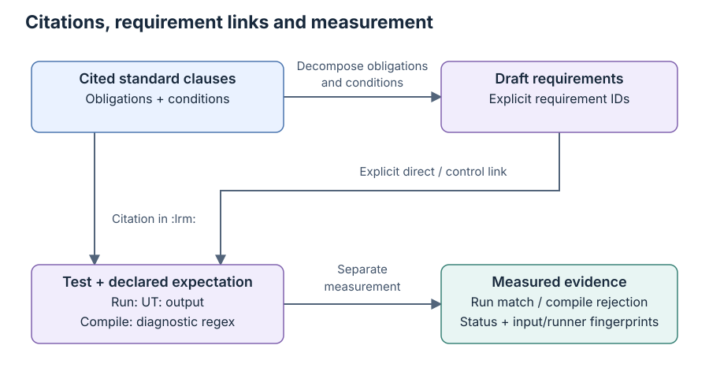

# Draft requirement ledger and coverage inventory

[日本語](requirements.ja.md) · [README](../README.md) · [Testing guide](testing.md)

## Current state

A zero mapping backlog records links between tests and duties, rather than complete behavior coverage; see [Read coverage and progress](reading-guide.md#read-coverage-and-progress) before interpreting the totals.

M4 is in progress. The [scope proposal](../coverage/scope.json),
[requirement ledger](../coverage/requirements.json),
[identifier assessments](../coverage/assessments.json) and
[test index](../coverage/test_index.json) are versioned inputs. The ledger
contains 4009 AI-drafted requirements, all with direct links to 2455 tests.
Forty-four tests have only control links. All 2499 tests have a requirement link.
Both direct-test and test-link queues are empty. The memory-walk oracle is an
explicit historical interpretation requiring review; this does not certify
complete IEEE coverage. No requirement records human review.

A control-only test checks a supporting premise, and [the HDL-view example](faq.md#q308-why-keep-standard-views-and-member-view-controls-separate) shows why its match cannot establish a missing standard API contract.

The clause catalog has 2,507 identifiers. 2034 have a partial
requirement decomposition; 420 have explicit AI assessments (291 structural,
129 contextual), and 62 remain unassessed. No state certifies completion.
Starting M4 does not approve the scope or denominator, or complete
M1–M3. `approved_denominator` and `coverage_percentage` remain `null`.

Here `null` records that the denominator and percentage are unset pending approval; [Q77](faq.md#q77-why-is-there-no-coverage-percentage-after-starting-m4) explains the decisions needed to calculate them.

## Counting unit and scope proposal

The denominator would be the agreed set of applicable obligations, so [the approval steps](#remaining-m4-work-and-approval) must resolve that set before any requirement-coverage percentage is published.

An obligation is one behavior the standard requires under stated conditions; [the coverage glossary](glossary.md#scope-and-coverage) distinguishes it from a clause number or test count.

The proposed unit is one observable normative obligation together with its
applicability conditions. A method clause may need separate requirements for
success, failure, default arguments, ordering and side effects. Conversely,
a heading is not an obligation. The 4009 draft entries span several areas,
without exhausting the obligations in their clauses.

The proposal assigns every root in the existing identifier catalog once:

| Disposition | Roots | Identifier count | Meaning |
| --- | --- | --- | --- |
| Candidate | 5–19, B–G | 2,482 | Examine normative behavior for requirement decomposition |
| Context | 1–4 | 16 | Scope, references, definitions and acronyms; still inform interpretation |
| Deferred | H | 9 | Deprecated APIs await a separate scope decision; no approved exclusion |

These are identifier counts, not requirement counts. Annex A is informative
and absent from this catalog. This census does not independently certify the
catalog's completeness. Normative/non-normative distinctions still require
reading the standard. Library omissions, known differences, unimplemented
HDL/DPI support and backend availability do not silently remove candidate
obligations. SystemVerilog language requirements belong to kirimasim-tests;
UVM requirements that depend on language or HDL facilities remain candidates.

All decomposition uses the user-provided IEEE 1800.2-2020 standard. Statements
are original English/Japanese paraphrases with clause references, not copied
standard text or implementation-derived expectations. Commercial simulator
results remain excluded under the [posting policy](faq.md#commercial-simulator-and-issue-reporting-policy).
The ledger tool consumes no simulator results.

## Citations, requirements and execution evidence

A direct link records a test intended to check the stated obligation, and a control link records a test supporting its setup or conditions; [Scope and coverage](glossary.md#scope-and-coverage) defines these roles before the examples below.

The relationships below separate a clause citation, a reviewed requirement
link and a measured result. The ledger checks expected-output links;
execution records carry the measured status and conditions.



A test's first UVM `:lrm:` reference is its **primary focus**; later UVM
references are **supporting citations**. Of the catalog identifiers, 1279
have a primary-focus test and 2,066 have either kind of citation. Supporting
references often describe setup APIs. No reference creates a requirement link,
and a child-clause reference is not automatically rolled up to its parent.

For the 2,482 candidate identifiers, the historical two-tests-per-clause
census currently shows 1,203 with zero primary-focus tests, 771 with one,
and 508 with at least two. It measures test placement only. It does not
establish that an identifier has two independent checks, that its normative
obligations are decomposed, or that either test passes. It is not an approved
requirement denominator or a declaration that all zero-focus clauses are gaps.

To trace a fixture, search its test ID in the [ledger](../coverage/requirements.json)'s `test_links` and read the enclosing requirement's conditions and limitations; [the test-header guide](testing.md#metadata) explains the source citations to compare with that mapping.

Requirement IDs such as `UVM-CLONE-DISTINCT` are stable names independent of
test filenames. Two clone requirements can share clause 5.3.5.2 while checking
distinct-handle creation and subsequent scalar independence separately.
The callback requirement `UVM-VREG-FIELD-POST-WRITE-ORDER` links the standalone
field test directly and a parent-register write test as a control. A control
helps assess the fixture but does not supply a direct link for the requirement.

Runtime links name exact `UT: ` lines from the generic expected output. These
**expected observations** bind the mapping to an oracle, not to an observed
pass. An anchored line can also contain observations for other obligations;
it does not make this requirement cover all of them. The checker verifies
references, fields, anchor membership and input identities. It cannot prove
that the test actually exercises the requirement or that its assertion is
sufficient. That needs review of the test, fixture and standard. Ordering in
an oracle remains a runner check; the ledger's anchor-membership check alone
does not establish ordering or repetition counts. Repeated identical expected
lines are anchored once; the runner still compares the complete expected sequence.

[Execution evidence](results.md) is separate and needs matching input, runner,
library and configuration identities. A direct link may retain a spec-only
known difference. It is not a pass or a conformance claim. The current 2499-test
snapshot includes newly measured fixtures; mapping unchanged existing tests
adds no new execution result for them.

## Versioned data and generated inventory

A schema version identifies a JSON data layout rather than a UVM library release; [the library setup](testing.md#the-uvm-library) describes the separate release lock used for execution.

Within a requirement, `conditions` says when the duty applies, `expected` says what must be observed, and `limitations` bounds the current claim; [the counting unit](#counting-unit-and-scope-proposal) explains why one API may need several such entries.

Canonical files are the maintained source data, while inventory and backlog files are generated views; [the handoff file guide](handoff.md#files-and-local-material) explains which material is available in a fresh clone.

Canonical JSON uses UTF-8. Scope, assessments and test index remain schema 1;
the requirement ledger now uses schema 2. The checker still reads schema 1
output-only ledgers. Generated inventory/backlog reports remain schema 2 and
record `ledger_schema_version` separately. Unknown fields, duplicate keys,
duplicate requirement IDs and unknown clauses/tests are rejected.

- `coverage/scope.json` records the bilingual counting unit, root dispositions
  and historical primary-focus target. Schema 1 permits only a proposed,
  incomplete scope with no approved denominator.
- `coverage/requirements.json` records each stable ID, clause, bilingual
  `statement`, `conditions`, `expected` and `limitations`, `review`, and
  `test_links`. Each link has a test ID and `direct` or `control` role, plus
  exactly one expectation form: runtime `expected_observations` or schema-2
  `expected_diagnostic`. A direct test must cite the requirement clause;
  a supporting citation is allowed when review establishes the actual link.
- `coverage/assessments.json` records individually read structural/contextual
  identifiers, bilingual `rationale`, `related_requirements`, and `review`.
  A `structural` record groups APIs without an independent behavior and has
  no related requirements. A `contextual` record explains behavior already
  decomposed elsewhere and must name existing requirements. No clause can
  have both a classification record and requirement entries. Only `ai` or
  `human` reviews can apply a classification; `unreviewed` cannot remove work
  from the unassessed queue. There is no automatic heading classifier.
- `coverage/test_index.json` snapshots every current test's `primary_clause`
  and `inputs_sha256`. The fingerprint uses the existing runner collector:
  source, declared helpers/includes/data, expected files and UVM lock. The
  index is an inventory, not 2499 reviewed requirement mappings.

A compile-diagnostic link requires `stage: compile`, a valid nonempty regex
exactly equal to the fixture's `:expected_stderr_regex:`, `:type: elaboration`
and a nonempty `:should_fail_because:`. Runtime output/exit expectations are
forbidden on that fixture. Unknown or mixed link fields, wrong stages,
invalid/stale patterns and unsupported schema versions are rejected. Schema 1
retains its original output-only link contract. The structure is:

The value `<exact :expected_stderr_regex: value>` below is a placeholder for the test header's actual diagnostic pattern; [the metadata guide](testing.md#metadata) explains how that pattern is declared.

```json
{
  "test": "u12/test_uvm_tlm_extension_base_abstract_declaration_rejects_direct_construction",
  "role": "direct",
  "expected_diagnostic": {
    "stage": "compile",
    "regex": "<exact :expected_stderr_regex: value>"
  }
}
```

The pattern is an expected oracle; validation does not read compiler logs or
establish a pass. Actual rejection and a matching error must be measured by
the runner. Compare the [rejection fixture](../tests/u12/test_uvm_tlm_extension_base_abstract_declaration_rejects_direct_construction.sv)
with its unchanged [legal runtime control](../tests/u12/test_tlm2_extension_defaults_and_legal_subclasses_preserve_names_and_object_views.sv).
Control links do not supply a direct requirement link.

Reports add `test_types` and per-root `primary_test_types` for simulation and
elaboration counts. Primary-focus totals still count fixtures; the normative
counting unit and scope are unchanged. A tagged compile-rejection match is
not a runtime seed result. Existing runtime anchors, stale-input safeguards
and all earlier requirement objects remain unchanged.

Review status is `ai`, `unreviewed` or `human`. Human status requires an
identified `reviewer` and ISO date in `reviewed_at`; other statuses must leave
both fields `null`. These fields record a review claim; the checker cannot
authenticate the reviewer. Changing a requirement does not automatically
establish renewed human review.

Run from the repository root:

```sh
python3 tools/requirements.py check
python3 tools/requirements.py inventory --json out/requirements-inventory.json --lang ja
python3 tools/requirements.py sync --output out/test-index-proposal.json
```

`sync` writes a proposal for review while preserving existing linked snapshots; [Q78](faq.md#q78-what-should-i-do-when-the-test-index-becomes-stale) explains how to resolve a stale index after changing a test.

These commands inspect requirement mappings without running a simulator; to obtain a measured test status, use [the runner commands](testing.md#running-the-suite).

`check` validates the canonical inputs and prints a summary. `inventory` also
writes all identifier dispositions, decomposition states, primary/supporting
citations, requirement links, review/oracle metadata, fingerprints and root totals.
Each identifier receives one decomposition state:

| State | What is recorded | Remaining review |
| --- | --- | --- |
| `partial` | One or more requirements for this identifier | Check the remaining obligations and applicability conditions |
| `assessed` | An explicit structural/contextual classification with rationale | Review the classification and, for contextual material, its related requirements |
| `unassessed` | Neither requirements nor an explicit classification | Read the clause, then decompose obligations or record a justified classification |

None of these states means complete or covered.
Generated denominator and percentage fields
remain `null`. `--lang en` or `--lang ja` selects summary language; JSON keys
and stable identifiers do not change. Generated files under `out/` are ignored
by Git, and no generated output may overwrite the four canonical inputs.

## Review work queue and root totals

A root is a top-level chapter or annex grouping identifiers, so [Scope and coverage](glossary.md#scope-and-coverage) distinguishes these row totals from a coverage percentage.

Use `backlog` to extract work items without editing the ledger:

```sh
python3 tools/requirements.py backlog --json out/requirements-backlog.json --lang ja
python3 tools/requirements.py backlog --root E --json out/requirements-backlog-E.json --lang ja
```

`--root` accepts an exact catalog root such as `5`, `17` or `E`, only with
`backlog`. Unknown roots, subclauses and directory labels such as `u05` are
rejected. Validation of the whole canonical ledger/index precedes extraction;
a root filter cannot hide a stale binding elsewhere.

The JSON separates `requirements_without_direct_tests` (full bilingual draft
records, including control-only requirements), `tests_without_requirement_links`
(test metadata and fingerprints without either link role), and
`unassessed_identifiers` (catalog identifiers with neither requirements nor an
explicit assessment). `identifier_assessments` preserves full selected
classification records separately, including their rationale, related requirements and review.
These are review queues, not established conformance gaps. Context/deferred
identifiers remain visible with their disposition, and all denominator and
percentage fields remain unset.

`inventory` and `backlog` include `roots` totals. Requirements belong to their
own clause root; tests belong to their primary-focus root. Thus chapter 17
requirements can link to tests placed under annex E without moving those
tests into chapter 17's primary count. Counts are not rolled up from children
to certify a parent requirement. Multiple requirements can share a test, and
one requirement can have multiple test links; neither implies independent
coverage from every anchor in a shared expected-output line.

All existing tests across the twenty-one primary-focus roots now have
requirement links, while normative decomposition remains partial:

Each row counts requirements by their own clause and tests by their primary citation, so [Q79](faq.md#q79-how-can-i-find-the-next-m4-review-items) explains why a linked test can belong to a different root.

| Root | Draft requirements | Primary-focus tests | Tests without links | Assessed identifiers | Unassessed identifiers |
| --- | --- | --- | --- | --- | --- |
| 5 | 177 | 92 | 0 | 12 | 0 |
| 6 | 170 | 68 | 0 | 19 | 0 |
| 7 | 91 | 35 | 0 | 20 | 0 |
| 8 | 83 | 65 | 0 | 12 | 0 |
| 9 | 141 | 63 | 0 | 22 | 0 |
| 10 | 160 | 114 | 0 | 29 | 0 |
| 11 | 35 | 20 | 0 | 4 | 0 |
| 12 | 324 | 194 | 0 | 45 | 0 |
| 13 | 152 | 58 | 0 | 21 | 0 |
| 14 | 228 | 146 | 0 | 17 | 0 |
| 15 | 131 | 116 | 0 | 18 | 0 |
| 16 | 279 | 186 | 0 | 32 | 1 |
| 17 | 42 | 11 | 0 | 8 | 0 |
| 18 | 928 | 614 | 0 | 62 | 1 |
| 19 | 199 | 165 | 0 | 24 | 0 |
| B | 239 | 183 | 0 | 7 | 19 |
| C | 98 | 69 | 0 | 13 | 0 |
| D | 120 | 28 | 0 | 8 | 0 |
| E | 114 | 88 | 0 | 20 | 0 |
| F | 253 | 164 | 0 | 23 | 7 |
| G | 45 | 20 | 0 | 4 | 0 |

This table includes roots with primary-focus tests, while the global unassessed total also includes context and deferred roots, whose treatment is explained in [the scope glossary](glossary.md#scope-and-coverage).

Zero unmapped tests and zero drafts without direct tests do not establish
complete requirement coverage. The remaining 53 identifiers still need
assessment/decomposition. Scope is proposed, all 4009 reviews are `ai` and
the denominator remains unapproved.

Thirteen new runtime inputs add eleven M1 cases and two M2 port/analysis
cases under the existing functional grouping. Ten match seeds 1/73. Three
retain seed-1 exit-0 differences without seed 73: two shared-domain repeated-IMP
lookups under a qualified strict schedule-local reading, and one literal EQ/NE
comparison at a stable UNINITIALIZED IMP. Other type/traversal and relational
observations match. [The typed-role FAQ](faq.md#named-roles-wait-operators-and-topology-policies) explains the different premises.

Separate phase inputs capture nodes before attaching both schedules to the
domain, then check distinct contexts and actual topdown/bottomup traversal.
They do not pass the original post-attachment lookup cases. A public-identity
diagnostic observes its two queries returning the first schedule's node;
duplicate-IMP scope selection remains a review question. The UNINITIALIZED wait
case retains literal equality/inequality expectations; state-mask semantics
and applicability to unexecuted implementations remain qualified, with no
confirmed defect attribution or complete live-phase claim.

Typed constructor roles are checked alongside actual analysis forwarding to
opposite child providers. Typed objection events distinguish raise, partial
drop and all-dropped completion after original callback work, with zero drain
and an untouched peer. Explicit, omitted and null topology printer calls check
selected policy identity and visits over five original components. No enum
numeric encoding, sibling order, exact print text or callback multiplicity is
fixed. Only the original topology emitter gains a newline to keep UT lines
separate from reporter text; earlier framing records are excluded and all
three dependent inputs are freshly measured without changing expected rows.

All thirteen source bodies and expectations remain unchanged except ten
proven tags. Twenty-one bilingual AI duties add twenty annex-F entries and
one qualified chapter-9 lookup entry. Five previously unassessed F leaves gain
partial decomposition; no classification is added. One unchanged constructor
source already cites F.2.5.1 and gains a direct designator link without new
execution or primary focus. Original and prescoped phase inputs have explicit
direct/control roles; another condition's pass never passes an original.

All 3988 previous duties, 420 assessments and 2486 ordinary records retain
their content. Current totals are 4009 AI duties, 2455 directly linked tests,
forty-four control-only tests and 140 tests with control links. Inventory is
2034 partial/420 assessed/53 unassessed. Annex F is 107/23/7 with 253 duties and
164 primary tests (130 simulation/34 elaboration). Chapter 9 adds one duty
without another primary input; all partial applicability and original targets
remain open.

The 99 compiler, 38 HDL, 18 command-line and 1082 compatible guest records are
retained unchanged. Guests have 1417 unmeasured inputs: 1414 additions and
three revised originals (1318 simulation/99 elaboration). There is no guest
rerun/filter, scope/catalog, runner/backend/tool/workflow change, commercial
result, implementation-derived oracle, human review or scope/denominator approval.

TLM 1 drafts cover selected interface/port defaults, FIFO queries, public
export methods, channel inheritance/defaults/constructors and queue capacities.
Actual analysis imps and nested exports preserve selected subscriber delivery,
per-subscriber order and live handles. The request/response channel defaults
both queues to one slot; the coupled transport channel fixes both at one.
Re-reading 12.2.9.2 exposed that independent capacity obligation, so its earlier
contextual classification is removed and replaced by two direct requirements.
This correction preserves the original scope rather than treating an overview
as an exclusion.

TLM 2 drafts include extension defaults/legal inheritance/name pass-through,
all eight socket declarations, ordinary port/export and imp defaults, and
selected exact transaction/phase base views. Real ports/exports delegate to
imps with explicitly named implementations. Real socket pairs distinguish
explicit workers from omitted compatible parents in both directions. A custom
phase crosses both nonblocking relay families; blocking relays wait for their
original target and support reuse. These implementations are setup, not a
prescribed data algorithm or complete physical bus/base protocol.

Eighty-three new drafts map twelve new fixtures; all prior requirements and
fixture inputs remain unchanged. Twelve individually read methods/grouping
headings receive structural assessments. Normative socket/extension overviews
remain partially decomposed, preserving their remaining IS-A/HAS-A, application
and binding obligations. Chapter 12 has 169 partial, 45 assessed and zero
unassessed identifiers. Its 324 drafts and the entire M1–M4 goal remain open;
zero unassessed identifiers is not full normative coverage.

Two acceptance probes use the nonblocking provider types literally printed
under blocking pass-through connect headings in 12.3.5.7.4/12.3.5.8.4. They
are rejected at seed 1. The operational blocking control matches, but it does
not resolve those conflicting lists. A third qualified probe interprets the
same-kind terminator restriction as leaving no direct provider entry; initiator
calls report ERROR yet retain a raw entry, while target calls leave none.
The standard does not explicitly prescribe post-invalid-call list state, so
this remains a reviewable interpretation difference, not a proven defect.
All three retain their expected output, without seed 73 results.

Exact printed connect signatures that omit P/parameter syntax, the forward
port's backward-path prose, other abstract/pure-method conditions, invalid
user extensions, nominal IMP=int, full member ownership, all protocol/timing
combinations and bus rules remain separate partial obligations. Earlier
payload rand/constructor/virtual-query probes remain valid; response-string
virtual dispatch does not prescribe its underlying text format.

The independent RSP=int regular-port declaration build difference remains.
Channel RSP defaults explicitly follow REQ. Constructor-only probes do not
establish runtime binding. Summary alias/imp parameters, zero-capacity
is_full wording, mismatched payload length wording, the response-string
representation, target/interconnect bus obligations and broader concurrent
compatibility/protocol combinations remain open.

Objection/callback drafts cover selected constructor/base/type declarations,
propagation-mode queries, legal idle changes and ERRORs for changes while
raised or draining. Actual default objection hooks call original component
methods and an explicitly enabled registered callback with source/description/
count metadata. Positive drain and callback-body delays verify the source
hooks run after drain while root propagation remains pending. Local counts
and descendant totals are observed separately. Optional CB add/delete uses
a valid registered pair, typed enumeration and actual typed dispatch.

The earlier thirteen-fixture audit added twenty-eight objection/callback drafts:
nine M1 objection/heartbeat cases and four M2 generic-callback cases. Its seven
structural and seven contextual assessments remain recorded. With the two
get_global identifiers now decomposed, chapter 10 has 87 partial, 29 assessed
and zero unassessed identifiers. The two return-type conflicts remain qualified;
see [the lookup FAQ](faq.md#dedicated-global-lookups-and-mapping-corrections).
The callback_mode omitted argument also has conflicting declaration/prose
values; all new state checks use explicit arguments. In mode zero the selected
callback routing matches, but intermediate total queries return zero instead
of the descendant counts required by the query definition. That whole fixture
remains spec-only; correct routing is not a complete pass.

Synchronization drafts cover selected constructor/type declarations, raw and
persistent trigger waits, accepted-trigger times/state/data, live object versus
scalar payload behavior, actual waiter accounting, raised barrier thresholds
and reset without wakeup. Initial event-pool membership is checked before any
lazy get can create the named entries. These selected fixtures retain narrow
constructor, wait/state/data and barrier conditions; they do not exhaust the
obligations or applicability conditions of their clauses.

The raw early/late case establishes its first waiter before triggering. Its
retained difference concerns the early caller; the late caller still waits
for a fresh trigger. No-wakeup event reset retains three blocked processes,
but the pinned waiter query returns zero; all three subsequently resume on a
fresh trigger. The barrier silent-reset/fresh-threshold control matches.
The event pool lacks the three required initial names in the pinned run.
Pool get_global return declarations conflict with item-return prose; both
identifiers now have partial duties, with the conflict retained as explained in
[the dedicated-lookup FAQ](faq.md#dedicated-global-lookups-and-mapping-corrections). Delta-delay options, arbitrary concurrency,
callback modes and broader reset/cancellation conditions remain separate.

Register-interaction drafts cover selected item/adapter/backdoor names and
inheritance, virtual subtype formatting, default function-based reads, delayed
task-based reads with first/last protected helpers, callback pipelines, actual
register translation and pre-run predictor configuration. Direct and layered
translation fixtures use real upstream/bus sequencers and delayed original
drivers; a failure/retry case preserves returned status/data. A default-BASE
virtual sequence uses the model property for real convenience accesses to two
independent blocks. Separate constructor/type and no-DPI HDL-parameter probes
retain narrower limits. Chapter 19 currently has 87 partial, 24 assessed and zero unassessed
identifier. The earlier nine classifications retain their individual rationale;
current additions and the two limitation revisions are identified above.

Callback encode/decode drafts distinguish invocation order from value
propagation. Four two-element user-backdoor fixtures retain standard-derived
transformed values despite pinned-library differences; default callback
no-change behavior is a separate matching control. Selected task-read boundary
conditions now have direct fixtures, while broader cancellation/concurrency,
write declaration ambiguity, default formatter completeness, parent_sequence
do_clone, pending-predictor diagnostic severity and broader force/release conditions remain open.
No new fixture establishes physical DUT traffic or arbitrary protocols.

Sequence drafts now cover the declared item/base/generic/library inheritance
and request/response type defaults, the standardized protected execution-counter
field, selected cyclic-selector bounds/cycles/subsets, and relevance-wait
cancellation. Direct protected-field probes do not establish the missing public
getter; direct selector randomization does not establish RANDC-mode execution
through missing mode APIs. Two library counter fixtures use a bound sequencer,
no driver items and the legal default ten-child budget. Five individually read
introductions/example sections receive contextual assessments with related
requirements. Chapter 14 now has 89 partial and 17 assessed identifiers, zero
unassessed. Six existing requirements gain nine direct links without changing
their prior links or simulation inputs; a counter limitation is clarified.
Three unchanged default-RAND fixtures gain introduction-level mappings. Neither
new citations nor added links certify two independent complete checks.

Command-line drafts use an explicit actual-process VPI condition. They cover
construction snapshots, report-object inheritance, singleton identity,
argument/plus/UVM filtering, literal and selected extended-regex matches,
suffix counts/values and all nine built-in option clauses. Selected options
exercise actual factory creation, report settings/overrides, timed changes,
quit-count locking, config numeric bases/strings and a phase default sequence.
Annex G has 18 partial identifiers and four individually read structural
assessments, with zero unassessed. Regex suffix extraction, broader expressions,
duplicate-option variants, wildcard/ALL combinations and further phase/resource
conditions remain open. One native case retains the required quit-change WARNING
where the pinned server issues INFO. Ordinary unlinked builds and separate
native results remain distinct; neither creates completed coverage.

Register-global drafts distinguish default/configured type widths, documented
enum symbols, composable coverage selections, public slice fields and the
standard concat constructor/accessors. Declaration checks do not establish
four-state storage or the operational meaning of enum choices. Chapter 17 now
has 22 partly decomposed identifiers and eight explicit assessments, with zero
unassessed identifiers. Its remaining conditions include X/Z storage, downstream
enum-controlled operations, application/user coverage allocation and stored-name
observability. Three concat fixtures retain missing-API builds. Six individually
read organizing headings are structural; two contextual records name existing
obligations. Four macro clauses also gain partial decomposition. The goal to
eliminate all M1–M4 gaps remains active; these counts do not certify completion.

Object drafts distinguish static/dynamic proxies, current-name default lookup,
leaf naming independent of factory context, and direct virtual printing hooks.
Sequence-report drafts track current handlers, reporter origins, generated and
reused contexts, and severity admission. The latter retains a class-specific
interpretation difference. Nonuniform TLM-adapter drafts check roundtrip valid
bits, masks, status and independent payload arrays; they establish neither
absolute one-way byte order nor inverse valid-bit reconstruction. Hierarchical
file drafts check four recursive settings, precedence, a narrowed subtree and
outside peers. Three unchanged object/printing fixtures gain links. Three
individually read headings are structural; the sequence-report introduction is
contextual with named related requirements. The catalog also restores three
manually checked identifiers; see [provenance](provenance.md#clause-catalog-maintenance).

Handler drafts observe actual public dispatch, supplied/generated fields,
shared handlers and replacement routing. Relevance drafts cover all-waiting,
eligible-peer and restarted-gate conditions without exact polling counts.
Standard TLM-adapter drafts cover fresh payloads, five error statuses, reuse of
representable operation fields and an active frontdoor with scoped context.
The inverse mapping from byte length to sub-byte valid-bit extent remains open;
no particular n_bits reconstruction is asserted. Three unchanged configuration
fixtures gain links. Four individually read headings gain structural assessments.

Preformed-message drafts cover current-handle identity, live public setters,
origin rebinding and reporter actions. Three such fixtures retain a missing
standard API, with no runtime result. Reporting admission separates INFO limits
from other severities. Missing-default lock/grab/unlock/ungrab drafts observe
required fatal severity using a controlled testbench termination. Field drafts
add shared-byte, byte-crossing and narrow-bus endian conditions. Three unchanged
fixtures add priority and field-introspection requirements without measurements.
Four individually read grouping headings gain structural assessments.

Further catcher drafts separate six field mutations, changed-value getters,
fresh-report state and explicit filename/line queries. Sequence release drafts
separate default/explicit targets, peer blocking and cross-release of lock/grab.
Three unchanged fixtures gain direct do_kill links for direct kill and sequencer
stop; this adds no measurement and leaves their other hook results unchanged.
Field drafts distinguish individual eligibility, selected byte lanes, isolated
live/mirrored neighbors and full-register fallback. Two selected individual
field conditions retain valid expected output despite pinned-library differences.
Four individually read methods headings gain structural assessments.

Catcher drafts separate helper bypass, severity/ID emission, reporter identity,
outer-report continuation, current-ID mutation and CAUGHT/THROW disposition
after immediate issue. Sequence drafts distinguish initial, replaced and cleared
req/rsp fields under explicit deep printing. Adapter drafts follow separate
response identity, status, repeated values and response-side context across
register writes, repeated reads, a failed-write retry and memory-read recovery.
Four individually read organizing headings have structural assessments.
These are selected obligations, not exhaustive decompositions of their APIs.

Heartbeat drafts distinguish selected modes, missing/replaced/reused events,
stopping and healthy ALL_ACTIVE windows across participant changes. Payload
drafts add fourteen method-specific virtual-dispatch obligations and explicit
links for eleven existing setter observations. Six transaction hook/time-query
drafts use one unchanged fixture. FIFO drafts cover public abstract queues,
capacity, non-popping get, debug-argument neutrality and selected inline/subtype
constraints. FIFO bus access, comparison and initialization for those operations
remain open. The payload-member introduction is contextual; its child attribute
ownership and target/transport obligations remain separate and unassessed.

Constructor drafts distinguish omitted, explicit and explicitly empty names
for recording databases/streams/links, sequence types and register files.
Prefilled-link drafts add default names and independent instances. Five
unchanged M2 fixtures gain explicit setter, randomization-gate, handler-query
and current-item obligations without new execution claims. Register-file
drafts cover configuration, symbolic local/full paths, abstraction isolation,
clearing, flattened scopes and nearest-default selection. Presence/local-path
queries use the enclosing default; full-path/default queries follow their own
contracts. Two inherited-default expectations retain pinned-library differences.

Recording drafts add close failure/retry, stream/recorder null-result gates,
exact callback metadata, link dispatch and closed-but-not-freed endpoints.
Four unchanged hook fixtures gain explicit backend/endpoint-hook links, with
no new execution claim for them. Sequence drafts distinguish optional body
hooks from mandatory start hooks and parent callbacks, and exercise phase/
automatic-objection changes between completed starts. Model drafts distinguish
virtual-field local/default/explicit recursion, simple-name scope, and map
content removal. Block/map descendant-name expectations retain measured
differences in the pinned library; logical block hierarchy and address-map
submap hierarchy remain separate.

Abstract-registry drafts now distinguish virtual-type proxies, explicit/default
names, current-factory initialization, concrete type/instance overrides and
error/null callbacks. Parent-present and parentless component requests are
separate conditions; the parentless callback retains a null-dereference result.
ID-copy drafts verify two live response routes, copied transaction values and
preserved payload/names without internal sequence-ID accessors. Parent-change
drafts retain current-chain depth even though the pinned cache stays stale.
Map drafts cover creation arguments, local listings/defaults, explicit door
replacement and map removal of registers/memories/static virtual overlays,
including preservation of same-named child content.

Registry drafts distinguish singleton identity per specialization, explicit and
default type names, retrieval without represented-instance construction,
registration with a newly selected factory and callback creation through it.
History drafts add zero capacity with real traffic, reenabling and newest-first
retention, exact handle sharing and peer isolation. Block drafts distinguish
recursive lock/offset lookup, lock-state queries, propagated modes, structural
unlock/rebuild, lock waiting and absolute/relative block searches. Method and
query headings are classified only after individual reading; they create no
extra passing tests or claim of exhaustive clause decomposition.

Configuration drafts observe default/disabled build dispatch, scope matching,
exact resource/UVM_SET dispatch, hook ordering, suppression and reuse. Four
resource cases retain differences in the default/explicit strict builds.
Port drafts add resource-controlled hierarchy checks, illegal outgoing roles
and cardinality diagnostics. Memory-policy drafts observe address-unit length,
bounds, constrained/procedural starts, default selection and exact in-use handles.

420 individually read identifier assessments preserve rationale and AI status
in [the classification file](../coverage/assessments.json). Chapter 11 has no
unassessed identifiers, while every behavior clause remains partially decomposed;
this is not completed coverage. No automatic classification, parent rollup or
approved denominator is introduced.

The [memory-walk fixture](../tests/uE/test_memory_walk_address_data_relations_follow_the_documented_historical_interpretation.sv)
now supplies algorithm-specific observations under a documented historical
interpretation. See [Q134](faq.md#q134-how-is-the-memory-walk-algorithm-interpreted).
It does not promote location masks or a stuck-bit fault into algorithm proof,
and the interpretation is not an IEEE amendment or human approval.

Container drafts distinguish names/default specializations, reference sharing,
key replacement/membership, queue size/order, valid and invalid retrieval,
nonempty pops and indexed/default deletion. Every method clause in chapter 11
now has partial decomposition; its chapter/method headings are assessed as
structural and its overview as contextual. This does not exhaust all conditions
or certify two independent
checks per requirement.

Bidirectional export drafts cover nine concrete constructor variants, nested
blocking/nonblocking custom types, status propagation and reuse. Two unchanged
master/slave fixtures add explicit directional export links. HDL drafts cover
explicit/default abstraction selection and zero-time force_time delegation.
Selected positive-duration observations are now measured under the separate
HDL condition; [the timing FAQ](faq.md#positive-duration-force_time-observations)
records their scope without prescribing a task return value.

Port-base drafts now distinguish omitted constructor bounds, minimum/maximum
queries, unbounded state, leaf/full names, exact parent, role predicates,
generic type names, provider/client membership and export fanout resolution.
The export default-index drafts separately observe initial selection and
reselection after elaboration; no provider index ordering is prescribed.

HDL deposit and accessibility now have direct fixtures using actual public
variables under the [explicit VPI condition](testing.md#verilator-vpi-hdl-subset).
Additional links observe path presence, 40-bit nondestructive reads, missing
read failure and an accessible default-abstraction control. The supplied
backend is the measured implementation, not a vendor overlay or guest result.
The E.7 warning/no-transfer interpretation retains a difference: the pinned
sequence reports ERROR and attempts reads. These links close two direct-test
gaps without converting their execution outcomes into passes.

The final existing-test mappings distinguish split TLM 1 implementations,
nonblocking request/reply outcomes and reuse; TLM 2 blocking/nonblocking
exports, socket return paths, passthrough relays, payload packing and canonical
time APIs. Endpoint arithmetic and response generation remain fixture code.
Partial-request effects on failed transport, arbitrary phase protocols,
failed output values and raw packed-bit order are not inferred.

Register mappings distinguish metadata and map-right intersections, selected
write-zero prediction policies, pre/post method and callback effects,
registration removal and explicit ordering. Virtual-register mappings cover
static/dynamic placement, allocation, relocation/release, field slices and
owner/map/address identity. Memory-manager mappings cover overlap/bounds,
whole-location rounding, constrained allocation, iteration membership,
compatible reconfiguration and relative frontdoor translation. Modeled bus
accesses establish no physical DUT, DPI backend or full walking algorithm.

The new [policy/object synchronization test](../tests/u16/test_policy_object_stack_tracks_nested_active_policy_push_and_pop.sv)
observes two nested policies through the standard object-side getter. It now
links both push bookkeeping and pop restoration, while preserving the known
missing-API build difference. Existing policy-side stack tests alone do not
supply this observation.

Earlier mappings and their limits cover core services, recording, phases,
synchronization, utilities, sequence ownership/lifecycle/response controls,
register transfer/prediction/coverage, convenience wrappers and annex E dispatch.
See [FAQ](faq.md), [known differences](known-differences.md) and the
[increment history](history.md) for the behavioral boundaries and earlier
expansions. Signature/prose conflicts remain interpretations requiring review,
including B.5.11 invocation, failed FIFO outputs and stream enumeration counts.
No mapping adds a measured pass, human approval or an approved denominator.

## Generated report identity

A generated inventory describes mappings and is separate from measured execution evidence; [Evidence assembly](results.md#evidence-assembly) explains the identities required for result reuse.

Every generated inventory and backlog carries `ledger_inputs_sha256`. It
identifies the complete validated input state: `coverage/scope.json`,
`coverage/requirements.json`, `coverage/assessments.json`,
`coverage/test_index.json` and the catalog's
`catalog_sha256`. The index contains the current test-input fingerprints;
ledger validation binds those snapshots to the actual test inputs first.

The tool hashes UTF-8 canonical JSON with sorted object keys and compact
separators. JSON whitespace, key order and escaped versus literal Japanese
text do not affect this identity. Array order is retained, and catalog byte
changes affect its own fingerprint. Absolute repository paths, generated
output paths, report language and a backlog root filter are not input fields.
The identity is shared by full and filtered reports from the same inputs.
Compare the report schema and selection as well when comparing different views;
this is an input identity, not a hash of the generated output file.

Requirement wording, applicability, expectations, limitations, review or link
changes affect the identity, as do classification rationale/review, scope or
accepted snapshot changes. A digest
is neither review approval nor an execution result. It is separate from each
test's `inputs_sha256` and the runner's `runner_sha256`. Old generated reports
need regeneration after a semantic ledger change even when the simulation
sources stay unchanged. A same-hash report can still describe an incomplete,
unapproved inventory with known differences.

## Updating a test or mapping

The index binds a mapping to exact test inputs rather than only a filename; [Q78](faq.md#q78-what-should-i-do-when-the-test-index-becomes-stale) explains why a stale fingerprint needs mapping review before it is replaced.

1. Read the applicable normative behavior; write or revise the bilingual
   requirement, conditions and limitations. Reassess its review status.
2. Inspect the test and expected observations. Add explicit `direct` or
   `control` links; leave links empty when the requirement is not yet mapped.
3. Run `check`. Changed inputs or primary focus, added tests and removed tests
   invalidate the canonical index.
4. Use `sync` to create a separate proposal. It adds current tests and refreshes
   unlinked snapshots, but preserves existing snapshots of linked tests. Thus
   adopting a proposal alone does not clear a stale linked mapping. Removing
   a linked test first requires reviewing/removing its links.
5. Compare the proposal and source changes. After reassessing every affected
   mapping, update its fingerprint/focus from the current inputs and adopt
   the reviewed index changes. A new snapshot is not itself a human review.
6. Run metadata, ledger and tool checks; update the paired guides when scope,
   schema or inventory claims change. Reproduce affected execution evidence
   separately when simulation inputs or runners change.

A shared helper change may invalidate several tests at once, so [the result-reuse checklist](results.md#evidence-assembly) must be applied to every dependent record as well as to the edited fixture.

There is deliberately no command that silently certifies existing mappings
when their inputs change. The regression tests cover stale expected/helper/
lock inputs, direct/control distinctions, citation non-promotion, duplicate
or invalid data, scope claims and generated-output protection. Check CI runs
this validation alongside the existing metadata and library checks.

## Remaining M4 work and approval

An empty unassessed queue can still leave partial obligations and applicability conditions open; [the inventory states](#review-work-queue-and-root-totals) explain which remaining work to inspect.

Continue reading candidate clauses and splitting their obligations and
conditions. Map existing tests before deciding which new tests are necessary;
record unsupported or unmatched behavior without changing its normative
expectation. Review the context/deferred choices, catalog completeness,
requirement identities, overlap and genuinely non-normative material. Track
backend constraints as limitations rather than hidden denominator exclusions.

Before publishing a coverage percentage, finish and review the normative
inventory, resolve the scope choices and obtain explicit approval of the
counting rule and frozen requirement set. Define separately what counts as
reviewed test coverage and as execution success, including execution conditions
and evidence identity. Approval needs a later scope schema/procedure update; scope schema
1 intentionally cannot express a completed inventory or approved denominator.
The current 4009 AI drafts and their direct links do not satisfy that gate.
