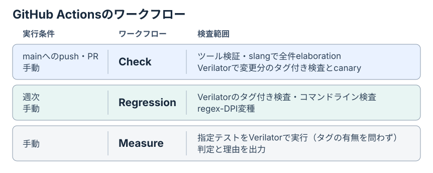

# 現在の実行結果と測定方法

[English](results.md) · [README](../README.ja.md) · [既知差分](known-differences.ja.md)

## 現在のスナップショット

runtime一致、compiler拒否、未測定入力は実行条件が異なるため、件数を併せて読む方法は[結果を読む](reading-guide.ja.md#結果を読む)を参照してください。

2026-11-21の移行で、固定リリースを5.052から5.054へ変え、2値の全2771入力を5.054のlocal全件測定（seed 1／73）で測り直しました。tagを`verilator@5.054`に付け替えた2312件はこの測定で一致したもので、既知差分の459件は一致しなかったもので、原因は原因の記録に整理し直しました。DPI条件の3つの部分集合も5.054で測り直し、状態は5.052の記録と同じです。hostedのRegression（[run 44905474705](https://github.com/kurochan001/kirimasim-uvm-tests/actions/runs/44905474705)）は2ae19a1bでtag付き2312件をVerilator 5.054で実行し、24 jobすべて成功した。結果を履歴とこの文書に記録した。4値の7件にはVerilatorの記録がありません。2026-11-23には修正後の実行テスト4件が両seedで一致し、不正設計3件が期待した診断で拒否されました。残る修正1件は4値の設定値を検査します。kirimasim 0.1.3（simulatorのcommit 21ee5a43）のrunnerで2026-11-23に当時の全2778入力を再測定し、`out/kirimasim-20261123-doc-review.json` の各入力の指紋とrunnerの指紋を作業ツリーと照合しました。
11月24日に追加した14件の2値シミュレーションはVerilatorの両シードで一致し、protectedメソッドの外部呼出しはコンパイル時に拒否されました。Ghostのライブラリ方式では4値イベントも実行しました。[追加テストの詳細](history.ja.md#2026-11-24-状態変更と未完了要求)

スイートは22 directoryの2796件で、simulation 2696件とelaboration 100件です。
milestoneはM1 1205件（1124／81）、M2 641件（633／8）、M3 950件（939／11）で、括弧内はruntime／elaborationです。
全件が`spec_check: ai`で、人のレビューは記録していません。DPIなし2735件のうち100件は不正elaboration検査であり、HDL-DPI 38件とcommand-line／regex-DPI runtime 23件は別です。

backendの行は通常条件にも含まれる入力を条件を変えて測定した記録であり、結果を別に数える理由は[実行環境の説明](testing.ja.md#uvmライブラリ)で確認できます。

seed 1／73で一致しても検査系は1件と数え、設定で指定したseedも最初の不一致後には実行されない場合があるため、実行範囲の列の読み方は[seed件数の説明](faq.ja.md#q201-全2778テストを2-seedで実行しましたか)で確認できます。

| シミュレータとライブラリ | 観測結果 | 実行範囲 |
| --- | --- | --- |
| Verilator 5.054・固定版UVM | `pass` 2328件：runtime 2233＋compile拒否95、`known` 460件 | runtime一致はseed 1／73。期待compiler拒否は実行時seedを実行しない |
| Verilator 5.054・独自VPI HDL backend | `pass` 37件、`fail` 1件 | 重複する38件の別条件。一致はseed 1／73、差分はseed 1 |
| Verilator 5.054・独自command-line VPI bridge・固定regex DPI | `pass` 20件、`known` 3件 | 重複する23件の別条件。一致はseed 1／73、差分はseed 1 |
| Verilator 5.054・regex DPIとcommand-line DPIで再実行する通常検査系 | `pass` 26件 | `coverage/regex_dpi_variants.txt`による重複する26件の別条件。一致はseed 1／73 |
| kirimasim 0.2.1（commit e93839fdcbea）・固定版UVM | 期待したコンパイル拒否99件、unsupported 2621件、fail 76件 | 11月24日の全件実行と、変更・追加入力の個別測定を合算 |
| Ghost・同梱UVM | `pass`が205件、`fail`が873件 | 各seedで未変更1078入力。失敗集合は同じ。1718入力は未測定 |
| Ghost・固定版UVM | 各シードで `pass` 2314件、`fail` 482件 | シード1・73の全件測定と変更・追加入力の個別測定を入力指紋で照合して合算。[ライブラリ方式の比較基準](ghost-dual-handoff.ja.md#修正後の確認) |

固定ライブラリはAccellera UVM 2020.3.1、コミット`78c06547a2a0`で、326ファイルを
[lock](../third_party/uvm.lock)と照合します。Ghostの同梱実行は、lockのパッケージではなく供給されたライブラリを使います。
非公開シミュレータの識別情報、版、パス、profileの内容、診断は公開しません。
公開interfaceは[Ghostの設定](testing.ja.md#ghost)で説明します。Icarus VerilogはこのUVMスイートには使いません。

## 結果の解釈

1つのテストに複数の観測がある場合、他の行が一致しても必須の観測に差分があれば全体の成功にはならず、その分類は[判定規則](faq.ja.md#q5-passfailknownunsupportedはどう違いますか)で確認できます。

個別の記録を調べるときは、[差分を調べる](reading-guide.ja.md#差分を調べる)の手順で、結果JSONからソース、期待する観測、runnerの条件を辿れます。

識別子に不慣れな場合は、結果ID、ソースのfile名、UVMクラス、要求IDの関係を[スモークテストの具体例](reading-guide.ja.md#1件のテストをファイルで辿る)で確認できます。

runtimeの出力差分では`reason`が最初に異なる選択行を示すため、指定した期待行の列との比較方法は[観測の規則](testing.ja.md#何を観測するか)で確認してください。

ビルド失敗はシミュレーション開始前の停止、runtime差分はモデル実行中の不一致を表し、それぞれにどのseedの結果があるかは[Q14](faq.ja.md#q14-seedを2つ変えれば決定性や4値の動作も証明できますか)で説明しています。

正当なnegative期待95件は宣言したfixture／type／memberの診断によるcompiler拒否で一致します。
不正design 5件はsubscriberのwrite、visitorのvisit、proxyのget_immediate_children、adapterのacceptの欠落、印字virtual builtin dispatcherの直接生成を受理し、拒否oracleを既知差分として保持します。
受理されてもruntimeは実行せず、simulationの予期しないbuild 141件は別です。passには宣言した期待との一致が必要です。

これらの差分の原因は、下の症状の分類とは別に[原因の記録](known-differences.ja.md#既知差分の原因)で割り当てます。library 321件、interpretation 61件、simulator 21件、DPIの実行条件57件で、未分類の記録はありません。

測定したspecのみの460件は規格由来の出力またはcompile診断期待を保持し（4値のspecのみ8件にはVerilatorの記録がありません）、不正compiler受理5件とsimulation 455件です。
simulationのうち313件はseed 1で最初に異なり、seed 73結果はありません。下位履歴のGREEDYテストはseed 1・73で一致し、同じ条件のseed 2で不一致でした。 [GREEDYの再測定](history.ja.md#2026-11-28-greedyの割り当て履歴)

API／型名欠落build 43件はtime API 1、sequence-library API 14、HDL slice-view 12、named-concat constructor 1、object active-policy API 5、catcher message-handle 3、印刷されたbase記録状態getter 1、印刷report callback typedef 1、built-in type_id 2、typed resource-DB helper 3です。

time減算build 1件は省略可と印刷されたsecs引数を要求します。
宣言build 2件は既定型の不一致で、別の2件は印刷all_dropped function／taskとclone暗黙scalar／map返却の食違いを保持します。
3件は継承したtype_id registry特殊化の非互換で、1件は5.054の内部エラーです。1件はmemory backdoor_readのprotected access差分で、2件は記載外pure hookを要求する合法resource-base／記載methodだけの完全core-service拡張です。ほか61件はDPI未linkでHDL 38・command-line 23です。
追加の合法build 3件は字面のenum-collection T解釈を使います。
ほか7 buildは厳密なattribute定義6件と印刷enum-unpackの引数を保持します。
さらに3 buildは独自STRUCTUREの依存visitor既定値を保持します。
限定したvirtual抽象overview基底型の2入力は文言の食違いを保持し、明示class基底のcontrolは別に一致します。
ほか3件は印刷返却型の食違いで、専用poolの2件はpool／itemの食違いを保持し、phaseのget_scheduleの1件は、印刷されたstringの引数にclassのhandleを渡す呼び出しを5.054がbuild時に拒否する差分です。
これらのsimulation build 141件にはruntime結果がなく、別command-line条件は20一致、quit-warning差分1件、正規表現の差分2件を保持します。

印刷上は具象のuvm_vreg_cbsの合法構築1入力は、固定版のvirtual宣言でabstractとして拒否され、期待を保持してruntimeはありません。

追加の未登録packetのsimulation build 4件は、predictor型名生成に使うfactory返却型で停止し、runtimeの証拠はありません。IEEEの必須登録前提は作りません。

追加のsimulation build 1件は、大きいflag拡張でのUVM_PACKER_MIN_BITS未定義であり、runtime結果はありません。もう1件だった大きいflag拡張のenum method未対応は、5.054で一致してtagを付けました。

共有handler resetではseverity／ID verbosity値が残り、general／ID値とaction／fileは既定へ戻ります。
期待するresetと後続の境界配送は変更せず、runtimeの既知fixtureが1件増えます。以前のseverity override reset差分も保持します。

別VPI条件は38検査系で、37件が両seed一致です。memory 3入力は実array cellの継承task、分割bank、ROM writeとpokeを扱い、wrapperは別の公開read宣言の制限を保持します。
primitive force／release 9入力は実公開8／40-bit reg／wireと即時release/read動作を検査します。

新規の正時間force_time 8入力は期間5／13、期間内のforce保持、満了後のreg／wire状態、後続更新、未使用target／peer分離を観測します。
共通コンパイル既定時間単位で逐次呼出し、満了瞬間の順序、復帰時刻／戻り値、重なる引数の動作は主張しません。
backendと両runnerは未変更です。実register 6入力は16／40-bit whole変数と合法な2変数split referenceで公開backdoor_read、peek、pokeを観測します。現在のHDL 38記録は今回も未変更で保持します。

E.7の利用できないpathのsequenceは、保持するwarning／転送なし期待に対しseed 1でERRORとread試行の差分を保持し、seed 73結果はありません。
一般型／select／array、時間単位の変換／丸め、重なる時間付き呼出し、失敗／中止、4値は未完です。
重複する一致を通常合計へ加えず、[HDLの準備](testing.ja.md#verilatorのvpi-hdl部分集合)と[既知差分](known-differences.ja.md)を参照してください。

kirimasim 0.2.1は、2560件で型`uvm_object_wrapper`をunsupportedと報告します。`:uvm_dpi: yes`の61件は、runnerがDPIのbackendを渡さないため、実行せずにunsupportedと報告します。`fail`の76件は、[slangの記録](testing.ja.md#slangでのelaboration)が理由libraryで挙げるテストとちょうど一致し、固定版libraryではcompileできないものです。`pass`の99件は、不正design 100件のうち、patternに一致するmessageで拒否された99件です。残る1件は固定版libraryでは合法になり、unsupportedの型に届きます。
いずれも、その障害より後のUVM動作を実行できた証拠ではありません。Ghostの同梱版の不一致だけでは、
シミュレータとライブラリのどちらが原因かは決まらず、固定版ライブラリでの結果も示しません。ゲストの付録Eの一致は、
[RO registerのskip](../tests/uE/test_single_register_access_sequence_skips_a_readonly_register.sv)、
[registerのbackdoorなしのskip](../tests/uE/test_single_register_access_sequence_skips_a_register_without_a_backdoor.sv)、
[memoryのbackdoorなしのskip](../tests/uE/test_single_memory_access_sequence_skips_a_memory_without_a_backdoor.sv)の条件だけを対象にします。
frontdoor／backdoorの転送動作の成功は示しません。

`known`・`unsupported`は成功に数えません。コマンドの終了コードだけではスイートの一致件数は分からないため、
[FAQ](faq.ja.md#結果の読み方)の分類と終了規則も確認します。2つのseedでは、決定性や4値の正しさは証明できません。

追加のsimulation build 2件はB.4の方向を限定した型controlで、代入箇所の型不一致とruntimeなしを保持し、必須継承やlibraryだけの原因を主張しない理由は[Q392](faq.ja.md#q392-型関係のcontrolでb4の基底の記述は解決しますか)で説明しています。

## 記録の合算

この節は既存記録を合算してスナップショットの根拠にする条件を説明するもので、初めて手元で測定する場合は[1件を実行するコマンド](faq.ja.md#q3-まず1件だけ動かすにはどうしますか)と[JSONを読む具体例](reading-guide.ja.md#結果jsonを開く)から始められます。

指紋は再利用する記録の正確な入力を識別するため、変更後に古い一致を使えない理由は[実行と結果](glossary.ja.md#実行と結果)を参照してください。

ここでの未測定入力は、以前の版を実行していても現在と互換な記録がない入力を指し、再利用前の確認は[Q15](faq.ja.md#q15-過去の結果を現在も使えるかどう確認しますか)で説明しています。

124回目の拡充時点のsnapshotは[9601387](https://github.com/kurochan001/kirimasim-uvm-tests/commit/960138734ce23d521c36a645315044e070487cfa)から2値のVerilator記録2755件を引き継ぎ、2026-11-09 JSTに段階0の入力1件（M1）を追加しました。4値の7入力にVerilatorの記録はありませんでした。

以下のprofileは記載した条件だけを検査し、別の前提の一致で元の差分を成功へ読み替えない理由と台帳のdirect／controlの役割は[要求対応のガイド](requirements.ja.md#引用要求実行の証拠)で説明しています。

124回目は、外部レビューの7番目の項目であるkirimasimの立ち上げ段階を扱います。[`coverage/kirimasim_stages.json`](../coverage/kirimasim_stages.json)は、テスト自身のsourceにあるUVMの各部分のmarkerから、各テストに0（uvm_pkgだけ）から6（register層）までの段階を割り当て、段階ごとに代表の短いセットを持ちます。
`tools/kirimasim_stages.py`がCheckでこれを検査し、kirimasimのrunnerに渡す短いセットを出力します。124回目の拡充時点での段階別件数は1、1030、95、111、326、250、950件でした。
現在の段階別件数と結果、規則、短いセット、必要なSystemVerilogの機能とkirimasim-testsのテストとの対応は[段階のガイド](kirimasim-stages.ja.md)で説明しています。テストのheaderは変えないため、入力の指紋は変わりません。

u01の新しい段階0の入力1件は、uvm_pkgをimportし、UVM_LOWをimportとpackage名の両方から名指しするだけで、UVM objectを作らず、run_testも呼びません。最初の凍結のまま、tag付けの前後でseed 1／73が一致し、新しい義務1件で扱います。
AI義務は4151件で、旧要求4150件と分類445件はすべて同一です。直接対応は2707テスト、control対応は158テスト、controlのみは56テストです。元の通常2755記録と旧既知463入力は全て維持します。新しい入力はM1に数えます。

全体は2796テスト（simulation 2696／elaboration 100）です。通常一致は2328件で、runtime両seed 2233入力とcompiler拒否95件です。
既知は460入力で、runtime差分314件、simulation build 141件、runtimeのない不正design受理5件です。specのみは4値の8入力を含めて468件です。
command-line条件は23検査系（pass 20、known 3）、regex-DPI変種の条件は26件（すべてpass）のままで、どちらも通常の総数へ加算しません。Ghost同梱方式の互換記録は1078件、未測定は1718入力（simulation 1618件、elaboration 100件）です。

主引用がある番号は1329で、candidateは0件1158／目標未満766／2件以上558です。
部分2062番号、実際に残る条件、元の段階目標、人の照合、範囲／分母承認は未完で、条件の一致で完了にならない理由は[進捗のガイド](reading-guide.ja.md#対応状況と進捗を読む)で説明しています。

kirimasim／Ghost記録は、固定した実行ファイルとseedごとの非公開profileで取得しました。

TLM2の同種接続を検査するテストのセットアップを直し、同じkirimasim 0.2.1ビルドで引き続きunsupported、Verilatorでは記録済みの解釈差分になることを確認しました。 [11月28日の再確認](history.ja.md#2026-11-28-tlm2終端ソケットのテストの修正)

バリアの起床なしリセットのテストは、固定版UVMを使ったVerilator 5.054とGhostで、シード1・73とも修正後の期待値に一致しました。同じkirimasim 0.2.1ビルドでは引き続きunsupportedです。 [バリアの再確認](history.ja.md#2026-11-28-バリアの起床なしリセット)

商用シミュレータの結果は[投稿方針](faq.ja.md#商用シミュレータとissueの投稿方針)に従って除外します。

Ghostの元ファイルは各seedの1085記録を保持しています。以前の修正で4件を除外しました。2026-11-23のレビューでは、共通phaseの順序（旧pass）、BODY／FINISHEDの状態待機（旧fail）、default mapの選択と再帰lock（旧fail）の3件を各seedの集計から除外しました。他の修正5件は元からGhostの測定対象外でした。現在の入力と互換な結果は各seedで一致205件・不一致873件です。

以前の除外の出典は`out/thin-one-hundred-sixth-guest-exclusions.json`、このworkspaceで最後に組み立てた証拠の範囲は`out/thin-one-hundred-twenty-sixth-a-evidence-scope.json`です。127回目と128回目の測定は別のsessionで行われ、そのfileはこのworkspaceにありません。129回目以降に足したテストは、測定ごとのbatch fileが`out/`にあり、それらを含む合算の記録はまだありません。

指紋ごとに、識別する入力が異なります。

SHA-256は記録した内容から計算する識別値であり、1つの識別値の一致だけでは実行条件の同一性を示さない理由は[指紋の用語説明](glossary.ja.md#実行と結果)で確認できます。

要求文だけの編集では棚卸しを再生成し、テストのヘッダーの編集ではテスト入力の指紋が変わり互換な実行の証拠が必要になるため、両方の手順は[更新方法](requirements.ja.md#テストや対応付けの更新)を参照してください。

| 識別子 | 識別する内容 | 使い方 |
| --- | --- | --- |
| `inputs_sha256` | テストsource、期待値file、収集したhelper／data、library lock | 各記録を現在のテスト入力と照合する |
| `runner_sha256` | 選択したrunner、`suite_results.py`、`uvm_common.py` | batch間で一致し、`runner_changed`がfalseであることを確認する |
| `uvm_reports` | `coverage/uvm_reports.json`のSHA-256 | 宣言の内容が記録時と同じであることを確認する |
| `ledger_inputs_sha256` | 正本の範囲、要求、分類、テスト索引、条項catalog | simulationの証拠と別に、生成したinventory／backlogを識別する |

[台帳の識別子](requirements.ja.md#生成レポートの識別)は、生成したレビュー資料のものです。
入力／runnerのhashが一致しても、実行記録を再利用する前にシミュレータ、configuration、libraryの同一性を確認します。

合算する前に、次を確認します。

- Verilatorの記録は現在の2値の全入力を覆い、kirimasimとGhost固定版方式の記録はそれぞれ全2796入力を覆うこと。Ghost同梱方式の1078件は、その方式の実行条件で照合すること。
- 各記録の`inputs_sha256`が、ランナーの集めた現在のソース、期待出力、関連入力、ライブラリのlockと一致すること。
- batch間でシミュレータの版、configuration、`runner_sha256`が一致し、`runner_changed`がfalseであること。
- このスナップショットでは、Verilatorタグ付きの全ケースが`pass`、現在の2値のタグなしケースがすべて`known`であること。
- Ghostの2つのseedで、不一致になるテストの集合が同じであること。

これは現在の入力に対する互換な実行記録の合算であり、全件を単一のコマンドで再実行したという主張ではありません。
追加時の件数と測定、過去のスモーク、build変更の詳細は[開発履歴](history.ja.md)に残します。
更新した記録で以前の記録を置き換える場合も、現在の入力の指紋を先に確認します。

guestの記録は、非公開の実行fileがなければ測り直せません。編集がcommentと改行の追加だけのときは、[codeの同一性の検査](testing.ja.md#読みやすさの編集)で、編集した入力が字句、metadataの項目、directive、metacomment、`` `__LINE__ ``の距離をすべて保つことを示します。そのような記録は新しい指紋へ持ち越し、古い指紋を`carried_from`に残し、新しい測定とは扱いません。編集した入力のVerilatorの結果は測り直します。

読みやすさ（項目8）は、22のdirectoryすべてで終えました。各directoryの入力と、そのfileを集める他のdirectoryの入力は、seed 1／73で測り直してすべての状態が変わらず、指紋は`tools/code_identity.py`で持ち越し、guestの記録も持ち越しました。絞ったRegressionのrunは次のとおりです。括弧の中は、directoryごとに測り直した入力の数です。

| directory（入力） | Regressionのrun | 結果 |
| --- | --- | --- |
| u17（11） | [42619611363](https://github.com/kurochan001/kirimasim-uvm-tests/actions/runs/42619611363) | tag付き検査6件が一致 |
| u11（20） | [42663897873](https://github.com/kurochan001/kirimasim-uvm-tests/actions/runs/42663897873) | 成功 |
| uG（23） | [42677380895](https://github.com/kurochan001/kirimasim-uvm-tests/actions/runs/42677380895) | 成功 |
| uD（28）、u07（35）、u01（38）、u13（58）、u09（63）、u06（68）、u08（69）、uC（72）、uE（88）、u05（100）、u15（125） | [42686227804](https://github.com/kurochan001/kirimasim-uvm-tests/actions/runs/42686227804) | 成功 |
| u10（144） | [43024352324](https://github.com/kurochan001/kirimasim-uvm-tests/actions/runs/43024352324) | 成功 |
| u14（147） | [43055148276](https://github.com/kurochan001/kirimasim-uvm-tests/actions/runs/43055148276) | 成功 |
| u19（170） | [43076690673](https://github.com/kurochan001/kirimasim-uvm-tests/actions/runs/43076690673) | 成功 |
| u16（188） | [43099407618](https://github.com/kurochan001/kirimasim-uvm-tests/actions/runs/43099407618) | 成功 |
| u12（205）、uF（214）、uB（241）、u18（652） | [43119845864](https://github.com/kurochan001/kirimasim-uvm-tests/actions/runs/43119845864) | 成功 |

[要求台帳の案](requirements.ja.md)はAI義務4189件と未評価0番号、部分2062／分類445です。
第10章は87／29／0、第18章は393／63／0で、部分契約と元の目標は未完です。
直接対応2740テスト、他の56テストはcontrol専用です。Ghostの互換記録は1078入力で、修正した元入力7件を含む1718入力は未測定です。
範囲と分母は未承認です。

## 全出力の比較

runnerは、規格が定める`UT: `行でテストを判定します。reportの書式、printerの表、topologyの表示など、それ以外の出力は規格が定めておらず、判定していません。それでも、同じlibraryと同じテストなら、2つのsimulatorの間でのその出力の違いはsimulatorによるものなので、規格適合とは別の証拠として残します。[`tools/full_output.py`](../tools/full_output.py)は、各テストの標準出力の全体を保存し、保存した2組を比べます。期待値、oracle、判定は変えず、そのfileはrunnerの記録ではありません。

```sh
python3 tools/full_output.py capture --simulator verilator --seed 1 -j 2 --build-jobs 2 --output out/full-verilator
python3 tools/full_output.py capture --simulator kirimasim --kirimasim /path/to/kirimasim -j 8 --output out/full-kirimasim
python3 tools/full_output.py compare out/full-verilator out/full-kirimasim --json out/full-compare.json
```

`capture`は、そのsimulatorのrunnerを通してテストを実行するので、commandはrunnerのものと同じです。runnerが読む出力を取っておくだけで、runnerのfileと指紋は変わりません。repositoryのdirectoryと一時directoryをplaceholderに置き換え、Verilator自身が実行について出す行を取り除きます。`compare`は、両方の組にあるテストごとに、出力が同一か、`UT: `行の外だけが違うか、`UT: `行も違うかを、最初に違う行とともに報告します。最初に4件を、localのVerilator 5.054で試したところ、seed 1での2回の保存どうしと、seed 1とseed 73の間で、出力は同一でした。kirimasimとの比較はまだありません。kirimasim 0.1.3は、simulationテストを1件も実行できないためです。保存した組は`out/`の下のlocalのfileで、公開しません。

## 再現と結果の保存

同じ`--json`のパスを指定するとそのファイルを上書きするため、[実行コマンド](testing.ja.md#スイートの実行)を使って以前の実行も残す場合は別のファイル名を選びます。

ケースを再実行すると手元の新しい測定が得られ、実行ごとの保存先JSONの指定は[結果を保存するガイド](testing.ja.md#スイートの実行)で確認できます。

1つのJSONに項目がないケースはそのファイルから判定できないため、判定の場所と選択した入力の確認方法は[JSONを読む具体例](reading-guide.ja.md#結果jsonを開く)で説明しています。

一覧の差分を1件だけ調べるときは、記録と同じライブラリ／backend条件を保ち、[1件を実行するコマンド](faq.ja.md#q3-まず1件だけ動かすにはどうしますか)にそのソースのパスを指定します。

JSON出力は選択した実行のローカル記録であり、公開されるCheckバッジとの関係は[Q10](faq.ja.md#q10-nightlyや公開の結果ダッシュボードはどこにありますか)で説明しています。

過去の`out/`ファイルは新規cloneに含まれない場合があるため、[ローカル資料の案内](handoff.ja.md#ファイルとローカル資料)で、再現に使う版管理されたコマンドと任意の測定資料を区別しています。

結果のテストIDは`tests/`より下のパスから`.sv`を除いた形なので、JSONの項目からソースとその期待値ファイルを探すときは[配置の案内](testing.ja.md#ディレクトリ構成)を参照してください。

コマンド、profileのmode、ライブラリの設定は[テストと開発のガイド](testing.ja.md#スイートの実行)で説明します。
`--json out/<name>.json`を指定すると、分類、理由、configuration、指紋を保存します。
`out/`はGitの対象外で、Checkはこのローカル記録を公開しません。
入力、ランナー、実行ファイル、profile、ライブラリが異なる結果は、別の実行条件です。

## 継続的インテグレーション



コミットはリポジトリの版を識別するため、リンク先のworkflow実行を手元のファイルと比べる前に対象コミットを確認し、作業の基点を確かめる方法は[引継ぎ時点の説明](handoff.ja.md#引継ぎ時点と目的)を参照してください。

shardは選んだテストを重複なく分担する単位で、最後のgateは全shardの成功を要求し、検査範囲との関係は[Q268](faq.ja.md#q268-checkをshardへ分割すると必要なテスト範囲は減りますか)で説明しています。

[Check](../.github/workflows/check.yml)は`main`へのpush、pull request、手動実行で動きます。
tools jobは、固定ライブラリの整合性、`tools/` 配下で検出したすべてのPython単体テスト、metadata 2796件、要求台帳の案／テスト索引、既知差分の原因の記録、[reportの宣言](testing.ja.md#時間単位とreportの宣言)、[kirimasimの立ち上げ段階](kirimasim-stages.ja.md)を検査します。slang jobは、[全テストをslangでelaborate](testing.ja.md#slangでのelaboration)し、[APIの集計](requirements.ja.md#apiの集計)をテストと照合します。所要は8分ほどです。
Verilator jobは、基点の版から記録入力が変わった通常oracle付き検査と、canaryの`tests/u09/test_common_phases_run_in_order.sv`を、runtimeはseed 1／73で実行します（[選択ツール](../tools/ci_select.py)）。
pushのときの基点は、`main`で最後に成功したCheckのheadです。新しいpushで取り消されたrunや失敗したrunの検査が、次に選び直されるようにするためです。そのようなrunがなければ、直前のpushを基点にします。基点が得られない場合、runner・正規化・library lock・fetcher・reportの宣言・準備用actionが変わった場合、影響する検査が30件を超える場合はcanaryだけを実行し、Regressionを求める警告を出します。別のDPI条件でしか動かないfileが変わったときは、Checkが実行しないfileとして、別の警告で名前を挙げます。準備用actionは、復元またはbuildしたVerilatorが5.054と報告しなければ止まります。Verilator jobは、原因の記録にある再現例9個もbuildし直します。Checkの成功は選んだ検査だけの成功です。

[Regression](../.github/workflows/regression.yml)は手動実行と毎週（土曜17:23 UTC）に動きます。
タグ付き通常検査2328件（seed 1／73のruntime 2233・実行時seedなしのcompiler拒否95）を重複しない20 shard（117件が8、116件が12）へ分け、Checkや他のrepositoryがhostedのjob枠を使えるよう同時実行は最大4、各job上限は360分です。
別条件の明示command-line 20件とregex-DPI変種26件はそれぞれ別jobで実行し、gateは3つすべての成功を要求します。新しい要求は実行中のrunを取り消さずに待ちます。待てる要求は1つだけなので、さらに要求が来ると、待っていた要求が置き換わります。手動の実行は`tests/`の下のdirectoryに絞れます（入力`directories`）。そのときは計画のjobが、指定directoryのファイルを使う通常検査を選び、115件ごとに1 shard（端数切り上げ、上限20）を割り当てます。command-lineとregex-DPIのjobにも同じ条件を適用し、共有helperを使う他のdirectoryのテストも対象にします。毎週の実行は絞りません。

以前の単一Checkはpushごとに全選択を実行していました。分割前の[実行](https://github.com/kurochan001/kirimasim-uvm-tests/actions/runs/41976785278)は150分のjob上限を超え、その後の8 shard版も完了していません。
新しいpushで置き換えられなかった唯一の[実行](https://github.com/kurochan001/kirimasim-uvm-tests/actions/runs/42121591333)では8 shardすべてが150分の上限に達し、2026-10-31より後の他の実行は新しいpushで取り消されました。
この分割でもseed 1／73、compiler拒否の判定規則、固定依存関係、runner指紋は変わらず、選択ツールはrunner指紋に含まれません。
shard数はlocalのbuild時間から見積もったもので、local検証でhostedのRegression成功は立証しません。

最初のRegression起動である42d03abの[run 42359747603](https://github.com/kurochan001/kirimasim-uvm-tests/actions/runs/42359747603)は、command-line jobと20 shardのうち3 shardが完了した時点で取り消しました。
command-line jobは成功し、3 shardは342検査のうち334件が一致しました。8件の差分はすべて制約付きの乱数化に依存する検査で、hostedのimageにはpath上のSMT solverがなく、`randomize()`が失敗していました。
各検査はz3のあるlocalでは一致し、localのpathからz3を外すと、確かめた4件で同じseed 1の値を含む差分を再現しました。以前に成功したCheckは、乱数化する検査を選んでいません。
[準備用action](../.github/actions/setup-verilator/action.yml)はすべてのjobでz3を導入するようになり、取り消したrunはどのcommitのRegression結果でもありません。

修正後のdb06513での[run 42372122368](https://github.com/kurochan001/kirimasim-uvm-tests/actions/runs/42372122368)は、20 shardでタグ付き検査2273件すべてがseed 1／73で一致し、command-line 17件も成功しました。各shardは113〜199分で、360分の上限内でした。hostedのRegressionで初めて全件がそろったこの結果の対象はそのcommitで、後のcommitにはそれぞれのCheckまたはRegressionが必要です。

その後の2回のRegressionは、それぞれのcommitのtag付き検査をすべて対象にしました。読みやすさの編集の後に起動したa3956ceでの[run 43216444797](https://github.com/kurochan001/kirimasim-uvm-tests/actions/runs/43216444797)と、73a73adでの毎週の[run 43643757165](https://github.com/kurochan001/kirimasim-uvm-tests/actions/runs/43643757165)で、どちらも24 jobすべてが成功しました。runnerが時間単位を渡し、reportの宣言を検査するようになった後にe37fb89で起動した[run 44729525874](https://github.com/kurochan001/kirimasim-uvm-tests/actions/runs/44729525874)は、2026-11-21に24 jobすべてが成功しました。これで、現在のrunnerと、そのcommitでtag付きだった検査すべてを、Verilator 5.052のRegressionが対象にしています。e37fb89の後に足した15件のうち、tag付きの14件は、公開したpushのCheckがVerilator 5.052で実行しました。143回目で変更した6件は、[Measureのrun 44848496017](https://github.com/kurochan001/kirimasim-uvm-tests/actions/runs/44848496017)がVerilator 5.052のseed 1／73で実行しました。tag付きの5件は一致し、specのみの1件は記録のとおりに違います。これらの実行は5.052期のsuiteを覆うものです。146回目の移行の[run 44905474705](https://github.com/kurochan001/kirimasim-uvm-tests/actions/runs/44905474705)は、tag付き2312件、command-line 20件とregex-DPI変種26件を5.054で実行し、2026-11-22に24 jobすべてが成功しました（shardは89〜151分、run全体は約11時間半）。結果は[履歴](history.ja.md)に記録しています。

CheckとRegressionの通常Verilator jobはタグ付きテストを選びます。Checkのslang jobはspecのみのテストもelaborateします。kirimasim、Ghost、HDLの測定値はローカル実行によるものです。手動のworkflowである[Measure](../.github/workflows/measure.yml)は、名前を挙げたテストを、tagの有無にかかわらず固定版のVerilator 5.054で実行し、状態を出力します。記録は変えません。READMEのバッジは現在のCheckの状態で、このローカル測定とは別です。
CheckやRegressionが成功しても、UVMの完全な適合性や全シミュレータの成功を示しません。結果の自動公開はありません。
