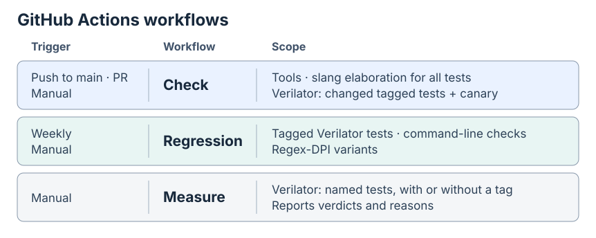

# Current results and measurement methodology

[日本語](results.ja.md) · [README](../README.md) · [Known differences](known-differences.md)

## Current snapshot

Runtime matches, compiler rejections and unmeasured inputs describe different execution conditions; [Read a result](reading-guide.md#read-a-result) explains how to read the counts together.

The 2026-11-21 migration moved the fixed release from 5.052 to 5.054 and
remeasured every two-state input on 5.054 locally at seeds 1/73. The 2312 tests
whose tags moved to `verilator@5.054` are the ones that matched in that
measurement, and the 459 known differences are the ones that did not, with
their causes re-assigned in the cause record. The three DPI-condition subsets
were remeasured on 5.054 too, and their states match the 5.052 records. The hosted Regression ([run 44905474705](https://github.com/kurochan001/kirimasim-uvm-tests/actions/runs/44905474705)) ran all 2312 tagged checks with Verilator 5.054 on 2ae19a1b and succeeded in all 24 jobs, as recorded in the history and here.
On November 23, four revised simulation cases matched both seeds and three revised illegal designs were rejected. The 0.1.3 kirimasim run covered the 2778 inputs present that day. On November 24, Verilator matched the fourteen new two-state simulations at both seeds and rejected the external protected-method call. Ghost ran all sixteen additions, including the four-state event. [Regression details](history.md#2026-11-24-state-changes-and-outstanding-requests)

The suite has 2799 fixtures in 22 directories: 2699 simulation and 100
elaboration. Milestone totals are M1 1205 (1124/81), M2 642 (634/8) and M3 952
(941/11), with runtime/elaboration counts in parentheses. All use `spec_check: ai`;
none records human review. Of 2738 no-DPI fixtures, 100 are illegal elaboration
checks. The thirty-eight HDL-DPI and twenty-three command-line/regex-DPI runtime fixtures
remain separate.

Counts do not establish a reviewed coverage percentage.

Backend rows revisit inputs already included in the ordinary row under different conditions; [the execution setup](testing.md#the-uvm-library) explains why their results are counted separately.

A runtime match at seeds 1/73 still counts as one fixture, while a seed requested in configuration may be skipped after a first mismatch; [the seed-count explanation](faq.md#q201-did-all-2778-tests-run-at-two-seeds) explains how to read the execution scope column.

| Simulator and library | Observation | Execution scope |
| --- | --- | --- |
| Verilator 5.054, pinned UVM | 2331 `pass`: 2236 runtime + 95 compile rejection; 460 `known` | Runtime matches use seeds 1/73; expected compiler rejections execute no runtime seed |
| Verilator 5.054, original VPI HDL backend | 37 `pass`; 1 `fail` | Separate overlapping 38-case condition; matches at seeds 1/73, difference at seed 1 |
| Verilator 5.054, original command-line VPI bridge and pinned regex DPI | 20 `pass`; 3 `known` | Separate overlapping 23-case condition; matches at seeds 1/73, differences at seed 1 |
| Verilator 5.054, listed ordinary fixtures with regex and command-line DPI | 26 `pass` | Separate overlapping 26-case condition from `coverage/regex_dpi_variants.txt`; matches at seeds 1/73 |
| kirimasim 0.2.1 (commit e93839fdcbea), pinned UVM | 99 expected compiler rejections, 2624 unsupported, 76 failures | November 24 baseline plus targeted measurements for changed and added inputs |
| Ghost, bundled UVM | 205 `pass`; 873 `fail` | 1078 unchanged inputs at each seed; identical failing sets; 1721 inputs unmeasured |
| Ghost, pinned UVM | 2317 `pass`; 482 `fail` at each seed | Full baseline plus targeted runs for changed and added inputs, matched by fingerprint at seeds 1 and 73. [Library-mode baseline](ghost-dual-handoff.md#verification-after-the-fixes) |

The pinned library is Accellera UVM 2020.3.1, commit `78c06547a2a0`, with
326 files checked against [the lock](../third_party/uvm.lock). A Ghost bundled
run uses the supplied library rather than that lock's package. Private
simulator identity, version, paths, profile contents and diagnostics are
not published. [Ghost setup](testing.md#ghost) describes the public interface.
Icarus Verilog is not used for this UVM suite.

## Interpretation

One test may check several observations, and a required mismatch keeps the whole case from passing even when other rows match; [the judgment rules](faq.md#q5-what-do-pass-fail-known-and-unsupported-mean) explain its recorded status.

To investigate an individual row, [Trace a difference](reading-guide.md#trace-a-difference) connects its result JSON to the source, expected observation and runner condition.

If the identifiers are unfamiliar, [the smoke-test example](reading-guide.md#follow-one-test-through-the-files) shows how a result ID, source filename, UVM class and requirement ID relate to one another.

For a runtime output mismatch, `reason` identifies the first differing selected line, so use [the observation rules](testing.md#what-is-observed) to compare it with the declared expected sequence.

A build failure stops before simulation, while a runtime difference comes from an executed model; [Q14](faq.md#q14-do-two-seeds-prove-determinism-or-four-state-correctness) explains which seed results exist in each case.

95 valid negative expectations match by compiler rejection with the
declared fixture/type/member diagnostic. Five illegal designs remain accepted:
subscriber write, visitor visit, proxy get_immediate_children and adapter accept omissions, and direct construction of the
printed virtual builtin dispatcher. They retain the rejection oracle as known
differences without runtime, even when accepted. The 141 unexpected simulation
builds remain separate. A pass requires the declared expectation.

[The cause record](known-differences.md#causes-of-the-known-differences) assigns causes to these
differences separately from the symptom categories below: 321 library, 61 interpretation,
21 simulator and 57 DPI-condition causes, with no entry unassigned.

The 460 measured spec-only cases retain standard-derived output or compile-diagnostic
expectations; the eight four-state spec-only cases have no Verilator record. Five are illegal compiler acceptances; 455 are simulation cases.
Of these, 313 first differ at runtime seed 1 without seed 73. The low-history GREEDY fixture matches at seeds 1 and 73 and differs at seed 2 under the same conditions. [GREEDY retest](history.md#2026-11-28-greedy-allocation-history)

Forty-three cannot build
because of missing APIs/type names: one time API, fourteen sequence-library APIs,
twelve HDL slice-view cases, one named-concat constructor, five object active-policy API cases,
three catcher message-handle cases, the printed base recording-state getter,
the printed report callback typedef and two builtin type_id cases, plus three typed resource-DB helper cases.

One time-decrement build requires the printed optional secs argument.
Two declaration builds retain incompatible defaults; two retain printed
all_dropped function/task and clone implicit-scalar/map-return conflicts. Three
retain incompatible inherited type_id registry specializations; one of those
stops building on Verilator 5.054 with an internal compiler error; one retains the
protected memory backdoor_read accessibility difference. Two legal extensions, resource-base and listed-only complete core service,
also require unlisted pure hooks. Another 61 request
unlinked DPI: thirty-eight HDL and twenty-three command-line cases. Three additional legal
builds use the literal enum-collection T interpretation. Seven further builds
retain six strict attribute definitions and the printed enum-unpack arity.
Three more builds retain dependent visitor defaults with custom STRUCTURE.
Two qualified virtual-abstraction overview-base inputs retain the wording
conflict; their explicit class-base controls match separately. Three build
failures retain printed return-type conflicts: two dedicated-pool inputs keep
the pool/item conflict, and the phase `get_schedule` input now fails to build
because Verilator 5.054 rejects passing a class handle to a printed string
argument. These 141
simulation builds have no runtime result. Separate command-line evidence has
twenty matches, one quit-warning difference and two regular-expression differences.

One additional legal construction input is rejected as an abstract uvm_vreg_cbs
facade under the pinned virtual declaration; its printed concrete expectation is
retained without runtime.

Four additional bare-packet simulation builds stop at the typed factory result used for predictor type naming; they have no runtime evidence and do not create a mandatory IEEE registration prerequisite.

One additional simulation build reports an undefined UVM_PACKER_MIN_BITS and has no runtime result; the other of the pair, the unsupported enum method for the large flag extension, matched on Verilator 5.054 and is tagged.

The shared-handler reset case retains the severity/ID verbosity value while
general and ID values, action and file return to defaults. The expected reset
and subsequent boundary delivery remain unchanged. This adds one runtime
fixture to the known set; prior severity-override reset differences remain.

The separate VPI condition has thirty-eight fixtures: thirty-seven match both
seeds. Three memory inputs access real array cells through inherited tasks,
split banks and ROM write versus poke; wrappers retain the separate public-read
declaration limitation. Nine primitive force/release inputs check real public
8/40-bit regs/wires and immediate release/read behavior.

Eight new positive-duration force_time inputs observe periods 5/13, interior
force retention, post-period reg/wire state, later updates and dormant/peer
isolation. Calls are sequential in the shared compilation-default time unit;
no exact-expiry ordering, return-time/result or overlapping-argument claim is
made. The backend and both runners are unchanged. Six actual-register inputs cover
public backdoor_read, peek and poke observations for 16/40-bit whole variables
and legal two-variable split references. All thirty-eight current HDL records
are retained unchanged in this increment.

The E.7 inaccessible-path sequence still reports ERROR and attempts reads rather
than the retained warning/no-transfer expectation at seed 1, with no seed 73
result. General types/selects/arrays, cross-unit/rounding, overlapping timed calls,
failure/cancellation and four-state behavior remain open. Do not add overlapping
matches to ordinary results; see [HDL setup](testing.md#verilator-vpi-hdl-subset)
and [known differences](known-differences.md).

kirimasim 0.2.1 reports the type `uvm_object_wrapper` as unsupported on 2563 cases, and the runner reports the 61 `:uvm_dpi: yes` cases as unsupported without running them, because it passes no DPI back end. The 76 `fail` cases are exactly the tests that [the slang record](testing.md#slang-elaboration) lists with the reason library: they do not compile with the pinned library. The 99 `pass` cases are 99 of the 100 illegal designs, rejected with a message that matches their pattern; the other, which the pinned library makes legal, reaches the unsupported type. [The bring-up stages](kirimasim-stages.md#current-kirimasim-records-by-stage)
count these records by stage: the same construct stops every stage. Neither category establishes
execution of the UVM behavior beyond those blockers. Ghost's bundled
mismatches do not identify whether the simulator or its library caused them,
and they do not establish results for the pinned library. Ghost's annex E matches cover only the
[RO register skip](../tests/uE/test_single_register_access_sequence_skips_a_readonly_register.sv),
[missing-register-backdoor skip](../tests/uE/test_single_register_access_sequence_skips_a_register_without_a_backdoor.sv) and
[missing-memory-backdoor skip](../tests/uE/test_single_memory_access_sequence_skips_a_memory_without_a_backdoor.sv).
They establish no frontdoor/backdoor transfer behavior.

`known` and `unsupported` are not passes. A command's exit code alone is not
a suite pass count; the [FAQ](faq.md#understanding-a-result) explains status
and exit-code rules. Two seeds do not prove determinism or four-state correctness.

Two additional simulation builds are the conditional B.4 directional type controls, with assignment-type errors and no runtime; [Q392](faq.md#q392-do-the-type-relation-controls-settle-the-b4-base-wording) explains why they do not establish mandatory ancestry or a library-only cause.

## Evidence assembly

This section explains how existing records can support a combined snapshot; for a first local measurement, use [the single-test command](faq.md#q3-how-can-i-run-one-test-first) and [the JSON-reading example](reading-guide.md#open-the-result-json).

A fingerprint identifies the exact inputs behind a reused record, so [Execution and result records](glossary.md#execution-and-result-records) explains why an old match may not apply after an edit.

Here an unmeasured input has no compatible current record, even if an older version was run; [Q15](faq.md#q15-how-do-i-know-whether-an-old-result-still-applies) explains the checks needed before reusing it.

The snapshot for expansion 124 started from [9601387](https://github.com/kurochan001/kirimasim-uvm-tests/commit/960138734ce23d521c36a645315044e070487cfa), retained the 2755 earlier two-state Verilator records and added one stage-0 input (M1) on 2026-11-09 JST. The seven four-state inputs had no Verilator record.

The profiles below check only their stated conditions, so a match under a different premise cannot pass an original difference; [the requirement-link guide](requirements.md#citations-requirements-and-execution-evidence) explains the recorded direct/control roles.

The 124th expansion implements the external review's seventh item, the
bring-up stages of kirimasim. [`coverage/kirimasim_stages.json`](../coverage/kirimasim_stages.json)
gives every test a stage from 0 (uvm_pkg only) to 6 (register layer), decided
by markers of each part of UVM in the test's own sources, and a short set of
representatives for each stage; `tools/kirimasim_stages.py` checks it in Check
and prints the short sets for the kirimasim runner. At expansion 124 the stages held 1, 1030, 95, 111, 326, 250 and 950 tests. For current counts and outcomes see [the stage guide](kirimasim-stages.md), which also lists representative tests and the SystemVerilog features exercised at each stage.
No test header changes, so no input fingerprint changes.

One new stage-0 input in u01 imports uvm_pkg and names UVM_LOW through the
import and through the package name, without creating a UVM object or calling
run_test. It matches seeds 1/73 before and after tagging from the first freeze,
and one new duty covers it. The total is 4151 AI duties, with all 4150 old
objects and 445 assessments unchanged; 2707 tests have direct links, 158 have
controls and 56 are control-only. All 2755 old ordinary records and 463 old
known inputs remain unchanged. The new input counts as M1.

The suite has 2799 tests (2699 simulation/100 elaboration). Ordinary results
are 2331 matches: 2236 runtime inputs at both seeds and 95 compiler rejections.
Known inputs total 460: 314 runtime differences, 141 simulation builds
and five accepted illegal designs without runtime; spec-only cases total 468
with the eight four-state inputs. The command-line condition keeps 23 fixtures
(20 pass, 3 known) and the regex-DPI variant condition 26 (all pass); neither
is added to the ordinary totals. The Ghost bundled subset has 1078 compatible records. Its 1721 unmeasured inputs include 1621 simulations and 100 elaboration cases. See the pinned-mode selection above for the separate library condition.

The primary-focus census has 1158 candidates with zero tests, 766 below the target and 558 with at least two. All 2062 partial identifiers, actual remaining
conditions, original milestone targets, human review and scope/denominator
approval remain open; [the progress guide](reading-guide.md#read-coverage-and-progress)
explains why matching conditions do not supply completion.

Retained kirimasim/Ghost records were collected with fixed executable
snapshots and Ghost's seed-specific private profiles.

The revised TLM2 same-kind connection fixture retained its unsupported verdict on the same kirimasim 0.2.1 build and its recorded Verilator interpretation difference. [November 28 retest](history.md#2026-11-28-tlm2-terminator-fixture-correction)

The revised silent barrier reset fixture matches on seeds 1 and 73 in Verilator 5.054 and Ghost with pinned UVM. The same kirimasim 0.2.1 build retains its unsupported verdict. [Barrier test review](history.md#2026-11-28-silent-barrier-reset)

Commercial simulator results are excluded under the
[reporting policy](faq.md#commercial-simulator-and-issue-reporting-policy).

The original Ghost files retain 1085 records per seed. Four earlier revisions were already excluded. The 2026-11-23 review excluded the old result of the common-phase ordering test (pass), the BODY/FINISHED sequence-state waiter (fail), and the default-map selection and recursive lock test (fail) at each seed. The other five revised tests were already outside the Ghost subset. This leaves 205 matches and 873 failures per seed on the current inputs.

Earlier exclusions are recorded in `out/thin-one-hundred-sixth-guest-exclusions.json`;
the last evidence scope assembled in this workspace is `out/thin-one-hundred-twenty-sixth-a-evidence-scope.json`. The measurements of the 127th and 128th expansions were made in another session, and their files are not in this workspace; the tests added from the 129th expansion on have one batch file for each measurement under `out/`, and no combined record includes them yet.

The fingerprints identify different inputs:

SHA-256 is a digest of recorded content, and [the fingerprint glossary](glossary.md#execution-and-result-records) explains why matching one digest alone does not establish the same execution conditions.

Editing only a requirement's wording calls for a regenerated inventory, while editing a test header changes its test fingerprint and requires compatible execution evidence; [the update procedure](requirements.md#updating-a-test-or-mapping) describes both paths.

| Identity | What it identifies | How to use it |
| --- | --- | --- |
| `inputs_sha256` | Test source, expected files, collected helpers/data and library lock | Compare each record with the current test inputs |
| `runner_sha256` | Selected runner, `suite_results.py` and `uvm_common.py` | Match across batches and require `runner_changed` to be false |
| `uvm_reports` | SHA-256 of `coverage/uvm_reports.json` | Check that the declarations match the record |
| `ledger_inputs_sha256` | Canonical scope, requirements, assessments, test index and clause catalog | Identify a generated inventory/backlog, separately from simulation evidence |

The [ledger identity](requirements.md#generated-report-identity) belongs to
generated review reports. Matching input/runner hashes still requires checking
simulator, configuration and library identities before reusing execution records.

Before combining records, check that:

- Verilator IDs cover every current two-state input exactly; the eight
  four-state inputs have no Verilator record. The kirimasim and pinned Ghost records each cover all 2799 inputs. Keep the 1078 Ghost bundled IDs under their separate configuration.
- Each record's `inputs_sha256` matches its current source, expected output,
  associated inputs and library lock as collected by the runner.
- Simulator version, configuration and `runner_sha256` match between batches,
  and `runner_changed` is false.
- Every Verilator-tagged case is `pass` and every current two-state untagged
  case is `known` in this snapshot.
- Ghost's two seed runs have the same failing test set.

This is compatible recorded evidence over the current inputs; it does not
claim that a single invocation reran the entire suite. The
[development history](history.md) retains increment counts, measurements,
prior smoke tests and build-change details. Refreshed records replace older
ones only after their current input fingerprints are verified.

A guest record cannot be measured again without the private executables. When
an edit only adds comments or line breaks, [the code-identity check](testing.md#readability-edits)
shows that the edited inputs keep every token, metadata field, directive,
metacomment and `` `__LINE__ `` distance; such a record is carried forward to
the new fingerprint, keeps its old one in `carried_from`, and is not a new
measurement. Verilator results of the edited inputs are measured again.

Readability (item 8) is finished in all 22 directories. Each directory's inputs, and every input elsewhere that collects one of its files, were measured again at seeds 1/73 with every status unchanged; their fingerprints moved forward with `tools/code_identity.py` and their guest records were carried forward. The narrowed Regression runs, with the inputs measured again for each directory in parentheses:

| Directories (inputs) | Regression run | Result |
| --- | --- | --- |
| u17 (11) | [42619611363](https://github.com/kurochan001/kirimasim-uvm-tests/actions/runs/42619611363) | matched its 6 tagged checks |
| u11 (20) | [42663897873](https://github.com/kurochan001/kirimasim-uvm-tests/actions/runs/42663897873) | succeeded |
| uG (23) | [42677380895](https://github.com/kurochan001/kirimasim-uvm-tests/actions/runs/42677380895) | succeeded |
| uD (28), u07 (35), u01 (38), u13 (58), u09 (63), u06 (68), u08 (69), uC (72), uE (88), u05 (100), u15 (125) | [42686227804](https://github.com/kurochan001/kirimasim-uvm-tests/actions/runs/42686227804) | succeeded |
| u10 (144) | [43024352324](https://github.com/kurochan001/kirimasim-uvm-tests/actions/runs/43024352324) | succeeded |
| u14 (147) | [43055148276](https://github.com/kurochan001/kirimasim-uvm-tests/actions/runs/43055148276) | succeeded |
| u19 (170) | [43076690673](https://github.com/kurochan001/kirimasim-uvm-tests/actions/runs/43076690673) | succeeded |
| u16 (188) | [43099407618](https://github.com/kurochan001/kirimasim-uvm-tests/actions/runs/43099407618) | succeeded |
| u12 (205), uF (214), uB (241), u18 (652) | [43119845864](https://github.com/kurochan001/kirimasim-uvm-tests/actions/runs/43119845864) | succeeded |

The [draft ledger](requirements.md) has 4192 AI duties and 0 unassessed
identifiers: 2062 partial/445 assessed. Chapter 10 is 87/29/0; chapter 18 is
393/63/0. Their partial contracts and original targets remain open. Direct
links cover 2743 tests; 56 others have only controls. The Ghost bundled selection retains 1078 compatible inputs. Its 1721 unmeasured inputs include seven revised originals. Scope and denominator remain unapproved.

## Whole-output comparison

The runners judge a test by its `UT: ` lines, which the standard determines. The rest of the output, such as the form of a report, a printer's table or a topology listing, is not determined by the standard and is not judged. With the same library and the same test, a difference in that output between two simulators still comes from the simulators, so it is kept as evidence apart from conformance. [`tools/full_output.py`](../tools/full_output.py) saves the whole standard output of each test and compares two saved sets; it changes no expectation, no oracle and no verdict, and its files are not runner records.

```sh
python3 tools/full_output.py capture --simulator verilator --seed 1 -j 2 --build-jobs 2 --output out/full-verilator
python3 tools/full_output.py capture --simulator kirimasim --kirimasim /path/to/kirimasim -j 8 --output out/full-kirimasim
python3 tools/full_output.py compare out/full-verilator out/full-kirimasim --json out/full-compare.json
```

`capture` runs the tests through the simulator's own runner, so the commands are the runner's, and keeps the output that the runner reads; the runner files and their fingerprints do not change. It replaces the repository's directory and temporary directories by placeholders and drops the lines that Verilator itself prints about the run. `compare` reports, for each test in both sets, whether the outputs are identical, differ only outside the `UT: ` lines or differ in them, with the first differing line. A first use on four tests, with a local Verilator 5.054, gave identical outputs for two captures at seed 1 and for seeds 1 and 73. No comparison with kirimasim exists yet, because kirimasim 0.1.3 runs no simulation test; the saved sets are local files under `out/` and are not published.

## Reproducing and retaining results

Writing to the same `--json` path replaces that file, so choose a new filename to retain an earlier run when following [the runner commands](testing.md#running-the-suite).

A rerun creates a new local measurement, and [the result-saving guide](testing.md#running-the-suite) explains how to choose an output JSON for that run.

An entry missing from one JSON file supplies no judgment for that case, so [the JSON-reading example](reading-guide.md#open-the-result-json) explains where to find its status and how to check the selected inputs.

To investigate one listed difference, select its source path with [the single-test command](faq.md#q3-how-can-i-run-one-test-first) and retain the same library and backend conditions as the record.

The JSON output is a local record of a selected run, and [Q10](faq.md#q10-where-is-nightly-or-the-public-results-dashboard) explains how it relates to the public Check badge.

Historical `out/` files may be absent in a fresh clone, so [the local-material guide](handoff.md#files-and-local-material) distinguishes reproducible tracked commands from optional measurement artifacts.

A result test ID is the path below `tests/` without `.sv`, so [the layout guide](testing.md#layout) helps locate the source and its declared expected file from a JSON entry.

The [testing guide](testing.md#running-the-suite) documents the commands,
profile modes and library settings. Request `--json out/<name>.json` to retain
statuses, reasons, configuration and fingerprints. `out/` is ignored by Git,
and Check does not publish these local evidence files. A result from different
inputs, a different runner, executable, profile or library is a separate condition.

## Continuous integration



A commit identifies a repository revision, so check the revision on a linked workflow run before comparing it with your files; [the handoff snapshot guide](handoff.md#snapshot-and-objective) explains how to establish the workspace's starting point.

A shard runs a disjoint subset of the selected tests, and the final gate requires every shard to succeed; [Q268](faq.md#q268-does-dividing-check-into-shards-reduce-the-required-test-scope) explains how that relates to the test scope.

[Check](../.github/workflows/check.yml) runs on pushes to `main`, pull requests
and manual dispatch. Its tools job checks pinned-library integrity, all Python tool tests discovered under `tools/`,
2799 metadata records, the draft ledger/index, the cause record of the known
differences, the [report declarations](testing.md#time-unit-and-report-declarations) and the [kirimasim bring-up stages](kirimasim-stages.md). Its slang job [elaborates every test with slang](testing.md#slang-elaboration) and compares [the API census](requirements.md#api-census) with the tests; it takes about eight minutes. Its Verilator job runs the
tagged ordinary checks whose recorded inputs changed since the base revision,
plus the canary `tests/u09/test_common_phases_run_in_order.sv`, with runtime
seeds 1/73 ([the selection tool](../tools/ci_select.py)). For a push, the base is the head of the last Check on `main` that succeeded, so the checks of a run that a newer push cancelled, or that failed, are selected again; without such a run it is the previous push. When the base is
unavailable, when the runner, its normalization, the library lock, the
fetcher, the report declarations or the setup action changed, or when more than 30 checks are affected, only the canary runs
and a warning asks for Regression. Another warning names changed files that only a separate DPI condition exercises, which Check does not run. The setup action stops unless the Verilator it restored or built reports release 5.054. The Verilator job also rebuilds the cause
record's nine reproducers. A green Check covers the selected checks only.

[Regression](../.github/workflows/regression.yml) runs on manual dispatch and
weekly (Saturdays 17:23 UTC). It runs all 2331 tagged ordinary checks (2236
runtime cases at seeds 1/73 and 95 compiler rejections without runtime seeds)
in 20 disjoint shards (eleven of 117 and nine of 116), at most 4 concurrent so
that Check and other repositories keep hosted job slots, each limited to 360 minutes, the twenty explicit command-line checks in a
separate job under their condition, and the twenty-six regex-DPI variants in another job. Its gate requires all three. A newer request
waits for a run in progress instead of cancelling it; only one request can wait, so a further request replaces the waiting one. A manual run can be
narrowed to directories under `tests/` (input `directories`); a plan job then
selects the ordinary checks that use files from those directories and allocates one shard per 115 checks, rounded up, with a maximum of 20. The same input-file filter applies to the command-line and regex-DPI jobs, including tests elsewhere that use a shared helper. The weekly run is never narrowed.

The former single Check ran the whole selection on every push. Its unsharded
[run](https://github.com/kurochan001/kirimasim-uvm-tests/actions/runs/41976785278)
exceeded the 150-minute job limit, and the 8-shard version did not finish either:
in its one [run](https://github.com/kurochan001/kirimasim-uvm-tests/actions/runs/42121591333)
not superseded by a newer push, all eight shards reached the 150-minute limit,
and the other runs after 2026-10-31 were cancelled by newer pushes. The split
keeps seeds 1/73, compiler-rejection judgment, pinned dependencies and runner
fingerprints unchanged; the selection tool is not part of the runner fingerprint.
The shard count is estimated from local build times, so local validation does
not establish a successful hosted Regression result.

The first Regression dispatch, [run 42359747603](https://github.com/kurochan001/kirimasim-uvm-tests/actions/runs/42359747603)
on 42d03ab, was cancelled after its command-line job and three of its twenty
shards had completed. The command-line job succeeded; the three shards matched
334 of 342 checks. All eight differences were checks that depend on constrained
randomization: the hosted image provided no SMT solver on the path, so
`randomize()` failed. Each matches locally with z3, and removing z3 from the
local path reproduced the four differences checked, including the same seed-1
value. Earlier green Check runs selected no check that randomizes. The
[setup action](../.github/actions/setup-verilator/action.yml) now installs z3
in every job, and the cancelled run is not a Regression result for any commit.

After the fix, [run 42372122368](https://github.com/kurochan001/kirimasim-uvm-tests/actions/runs/42372122368) on db06513 matched all 2273 tagged checks in its 20 shards
at seeds 1/73 and passed the seventeen command-line checks. Each shard took 113
to 199 minutes, within the 360-minute limit. This first complete hosted
Regression result covers that commit; later commits need their own Check or
Regression.

Two later Regression runs covered every tagged check of their commits: [run 43216444797](https://github.com/kurochan001/kirimasim-uvm-tests/actions/runs/43216444797) on a3956ce, dispatched after the readability edits, and the weekly [run 43643757165](https://github.com/kurochan001/kirimasim-uvm-tests/actions/runs/43643757165) on 73a73ad; all 24 jobs of each succeeded. [Run 44729525874](https://github.com/kurochan001/kirimasim-uvm-tests/actions/runs/44729525874), dispatched on e37fb89 after the runner began to pass the time scale and check the report declarations, succeeded in all 24 jobs on 2026-11-21, so a Regression with Verilator 5.052 covers the current runner and every check tagged at that commit. Of the fifteen tests added after e37fb89, the fourteen tagged ones were run by Check with Verilator 5.052 in the push that published them. The six tests that the 143rd expansion changed were run by [Measure run 44848496017](https://github.com/kurochan001/kirimasim-uvm-tests/actions/runs/44848496017) with Verilator 5.052 at seeds 1/73: the five tagged ones match, and the spec-only one differs as its record says. These runs cover the 5.052-era suite only. In the 146th expansion's migration, [run 44905474705](https://github.com/kurochan001/kirimasim-uvm-tests/actions/runs/44905474705) ran the 2312 tagged checks, the 20 command-line checks and the 26 regex-DPI variants with Verilator 5.054 and succeeded in all 24 jobs on 2026-11-22 (shards 89 to 151 minutes, about 11.5 hours in all); the results are recorded in the [history](history.md).

Check and Regression select tagged tests for their ordinary Verilator jobs. Check also elaborates spec-only fixtures with slang. The kirimasim, Ghost and HDL measurements come from local runs. [Measure](../.github/workflows/measure.yml), a manual workflow, runs named tests, tagged or not, with the pinned Verilator 5.054 and prints their statuses; it changes no record. The README's badge is
the live Check state, separate from these local measurements. A green Check or
Regression does not establish complete UVM conformance or a passing result for
every simulator. There is no automatic result publication.
