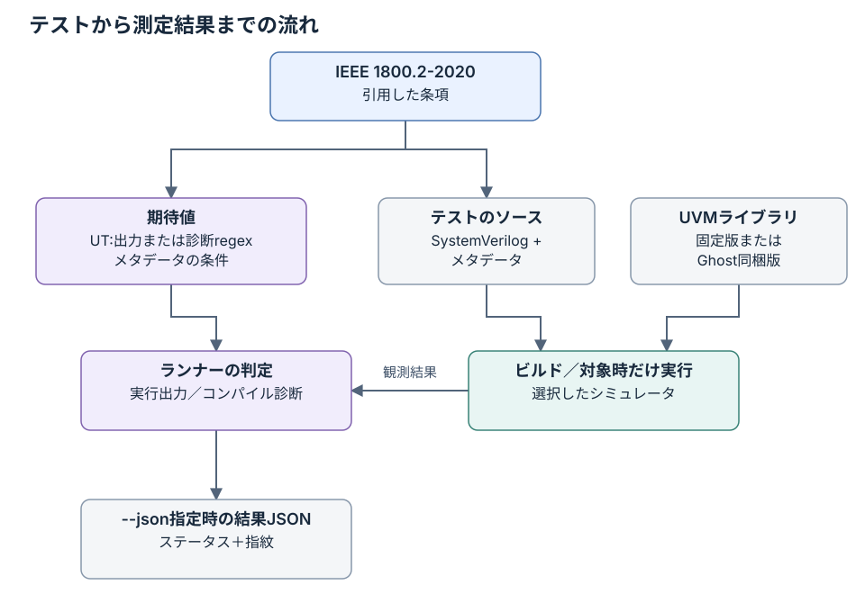

# テストと開発のガイド

[English](testing.md) · [README](../README.ja.md) · [FAQ](faq.ja.md)

現在のテスト形式、ライブラリの準備、ランナー、変更時の規則を説明します。
件数と対象範囲は[README](../README.ja.md)、測定の詳細は[実行結果](results.ja.md)、過去の作業は[履歴](history.ja.md)を参照してください。

## 確かめること

- **対象**：シミュレータがUVMライブラリを実行したとき、IEEE 1800.2-2020が定める結果になるか。
  フェーズの順序、objectionによるフェーズの終了、factoryの置き換え、config_dbの検索、
  シーケンスとシーケンサ、TLMの接続、レジスタ層などです。
- **期待値の根拠**：1800.2-2020の条項。`:lrm:`に記録し、テストの冒頭のコメントで、何を確かめるかを
  自分の言葉で説明します。規格本文は転載しません。
- **ライブラリ**：Accellera版UVMライブラリのリリース2020.3.1を、`third_party/uvm.lock`で固定して使います
  （「UVMライブラリ」を参照）。配布物の`DEVIATIONS.md`には、ライブラリが規格と異なる箇所が3件あります
  （18.2.3.4、18.4.3.6、13.1.5.1）。期待値はこれらに依存させず、触れざるをえないテストは差異として記録します。
- **範囲外**：SystemVerilogの言語そのもの（kirimasim-testsで扱う）、UVMの教材、性能、
  レジスタモデルの生成ツール、ベンダー固有の拡張。

## ディレクトリ構成

```text
tests/uNN/<name>.sv          メタデータ付きテスト（NNは1800.2の章）
tests/uNN/<name>.expected    期待する観測行
tests/uB/, uC/, uD/          付録テスト：マクロ、設定、callback
tests/uE/                   組み込みregister／memoryテストsequence
tests/uF/, uG/              文字列utility・command-lineの照会
docs/testing*.md            テスト形式・実行・変更時の規則
docs/results*.md            現在の測定条件と記録
docs/requirements*.md       範囲の案・要求の対応付け・棚卸し
coverage/*.json             版管理する範囲・要求台帳・番号の分類・テスト索引
docs/provenance*.md         関連リポジトリとソースの由来
docs/glossary*.md            用語集
docs/faq*.md                 よくある質問
docs/known-differences*.md   現在の制約とspecのみの期待値
docs/handoff*.md            作業の引継ぎと再開手順
docs/history*.md             過去の追加作業と測定
third_party/uvm.lock         固定したライブラリ：リリース、取得元、コミット、指紋
third_party/uvm/<version>/   ライブラリ本体（取得するもので、コミットしない）
tools/fetch_uvm.py           ライブラリを取得し、指紋を確かめる
tools/uvm_common.py          ライブラリと一緒にコンパイルする方法、観測する行
tools/run_kirimasim.py       kirimasimのランナー
tools/run_verilator.py       Verilatorのランナー
tools/run_ghost.py           非公開プロファイルを使うGhostのランナー
tools/suite_results.py       判定と結果JSON（kirimasim-testsから写したもの）
tools/lint_metadata.py       メタデータとテストの形式の検査
tools/requirements.py        要求台帳の案の検査と棚卸し
tools/sv_lifetimes.py        初期化付き手続き内ローカル変数の字句チェック
tools/clauses_1800_2.txt     1800.2-2020の条項番号（番号だけ）
tools/UPSTREAM               写したツールの元と、変えた点
```

## テストの形式

### 例

```systemverilog
/*
:name: test_common_phases_run_in_order
:description: the common phases run in their order, ... (IEEE 1800.2-2020 Section 9.8.1)
:tags: u09 uvm
:type: simulation
:lrm: 1800.2-2020 9.8.1 9.5 9.6 9.7 10.5.1
:uvm: 2020.3.1
:oracle: spec verilator@5.052
:spec_check: ai
:fourstate: no
:nondeterministic: no
:args: +UVM_TESTNAME=t
:expected_stdout: @test_common_phases_run_in_order.expected
*/
```

memory／FIFO追加では[記載API設定](../tests/u18/helpers63/fifo_frontdoor_fixture63.svh)と
[固定build control](../tests/u18/helpers63_initialized/fifo_initialized_fixture63.svh)の独立helper directory 2個を宣言します。
利用sourceは`:files:`でhelperを指定し、directory内容が入力指紋に入ります。helper変更時は全依存入力を再測定します。
初期化variantは台帳でcontrol専用であり、constructor／configureだけの前提の入力をpassにしません。

core-service宣言も[記載methodだけの本体](../tests/uF/helpers64/core_method_bodies64.svh)と
[明示追加hook本体](../tests/uF/helpers64_decl_control/core_decl_control_bodies64.svh)を別の宣言directoryに保持します。
完全な追加hook入力はcontrol専用です。省略26入力は選択したpure method欠落1個だけを分離するためhookを使い、
最終診断は他の欠落method errorなしにそのmethodを示す必要があります。無関係なcompile拒否で期待値をpassにできません。

### メタデータ

kirimasim-testsとsv-testsの形式を引き継ぎ、次の点を変えます。

| フィールド | 意味 |
| --- | --- |
| `:lrm:` | `1800.2-2020 <clauses>`。言語の規則にも依存するテストは、その後に`1800-2023 <clauses>`を足す。1800.2の最初の条項がディレクトリを決める |
| `:tags:` | 章のディレクトリ`uNN`と`uvm`（sv-testsがUVMのテストに付けるタグ） |
| `:uvm:` | テストが前提にするライブラリのリリース。固定したものと同じでなければならない |
| `:uvm_dpi:` | `yes`はDPIを有効にするマクロ指定。実装の供給・リンクは別途必要。[コンパイル](#コンパイル)を参照 |
| `:uvm_defines:` | ライブラリに渡すマクロ（例：`UVM_ENABLE_DEPRECATED_API`） |
| `:uvm_cmdline_backend:` | `vpi`は実process引数を使う別command-line runnerを選択 |
| `:uvm_cmdline_oracle:` | `verilator@5.052`は再現済みcommand-line検査系を既定checkへ選択 |
| `:uvm_hdl_backend:` | `vpi`は別のHDL runnerを明示選択する。他のrunnerはlinkしない |
| `:dpi_c:` | `@../../tools/uvm_hdl_vpi.cpp`で独自backendを宣言し指紋へ含める |
| `:args:` | `+UVM_TESTNAME=…`などの実行時引数 |

`:oracle:`・`:spec_check:`・`:fourstate:`・`:nondeterministic:`・`:should_fail_because:`・
`:expected_stderr_regex:`・`:expected_exit:`・`:files:`・`:defines:`・`:incdirs:`・`:top_module:`の意味は
kirimasim-testsと同じです。共通実装の取得元は[ソースの出典](provenance.ja.md)を参照してください。

negative検査系55件は`:type: elaboration`と`:should_fail_because:`を使い、`:expected_stderr_regex:`でfixture、class／methodまたはconst参照の診断を識別します。
期待するruntime出力や終了は持たせません。compile拒否と一致errorの両方が必要で、受理されたdesignはbinaryを実行せず不一致にします。
要求したseedはsimulation用であり、受理／拒否いずれの不正designも実行時seedを実行しません。台帳schema-2の診断形式は、この宣言oracleを測定と別に記録します。

既定sequencerなしの所有API検査系は、元のUVM_FATAL severityをcatchした後、検査系自身のfatalで意図的に終了します。
`:expected_exit: nonzero`と`:expected_stderr_regex:`は検査系固有のsentinelを要求し、library診断やlibrary fatalの終了コードを固定しません。
signalは引き続き失敗とし、nonzero終了だけでは必要な観測を満たしません。

### 何を観測するか

1800.2が定めるのは、レポートを組み立てるメソッドの役割までで、出来上がる文字列ではありません。
`compose_report_message`（6.5.1.2.15）は重大度・コンポーネント名・ID・メッセージから文字列を作りますが、
`UVM_INFO file(line) @ time: name [id] msg`という並びはライブラリが決めています。
ファイル名、行番号、時刻の書式も、ライブラリとシミュレータで変わります。そこで次のようにします。

- **既定のレポート行は比べない。**
- **simulationテストは、観測した値を`UT: `で始まる行に`$display`で出す。** 出すのは規格が定める値だけです
  （フェーズの順序、件数、読み戻した値、比較の結果など）。期待出力と比べるのはこの行だけです。
  レポートの仕組みが壊れていても、他の章のテストが巻き込まれずに済みます。
- **レポートの件数は値で読む。** report serverの`get_severity_count`・`get_id_count`で読み、
  `UT: `の行に出します。
- **6章（レポート）のテスト**は、独自のreport serverやreport catcherを使い、規格が定める入力
  （重大度、ID、冗長度、動作）と結果の対応を`UT: `の行で確かめます。
- 規格が定めないものに依存しません。乱数の値、同時に始まるプロセスの順序、
  規格が定める以外の自動生成名などです。

sequencer relevance上限fixtureは独自zero-time callbackを数え、選択上限または最初の超過で未指定のerror通知を許容します。
通知または上限付きfallback後にcallbackをblockし、復旧を仮定せずownerを完了させます。正時刻からの初回burstは時刻0の比較対象と独立です。
private counter／reset規則は主張しません。

transaction-event fixtureは実pull portを動かし、規格typed callbackで指定item-pool eventを観測します。初回要求前に無効化し、
明示component markと独自address／data gateで後続完了をモデル化します。選択した通知／timestampを扱い、初期pool所属、DB配置、物理DUT動作は認定しません。

builtin-sequence宣言fixtureは実際の省略／明示constructor呼出し、正確なstatic base／target receiver、protected slot用の独自合法派生accessorを使います。
最小不正probeはvirtual直接生成とprotected外部accessをruntimeなしで評価します。実行中factory-child probeは実行childを宣言slotと選択対象へ照合し、
独自bodyによってbuiltin access／walk algorithmを認定しません。既存full-algorithm controlは別の引用と実行同一性を保持します。

## 期待出力の決め方

1. 引用した条項から期待出力を決めます（`:oracle: spec`）。
2. ライブラリのソース（Apache-2.0）は規格の理解のために読めますが、期待値は規格から決めます。
   ライブラリ自身の`DEVIATIONS.md`と[既知差分](known-differences.ja.md)で、
   ライブラリの制約と固定版で再現したoracleを区別します。
   不足する必須動作を直接検査するテストは、specのみの期待値を保持します。
3. 固定版での再現：
   - Verilator 5.052は、`UVM_NO_DPI`でライブラリをビルドして実行できます。x・zに依存せず、
     seed 1と73の両方で再現したテストには、kirimasim-testsと同じく`verilator@5.052`を付けます。
   - Icarus Verilog 13.0はUVMを実行できないので使いません。
4. シミュレータと期待出力が食い違っても、出力を写して解決しません。判断するのは条項です。

### テストから結果までの流れ

引用した条項から決める期待値と、実行から得る観測結果を、判定の段階で照合します。



ビルド・実行の失敗も結果として記録します。ライブラリの識別情報も実行条件の一部で、
Ghostの同梱モードでは供給されたUVMを使います。ステータスとコマンドの終了コードは
[FAQ](faq.ja.md#結果の読み方)を参照してください。

## UVMライブラリ

### 取得

`python3 tools/fetch_uvm.py`は、`third_party/uvm.lock`が名指すリリースを
[accellera-official/uvm-core](https://github.com/accellera-official/uvm-core)
（タグ`2020.3.1`、コミット`78c06547a2a0`）から取得して`third_party/uvm/2020.3.1/`に置き、
展開したファイルの指紋（326ファイルそれぞれのパスとSHA-256）を確かめます。
取得先が圧縮し直すことがあるので、アーカイブ自体の指紋は使いません。
`--check`は、置いてあるコピーだけを確かめます。ライブラリはコミットしません。

### コンパイル

- 固定版の実行は`src`をinclude先に追加し、テストより先に`src/uvm_pkg.sv`をコンパイルします。
  Verilatorは`-I`、kirimasim・Ghostは`+incdir+`を使います。Ghostの同梱モードは別途パッケージを供給します。
- テストが`:uvm_dpi: yes`としない限り`UVM_NO_DPI`を定義します。ライブラリのHDLバックドア用のDPIは、
  商用シミュレータ3種向けの実装しか持たないためです。DPIなしのライブラリは、`+UVM_TESTNAME`を自分で読み、
  名前の照合を正規表現ではなくglobで行い、コンポーネント名を検査しません。
  `UVM_NO_DPI`のサポートを削除するかもしれない、という警告も出します。
  正規表現や組み込みのHDLバックドアに依存するテストは`:uvm_dpi: yes`とし、DPIを読み込める対応環境が必要です
  （`UVM_HDL_NO_DPI`ならバックドアだけを外せます）。
- ユーザー定義の`uvm_reg_backdoor`による記憶域handlerはHDL DPIなしで使えます。
  商用シミュレータの実行・結果はプロジェクトの方針で除外し、組み込みHDL path／DPIの検査は未完です。
- 現在の1901件は`UVM_NO_DPI`を使い、11件はHDL DPIを明示的に有効にします。
  `:uvm_dpi: yes`はこのマクロを外す指定で、
  C/C++のDPI実装を自動でビルド・リンクする指定ではありません。
  現在のVerilatorランナーはDPIのC/C++ソースを追加しません。
- `:uvm_defines:`で`UVM_ENABLE_DEPRECATED_API`を指定できますが、現在は付録Hのテストも、
  このマクロを要求するテストもありません。

### VerilatorのVPI HDL部分集合

別の[HDL runner](../tools/run_verilator_hdl.py)は、公開VPI経由で独自の[backend](../tools/uvm_hdl_vpi.cpp)をlinkし、
実際のHDL storageを使います。Verilatorは5.052固定です。明示選択する11検査系は、
`:uvm_dpi: yes`、`:uvm_hdl_backend: vpi`、宣言した`:dpi_c:` pathを設定し、
`UVM_REGEX_NO_DPI`と`UVM_CMDLINE_NO_DPI`で無関係なimportを無効にします。
runnerは、どちらのdefines fieldでも、HDL無効化macroと、既定1024 bitのUVM DPI ABIの変更を拒否します。

```sh
python3 tools/run_verilator_hdl.py --seeds 1 73 --build-jobs 2 -j 1 \
  --json out/verilator-hdl.json
```

未変更のbackendは、対応する64 bitまでのpacked変数handleを受け付けます。以前のfixtureは8／40-bit変数を使い、
memory 3 fixtureは選択した実16-bit array wordと8／16-bit分割bankも測定します。check／read／depositは実simulator handleへ達し、neighbor cellが分離controlになります。
固定libraryはbackdoor_readをprotectedにするため、継承taskの2 fixtureは独自公開wrapperを使います。別の合法宣言probeでそのaccess差分を保持し、公開write宣言は独立に合法です。
wrapperで公開read契約をpassにはしません。

force／releaseは失敗を返します。選択array wordの一致で、一般array／type support、four-state値、細かい権限、vendor overlayを示しません。
独自の限定backendであり、他simulatorのHDL実装の証明ではありません。

可視性と評価の制約は、[公開VPI文書](https://verilator.org/guide/latest/connecting.html#verification-procedural-interface-vpi)を参照してください。
検査系は、deposit後に再評価を許してからHDL値を観測します。simulator実装sourceは読みません。
通常runnerは変更せず、このbackendをlinkしないため、11検査系は`:oracle: spec`を保持します。
別runnerは、`verilator_hdl`、独自の`runner_sha256`、backend設定を記録し、同じ共通期待値を使います。
選択した不一致があれば失敗を返します。実array 3 fixtureを含む10件は両seed一致、E.7のwarning／転送なしの1件は差分です。
重複する11件の別条件を、通常runnerのevidenceとは分けてください。

現在のIEEE本文にないalgorithmの詳細には、検査系と台帳で明示的に限定したAI解釈を記録する場合があります。
memory-walkは、[Q134](faq.ja.md#q134-memory-walk-algorithmをどう解釈していますか)で説明する公式の歴史的資料を使います。
この対応はレビュー対象で、省略された規範的詳細の承認ではありません。
algorithm実装の複製や、simulatorの観測出力をoracleにしません。

### Verilatorのcommand-line部分集合

[別runner](../tools/run_verilator_cmdline.py)は、標準VPIを通す独自の[引数bridge](../tools/cmdline_backend/uvm_cmdline_vpi.cpp)を使います。
[regex wrapper](../tools/cmdline_backend/uvm_cmdline_regex.cpp)は固定したApache-2.0 UVM regex実装をcompileし、
[移植用header](../tools/cmdline_backend/malloc.h)はmalloc headerのないhostへ標準の割当宣言を提供します。
bridgeへUVM parserを複製せず、simulator実装sourceも使いません。合成した一覧ではなく、実process引数です。

検査系は`:uvm_dpi: yes`、`:uvm_cmdline_backend: vpi`、`:uvm_defines: UVM_HDL_NO_DPI`を指定し、
bridgeを`:dpi_c:`、wrapper／headerを`:files:`へ宣言します。directory内容とlibrary lockをfingerprintへ含めます。
backend検証はcommand-line／regex DPI無効化、宣言欠落、別backend、4-state検査系を拒否します。HDL accessは無効で、
任意のregex、不正option、4-stateの完全性は主張しません。

```sh
python3 tools/run_verilator_cmdline.py --seeds 1 73 --build-jobs 2 -j 2 \
  --json out/verilator-cmdline.json
python3 tools/run_verilator_cmdline.py --all --seeds 1 73 --build-jobs 2 -j 2 \
  --json out/verilator-cmdline-all.json
```

既定では`:uvm_cmdline_oracle: verilator@5.052`で再現済み17検査系を選びます。`--all`はspecのみのquit警告検査を加え、
差分をpassではない`known`で記録します。再現済み選択検査の回帰は`fail`で、終了codeも非zeroです。
modelを1回buildし、両seedを新規processで実行します。別の`verilator_cmdline`結果同一性でrunnerを独立にhashし、generic期待出力を共有します。
重複する通常18記録はDPIのlinkに失敗するため、両条件を分けます。Checkは既定のcommand-line 17件を実行し、既知差分の1件は実行しません。

## スイートの実行

```sh
python3 tools/fetch_uvm.py
python3 tools/run_kirimasim.py --kirimasim /path/to/kirimasim -j 8 --json out/kirimasim.json
python3 tools/run_verilator.py --seeds 1 73 --build-jobs 2 -j 2 --json out/verilator.json
```

ランナーにはPython 3.10以降が必要です。結果のJSONはkirimasim-testsと同じ形
（`tools/suite_results.py`）なので、履歴やレポートのツールでそのまま読めます。
`run_verilator.py`はテストごとにUVMパッケージ全体をビルドします。
`-j`は並行するテスト数、`--build-jobs`は各テストのC++ビルド並列数です
（既定の0はすべてのハードウェアスレッド）。ccacheは使いません。Verilatorは大きなモデルを
事前コンパイル済みヘッダーでビルドし、そこにビルド先の絶対パスが入るので、ccacheが別の場所で作った
ヘッダーを返すとビルドが壊れるためです。

runtimeでは`--seeds 1 73`で各モデルを一度だけビルドし、seedごとに新しいプロセスで実行します。
要求した全runtime seedで一致した場合だけ成功です。従来の`--seed N`も使えます。
結果JSONのconfigurationには、指定に応じて`seed`か`seeds`を記録します。

Verilatorの既定の対象はoracle付き・2値の1653件（runtime 1569・期待compiler拒否84）です。`--all`を付けるとspecのみの277件も含めます。
oracleのないテストの不一致は`known`で、コマンドを失敗させません。oracle付きの不一致は失敗です。
テストのパスを明示した場合は、そのテストだけが対象です。スモークテスト1件の実行例です。

```sh
python3 tools/run_verilator.py --seeds 1 73 --build-jobs 2 -j 1 \
  --json out/verilator-smoke.json tests/u09/test_common_phases_run_in_order.sv
```

各実行は一時的なビルドディレクトリを使います。`out/`はGitの対象外で、CheckはそのJSONを公開しません。
結果の分類・終了コード・指紋の読み方は[FAQ](faq.ja.md)を参照してください。

### Ghost

```sh
python3 tools/run_ghost.py --simulator /path/to/private/simulator \
  --profile /path/to/private-profile.json -j 2 --json out/ghost.json
```

非公開のJSONプロファイルに`arguments`（文字列の配列）、`environment`（文字列の対応表）、
`uvm_mode`を明示します。

- `pinned`：固定版UVMをテストより先にコンパイルします。同梱UVMの自動読み込みは
  プロファイル側で無効にします。
- `bundled`：UVMの供給をプロファイルとシミュレータに任せ、別のパッケージをコンパイルしません。
  共通の規格期待値と比較しますが、**固定版ライブラリの実行証拠にはしません**。
  テストの`:uvm:`から同梱ライブラリの版を推測しません。

同梱モードのプロファイルには、ソースとヘッダーを含む非公開ディレクトリ`uvm_library_dir`も
指定し、実行引数で同じライブラリを選びます。コードもヘッダーも実行ファイル内に組み込まれて
いる場合だけ、代わりに`uvm_embedded: true`を指定します。この2通りのどちらかが必要です。
ディレクトリのパスは結果に書きません。

公開JSONには`uvm_source`、`uvm_pinned`、テストが前提にする版（`test_uvm`）、実行ファイルと
プロファイルのSHA-256を記録します。固定版とディレクトリに置かれた同梱版では、ライブラリの
内容の指紋とファイル数も記録します。
シミュレータの名前・版・パス、プロファイルの内容、診断は公開しません。
実行中に実行ファイル・プロファイル・ライブラリが変わったら、結果を書きません。
固定版モードでは、実行前にライブラリの内容がlockと一致することも確かめます。

## 検査

```sh
python3 tools/fetch_uvm.py --check
python3 -m unittest discover -s tools -p 'test_*.py'
python3 tools/lint_metadata.py
python3 tools/requirements.py check
```

現在のツールの単体テストは110件、メタデータの対象はテスト1930件（simulation 1843件・elaboration 87件）です。
[台帳の検査](requirements.ja.md)は、範囲案、明示した期待値への対応、入力の指紋を検査し、カバレッジを主張しません。
[Check](../.github/workflows/check.yml)は`main`へのpush・pull request・手動実行で動きます。
別のVerilatorジョブは5.052・`UVM_NO_DPI`・seed 1と73でoracle付きのテストを実行し、
各モデルを一度ビルドして2回使います。Checkの成功はその検査の成功を示し、
UVMの全要求や全シミュレータの成功を示すものではありません。

## テストの追加・修正

商用シミュレータの結果・出力・診断は、非公開・第三者・匿名化した資料も含め、期待値、実装判断、Issueへ利用しません。
[投稿方針](faq.ja.md#商用シミュレータとissueの投稿方針)と[Issueフォーム](../.github/ISSUE_TEMPLATE/report.yml)を使い、
報告のために商用製品を実行しないでください。Ghostの仮名を使えるのは本プロジェクトのゲストの公開用結果だけです。

シミュレータを動かす前に、引用した規格から観測結果を決めます。テストは独立させ、
規格が定める結果だけを`UT: `行に出力します。シミュレータとライブラリの組み合わせで差があっても、
規格の期待値を保持します。初期化付き手続き内ローカル変数は寿命を明示し（SystemVerilog 6.21）、
forkの共有状態が生存するようにし、blockingの観測にはwatchdogを設けます。
メタデータとツールを検査し、固定版のoracleタグは両seedで再現してから付けます。
規格PDFはローカルに置き、Gitの対象にしません。

## 権利と出典

- 1800.2の本文・図・サンプルコードは転載しません。条項番号を引用し、自分の言葉で説明します。
- UVMライブラリはApache-2.0です。取得するもので、コミットしません。
  コミットする場合は、`LICENSE.txt`と`NOTICE.txt`を一緒に置きます。
- GPL・LGPLのシミュレータ（Icarus Verilog、Verilator）の実装ソースは読みません。
- 公開前のシミュレータの名前、版、実行プロファイル、パスは公開しません。

## ドキュメントの更新

プロジェクトの各ガイドには英語の`.md`と日本語の`.ja.md`を用意し、見出し、事実、コマンド、表、図、
リンクを対応させて、同じ変更で両方を更新します。API名、metadata、コマンドのoption、期待出力など、
機械が読む文字列の表記は変えません。[LICENSE](../LICENSE)の原文には、全文の非公式な
[日本語参考訳](../LICENSE.ja.md)を用意します。

SVGは`docs/images/`に`.svg`と`.ja.svg`の対で置き、label、`title`、`desc`を翻訳します。
SVGのソースを直接編集できるため、両版のnode、矢印、method名を対応させて維持します。
埋め込む画像には、その言語で内容を説明するMarkdownの代替テキストを付けます。

READMEには現在の対象範囲、前提環境、コマンド、実行結果、未完の作業を記載します。
追加作業の経緯と過去の測定は[履歴](history.ja.md)、現在の測定方法は[実行結果](results.ja.md)、
ソースの由来は[出典](provenance.ja.md)へ記載します。節を移動したら、両言語のローカルリンクとanchorを確認します。
