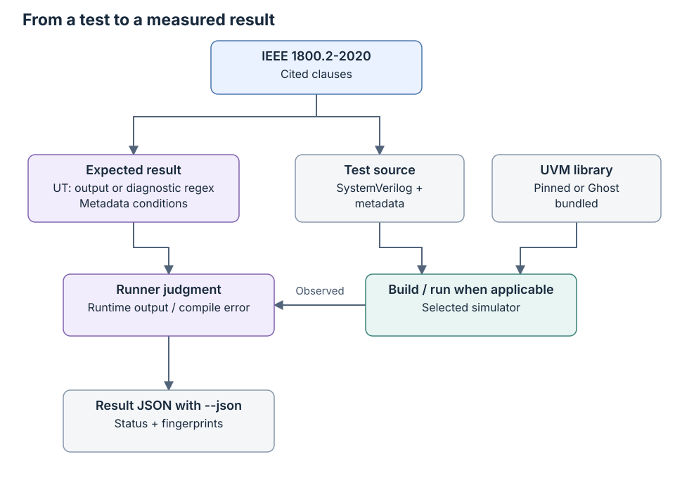

# Testing and contribution guide

[日本語](testing.ja.md) · [README](../README.md) · [FAQ](faq.md)

This guide describes the current test format, library setup, runners and contribution rules.
Current counts and scope are in the [README](../README.md); measurement details are in
[results](results.md), and earlier work is in [history](history.md).

## What the suite checks

The simulator runs the language and the UVM library supplies the tested classes; see [What this repository tests](reading-guide.md#what-this-repository-tests) for their roles.

- **Subject:** whether a simulator runs the UVM library so that the results
  are those IEEE 1800.2-2020 sets: the order of the phases, the end of a phase
  by objections, factory overrides, config_db lookups, sequences and
  sequencers, TLM connections, the register layer and so on.
- **Ground of an expected result:** a clause of 1800.2-2020, cited in `:lrm:`.
  A comment at the top of each test says, in our own words, what it checks; no
  text of the standard is copied.
- **Library:** the Accellera UVM library, release 2020.3.1, pinned by
  `third_party/uvm.lock` (see "The UVM library"). Its `DEVIATIONS.md` lists
  three places where the library differs from the standard (18.2.3.4,
  18.4.3.6 and 13.1.5.1). No expected result depends on them; a test that has
  to touch one records the difference.
- **Out of scope:** the SystemVerilog language itself (kirimasim-tests),
  teaching material for UVM, performance, generators of register models, and
  vendor extensions.

## Layout

The `uNN` directory identifies a standard chapter, while M1–M4 identify development stages; [the scope glossary](glossary.md#scope-and-coverage) explains how these groupings relate to requirements.

```text
tests/uNN/<name>.sv          a test with metadata; NN is the chapter of 1800.2
tests/uNN/<name>.expected    its expected observed lines
tests/uB/, uC/, uD/          annex tests: macros, configuration, callbacks
tests/uE/                   built-in register/memory test sequences
tests/uF/, uG/              string utilities and command-line queries
docs/testing*.md            test format, execution and contribution rules
docs/results*.md            current measurement conditions and evidence
docs/requirements*.md       draft scope, requirement mapping and census
coverage/*.json             versioned scope, requirements, assessments and test index
docs/provenance*.md         related repositories and source attribution
docs/glossary*.md            terminology
docs/faq*.md                 common questions
docs/known-differences*.md   current limitations and spec-only expectations
docs/handoff*.md            development handoff and restart workflow
docs/history*.md             earlier increments and measurements
third_party/uvm.lock         the pinned library: release, source, commit, digest
third_party/uvm/<version>/   the library itself, fetched, not committed
tools/fetch_uvm.py           fetches the library and checks its digest
tools/uvm_common.py          how a test is compiled with the library, what is observed
tools/run_kirimasim.py       runner for kirimasim
tools/run_verilator.py       runner for Verilator
tools/run_ghost.py           private-profile runner under the public alias Ghost
tools/suite_results.py       judgment and result JSON, copied from kirimasim-tests
tools/lint_metadata.py       checks of the metadata and the form of the tests
tools/requirements.py        validates and inventories the draft requirement ledger
tools/sv_lifetimes.py        lexical guard for initialized procedural locals
tools/clauses_1800_2.txt     clause numbers of 1800.2-2020 (numbers only)
tools/UPSTREAM               where the copied tool comes from, and what changed
```

## Test format

A test pairs observed behavior with an independently derived expectation; [Standards and expectations](glossary.md#standards-and-expectations) explains the oracle and expected-output terms used below.

### Example

The block below shows only a metadata header; [the complete smoke-test source](../tests/u09/test_common_phases_run_in_order.sv) also contains the classes and top module needed to run it.

```systemverilog
/*
:name: test_common_phases_run_in_order
:description: the common phases run in their order, ... (IEEE 1800.2-2020 Section 9.8.1)
:tags: u09 uvm
:type: simulation
:lrm: 1800.2-2020 9.8.1 9.5 9.6 9.7 10.5.1
:uvm: 2020.3.1
:oracle: spec verilator@5.052
:spec_check: ai
:fourstate: no
:nondeterministic: no
:args: +UVM_TESTNAME=t
:expected_stdout: @test_common_phases_run_in_order.expected
*/
```

The fixture is the test's setup and observers, and a helper is supporting code or data; [the execution glossary](glossary.md#execution-and-result-records) explains these terms before the specialized examples below.

Each helper note below describes setup for a particular test family; for a first test, continue to [metadata](#metadata) and [the observation rules](#what-is-observed) before using those specialized fixtures.

The memory/FIFO increment declares two isolated helper directories:
[listed-API setup](../tests/u18/helpers63/fifo_frontdoor_fixture63.svh) and
[pinned build control](../tests/u18/helpers63_initialized/fifo_initialized_fixture63.svh).
Each opting-in source names its helper in `:files:`; directory contents enter
its input fingerprint. Changing a helper requires remeasurement of every
dependent input. The initialized variant is control-only in the ledger and
does not pass an input under the constructor/configure-only premise.

Core-service declarations likewise keep [listed-only bodies](../tests/uF/helpers64/core_method_bodies64.svh)
and [explicit extra-hook bodies](../tests/uF/helpers64_decl_control/core_decl_control_bodies64.svh)
in separate declared directories. The complete extra-hook input is control-only.
The 26 omission inputs use that hook only to isolate one selected missing pure
method; their final diagnostics must identify that method without another
missing-method error. An unrelated compile rejection cannot pass the oracle.

Field-macro inputs keep literal collection-type arguments and PACK-only flags
separate from element-enum and explicit-UNPACK controls. Each variant has its
own fingerprint and expectation file; control passes do not replace direct
premises. The const-ARG input is an illegal compiler check without runtime.
Compatible packing roundtrips do not prescribe stream encoding or independently
certify every one-way suppression condition.

The [original field-access helper](../tests/u18/helpers66/field_access_fixture66.svh) supplies isolated frontdoor route
buffers and backdoor storage; it is not actual HDL or map-alias coherence
evidence. Physical neighbor values deliberately differ from model resets.
Callback-driven map changes and explicit initial-map controls retain distinct
premises. Any helper change requires new measurements for all dependent inputs.
Separate post rows cannot pass a complete trace with a pre-order difference.
Never reuse a superseded seed log under a current input fingerprint.

The [protection helper](../tests/u18/helpers67/protection_fixture67.svh) uses
original per-register frontdoor/backdoor storage and two byte fields. Callback
guard tests observe ERROR presence, failing status, zero transfers and retained
storage without requiring exact diagnostic text or counts. Opposite directions
and removal histories have separate observations. Rejected read data is not
prescribed. Post-predict distinguishes direct from successful read/write kinds.
Use literal display formats for tagged observation rows; a packed concatenation
is an integral expression. Remeasure all dependent inputs after helper changes.

The [recording helper](../tests/uB/helpers68/recording_fixture68.svh) observes
declared recorder hooks through live transaction handles. Printed three-argument
attributes and four-argument compatibility controls have separate identities.
The six extension-tolerant inputs are control-only; direct small-field API and
enumN controls also have their own direct duties. Scalar macro directions use
public APIs independently and preserve a seven-bit trailer; no raw stream
layout or universal size/error behavior is inferred. See [macro interpretation
and controls](faq.md#recording-and-scalar-macro-conditions) before changing a premise.

The [traversal helper](../tests/uF/helpers69/traversal_fixture69.svh) supplies
original nodes, typed visitors and complete interface bodies. Actual builtin
adapters supply traversal; original bodies only expose declared dispatch or
delegate to that public implementation. Constructor wrappers invoke the actual
base with the selected omitted/explicit argument form. Dependent-default and
explicit-type inputs remain distinct; see [the traversal FAQ](faq.md#traversal-declarations-and-defaults)
before interpreting a type, name or compiler result.

The [virtual-query helper](../tests/u18/helpers70/vreg_query_fixture70.svh)
supplies original block/memory/map setup without storage-transfer handlers.
Explicit dynamic implementation avoids the separately known omitted-memory
resize premise. Region identity uses the sole manager reservation, not its
known owner getter. Gated report observations preserve severity without exact
vendor wording/counts. Constructor/getter chains, literal overview bases and
object-base controls stay qualified; see [the query FAQ](faq.md#virtual-register-queries-and-declaration-boundaries).

The [field-constructor helper](../tests/u18/helpers71/vreg_field_constructor71.svh)
uses factory-created original subtypes and captures the public name immediately
after the actual super.new call. Its captures do not assert a general factory
post-creation naming policy. Dedicated global-pool inputs call the actual static
API after explicit seeding; printed pool receivers remain separate from item
prose and live-state/wait controls. The corrected legacy input keeps its body
and oracle, but its new primary citation needs fresh evidence. See [the lookup
and mapping FAQ](faq.md#dedicated-global-lookups-and-mapping-corrections).

The [recorder-link helper](../tests/u16/helpers72/recorder_link_fixture72.svh) supplies original
in-memory database/stream/recorder callbacks. The error window surrounds only
establish_link after public state checks, and the original catcher terminates
without assuming recovery. This is not external recording-database validation;
see [the lifetime FAQ](faq.md#recorder-link-lifetime) for the close/free boundary.

The [canonical bus helper](../tests/u19/helpers73/busop_fixture73.svh) records actual
reg2bus inputs through an original numeric-word protocol. Read storage is seeded
independently; completed observer rows are sorted by address. The bus2reg count
means in-place return conversions, not separate response packets. Only valid
bits are constrained; see [the bus-operation FAQ](faq.md#canonical-bus-operations).

The [policy-plugin helper](../tests/u16/helpers74/policy_plugin_fixture74.svh) keeps one
object definition and original policy subtypes. Recorders are fresh; pack/unpack
use the same compatible policy and stream type, with observer ticks recording
field/state-handoff order. No stream layout or external database is assumed;
[the policy FAQ](faq.md#policy-substitution-and-typed-object-streams) explains the evidence.

The [printer-attribute helper](../tests/u16/helpers75/printer_columns75.svh) supplies
unique textual name/type/size/value attributes to the public API and checks
visibility. Collection-time versus emission-time settings and default versus
explicit peers remain distinct; see [the emission FAQ](faq.md#printer-attributes-and-emission-controls).

The [adapter parent-context helper](../tests/u19/helpers76/parent_sequence76.svh)
checks the required sequence base through the driver's public parent query and
supplies prototypes through an original clone bridge. This differs from register
item parent metadata; caller parents are omitted, as explained in
[the parent-context FAQ](faq.md#adapter-sequence-contexts).

The [model helper](../tests/u18/helpers79/hdl_models79.svh) and
[view helper](../tests/u18/helpers79/hdl_views79.svh) separate standard get_slices
inputs from explicit nonstandard member controls. Physical inputs do not compile
the view helper, but sibling include-directory contents affect fingerprints, so
all twenty-two inputs were remeasured after correction. [The path FAQ](faq.md#register-hdl-paths-and-observation-premises)
separates getter blockers, ancestor defaults and real HDL observations.

The [coverage-construction helper](../tests/u18/helpers80/coverage80.svh) supplies
full-name/simple-pattern selection, constructor-only additions and original public
sampling observers. Sampler bodies are not covergroups; the actual inherited block
method supplies recursive routing. Two external protected calls are separate
compiler-rejection inputs. Matching availability/enabled masks do not pass a
fixture with a previous-mask return difference; [the coverage FAQ](faq.md#register-coverage-construction-and-sampling)
records the interpretation limits.

### Metadata

The header tells the runner how to build and judge a case; [Q76](faq.md#q76-does-a-clause-citation-mean-its-requirements-are-tested) explains how its clause citations relate to requirement links.

`:spec_check: ai` records who reviewed the expectation, while `:oracle: spec verilator@5.052` also records fixed-release reproduction; [the expectation glossary](glossary.md#standards-and-expectations) explains why those fields describe separate checks.

The metadata follows kirimasim-tests and sv-tests, with these UVM-specific fields:

| Field | Meaning |
| --- | --- |
| `:lrm:` | `1800.2-2020 <clauses>`. A test that also relies on a rule of the language adds `1800-2023 <clauses>` after them. The first clause of 1800.2 sets the directory |
| `:tags:` | the chapter directory `uNN` and `uvm`, as sv-tests tags UVM tests |
| `:uvm:` | the library release the test is written for; it must be the locked one |
| `:uvm_dpi:` | `yes` requests DPI-enabled macros; supplying/linking the implementation is separate; see [compiling](#compiling) |
| `:uvm_defines:` | macros for the library, such as `UVM_ENABLE_DEPRECATED_API` |
| `:uvm_cmdline_backend:` | `vpi` opts into the separate actual-process command-line runner |
| `:uvm_cmdline_oracle:` | `verilator@5.052` selects a reproduced command-line case for default checks |
| `:uvm_hdl_backend:` | `vpi` opts into the separate HDL runner; other runners do not link it |
| `:dpi_c:` | `@../../tools/uvm_hdl_vpi.cpp` declares and fingerprints the original backend |
| `:args:` | run-time arguments such as `+UVM_TESTNAME=…` |

An `@` value in `:expected_stdout:` names a file relative to the test source, and [Q7](faq.md#q7-why-compare-ut-lines-rather-than-all-uvm-messages) explains which output lines belong in that file.

`:oracle:`, `:spec_check:`, `:fourstate:`, `:nondeterministic:`,
`:should_fail_because:`, `:expected_stderr_regex:`, `:expected_exit:`,
`:files:`, `:defines:`, `:incdirs:` and `:top_module:` mean what they mean in
kirimasim-tests; the [tool provenance](provenance.md) identifies the shared implementation.

The `:fourstate: no` declaration says the fixture does not require X/Z values; [Q14](faq.md#q14-do-two-seeds-prove-determinism-or-four-state-correctness) explains the limits of the resulting two-state evidence.

Negative fixtures use `:type: elaboration` and
`:should_fail_because:`. Their `:expected_stderr_regex:` identifies the fixture,
class/method or const-reference diagnostic. They have no expected runtime output
or exit. A match requires compiler rejection plus a matching error; an accepted
design fails without running its binary. Requested seeds apply to simulation,
so no runtime seed is executed for any illegal design, accepted or rejected. The ledger's schema-2
diagnostic form records that declared oracle separately from measurements.

Here `elaboration` labels a compiler-rejection test that runs no UVM phases; [Q199](faq.md#q199-why-does-a-compiler-rejection-count-as-a-match) explains why the intended diagnostic, as well as rejection, is required.

Missing-default ownership fixtures deliberately end through a testbench fatal
after catching original UVM_FATAL severity. Their `:expected_exit: nonzero`
and `:expected_stderr_regex:` require a unique fixture sentinel. They do not
fix a library diagnostic or library fatal exit code. Signals still fail; a
nonzero exit alone never establishes the required observation.

A helper declared through `:files:` or an include directory can bring sibling files into the input fingerprint, so follow [the mapping update procedure](requirements.md#updating-a-test-or-mapping) for every affected test when that directory changes.

### What is observed

An intentional UVM error can be the required observation, so [Q7](faq.md#q7-why-compare-ut-lines-rather-than-all-uvm-messages) explains why an error message alone does not determine the test's status.

1800.2 defines what the methods that build a report do, not the text they
produce: `compose_report_message` (6.5.1.2.15) builds the string from the
severity, the component name, the id and the message, while the layout
`UVM_INFO file(line) @ time: name [id] msg` is the library's. File names, line
numbers and the format of times also depend on the library and the simulator.
So:

- **The default report lines are not compared.**
- **A simulation test prints what it observes on lines that begin with `UT: `**, with
  `$display`, and only the values that the standard fixes: the order of phases,
  counts, values read back, results of comparisons. Only those lines are
  compared with the expected output. A failure of the report machinery then
  does not take down the tests of other chapters.
- **Report counts are read as values**, with `get_severity_count` and
  `get_id_count` of the report server, and printed on `UT: ` lines.
- **Tests of chapter 6 (reporting)** install their own report server or
  report catcher and check, on `UT: ` lines, how the inputs that the standard
  defines (severity, id, verbosity, actions) lead to results.
- A test does not depend on what the standard leaves open: random values, the
  order of processes started at the same time, generated names other than
  those the standard fixes.

The sequencer relevance-bound fixtures count original zero-time callbacks and
accept an unspecified error notification at the selected bound or first excess.
A callback blocks after notification or a bounded fallback, allowing the owner
to finish without assuming recovery. A positive-time first burst is independent
of the time-zero controls. No private counter/reset rule is asserted.

Transaction-event fixtures drive a real pull port and observe named item-pool
events through standard typed callbacks. Disable occurs before the first request;
explicit component marks and custom address/data gates model later completion.
They certify selected notifications/timestamps, not initial pool membership,
database layout or physical DUT behavior.

Builtin-sequence declaration fixtures use actual omitted/explicit constructor
calls, exact static base/target receivers and original legal derived accessors
for protected slots. Minimal illegal probes assess direct virtual construction
and external protected access without runtime. Live factory-child probes compare
the executing child with its declared slot and selected targets; their original
bodies do not certify the builtin access/walk algorithms. Old full-algorithm
controls retain separate citations and execution identities.

## Where the expected outputs come from

A suspected expectation error needs a clause-based correction, so use [Q18](faq.md#q18-how-should-i-report-or-correct-a-wrong-expectation) to distinguish that correction from a simulator or library difference.

1. The expected output is derived from the cited clauses (`:oracle: spec`).
2. The library's source (Apache-2.0) may be read to understand the text of the
   standard, but expected outputs come from the standard. The library's
   `DEVIATIONS.md` and our [known differences](known-differences.md)
   distinguish library limitations from reproduced fixed-release oracles.
   Tests directly checking missing required behavior keep spec-only expectations.
3. Reproduction with fixed releases:
   - Verilator 5.052 builds and runs the library with `UVM_NO_DPI`. A test that
     does not depend on x or z and that Verilator 5.052 reproduces with seeds
     1 and 73 gets `verilator@5.052`, as in kirimasim-tests.
   - Icarus Verilog 13.0 cannot run UVM and is not used.
4. A disagreement between a simulator and an expected output is never solved
   by copying the simulator's output; the clause decides.

### From a test to a result

The two paths meet at judgment: the cited clauses determine the expectation,
and execution supplies the observation.



Build and run failures also receive a result. The library identity remains
part of the execution conditions; a Ghost bundled run uses its supplied UVM.
For status meanings and command exit codes, see the
[FAQ](faq.md#understanding-a-result).

## The UVM library

The simulator and UVM library are separate prerequisites, so check [Before the first run](reading-guide.md#before-the-first-run) before diagnosing a missing executable or package.

### Fetching

A lock file fixes the library version and content used for a run; [the library provenance](provenance.md#library-and-standards) explains why the downloaded tree is kept separate from the suite's sources.

`python3 tools/fetch_uvm.py` fetches the release that `third_party/uvm.lock`
names from [accellera-official/uvm-core](https://github.com/accellera-official/uvm-core)
(tag `2020.3.1`, commit `78c06547a2a0`) into `third_party/uvm/2020.3.1/` and
checks the digest of its extracted files (the path and SHA-256 of each of its
326 files). The archive itself is not hashed, as the host may compress it
again. `--check` checks the copy that is there. The library is not committed.

### Compiling

DPI lets SystemVerilog call external code, and [Q12](faq.md#q12-does-uvm_dpi-yes-automatically-enable-a-working-dpi-build) explains which extra implementation must be linked for a DPI-enabled test.

- Pinned-library runs add the library's `src` include directory and compile
  `src/uvm_pkg.sv` before the test sources. Verilator uses `-I`; kirimasim
  and Ghost use `+incdir+`. Ghost's bundled mode supplies its own package.
- `UVM_NO_DPI` is defined unless the test sets `:uvm_dpi: yes`. The library's
  DPI code for HDL backdoor access has implementations for three commercial
  simulators only. Without DPI the library reads `+UVM_TESTNAME` itself,
  matches names with globs rather than regular expressions, and does not check
  component names; it also warns that support for `UVM_NO_DPI` may be removed.
  A test that depends on regular expressions or built-in HDL backdoor access
  sets `:uvm_dpi: yes` and needs a supported setup where the DPI code can be loaded
  (`UVM_HDL_NO_DPI` leaves out the backdoor alone).
- User-defined `uvm_reg_backdoor` storage handlers work without HDL DPI.
  Commercial simulator execution/results are excluded by the project policy;
  built-in HDL-path/DPI coverage remains open.
- 2273 current cases use `UVM_NO_DPI`; thirty-four explicitly enable HDL DPI.
  `:uvm_dpi: yes` removes that macro;
  it does not automatically compile or link the C/C++ DPI implementation.
  The current Verilator runner does not add DPI C/C++ sources.
- `:uvm_defines:` can request `UVM_ENABLE_DEPRECATED_API`. There are currently
  no annex H tests or cases requesting this macro.

### Verilator VPI HDL subset

This backend connects UVM's DPI calls to the simulator's public VPI interface; [HDL execution conditions](glossary.md#hdl-execution-conditions) explains the two interfaces and the scope of a backend result.

The separate [HDL runner](../tools/run_verilator_hdl.py) links the original
[backend](../tools/uvm_hdl_vpi.cpp) to actual HDL storage with exactly Verilator
5.052. Thirty-four fixtures declare `:uvm_dpi: yes`, `:uvm_hdl_backend: vpi` and
`:dpi_c:`; `UVM_REGEX_NO_DPI` and `UVM_CMDLINE_NO_DPI` disable unrelated imports.
The runner rejects HDL-disabling macros and changes to the default 1024-bit
UVM DPI ABI in either defines field.

```sh
python3 tools/run_verilator_hdl.py --seeds 1 73 --build-jobs 2 -j 1 \
  --json out/verilator-hdl.json
```

Check/read/deposit reach supported packed handles up to 64 bits. Three memory
fixtures use actual 16-bit array words and 8/16-bit split banks with neighboring
cell controls. Two inherited-task fixtures use original public wrappers because
the pinned backdoor_read is protected; the separate legal public-read declaration
probe retains that difference. Wrapper matches do not pass its contract.

Force/release require public forceable packed signals. The backend checks the
documented public capability marker and applies standard VPI flags to the actual
handle; it does not write that marker or mock path/value storage. Public
[extension documentation](https://verilator.org/guide/latest/extensions.html)
describes integration, while original probes and current measurements establish
behavior on exactly 5.052. Eight 8/40-bit reg/wire inputs check force held across
opposing updates, plain release, immediate release/read and later updates. One
additional input checks missing/uninstrumented targets and a valid control.
Reg retains its forced value until a new procedural assignment; a driven wire
immediately returns its resolved value, as explained in [the HDL FAQ](faq.md#hdl-force-and-release-conditions).

See [public VPI documentation](https://verilator.org/guide/latest/connecting.html#verification-procedural-interface-vpi)
for visibility/evaluation constraints. Deposit/force observations allow
reevaluation; release/read samples the returned value immediately. General
arrays/selects/types, broader force_time conditions involving cross-unit
conversion, rounding, overlap or failures, four-state values, finer permissions
and vendor overlays remain open. No simulator implementation source
is read.

Ordinary runs do not link the backend and all thirty-four retain `:oracle: spec`.
The distinct `verilator_hdl` identity, `runner_sha256` and backend configuration
use the same expectations. Thirty-three match both seeds; the E.7 warning/
no-transfer case differs at seed 1 and strict mismatches fail. Twenty-eight
older records are retained. Six new physical register inputs use the unchanged
backend for public backdoor_read, peek and poke with 16/40-bit whole variables
and legal two-variable split representations. [The register-path FAQ](faq.md#register-hdl-paths-and-observation-premises)
separates these observations from symbolic member controls and the missing
standard concat getter. Keep the overlapping thirty-four ordinary DPI-link
failures separate.

Algorithm detail absent from current IEEE text may carry an explicitly qualified
AI interpretation. [Q134](faq.md#q134-how-is-the-memory-walk-algorithm-interpreted)
records the memory-walk historical reference and review limits; copied algorithm
implementations or measured output do not define its oracle.

### Verilator command-line subset

This condition observes actual process arguments with an extra linked bridge, so [the command-line FAQ](faq.md#actual-command-lines-and-separate-execution-conditions) explains why ordinary-runner results cannot substitute for it.

The [separate runner](../tools/run_verilator_cmdline.py) uses an original
[argument bridge](../tools/cmdline_backend/uvm_cmdline_vpi.cpp) over standard VPI.
The [regex wrapper](../tools/cmdline_backend/uvm_cmdline_regex.cpp) compiles the
pinned Apache-2.0 UVM regex implementation; the [portable header](../tools/cmdline_backend/malloc.h)
provides standard allocation declarations on hosts without a malloc header.
No UVM parser is copied into the bridge and no simulator implementation source
is used. These are actual process arguments, not a synthetic argument list.

Fixtures set `:uvm_dpi: yes`, `:uvm_cmdline_backend: vpi`,
`:uvm_defines: UVM_HDL_NO_DPI`, declare the bridge through `:dpi_c:` and the
wrapper/header through `:files:`. Directory contents and the library lock are
fingerprinted. Backend validation rejects disabled command-line/regex DPI,
missing declarations, another backend and four-state cases. HDL access remains
disabled. No arbitrary regex, invalid-option or four-state completeness is claimed.

```sh
python3 tools/run_verilator_cmdline.py --seeds 1 73 --build-jobs 2 -j 2 \
  --json out/verilator-cmdline.json
python3 tools/run_verilator_cmdline.py --all --seeds 1 73 --build-jobs 2 -j 2 \
  --json out/verilator-cmdline-all.json
```

The default selects seventeen reproduced fixtures through
`:uvm_cmdline_oracle: verilator@5.052`. `--all` adds the spec-only quit-warning
case and records its difference as `known`, which is not a pass. Regressions in
selected reproduced cases are `fail` and cause a nonzero exit. One model build
runs in fresh processes at both seeds. The separate `verilator_cmdline` result
identity hashes its runner independently; generic expected output is shared.
The eighteen overlapping ordinary records fail to link DPI. Keep both conditions
separate. Check runs the seventeen default command-line checks, not the known case.

## Running the suite

Paths such as `/path/to/kirimasim` are placeholders for your installed executable; [the prerequisites](faq.md#q2-what-do-i-need-and-where-does-uvm-come-from) explain what to prepare before copying the commands.

The Verilator exit code summarizes tagged regressions, so [Q6. Why can Verilator exit successfully with KNOWN results?](faq.md#q6-why-can-verilator-exit-successfully-with-known-results) explains why individual statuses still matter when including spec-only cases.

`--all` expands selection within the chosen runner; it does not link the [HDL backend](#verilator-vpi-hdl-subset) or [command-line bridge](#verilator-command-line-subset), which require their separate runners.

```sh
python3 tools/fetch_uvm.py
python3 tools/run_kirimasim.py --kirimasim /path/to/kirimasim -j 8 --json out/kirimasim.json
python3 tools/run_verilator.py --seeds 1 73 --build-jobs 2 -j 2 --json out/verilator.json
```

The runners need Python 3.10 or later. The results JSON has the form of
kirimasim-tests (`tools/suite_results.py`), so its history and report tools
can read it. `run_verilator.py` builds each test, including the whole UVM
package. `-j` controls concurrent tests; `--build-jobs` controls C++ build jobs
per test (0, the default, uses every hardware thread). It does not use ccache: Verilator builds
the large model with a precompiled header that records the absolute path of
its build directory, and a header that ccache kept from another directory
breaks the build.

For runtime cases, `--seeds 1 73` builds once and runs a fresh process for
each seed. All requested runtime seeds must match. `--seed N` remains available for a single seed.
The JSON configuration records either `seed` or `seeds` accordingly.

By default, Verilator selects 1962 tagged two-state checks: 1873 runtime
cases and 89 expected compiler rejections. To include
the 363 spec-only cases as well, add `--all`. A mismatch in an untagged case
is `known` and does not fail the command; a tagged mismatch does.
Explicit test paths select only those tests. For a single smoke test:

```sh
python3 tools/run_verilator.py --seeds 1 73 --build-jobs 2 -j 1 \
  --json out/verilator-smoke.json tests/u09/test_common_phases_run_in_order.sv
```

The seed list accepts several values, so keep an option such as `--build-jobs` between `--seeds 1 73` and a source path as shown in [the single-test example](faq.md#q3-how-can-i-run-one-test-first).

For a runtime mismatch, follow the selected test header's `:expected_stdout:` path and compare its `UT: ` lines using [the result-reading guide](reading-guide.md#read-a-result).

Each run uses a temporary build directory. `out/` is ignored by Git; Check
does not publish these JSON files. See the [FAQ](faq.md) for result
statuses, exit codes and fingerprint interpretation.

### Ghost

Ghost is the public alias for an authorized private simulator, and [Q11](faq.md#q11-what-does-the-ghost-result-cover-and-why-an-alias) explains the library modes used by its results.

```sh
python3 tools/run_ghost.py --simulator /path/to/private/simulator \
  --profile /path/to/private-profile.json -j 2 --json out/ghost.json
```

The private JSON profile supplies `arguments` (a list of strings),
`environment` (a mapping of strings) and an explicit `uvm_mode`:

- `pinned`: the runner includes and compiles the locked UVM package before
  the test sources. The profile must disable any automatic bundled package.
- `bundled`: the profile and simulator supply UVM; the runner does not compile
  another package. Such a run compares the same spec expectations but is
  **not evidence for the pinned library**. No bundled-library version is
  inferred from the test's `:uvm:` field.

Bundled profiles also provide `uvm_library_dir`, the private directory tree
containing the library's source and headers. The profile's arguments must
select that same library. For a library whose code and headers are actually
embedded in the executable, use `uvm_embedded: true` instead. Exactly one
identity is required; paths are never copied into results.

Public JSON records `uvm_source`, `uvm_pinned`, the test's library release
(`test_uvm`) and SHA-256 fingerprints of the executable and profile. Pinned
and directory-backed bundled runs also record the library's content digest
and file count. The simulator's name, version, paths, profile contents and
diagnostics stay private. If its executable, profile or library changes
during a run, results are not written. Pinned mode verifies the actual tree
against the lock before executing.

## Checks

These commands validate the library, tools and test descriptions; [Continuous integration](results.md#continuous-integration) describes the additional simulator checks performed by Check.

```sh
python3 tools/fetch_uvm.py --check
python3 -m unittest discover -s tools -p 'test_*.py'
python3 tools/lint_metadata.py
python3 tools/requirements.py check
```

The current tool suite has 110 unit tests; metadata validation checks all
2325 tests (2231 simulation, 94 elaboration). The [ledger check](requirements.md) validates the draft
scope, explicit oracle links and input fingerprints without claiming coverage. [Check](../.github/workflows/check.yml) runs on pushes to
`main`, pull requests and manual dispatch. Its Verilator matrix jobs use
5.052, `UVM_NO_DPI` and seeds 1 and 73 for the tagged cases. Each model is
built once for the two executions. A green Check establishes those checks,
not that every UVM requirement or every simulator passes.

The previous unsharded [Check run](https://github.com/kurochan001/kirimasim-uvm-tests/actions/runs/41976785278)
exceeded the configured 150-minute job limit. The current workflow partitions
the current 1962 tagged checks into 8 disjoint shards (246/246/245/245/245/245/245/245),
with at most 4 concurrent shard jobs. The exact union and absence of duplicates are
verified locally. The 17 command-line checks run once, on shard 0 before
ordinary checks. Seeds 1/73, compiler-rejection judgment, pinned dependencies
and runner fingerprints are unchanged. The existing verilator gate requires
all shards to succeed. Sharding is orchestration; local
validation does not establish a successful hosted workflow result.

## Adding or correcting a test

A watchdog limits how long a blocking observation may wait; [the execution glossary](glossary.md#execution-and-result-records) explains how it makes a missing completion observable.

Changing a source, helper or expectation changes the input identity, so follow [Updating a test or mapping](requirements.md#updating-a-test-or-mapping) before reusing old results.

Commercial simulator results, outputs and diagnostics are excluded from test
expectations, implementation decisions and Issue reports, including private,
third-party or anonymized material. Use the
[posting policy](faq.md#commercial-simulator-and-issue-reporting-policy) and
[Issue form](../.github/ISSUE_TEMPLATE/report.yml); do not run commercial products
for a report. Only the project's publication-ready guest results may use the
Ghost alias.

Derive observations from the cited standard before running the simulator.
Keep each test independent, print only prescribed results on `UT: ` lines,
and retain normative expectations when a simulator/library pair differs.
Use explicit lifetimes for initialized procedural locals (SystemVerilog 6.21),
keep shared fork state alive, and bound blocking observations with watchdogs.
Run metadata and tool checks; reproduce new fixed-release oracles at both
seeds before adding the tag. The standard PDFs remain local and ignored by Git.

## Rights and sources

The suite's license, the fetched library's license and the cited standards apply to different material; [the provenance guide](provenance.md#library-and-standards) identifies each source before the contribution rules below.

- No text, figure or example code of 1800.2 is copied; clauses are cited by
  number and described in our own words.
- The UVM library is Apache-2.0. It is fetched, not committed; if it is ever
  committed, its `LICENSE.txt` and `NOTICE.txt` go with it.
- The sources of GPL or LGPL simulators (Icarus Verilog, Verilator) are not read.
- The name, version, profile and paths of the unreleased simulator are not
  published.

## Documentation maintenance

At a term's first important use, add a brief explanation and a link to the relevant section of [the glossary](glossary.md), [FAQ](faq.md) or [reading guide](reading-guide.md), so readers can continue from that point.

Place a one-sentence explanation beside commands, metadata examples and result tables where a reader may need it, linking directly to the explanatory heading in the same language.

Maintain an English `.md` and Japanese `.ja.md` version of every project
guide, with corresponding headings, facts, commands, tables, diagrams and
links. Update both in the same change. API names, metadata, command options,
expected output and other machine-readable literals retain their spelling.
The original [LICENSE](../LICENSE) has a complete, non-authoritative
[Japanese reference translation](../LICENSE.ja.md).

Keep paired SVG assets in `docs/images/` (`.svg` and `.ja.svg`), with translated
labels, a `title` and a `desc`. The SVG source is directly editable; keep the
two versions' nodes, arrows and method names aligned. Give each embedded image
descriptive Markdown alt text in its language.

Keep the README about the current project: scope, prerequisites, commands,
results and open work. Put increment narratives and superseded measurements
in [history](history.md), current measurement methodology in [results](results.md),
and source origins in [provenance](provenance.md). Check both languages'
local links and anchors after moving sections.
