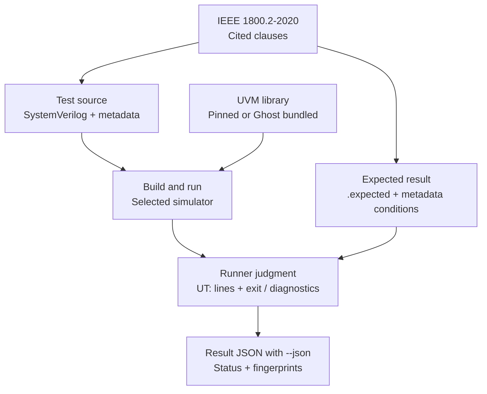

# Testing and contribution guide

[日本語](testing.ja.md) · [README](../README.md) · [FAQ](faq.md)

This guide describes the current test format, library setup, runners and contribution rules.
Current counts and scope are in the [README](../README.md); measurement details are in
[results](results.md), and earlier work is in [history](history.md).

## What the suite checks

- **Subject:** whether a simulator runs the UVM library so that the results
  are those IEEE 1800.2-2020 sets: the order of the phases, the end of a phase
  by objections, factory overrides, config_db lookups, sequences and
  sequencers, TLM connections, the register layer and so on.
- **Ground of an expected result:** a clause of 1800.2-2020, cited in `:lrm:`.
  A comment at the top of each test says, in our own words, what it checks; no
  text of the standard is copied.
- **Library:** the Accellera UVM library, release 2020.3.1, pinned by
  `third_party/uvm.lock` (see "The UVM library"). Its `DEVIATIONS.md` lists
  three places where the library differs from the standard (18.2.3.4,
  18.4.3.6 and 13.1.5.1). No expected result depends on them; a test that has
  to touch one records the difference.
- **Out of scope:** the SystemVerilog language itself (kirimasim-tests),
  teaching material for UVM, performance, generators of register models, and
  vendor extensions.

## Layout

```text
tests/uNN/<name>.sv          a test with metadata; NN is the chapter of 1800.2
tests/uNN/<name>.expected    its expected observed lines
tests/uB/, uC/, uD/          annex tests: macros, configuration, callbacks
tests/uE/                   built-in register/memory test sequences
tests/uF/, uG/              string utilities and command-line queries
docs/testing*.md            test format, execution and contribution rules
docs/results*.md            current measurement conditions and evidence
docs/requirements*.md       draft scope, requirement mapping and census
coverage/*.json             versioned scope, requirement ledger and test index
docs/provenance*.md         related repositories and source attribution
docs/glossary*.md            terminology
docs/faq*.md                 common questions
docs/known-differences*.md   current limitations and spec-only expectations
docs/history*.md             earlier increments and measurements
third_party/uvm.lock         the pinned library: release, source, commit, digest
third_party/uvm/<version>/   the library itself, fetched, not committed
tools/fetch_uvm.py           fetches the library and checks its digest
tools/uvm_common.py          how a test is compiled with the library, what is observed
tools/run_kirimasim.py       runner for kirimasim
tools/run_verilator.py       runner for Verilator
tools/run_ghost.py           private-profile runner under the public alias Ghost
tools/suite_results.py       judgment and result JSON, copied from kirimasim-tests
tools/lint_metadata.py       checks of the metadata and the form of the tests
tools/requirements.py        validates and inventories the draft requirement ledger
tools/sv_lifetimes.py        lexical guard for initialized procedural locals
tools/clauses_1800_2.txt     clause numbers of 1800.2-2020 (numbers only)
tools/UPSTREAM               where the copied tool comes from, and what changed
```

## Test format

### Example

```systemverilog
/*
:name: test_common_phases_run_in_order
:description: the common phases run in their order, ... (IEEE 1800.2-2020 Section 9.8.1)
:tags: u09 uvm
:type: simulation
:lrm: 1800.2-2020 9.8.1 9.5 9.6 9.7 10.5.1
:uvm: 2020.3.1
:oracle: spec verilator@5.052
:spec_check: ai
:fourstate: no
:nondeterministic: no
:args: +UVM_TESTNAME=t
:expected_stdout: @test_common_phases_run_in_order.expected
*/
```

### Metadata

The metadata follows kirimasim-tests and sv-tests, with these UVM-specific fields:

| Field | Meaning |
| --- | --- |
| `:lrm:` | `1800.2-2020 <clauses>`. A test that also relies on a rule of the language adds `1800-2023 <clauses>` after them. The first clause of 1800.2 sets the directory |
| `:tags:` | the chapter directory `uNN` and `uvm`, as sv-tests tags UVM tests |
| `:uvm:` | the library release the test is written for; it must be the locked one |
| `:uvm_dpi:` | `yes` requests DPI-enabled macros; supplying/linking the implementation is separate; see [compiling](#compiling) |
| `:uvm_defines:` | macros for the library, such as `UVM_ENABLE_DEPRECATED_API` |
| `:args:` | run-time arguments such as `+UVM_TESTNAME=…` |

`:oracle:`, `:spec_check:`, `:fourstate:`, `:nondeterministic:`,
`:should_fail_because:`, `:expected_stderr_regex:`, `:expected_exit:`,
`:files:`, `:defines:`, `:incdirs:` and `:top_module:` mean what they mean in
kirimasim-tests; the [tool provenance](provenance.md) identifies the shared implementation.

### What is observed

1800.2 defines what the methods that build a report do, not the text they
produce: `compose_report_message` (6.5.1.2.15) builds the string from the
severity, the component name, the id and the message, while the layout
`UVM_INFO file(line) @ time: name [id] msg` is the library's. File names, line
numbers and the format of times also depend on the library and the simulator.
So:

- **The default report lines are not compared.**
- **A test prints what it observes on lines that begin with `UT: `**, with
  `$display`, and only the values that the standard fixes: the order of phases,
  counts, values read back, results of comparisons. Only those lines are
  compared with the expected output. A failure of the report machinery then
  does not take down the tests of other chapters.
- **Report counts are read as values**, with `get_severity_count` and
  `get_id_count` of the report server, and printed on `UT: ` lines.
- **Tests of chapter 6 (reporting)** install their own report server or
  report catcher and check, on `UT: ` lines, how the inputs that the standard
  defines (severity, id, verbosity, actions) lead to results.
- A test does not depend on what the standard leaves open: random values, the
  order of processes started at the same time, generated names other than
  those the standard fixes.

## Where the expected outputs come from

1. The expected output is derived from the cited clauses (`:oracle: spec`).
2. The library's source (Apache-2.0) may be read to understand the text of the
   standard, but expected outputs come from the standard. The library's
   `DEVIATIONS.md` and our [known differences](known-differences.md)
   distinguish library limitations from reproduced fixed-release oracles.
   Tests directly checking missing required behavior keep spec-only expectations.
3. Reproduction with fixed releases:
   - Verilator 5.052 builds and runs the library with `UVM_NO_DPI`. A test that
     does not depend on x or z and that Verilator 5.052 reproduces with seeds
     1 and 73 gets `verilator@5.052`, as in kirimasim-tests.
   - Icarus Verilog 13.0 cannot run UVM and is not used.
4. A disagreement between a simulator and an expected output is never solved
   by copying the simulator's output; the clause decides.

### From a test to a result

The two paths meet at judgment: the cited clauses determine the expectation,
and execution supplies the observation.



Build and run failures also receive a result. The library identity remains
part of the execution conditions; a Ghost bundled run uses its supplied UVM.
For status meanings and command exit codes, see the
[FAQ](faq.md#understanding-a-result).

## The UVM library

### Fetching

`python3 tools/fetch_uvm.py` fetches the release that `third_party/uvm.lock`
names from [accellera-official/uvm-core](https://github.com/accellera-official/uvm-core)
(tag `2020.3.1`, commit `78c06547a2a0`) into `third_party/uvm/2020.3.1/` and
checks the digest of its extracted files (the path and SHA-256 of each of its
326 files). The archive itself is not hashed, as the host may compress it
again. `--check` checks the copy that is there. The library is not committed.

### Compiling

- Pinned-library runs add the library's `src` include directory and compile
  `src/uvm_pkg.sv` before the test sources. Verilator uses `-I`; kirimasim
  and Ghost use `+incdir+`. Ghost's bundled mode supplies its own package.
- `UVM_NO_DPI` is defined unless the test sets `:uvm_dpi: yes`. The library's
  DPI code for HDL backdoor access has implementations for three commercial
  simulators only. Without DPI the library reads `+UVM_TESTNAME` itself,
  matches names with globs rather than regular expressions, and does not check
  component names; it also warns that support for `UVM_NO_DPI` may be removed.
  A test that depends on regular expressions or built-in HDL backdoor access
  sets `:uvm_dpi: yes` and needs a supported setup where the DPI code can be loaded
  (`UVM_HDL_NO_DPI` leaves out the backdoor alone).
- User-defined `uvm_reg_backdoor` storage handlers work without HDL DPI.
  Commercial simulator execution/results are excluded by the project policy;
  built-in HDL-path/DPI coverage remains open.
- All 1085 current cases use `UVM_NO_DPI`. `:uvm_dpi: yes` removes that macro;
  it does not automatically compile or link the C/C++ DPI implementation.
  The current Verilator runner does not add DPI C/C++ sources.
- `:uvm_defines:` can request `UVM_ENABLE_DEPRECATED_API`. There are currently
  no annex H tests or cases requesting this macro.

## Running the suite

```sh
python3 tools/fetch_uvm.py
python3 tools/run_kirimasim.py --kirimasim /path/to/kirimasim -j 8 --json out/kirimasim.json
python3 tools/run_verilator.py --seeds 1 73 --build-jobs 2 -j 2 --json out/verilator.json
```

The runners need Python 3.10 or later. The results JSON has the form of
kirimasim-tests (`tools/suite_results.py`), so its history and report tools
can read it. `run_verilator.py` builds each test, including the whole UVM
package. `-j` controls concurrent tests; `--build-jobs` controls C++ build jobs
per test (0, the default, uses every hardware thread). It does not use ccache: Verilator builds
the large model with a precompiled header that records the absolute path of
its build directory, and a header that ccache kept from another directory
breaks the build.

`--seeds 1 73` builds each model once and runs it in a fresh process for each
seed. All seeds must match. `--seed N` remains available for a single seed.
The JSON configuration records either `seed` or `seeds` accordingly.

By default, Verilator selects the 979 tagged two-state cases. To include
the 106 spec-only cases as well, add `--all`. A mismatch in an untagged case
is `known` and does not fail the command; a tagged mismatch does.
Explicit test paths select only those tests. For a single smoke test:

```sh
python3 tools/run_verilator.py --seeds 1 73 --build-jobs 2 -j 1 \
  --json out/verilator-smoke.json tests/u09/test_common_phases_run_in_order.sv
```

Each run uses a temporary build directory. `out/` is ignored by Git; Check
does not publish these JSON files. See the [FAQ](faq.md) for result
statuses, exit codes and fingerprint interpretation.

### Ghost

```sh
python3 tools/run_ghost.py --simulator /path/to/private/simulator \
  --profile /path/to/private-profile.json -j 2 --json out/ghost.json
```

The private JSON profile supplies `arguments` (a list of strings),
`environment` (a mapping of strings) and an explicit `uvm_mode`:

- `pinned`: the runner includes and compiles the locked UVM package before
  the test sources. The profile must disable any automatic bundled package.
- `bundled`: the profile and simulator supply UVM; the runner does not compile
  another package. Such a run compares the same spec expectations but is
  **not evidence for the pinned library**. No bundled-library version is
  inferred from the test's `:uvm:` field.

Bundled profiles also provide `uvm_library_dir`, the private directory tree
containing the library's source and headers. The profile's arguments must
select that same library. For a library whose code and headers are actually
embedded in the executable, use `uvm_embedded: true` instead. Exactly one
identity is required; paths are never copied into results.

Public JSON records `uvm_source`, `uvm_pinned`, the test's library release
(`test_uvm`) and SHA-256 fingerprints of the executable and profile. Pinned
and directory-backed bundled runs also record the library's content digest
and file count. The simulator's name, version, paths, profile contents and
diagnostics stay private. If its executable, profile or library changes
during a run, results are not written. Pinned mode verifies the actual tree
against the lock before executing.

## Checks

```sh
python3 tools/fetch_uvm.py --check
python3 -m unittest discover -s tools -p 'test_*.py'
python3 tools/lint_metadata.py
python3 tools/requirements.py check
```

The current tool suite has 74 unit tests; metadata validation checks all
1085 simulation tests. The [ledger check](requirements.md) validates the draft
scope, explicit oracle links and input fingerprints without claiming coverage. [Check](../.github/workflows/check.yml) runs on pushes to
`main`, pull requests and manual dispatch. Its separate Verilator job uses
5.052, `UVM_NO_DPI` and seeds 1 and 73 for the tagged cases. Each model is
built once for the two executions. A green Check establishes those checks,
not that every UVM requirement or every simulator passes.

## Adding or correcting a test

Commercial simulator results, outputs and diagnostics are excluded from test
expectations, implementation decisions and Issue reports, including private,
third-party or anonymized material. Use the
[posting policy](faq.md#commercial-simulator-and-issue-reporting-policy) and
[Issue form](../.github/ISSUE_TEMPLATE/report.yml); do not run commercial products
for a report. Only the project's publication-ready guest results may use the
Ghost alias.

Derive observations from the cited standard before running the simulator.
Keep each test independent, print only prescribed results on `UT: ` lines,
and retain normative expectations when a simulator/library pair differs.
Use explicit lifetimes for initialized procedural locals (SystemVerilog 6.21),
keep shared fork state alive, and bound blocking observations with watchdogs.
Run metadata and tool checks; reproduce new fixed-release oracles at both
seeds before adding the tag. The standard PDFs remain local and ignored by Git.

## Rights and sources

- No text, figure or example code of 1800.2 is copied; clauses are cited by
  number and described in our own words.
- The UVM library is Apache-2.0. It is fetched, not committed; if it is ever
  committed, its `LICENSE.txt` and `NOTICE.txt` go with it.
- The sources of GPL or LGPL simulators (Icarus Verilog, Verilator) are not read.
- The name, version, profile and paths of the unreleased simulator are not
  published.

## Documentation maintenance

Maintain an English `.md` and Japanese `.ja.md` version of every project
guide, with corresponding headings, facts, commands, tables, diagrams and
links. Update both in the same change. API names, metadata, command options,
expected output and other machine-readable literals retain their spelling.
The original [LICENSE](../LICENSE) has a complete, non-authoritative
[Japanese reference translation](../LICENSE.ja.md).

Keep the README about the current project: scope, prerequisites, commands,
results and open work. Put increment narratives and superseded measurements
in [history](history.md), current measurement methodology in [results](results.md),
and source origins in [provenance](provenance.md). Check both languages'
local links and anchors after moving sections.
